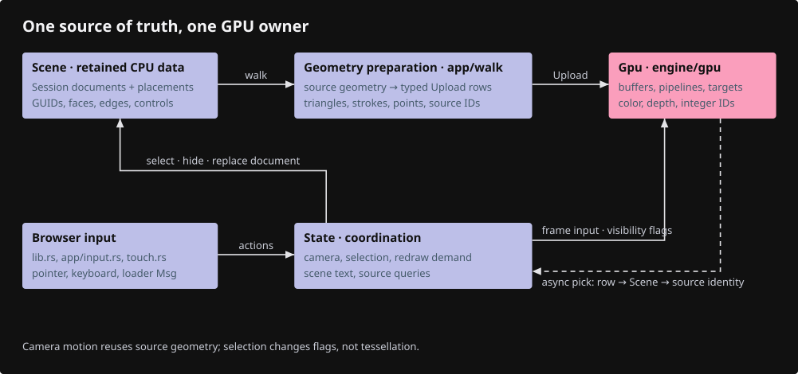
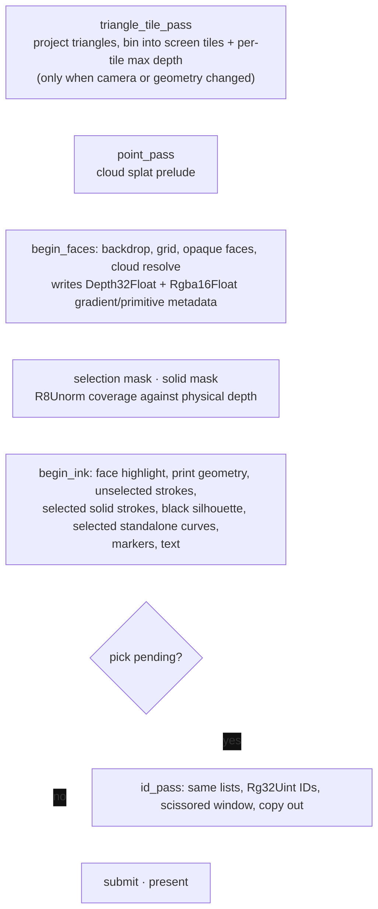
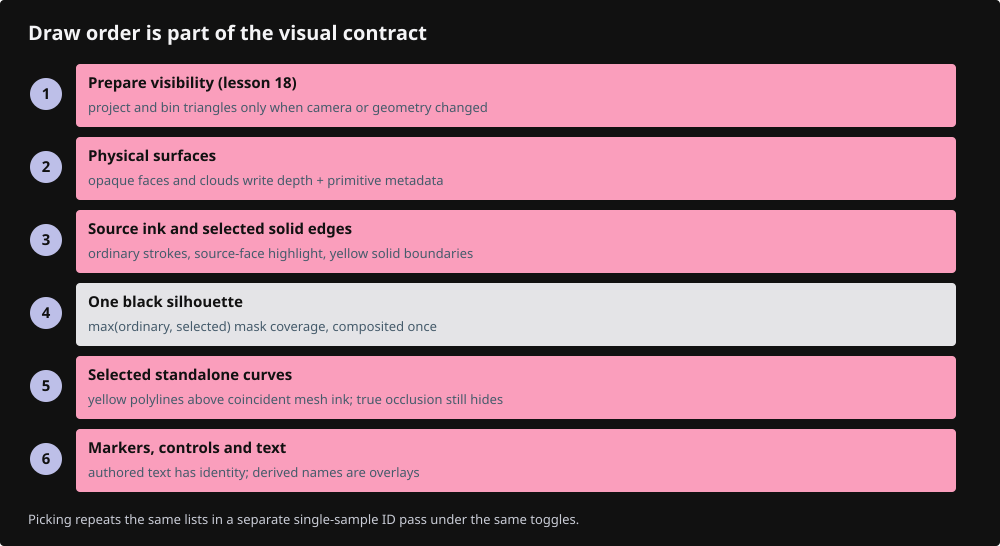
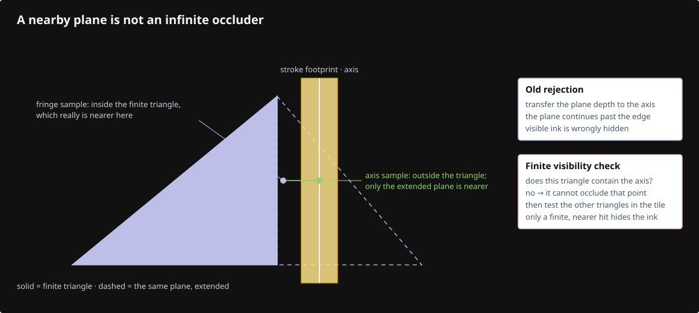

# Session Viewer architecture

Reference for the finished viewer: one browser application, Rust compiled to WebAssembly, `winit` for windowing and input, `wgpu` over browser WebGPU (no WebGL fallback), backed by a UI- and GPU-independent Cargo workspace crate (`viewer-core`). The [learning journey](docs/journey.md) covers the cumulative implementation.

## Workspace & module graph

The workspace splits pure geometry, document synchronization, command parsing/execution and display-row staging (`viewer-core`, depending on `session_rust`, `bytemuck`, `prost`, `serde`, `serde_json` and `serde_yml` — zero `wgpu`, `winit`, `egui`, `web-sys`, `wasm-bindgen`, `js-sys` or `glyphon` dependencies) from the WebGPU renderer, `egui` overlays, presentation stage and browser runtime (`session_viewer`).

```mermaid
%%{init: {"flowchart": {"useMaxWidth": false, "wrappingWidth": 320}, "themeVariables": {"primaryColor": "#ffffff", "primaryTextColor": "#111111", "primaryBorderColor": "#111111", "lineColor": "#ffffff", "secondaryColor": "#ffffff", "tertiaryColor": "#ffffff", "edgeLabelBackground": "#111111"}}}%%
graph TD
    subgraph web["session_viewer (browser + headless GPU)"]
        runtime["app/runtime.rs · App & Msg<br/>winit events, redraw scheduling"]
        state["state.rs · State<br/>impl CommandHost · Gpu + Window + SelectionState"]
        gpu["engine/gpu/context.rs · Gpu<br/>impl GpuSink · device, layouts, targets, lanes"]
        lanes["lanes: arena · segments · glyphs · cloud+splat · text · surface_outline · triangle_tiles"]
        pick["gpu/pick.rs · Picker"]
        render["gpu/render.rs · frame list"]
        shaders["shaders/*.wgsl"]
        ui["app/ui/* · command_dock/* · gpu/ui.rs<br/>egui panels & command completion"]
        stage["app/stage/*<br/>slide decks · TeX layout · Mode&lt;State&gt;"]
        loader["app/loader.rs · fetch.rs · live.rs<br/>browser fetch & streaming"]
        input["app/input.rs · touch.rs · gesture/*"]
        selftest["selftest/*<br/>native offscreen pixel & perf harness"]
    end

    subgraph core["viewer-core (UI- & GPU-free)"]
        host["command/host.rs · CommandHost & HeadlessHost"]
        cmd["command/* · 80 registered verbs"]
        scene["scene.rs · Scene · scene_sync/* · edit.rs · layers.rs"]
        walk["walk/* · producers<br/>mesh · brep · curves · cloud · points · sheet"]
        rows["rows/* · Upload · Instance (112 B) · ObjectRow"]
        sink["sink.rs · GpuSink"]
        cam["camera.rs · selection.rs · snap.rs · cplane.rs · gizmo.rs"]
        decode["decode.rs · validate.rs · manifest.rs · stream.rs · session_io.rs"]
    end

    runtime --> state
    runtime --> ui
    runtime --> stage
    runtime --> loader
    input --> state
    state --> host
    state --> scene
    state --> cam
    state --> gpu
    loader --> decode
    cmd --> host
    cmd --> scene
    scene --> walk
    scene --> sink
    walk --> rows
    gpu --> sink
    gpu --> rows
    gpu --> lanes
    gpu --> pick
    gpu --> render
    lanes --> shaders
    selftest --> gpu
    selftest --> scene
```

Two trait seams keep dependencies strictly one-way (`session_viewer → viewer-core → session_rust`):

1. **`CommandHost` (`viewer-core/src/command/host.rs`):** every command verb (`Action::run(&self, host: &mut dyn CommandHost)`) and interactive `Tool` operates against `CommandHost`. `State` (`src/state/host.rs`) implements it for the live browser/windowed viewer; `HeadlessHost` implements it in pure Rust so all 80 registered verbs execute in native tests (and CLI/MCP automation) without a window, `egui` or GPU.
2. **`GpuSink` (`viewer-core/src/sink.rs`):** `Scene` stages typed `Upload` rows (`viewer-core/src/rows/`) and flushes incremental row patches, selection/visibility flags and compactions through `impl GpuSink`, implemented by `Gpu` in `src/engine/gpu/sink.rs` and by CPU-only ledgers in headless tests.

The one upward runtime data flow is a pick answer: `Picker` returns an object row and sub-ID, `Scene` maps them to a source `(doc, guid)` identity, and `State` updates its single authoritative `SelectionState`.

## Owners

| Owner | Responsibility |
|---|---|
| `src/lib.rs` | Crate root declarations, shader table macro, WASM entry exports and `viewer-core` re-exports |
| `src/app/runtime.rs::App` | `winit` window and event loop, `Msg` handlers, the one place a redraw is requested |
| `src/state.rs::State`, `src/state/host.rs` | Window + `Gpu` + `Scene` + `Camera` + authoritative `SelectionState`, `impl CommandHost`, `needs_frame` / `dirty`, pick requests |
| `src/state/text.rs` | Selected-object names, source text presentation |
| `src/state/cloud_query.rs`, `viewer-core/src/cloud_query.rs` | Streamed-cloud source queries across pages, original-ID resolution |
| `src/state/sheet_query.rs`, `viewer-core/src/sheet_query.rs` | Sheet entity metadata: two ranged reads of the `SHM1` side table on selection |
| `viewer-core/src/command/` | Declarative `Spec` registry (`verbs!`, 80 specs), parser, `CommandHost`, `HeadlessHost`, `Tool` and `Recipe` |
| `viewer-core/src/scene.rs::Scene` | Retained `Rc<Session>` documents, placements, `(doc, guid) ↔ row` maps |
| `viewer-core/src/scene_text.rs` | Stable rows for authored text and document titles |
| `viewer-core/src/selection.rs` | `SelectionState`, `SelectionMode`, `ControlId`, `Controls` |
| `viewer-core/src/modeling.rs`, `viewer-core/src/edit.rs` | Validated source transactions (`MAX_STEPS`-bounded undo/redo in `edit.rs`) and placed control edits |
| `viewer-core/src/scene_sync.rs` | Reconcile changed identities; queue the resulting `GpuSink` work |
| `viewer-core/src/scene_sync/notes.rs` | Translate commit, undo and redo into the same invalidation notes |
| `viewer-core/src/scene_sync/nodes.rs` | Resolve tree nodes and world placements; maintain the node cache |
| `viewer-core/src/scene_sync/allocation.rs`, `tombs.rs`, `compaction.rs` | Allocate display rows, retain deleted rows for undo, reclaim unused storage |
| `viewer-core/src/scene_sync/preview.rs` | Capture and update one dragged object's display data |
| `viewer-core/src/hierarchy.rs`, `src/state/panel.rs` | Bounded tree/graph index and shared select/hide/colour actions |
| `viewer-core/src/walk/` | Source geometry → typed `Upload` rows (`viewer-core/src/rows/`) with source identity and bounds |
| `viewer-core/src/gizmo.rs`, `src/engine/gpu/widget.rs` | Handle hit-test math in `viewer-core`, rendered into one reusable unlit mesh with a temporary antialiasing tile |
| `src/app/ui/`, `src/command_dock/`, `src/engine/gpu/ui.rs` | `egui` panels (`panels!`), pure command-dock completion model/view, then GPU buffers and font textures |
| `src/app/stage/` | Interactive presentation engine: YAML slide decks, TeX math layout, 2D rounded matrix diagrams and 3D `Mode<State>` scenes |
| `src/engine/gpu/context.rs::Gpu` (re-exported by `engine/gpu/mod.rs`) | One `wgpu` device and queue (`Gpu::new` takes an `Arc<winit::window::Window>`; `Gpu::new_headless` runs offscreen without `winit`), layouts, frame uniforms, targets, every lane, `impl GpuSink` |
| `src/engine/gpu/arena.rs` | Mesh vertex, index and object columns; `faces.rs` source-face rows; `triangle_tiles.rs` finite-visibility cache |
| `src/engine/gpu/segments.rs` | Joined boundary pipes and standalone ribbons with source-edge IDs |
| `src/engine/gpu/glyphs.rs`, `cloud.rs`, `splat.rs` | Markers and control dots; cloud octree LOD nodes (`lod.rs`); point splat prelude and EDL resolve |
| `src/engine/gpu/surface_outline.rs` | Ordinary and selected coverage masks rasterized in one pass, block maxima of each, one black compositor that skips uncovered tiles |
| `src/engine/gpu/text.rs`, `text_plate.rs`, `text_plane.rs`, `text_outline.rs` | Shaped glyph runs, plates, fixed-plane text, imported outlines |
| `src/engine/gpu/pick.rs::Picker` | ID targets, bounded readback windows, generations and cancellation |
| `src/engine/gpu/buffers.rs` | Buffer allocation, `O(1)` `truncate`, and numbered resource groups |
| `src/engine/gpu/clip/pipelines.rs`, `ssao/pipelines.rs` | Pipeline construction separated from pass state and execution |
| `src/engine/pipelines/bindings.rs` | Shared buffer and texture binding descriptions |
| `src/app/loader.rs`, `fetch.rs`, `live.rs`, `viewer-core/src/stream.rs` | Browser fetching, validation, staged replacement, bounded ranged reads |
| `src/selftest/` | Native headless offscreen pixel assertions, GPU timestamp profiling and benchmark harness |

## Three representations of an object

| Representation | Example | Lifetime and precision |
|---|---|---|
| Source | One BRep face, its trim uses, original edge IDs | Retained `Session` data, f64 |
| Display | Triangles, ordered boundary node chains, curved edges sampled from their own curves, markers | Rebuilt on geometry change; source maps kept (`viewer-core/src/rows/`) |
| GPU | Packed vertices, `Instance` rows, draw ranges | Object-relative f32 plus rebased translations |

Selecting a source face (Ctrl+Shift) selects the face, not a tessellation triangle. Every segment of one BRep edge carries the original edge ID. `Controls` shows original vertices or control points, not display subdivisions.

A curved BRep edge is drawn from its own 3D curve, one chord per 4° of turning (`display_chain` in `viewer-core/src/walk/brep_edges.rs`), not from the face mesh's coarse boundary: the face mesh keeps its 16 steps around a small bore while the edge gets 90, so a circle reads as round at any zoom within reason. The dense samples pass exactly through every mesh vertex of the chain, each display segment is mapped to the chain segment it lies on for its incident-facet normals and its `surface_boundaries` entry, and it carries a sag: how far it rises off the facets, which the hidden-line test takes as slack (below). A straight edge keeps its two vertices. `VIEWER_COARSE_EDGES` draws every edge from the mesh vertices again, for comparison.

Congruent BReps of one document are walked once (`viewer-core/src/walk/brep_shapes.rs`): while `Scene::add_file` walks, each BRep gets a key from its topology, parameters, weights, colours and its 3D points in a frame found from its own control points; the first BRep of a key is walked and its rows are kept, and every later copy gets them turned and moved into place, its row, ids and facing words rewritten. A floor's hundreds of identical dowels and screws mesh once each; a mirrored copy or a different parameterization keys apart and walks on its own.

Source transactions become notes before synchronization starts. Node resolution, retained undo rows and compaction live below that coordinator, in private modules. Preview padding belongs to `viewer-core/src/rows/upload_padding.rs`: it knows the layout of each display table, while synchronization only reserves and accounts for the returned rows.

Shape and curve-gathering commands share option matching in `viewer-core/src/command/tool/options.rs`. It excludes Finish and Cancel actions, matches multi-word choices without changing their order, and returns how many input words the command consumed.

## A frame

By default (`?inflight=1`, configurable `1..=4` via `VIEWER_INFLIGHT` / `?inflight=`), the browser permits one redraw batch in flight at a time, including UI uploads and picking. If the GPU is busy, input continues updating the camera and commands; GPU completion requests a redraw of the latest state and records submit-to-completion latency. No old camera frames accumulate in the queue, and completion does not wake an idle view. Native headless rendering retains its synchronous readback path.

`Gpu::encode_frame` in `gpu/render.rs`:

Order matters twice in the ink pass: selected solid strokes go below the silhouette so their yellow fringe cannot narrow its black border, and selected standalone curves go above it so a coincident mesh edge cannot erase them. Both obey physical occlusion.

Instancing, section caps, ambient occlusion and the outline masks are passes: each owns its GPU state in one module, implements `Pass` (`gpu/pass.rs`: hooks before, in and after the face pass, the masks, the ink and the id pass) and is named once in `pass::PASSES`, which `render.rs` walks in order. Shared WGSL is included once: `pipelines::PRELUDE` ends every scene shader, and `build.rs` expands `#include "file.wgsl"` lines in the compute and point shaders.

The gumball tile is rendered and composited after scene ink; `egui` draws the final interface. Both overlays use their own layouts and avoid writing scene depth. Their sample counts do not depend on scene MSAA.

## Memory

Per-pixel attachments dominate: at 4× MSAA the colour, depth and `Rgba16Float` metadata targets cost 64 bytes per physical pixel, at 1× 12. `Targets::samples_for` chooses 4× only for solid geometry, inside the adapter's pixel budget (9 Mpx discrete, 2.5 Mpx integrated, 4.2 Mpx unknown), and below two physical pixels per CSS pixel, where the pixel density already halves the stair-steps; `?msaa=4` and `?msaa=1` force it. `?dpr=1.5` caps the device pixel ratio the canvas is rendered at (cached once on startup; default `view::DEFAULT_MAX_DPR = 2.0`), and `?dpr=3` asks for full native DPR back. Every size-bound texture is an `Attachment`, whose drop calls `destroy()`: `wgpu`'s WebGPU backend frees nothing on drop, so the old attachments of every resize would otherwise wait for the JavaScript garbage collector. `replace_buffer` does the same for a table that grew or a pool that was resized, and `State::resize` applies at most one resize per 100 ms while a drag lasts. Slow navigation uses temporary ink and outline tiers while dragging; release returns to full visibility detail. Only a page reloaded after device loss sets `view::reduce`: device scale 1, no antialiasing, in memory only. `?inspect=1` publishes `gpu_texture_estimate_bytes` and `gpu_buffer_capacity_bytes` (`?inspect=perf` publishes lightweight frame/CPU/GPU timing stats only).

## Depth and visible ink

- Depth is reversed: near is larger, the clear value is zero, opaque faces compare `Greater`.
- Huge close-up triangles use homogeneous depth anchored at the viewport centre; bounded distant triangles fit depth relative to a nearby screen corner; the near-clipped polygon still determines coverage. Strokes derive their screen line from original clip ends and measure coverage near the viewport centre. The [close-up regression report](docs/journey/line-visibility.md) explains the failure and native/Chrome checks.
- A stroke covers samples beside its axis. The ink shader transfers the winning primitive's depth to the axis through the stored gradient before comparing, so a line on a surface is not hidden by the surface beside it.
- Before testing stroke visibility, `ribbon.wgsl` rejects expanded screen boxes that cannot reach the viewport.
- A stroke drawn off its faces by `sag` mm carries that sag to the fragment stage as a depth and a pixel term (`sag_terms` in `ribbon.wgsl`), and every visibility test adds `ink_sag_slack`.
- A stroke of a sampled surface that one triangle covers at both ends is dropped in the vertex stage (`segment_covered` in `ribbon.wgsl`).
- A neighbouring triangle's plane can cross the axis outside the triangle. The finite fallback in `triangle_tiles.rs` bins projected triangles into 16×16 screen tiles alongside a per-tile `atomicMax` frontmost depth bound (`TileRecord.values[3]`): `ink_visibility.wgsl` exits in `O(1)` when no triangle in the tile can beat the stroke, otherwise scanning vectorized `vec4<u32>` entries (capped at 128 per tile).

## Rust ↔ WGSL interfaces

Bind group scheme for every draw (`engine/pipelines/layouts.rs`):

| Group | Binding | Rust layout | WGSL |
|---|---|---|---|
| 0 | 0 | `Layouts::mvp`, uniform | `@group(0) @binding(0) var<uniform> mvp: mat4x4<f32>` |
| 1 | 0 | `Layouts::line`, uniform | `@group(1) @binding(0) var<uniform> line: LineUniform` |
| 2 | 0 | `Layouts::instance`, storage | `@group(2) @binding(0) var<storage, read> instances: array<Instance>` |
| 2 | 1 | anchored translations, storage | `@group(2) @binding(1) var<storage, read> translations: array<vec4<f32>>` |
| 2 | 2–5 | `Layouts::ink_instance`: physical depth and gradient, single and multisampled | depth and float textures sampled by the ink fragment stage |
| 2 | 6–7 | projected triangles and tile lists | finite-visibility storage read by `ink_visibility.wgsl` |
| 3 | n | the lane's own rows (`ink_rows`, `segment_rows`, `points`) | e.g. `@group(3) @binding(0) var<storage, read> segments: array<StrokeSegment>` |

`Instance` (`viewer-core/src/rows/instance.rs`, mirrored in `src/shaders/scene.wgsl`) is one **112-byte** row: `model: [f32; 16]` (64 B, translation column zeroed), `color: [f32; 4]` (16 B), `flags: u32`, `ao_radius: f32`, `spacing: f32`, `_pad: u32` (`edge_color` RGBA8 in WGSL), and `effect: [f32; 4]` (line reveal, point scale and two reserved floats). The rebased translation is the 16-byte row at group 2 binding 1, so a re-anchor rewrites 16 bytes per object. Layout tests in `engine/gpu/instance/validation.rs` compare the Rust size and member offsets against the compiled WGSL declarations via `naga`.

Source-face mesh draws are vertex-pulled: `triangle.wgsl` reads `face_vertices`, `face_objects` and `face_indices` from storage at group 3, whereas coverage masks (`face_coverage.wgsl`) bind the vertex and index buffers directly (`arena.rs`). Textures: colour surface format, `Depth32Float` physical depth, `Rgba16Float` metadata (gradient in `xy`, packed primitive ID in `zw`), `R8Unorm` coverage masks, `Rg32Uint` pick IDs with their own `Depth32Float` and metadata.

## Flows

**Camera.** Pointer delta → `Input` → `Camera::orbit / pan / zoom_at` (`viewer-core/src/camera.rs`, f64, target + distance + quaternion) → `view_proj_anchored(aspect, anchor)` with reversed depth → `FrameUniforms` (`mvp`, eye, ortho half-height) → group 0.

**Geometry.** `Msg::File` → `Scene` retains the document → `viewer-core/src/walk/*` produce `Upload` rows (arena, segments, glyphs, cloud, object rows, bounds) with source maps → `Scene::upload_to(&mut impl GpuSink)` appends rows to lane buffers and rebinds → `render.rs` draws ranges.

**Picking.** Pointer up without a drag → `State::request_selection` records mode, generation, camera → `id_pass` renders IDs into a cropped window around the cursor plus a three-texel halo (`PickView::clip_transform`) → `Picker` maps a bounded copy asynchronously → row and sub-ID → `Scene::object_at / edge_at / face_at` → `SelectionState` → `Instance::FLAG_SELECTED` uploaded → redraw.

**Document history.** The kernel `Session` keeps a `History` of transactions (`viewer-core/src/edit.rs`, bounded to `MAX_STEPS` undo entries): a removal's record is the tombstone undo restores from, `replace` is the recorded edit, and every save purges the buffer.

**Sheets.** A drawing publishes as one `Sheet` message (`Objects.sheets`, field 17): packed fixed-width `coords`, `colors`, `widths` and `source_ids`, located by `viewer-core/src/stream.rs` from the first 8 KiB and streamed by byte range. A pick resolves row plus segment to the entity, and `sheet_query.rs` reads its GUID, name and kind from the `.meta` side table in two ranged reads.

**Controls.** The `Controls` command collects original vertices or control points into `SelectionState.controls` → marker rows uploaded with `ControlId` → dragging a mesh control patches GPU vertices in `O(1)` via `MeshPreview` and commits once on release.

**Text.** String, font, size → `engine/text.rs` shapes glyph runs with the bundled Noto fonts → `TextPlacement` (`Screen`, `Anchor`, `Nameplate`, `WorldPlane`, `WorldBillboard`) → `TextLane::prepare` rasterizes once per DPR into a coverage atlas.

**Loading.** Route → manifest (YAML/TOML/JSON) → `validate.rs` checks counts, indices, transforms → `decode.rs` decodes `Body` in 25k-object chunks yielding between chunks and between 250k-point cloud slices → `Msg::File` in manifest order.

## Lifecycles

| Change | Required work | Reused work |
|---|---|---|
| Camera, DPR or resize | Uniforms, placement, finite-visibility projection, targets; cancel stale picks | Documents, tessellation, shaped text, the visibility pool's grown size |
| Selection or colour | Object flags, selected labels, masks, redraw | Mesh buffers, projected-triangle cache |
| Hide or show | Visibility flags, projection invalidation, text visibility | Source geometry and identity |
| Document replacement | Source maps, display data, bounds, caches; cancel stale work | Device and pipelines |
| Text content or font | Reshape changed runs, raster, bounds | Unchanged glyph resources |
| Idle (including bare canvas hover) | Nothing submitted (`0` hover redraws) | Everything |

`reset` keeps capacity for an edit rebuild; `release` returns scene-sized storage on replacement. `SourceCache` (`app/inspection/source_memory.rs`) holds `Weak<Session>` identities, so measuring retained source payload never extends a document's lifetime.

## Input

| Input | Result |
|---|---|
| Left drag on handle / right drag / middle drag / wheel | Edit / orbit / pan / zoom toward the cursor |
| Left click | Select or toggle one source object |
| Left drag on an object | Move it or its selection on the ground, snapped when Snap is on; one undo step; Escape or a release over a panel puts it back |
| Left click on a gumball handle | A number box beside it: Move mm, Rotate deg or Scale factor; Enter applies one undo step, Escape closes |
| Ctrl + left click / Ctrl + Shift + left click | Select an original edge / original face |
| Unfocused keys `F`, `H`, `S`, `Delete`, `Ctrl+Z`, `Ctrl+Y`, `Ctrl+A` | Fit, Hide Selected, Snap toggle, Delete, Undo, Redo, Select All (`app/keys.rs`) |
| Printable typing | Focus the command dock immediately and retain the first character |
| Enter / Escape | Submit or finish the active command / cancel or clear |
| Right click | Repeat the last successful command |
| One-finger drag / two-finger drag / pinch | Orbit / pan / zoom on phones |

## Editing overlays & stage

`app/ui/mod.rs` owns the `egui` context and translates `winit` input into panel actions and commands; each panel (number box, command line, virtualized layers/graph) implements `Panel` and is registered in `panels!`. `command_dock/` holds the standalone completion/chip model and view. `app/stage/` implements `Mode<State>` for interactive technical slide decks (YAML choreography, TeX math layout, 2D rounded matrix diagrams and 3D equilibrium scenes).

## Adding a feature

- **New command verb:** one file in `viewer-core/src/command/verbs/` implementing `Action::run(&self, host: &mut dyn CommandHost)` and one line in `verbs!` (`REGISTRY`), covered automatically by `headless_tests.rs`.
- **New geometry family:** a `viewer-core/src/walk/` producer emitting `Upload` rows; a new GPU lane only when storage or drawing differs (`RowSpec` in `viewer-core/src/rows/patch.rs` + `Registered` in `engine/gpu/lane.rs`).
- **New left-button gesture:** one file in `src/app/gesture/` and one `// register:` line in `GESTURES`.
- **New per-feature state:** one field in `src/state/features.rs` (`Features`) and one hook in `BEFORE_PICKS` or `AFTER_PICKS`.
- **New optional render pass:** one `Pass` impl in `src/engine/gpu/` and one `// register:` line in `pass::PASSES`.
- **New UI panel:** one file in `src/app/ui/` and one line in `panels!`.

The CAD geometry contract (shared boundaries, trims, pcurves, provenance) is in the [CAD design record](docs/cad-design.md), and the frame-timing methodology is in [Benchmarking](docs/benchmarking.md).
