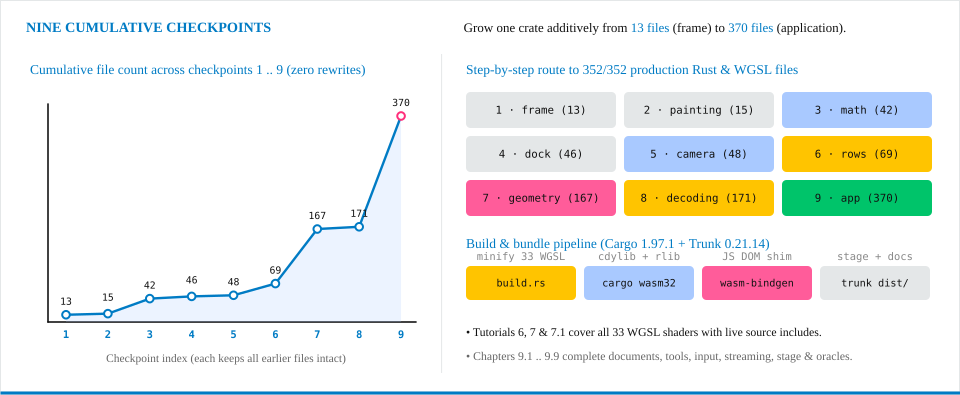

# Build and understand the Session Viewer

Build `session_viewer` step by step from an empty WebGPU canvas (`13` files) to the complete `352`-file Rust and WGSL CAD/stage application (`33` WGSL shaders). Every tutorial compiles and runs without rewriting earlier files.



## Prepare your computer

Install Rust `1.97.1`, `wasm32-unknown-unknown` and Trunk `0.21.14`:

```sh
rustup toolchain install 1.97.1 && rustup default 1.97.1
rustup target add wasm32-unknown-unknown
cargo install trunk --version 0.21.14 --locked
```

## Tutorials

1. **[1. Open a GPU frame](journey/completion-frame.md)** — initialize WebGPU and clear a surface (`13` files).
2. **[2. Paint shapes and text](journey/completion-painting.md)** — composite an `egui` triangle and label (`15` files).
3. **[3. Lay out and animate mathematics](journey/completion-mathematics.md)** — typeset OpenType math, matrices and `flat.rs` 2D constructions (`42` files).
4. **[4. Enter commands](journey/completion-dock.md)** — add the persistent command dock, history and option chips (`46` files).
5. **[5. Project and fit a scene](journey/completion-camera.md)** — add reverse-Z camera projection, orbit, rays and bounds fitting (`48` files).
6. **[6. Place and update object rows](journey/completion-rows.md)** — upload `112 B` `Instance` rows and the `6` shared WGSL headers (`69` files).
7. **[7. Render kernel geometry](journey/completion-geometry.md)** & **[7.1 Decide which ink is visible](journey/completion-visibility.md)** — compile all remaining `27` WGSL shaders for meshes, BRep ink, curves, text, clouds, section caps, outlines and SSAO (`167` files).
8. **[8. Decode a document](journey/completion-decoding.md)** — validate and decode `<= 512 MiB` `.pb` documents with `25,000`-object browser yields (`171` files).
9. **[9. Run the application](journey/completion-application.md)** (+ chapters **[9.1](journey/completion-documents.md)** .. **[9.9](journey/completion-debugging.md)**) — assemble the complete `352/352` production viewer (`production.html`).
