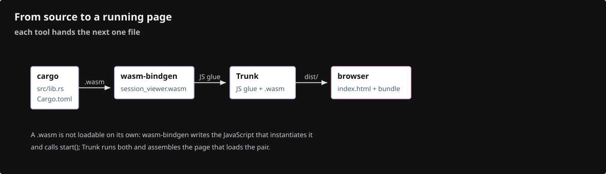

# Build and understand the Session Viewer

Jump straight to **[Tutorial 1: Open a GPU frame](journey/completion-frame.md)** to start coding, or review the [nine-checkpoint course map](journey/active.md).


## Prepare your computer

Install Rust `1.97.1`, the `wasm32-unknown-unknown` target, Trunk `0.21.14`, Node.js `>= 20.6` and a WebGPU browser (Chrome or Edge):

```sh
rustup toolchain install 1.97.1
rustup default 1.97.1
rustup target add wasm32-unknown-unknown
cargo install trunk --version 0.21.14 --locked
```

Clone with submodules and build the local documentation assets once from `session_tests`:

```sh
git clone --recurse-submodules https://github.com/petrasvestartas/session.git
cd session/session_tests
npm ci
DOCS_STRICT_LINKS=1 DOCS_BASE=/docs/ npm exec vite build -- --outDir ../session_viewer/dist/docs --emptyOutDir
cd ../session_viewer
```

Keep `Cargo.lock` intact so every checkpoint resolves the same `wgpu`, `egui`, `ttf-parser`, `swash` and `glyphon` crates.

## How Cargo, wasm-bindgen and Trunk package the viewer



| File | Role |
| --- | --- |
| [Cargo.toml](../Cargo.toml) | Emits `cdylib` (browser `.wasm`) and `rlib` (native tests/examples); links `session_rust` with `viewer-display`. |
| [build.rs](../build.rs) | Expands `#include "scene.wgsl"` once per shader into `OUT_DIR/shaders/` and strips `//` comments. |
| [Trunk.toml](../Trunk.toml) | Runs `build` in release mode and copies `stage/`, `decks/`, `text/` and `docs/` into `dist/`. |
| [index.html](../index.html) | Mounts `#viewer`, `diagnostics.js` and the Trunk `rust` pipeline (`wasm-opt="0"`). |

## Start coding

1. **[1. Open a GPU frame](journey/completion-frame.md)** — initialize WebGPU and clear a surface (`13` files).
2. **[2. Paint shapes and text](journey/completion-painting.md)** — composite an `egui` triangle and label (`15` files).
3. **[3. Lay out and animate mathematics](journey/completion-mathematics.md)** — typeset TeX, matrices and 2D/3D stage constructions (`42` files).

Optional Rust warm-up exercises live in [Foundations](foundations.md); learner checkpoint commands live in [Save and recovery](journey/recovery.md); target rendering requirements live in [Destination](journey/destination.md). Earlier drafts stay in [Archived tutorials](archived/README.md).
