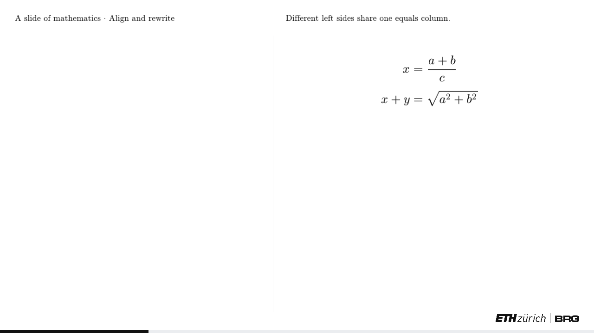
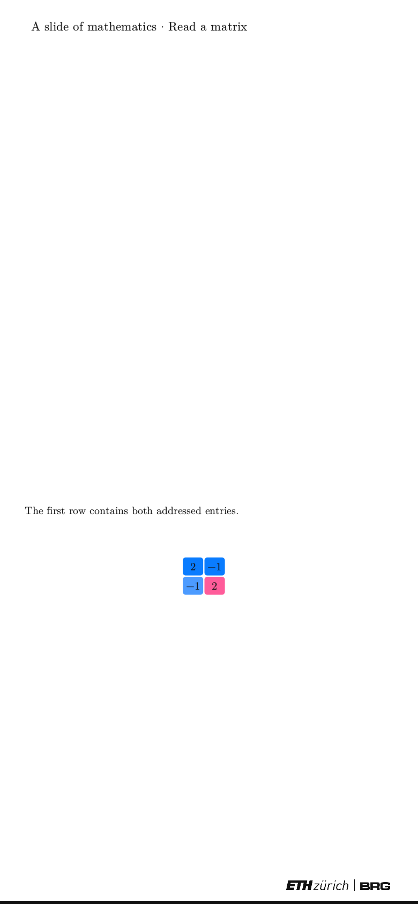

> Archived standalone mathematics subject. Its sources and historical receipts remain available. Follow the [current cumulative subject](../journey/03a-mathematics.md) for ongoing course integration.

# A slide of mathematics

Lay out equations and matrices, animate a matching transform, and step forward and backward through a YAML deck.

## Prerequisites and ownership

Complete the first wgpu frame and egui painting subjects. This subject owns the stage's font, TeX, painter, column layout, matrix layout, object state, clock, action playback, matching transform and deck format. The runnable checkpoint is `docs/lessons/03a-math`.

Use the production directory names: `src/app/stage/`. The supplied support modules `geometry.rs`, `view.rs` and `net.rs` keep the deck runtime complete; the later scene subject explains their geometry, camera and force-density work. They do not allocate viewer scene rows here. `spatial.rs` and the application's `StageApp` wiring belong to that later subject.

The kernel stays a path dependency. Geometry interpolation calls the live kernel; do not copy its algorithms into the lesson. The checkpoint shares the repository's fonts and logo assets, including their [license notice](https://github.com/petrasvestartas/session/blob/main/session_viewer/assets/stage/FONTS.md).

## Build

Copy the checkpoint's [manifest](../lessons/03a-math/Cargo.toml), [lock](../lessons/03a-math/Cargo.lock), [page](../lessons/03a-math/index.html), [module declarations](../lessons/03a-math/src/lib.rs) and [browser harness](../lessons/03a-math/src/browser.rs). The harness connects this subject to wgpu and egui; cumulative application integration remains pending.

Copy the complete source modules linked below. Type the named sections as you study their mechanisms. Keep those implementations together: adding a matrix or a deck later must not require replacing the painter or parser.

### Frame and letterbox

Type the coordinate mapping in [paint.rs](../lessons/03a-math/src/app/stage/paint.rs); keep authored positions independent of the browser's dimensions.

```rust
--8<-- "lessons/03a-math/src/app/stage/paint.rs:frame"
```

The design space is 1600 × 900. An 800 × 800 viewport fits it at half scale, leaving 175 points above and below. `pt` maps authored coordinates into screen points; `slide` reverses that mapping for input. Upright composition gives the scene and column separate mappings. It does not change the formula's authored coordinates.

### Font metrics and TeX

Copy [font.rs](../lessons/03a-math/src/app/stage/font.rs) and [tex.rs](../lessons/03a-math/src/app/stage/tex.rs). Read `Fonts::new`: dividing font units by units-per-em gives layout units independent of raster size.

```rust
--8<-- "lessons/03a-math/src/app/stage/font.rs:metrics"
```

Ink bounds and horizontal advance describe different things. Advancing by ink width would collapse deliberate spaces around glyphs. The font's OpenType MATH table supplies fraction gaps, script offsets and delimiter construction. A tall delimiter can use a larger glyph or an assembly of extender pieces.

Trace the lexer before following the layout: commands, groups, scripts and raw text must be distinct tokens before dimensions are measured.

```rust
--8<-- "lessons/03a-math/src/app/stage/tex.rs:lexer"
```

A fraction has separate numerator and denominator boxes. Layout positions them around the math axis and emits a rule between them. A square root needs a radical and an overbar; it is not a Unicode character pasted before a string.

```rust
--8<-- "lessons/03a-math/src/app/stage/tex.rs:typeset"
```

`Expr` carries positioned primitives, width, height, depth, an optional equals-sign offset and named parts. It also records unknown commands. Prose permits `$...$` mathematics; code uses the monospace face. These content forms share the painter rather than creating another rendering lane.

### Glyph atlas and painting

Type the atlas implementation; cache a raster by font, glyph ID and pixel size.

```rust
--8<-- "lessons/03a-math/src/app/stage/paint.rs:atlas"
```

Swash converts a glyph ID into coverage pixels. A cached space consumes no texture area. Bearings locate the raster relative to its baseline; one-pixel gutters separate atlas entries. Layout remains in em units, the object's size converts em to slide units, and the frame plus display density determines raster pixels.

Read `prim`, `Out::flush` and `paint` in the same file. Glyphs accumulate into one egui mesh until another shape must preserve drawing order. Rounded matrix cells, paths and pictures use that same ordered output. The atlas and painter are the full stage implementation, including raster-size quantization and atlas reset handling.

The viewer's scene text lane cannot draw these font glyph IDs. Mathematics therefore uses the font's MATH layout and egui glyph quads. The later 3D picture still uses the real scene and camera.

### Keep the presentation together

The production presentation owner is exercised by the separate mode probe. The standalone checkpoint still connects its stage and atlas directly in `browser.rs`; cumulative application wiring remains pending.

The production [presentation owner](../../src/app/stage/presentation.rs) keeps the running deck, its glyph and picture atlas, and the last painted coordinate mapping together:

```rust
--8<-- "session_viewer/src/app/stage/presentation.rs:stage-presentation"
```

Its constructor assigns each named picture an atlas index and an aspect ratio in the same pass. Its `paint` method stores the frame used for drawing, clears the previous overflow flag, paints, and returns whether animation, changed state or a newly overflowing atlas requires another frame. It clears `changed` only after calculating that result. The outer application owns the clock tick, camera projection, event routing and GPU submission.

Keeping this owner independent of scene rows lets the later `StageApp` contain the same presentation alongside `Scene3` and pointer state. It does not replace the parser, runtime or painter. Predict what would happen if `changed` were cleared before computing the return value: a static invalidation would no longer request another frame. The presentation regression tests check this transition, picture indices and desktop/upright coordinate round trips.

The [regression fixture](../../src/app/stage/presentation_tests.rs) creates a one-step formula deck and two pictures. It checks that picture IDs still address the correct aspect ratios and pixels. Painting twice must retain glyph output while the repaint request settles from true to false; mapping a slide point to screen coordinates and back must recover it in both viewport shapes. These are CPU egui checks, not GPU or device acceptance.

This ownership boundary is separate from cumulative acceptance. The standalone checkpoint and its recorded browser evidence remain intact; application-mode registration into the cumulative course is still pending.

### Register content without owning the application

A mode receives input and produces egui output; it does not acquire another surface or create another GPU device. Read [the application contract](../../src/app/mode.rs). `Host` is a Rust type parameter: the early mathematics mode works with an empty host, while the later scene mode receives the viewer state. The mathematics implementation never accesses the host, so adding a camera later does not require changing its painter.

```rust
--8<-- "session_viewer/src/app/stage/math_mode.rs:math-mode"
```

`Mode<Host>` uses a trait object so the application stores one active content implementation without knowing its concrete type. `Frame` carries the logical canvas rectangle, canvas dimensions, pixel density and current time; these are observations supplied by the application, not a second clock. The background is four normalized colour channels, so this interface does not require a GPU device.

The frame callback ticks the existing clock, runs egui once and returns both the output and repaint request. The application uploads textures and presents. Key input calls the presentation's navigation implementation; the scene adapter uses that same implementation. Pointer handling remains the later scene adapter's responsibility. The loaded-mode factory consumes its payload exactly once, using ownership rather than a second copy of the deck and fonts.

Predict whether replacing the empty host with a scene requires changing this implementation: it does not, because none of these operations reads host data. The scene adapter instead owns a separate callback that applies its camera before painting and synchronizes geometry afterwards. This interface passes the native mode probe and full application native and WebAssembly compilation. Optimized browser equivalence and adoption by the cumulative application's owning subject remain pending; the standalone browser harness is the currently runnable subject host.

### Column and equals alignment

Copy [layout.rs](../lessons/03a-math/src/app/stage/layout.rs) and [object.rs](../lessons/03a-math/src/app/stage/object.rs). An object keeps its content, colour, size, position, fit, opacity and named primitive groups. Layout measures blocks before positioning them.

Follow `relayout`: stacking determines vertical positions; fitting determines a common usable scale; equals alignment offsets each expression by its own `Expr::align`. Left-aligning `x=1` and `x+y=2` cannot align their equals signs because their left sides have different widths. Rows lay out formulas and matrices together.

The frame passed to the painter chooses the appropriate side's mapping:

```rust
--8<-- "lessons/03a-math/src/browser.rs:column"
```

### Matrices and addresses

Copy [matrix.rs](../lessons/03a-math/src/app/stage/matrix.rs). Measure entries before choosing cell width and height; centre each entry using its full height and depth.

```rust
--8<-- "lessons/03a-math/src/app/stage/matrix.rs:cells"
```

Each matrix cell has a rounded fill and zero or more glyph primitives. Groups such as `0,1`, `0,:`, `:,1`, `cells` and `entries` retain primitive indices. A later action can address a row without guessing coordinates. Entry ink is chosen for contrast against its cell fill.

Named net matrices select a square-pattern representation above 14 rows or columns. Authored matrices select it explicitly with `pattern: true`. Zero entries remain empty; nonzero entries show structure. This is a different reading task from inspecting individual values, so it does not squeeze hundreds of unreadable numbers into the same rectangle.

### Clock, actions and drawing

Copy [tween.rs](../lessons/03a-math/src/app/stage/tween.rs), [actions.rs](../lessons/03a-math/src/app/stage/actions.rs) and [draw.rs](../lessons/03a-math/src/app/stage/draw.rs). Sample motion from time and endpoints rather than repeatedly adding a distance per frame.

```rust
--8<-- "lessons/03a-math/src/app/stage/tween.rs:clock"
```

A transition starting at 100 ms with duration 200 ms reaches its midpoint at 200 ms and its endpoint at 300 ms. Easing changes the speed along that interval. Retargeting starts from the sampled current value, so an interruption does not jump back to an old starting value.

`actions.rs` updates object state and schedules effects. `draw.rs` converts that state into primitives, including fade-out snapshots and rounded boxes. Removing an object must retain enough drawing data to finish its disappearance. The runtime advances pending actions and retires completed animations:

```rust
--8<-- "lessons/03a-math/src/app/stage/run.rs:clock"
```

A thing moves only when the movement is the idea. Use a matching transform for a rewritten equation. Use appearance for a newly introduced object. Colour changes can identify an addressed matrix row without moving it elsewhere.

### Kernel motion values

The clock supplies a normalized, eased parameter. The kernel supplies the value at that parameter. Keeping these responsibilities separate lets one clock move different kinds of objects without adding a second timing system.

Read these live kernel implementations and their tests; the mathematics checkpoint already depends on this kernel. The later scene subject connects their results to scene rows.

| Operation | Meaning at the midpoint | Constraint to preserve |
| --- | --- | --- |
| [Vector::lerp](../../../session_rust/src/vector.rs) | Each component is halfway between its endpoints. Between `(2, 0, 0)` and `(0, 2, 0)`, the result is `(1, 1, 0)`. | This does not preserve vector length. Use it for component motion, not as a rotation algorithm. |
| [Color::lerp](../../../session_rust/src/color.rs) | Red, green, blue and alpha are blended component by component; the result keeps the first colour's name. | This is interpolation of stored channels, with no perceptual colour-space conversion. |
| [Line::lerp](../../../session_rust/src/line.rs) | The start moves toward the other start and the end toward the other end. | The result copies the first line's other properties. Swapping one line's endpoints changes the motion and can collapse the midpoint. |
| [Polyline::resampled](../../../session_rust/src/polyline.rs) | A requested count of points follows equal arc-length intervals, retaining the first and last point. | Counts below two, or inputs with fewer than two points, return a duplicate. Equal spacing need not retain every original corner. |
| [Polyline::morph](../../../session_rust/src/polyline.rs) | Both inputs are resampled to their larger point count, then corresponding points are blended. | Correspondence follows traversal order. Even at parameter zero the result may be the resampled first path, rather than its original vertex list. |
| [Xform::interpolate](../../../session_rust/src/xform.rs) | Translation and axis scales blend linearly; rotation follows a normalized quaternion blend, using spherical interpolation away from nearly equal rotations. | This interpolates a translation/rotation/scale decomposition, not all sixteen matrix entries. Do not assume arbitrary shear is preserved. |

The vector, colour and line implementations do not clamp the parameter. The stage clock clamps time before easing, so an expired animation stays at its endpoint. `geometry.rs::geo_points` uses the kernel's point, line and polyline operations after that time calculation. The stage's floating-point RGBA tween remains a separate small value implementation; it does not call `Color::lerp`.

Open **Lerp** in the Vector, Color and Line kernel test pages, **Morph** in Polyline (which also exercises resampling), and **Interpolate** in Xform. Read the live assertions before running the corresponding kernel tests. A discoverable test name alone does not establish that those tests ran in this checkout.

Predict the midpoint of a line and the same line with reversed endpoints: both ends meet at the centre. Compare that with rotating the line's placement by half a turn using `Xform::interpolate`: at the halfway orientation, its length stays unchanged. Choose the operation according to what the movement means.

### Steps, slides and stepping backward

Copy [run.rs](../lessons/03a-math/src/app/stage/run.rs). A chapter owns the shared scene and its slides; each slide contains steps. The runtime flattens those steps for navigation while retaining slide boundaries.

```rust
--8<-- "lessons/03a-math/src/app/stage/run.rs:navigation"
```

Advancing first finishes any running step. Going backward rebuilds the chapter and replays actions without animation up to the requested position. It does not invert every mutation. Replay restores removed objects, colours and transforms using the same action semantics as forward navigation.

### Matching transform

Copy [morph.rs](../lessons/03a-math/src/app/stage/morph.rs). Match explicit named parts first, then pair equal symbols without using either primitive twice.

```rust
--8<-- "lessons/03a-math/src/app/stage/morph.rs:matching"
```

Matched primitives interpolate their positions and sizes. Unmatched old primitives fade out; unmatched new primitives fade in. Longest-common-subsequence matching preserves the order of repeated symbols. In `x+y` becoming `x+y+z`, the existing symbols retain their identity while the new term appears.

### Deck data and errors

Copy [deck.rs](../lessons/03a-math/src/app/stage/deck.rs), [eval.rs](../lessons/03a-math/src/app/stage/eval.rs) and [check.rs](../lessons/03a-math/src/app/stage/check.rs), together with the supplied [geometry](../lessons/03a-math/src/app/stage/geometry.rs), [view](../lessons/03a-math/src/app/stage/view.rs) and [net](../lessons/03a-math/src/app/stage/net.rs) modules.

```rust
--8<-- "lessons/03a-math/src/app/stage/deck.rs:schema"
```

An index names chapter files. The chapter parser expands short keys and author blocks into actions. It carries the chapter name into errors; playback adds the step context. Unknown names and unsupported TeX must be reported rather than silently dropping the requested content. The overlap check uses laid-out ink bounds, not string lengths.

Type the lesson's [example.yaml](../lessons/03a-math/example.yaml). Its two slides exercise equals alignment, matching, a matrix and a row address.

```yaml
--8<-- "lessons/03a-math/example.yaml:deck"
```

The next scene subject uses the same schema and runtime. It adds the adapter that turns `Spatial` descriptions into kernel geometry and GPU rows; it does not replace the 2D implementation.

## Run and observe

From `docs/lessons/03a-math`, run `trunk serve --port 8780` through the workspace storage guard and build slot. Set `CARGO_TARGET_DIR` to the shared course Cargo cache and `CARGO_BUILD_JOBS=2`; use the same cache for native and wasm checks. Open `http://127.0.0.1:8780/`.

The first step aligns two equations. Right arrow advances to a matching rewrite, then a matrix and its coloured first row. Left arrow rebuilds the previous state. `T` changes the stage theme. The left scene region stays empty because this subject does not allocate 3D scene rows. Reload after changing the viewport size; the supplied browser harness has no resize integration yet.

Run native checks with `REGEN_PROTO=0 cargo test --locked --lib --target x86_64-unknown-linux-gnu -j2`, also through the guard and shared cache. Use your native host target on another platform. Tests include parser and layout facts, the lesson deck, replay, and the production suite that plays all five shipped decks.

## Predict and try

Change the second equation's left side from `x+y` to `x+y+z`. Predict which edge moves: the equals sign stays fixed while the left edge moves left. Restore it afterwards.

Advance to the matrix's coloured row, then step backward. Predict whether the previous row colour remains. Replay should recover the earlier state, including its original colours.

## Question and answer

Why replay previous steps instead of undoing each animation?

The action stream already describes how to construct every state. Replaying that stream also restores removed objects and their groups; inverse animations alone would not recover that information.

## Validation

The source-parity test passes for all 17 stage-core modules, comparing exact nonblank lines after removing teaching markers and normalizing shared logo paths. A fresh [Windows native run](../lessons/03a-math/native-windows-evidence.json) passes all 24 tests, including playback of the five production decks. The recorded cloud run also passes 24 native tests and its WebAssembly build. Chromium with Vulkan/SwiftShader passes four visible deck steps at 1280 × 720 (density 1) and 390 × 844 (density 2), exact previous-frame reconstruction and a theme round trip. This is software WebGPU evidence, not a hardware-driver or real-phone test. A fresh [Windows browser run](../lessons/03a-math/browser-windows-evidence.json) passes the same interaction checks on Chrome 157 with the Intel gen-12lp adapter, using desktop and upright emulated viewports. The Windows Vulkan/SwiftShader attempt timed out and is recorded as a failure. The [cloud browser record](../lessons/03a-math/full-browser-evidence.json) fingerprints its tested source; the older formula-only record remains historical. Cumulative course integration remains unfinished. The browser harness is a subject test host, not a replacement for the production application's event loop.






Reproduce browser checks after serving the built checkpoint with `node ../session_tests/scripts/course/math-browser.cjs http://127.0.0.1:8780/`. Supply Playwright and pngjs through `NODE_PATH` if installed outside `session_tests`; `CHROMIUM` selects the browser executable. The check rejects blank images, unchanged steps, runtime errors and failed navigation round trips. Its captures go to `target/math-browser`. `MATH_BROWSER_ARGS` accepts a JSON array of browser flags; the Windows hardware run uses `--enable-unsafe-webgpu`, `--ignore-gpu-blocklist` and `--use-angle=d3d11`. The receipt records the actual adapter and flags. These options do not change the interaction or pixel assertions.
