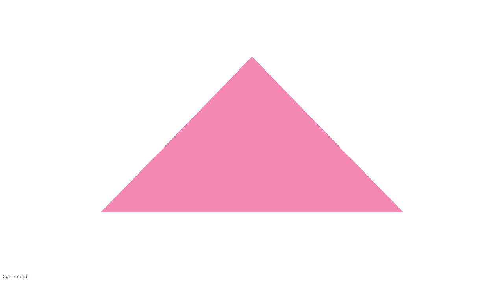
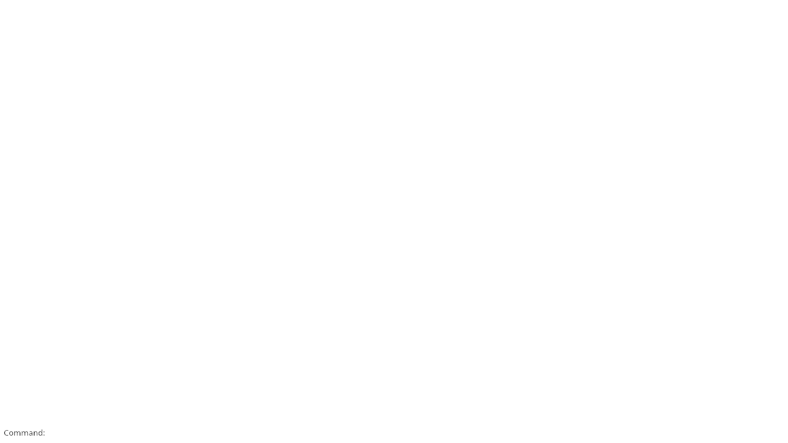

# Shaders and first egui painting

<a id="checkpoint-03-triangle"></a>

Draw a pink triangle and a crisp Command label in two ordered passes on one GPU surface.

## Prerequisites and ownership

Complete [Rust and the first GPU frame](consolidation/01-canvas.md). This subject introduces `triangle.wgsl`, `panel.rs`, and the shared command font/theme module, and connects them to the existing renderer and browser. It combines shader setup, font preparation and actual painting into one runnable checkpoint.

The next mathematics subject uses this same distinction between measured UI coordinates and GPU pixels. The command dock subsequently adds editing and input. Later renderer and panel ownership still needs consolidation; this checkpoint does not claim that those files are finished throughout the current course.

## Build

Use these complete files in the first-frame checkpoint; copy the bundled Noto fonts through the dependency command.

### Corners, coverage and colour

Type the shader in `src/triangle.wgsl`:

```wgsl
--8<-- "journey/code/03-paint-1.wgsl"
```

The vertex index selects one of three clip-space corners. Dividing clip x and y by w maps the visible square to −1 through +1; w is one here. Rasterization finds the covered pixels, then the fragment shader supplies their linear colour. Moving a corner changes coverage; changing only the fragment result changes colour.

Type the pipeline setup and draw in `src/renderer.rs`:

```rust
--8<-- "journey/code/03-paint-2.rs"
```

A pipeline joins the shader entry points, target format and primitive state. Keep it between frames. The shader supplies positions, so no vertex buffer is needed yet. `draw(0..3, 0..1)` requests three vertices and one instance. The first pass clears white, then records the triangle.

### Fonts and logical coordinates

Add the egui dependencies in `Cargo.toml` and register the new modules in `src/lib.rs`:

```toml
--8<-- "journey/code/03-paint-4.toml"
```

```rust
--8<-- "journey/code/03-paint-6.rs"
```

Copy the shared font configuration into `src/command_dock/theme.rs` and its module declaration into `src/command_dock/mod.rs`:

```rust
--8<-- "journey/code/03-paint-7.rs"
```

```rust
--8<-- "journey/code/03-paint-8.rs"
```

`include_bytes!` supplies font bytes for the lifetime of the program; `Arc` shares that allocation. Family order supplies fallback glyphs. Keep the font licenses beside the assets.

Type `src/panel.rs`:

```rust
--8<-- "journey/code/03-paint-5.rs"
```

`RawInput.screen_rect` uses logical points. Divide the physical target dimensions by display density: a 780-pixel image at density two is 390 points wide. The same density belongs in `ScreenDescriptor`; otherwise text size and pointer coordinates disagree.

`run_ui` measures and lays out the label, returning shapes and texture changes. Glyph coverage lives in a font atlas. Upload changed atlas pixels before drawing the meshes that sample them, then tessellate shapes and upload the mesh buffers.

### Two passes, one presentation

Connect the scene and panel in `src/browser.rs`:

```rust
--8<-- "journey/code/03-paint-3.rs"
```

Both painters use the same device and sRGB view format. The UI pass uses `Load`: its untouched pixels retain the triangle. `forget_lifetime` releases the pass's compile-time borrow of the encoder, but the pass still must end before finishing that encoder. Submit the UI buffers before presenting, and free retired atlas textures after their drawing work is submitted.

## Run and observe

From `session_viewer`, materialize a fresh checkpoint outside your handwritten project:

```sh
npm --prefix ../session_tests run course -- reference 03-triangle --output target/first-painting
cd target/first-painting
trunk serve --port 8780
```

The canvas contains a pink triangle with a white Command label panel at the bottom. The label is painted on the GPU; it is not an HTML input. Keyboard editing belongs to the next subject.

## Predict and try

Predict the result of replacing only the UI pass's `Load` with `Clear(wgpu::Color::WHITE)`. Run the experiment: the triangle disappears, while the label remains. Restore `Load` before continuing.

## Question and answer

Why must atlas uploads happen before the text draw?

The mesh carries glyph positions and texture coordinates, not the glyph's coverage pixels. Drawing before uploading the referenced atlas region would sample absent or stale coverage.

## Validation

This executable checkpoint preserves the exact endpoint of the former shader, font and painting sequence. Their [original checkpoints](../archived/painting/checkpoints.json) remain available; the full subsequent course endpoint is unchanged. Desktop and upright browser checks pass for triangle coverage, Noto label ink and the Load/Clear experiment. The experiment preserves every dock pixel. These captures use software WebGPU; hardware and real-phone acceptance are not claimed. Locked wasm compilation, optimized browser bundling and native scene-pixel verification pass. See the [recorded browser evidence](painting-evidence.json).




