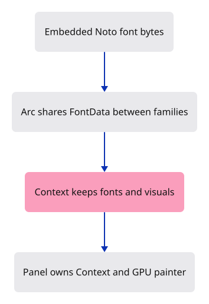

# 1.3.2 · Prepare the command fonts and painter

**Chapter 1 · Browser, Rust and the GPU · Section 1.3 · Shaders and the command dock** · [Contents](contents.md)

**Typing: 30–60 minutes.** [Estimate](typing-load.md).

Prepare one owner for the command drawing. It keeps an `egui::Context` and a GPU painter. The browser constructs this owner now; the triangle stays unchanged until we connect drawing.

## Type

Continue from [Give the GPU three corners](03-triangle.md). [Save or recover your work](recovery.md).

### 1. `Cargo.toml`

Add egui and its GPU painter.

<details>
<summary>Locate the existing block</summary>

```toml
wasm-bindgen-futures = "=0.4.78"
wgpu = "=29.0.4"

[dev-dependencies]
pollster = "=0.4.0"
log = "=0.4.34"
```

</details>

Edit the existing block to match this code; keep unchanged lines:

```toml
--8<-- "journey/code/03a-fonts-01.toml"
```

### 2. `src/panel.rs`

Keep the context and painter together.

Create the file and type:

```rust
--8<-- "journey/code/03a-fonts-02.rs"
```

### 3. `src/browser.rs`

Create the painter owner before presenting the scene.

<details>
<summary>Locate the existing block</summary>

```rust
    config.view_formats = vec![config.format.add_srgb_suffix()];
    surface.configure(&device, &config);
    let renderer = Renderer::new(device, queue, config.format.add_srgb_suffix());
    present(&surface, &renderer)?;
    report("Three corners became a triangle.");
    Ok(())
```

</details>

Edit the existing block to match this code; keep unchanged lines:

```rust
--8<-- "journey/code/03a-fonts-03.rs"
```

### 4. `src/lib.rs`

Register the browser-only drawing modules.

<details>
<summary>Locate the existing block</summary>

```rust
        }
    });
}
```

</details>

After that block, type:

```rust
--8<-- "journey/code/03a-fonts-04.rs" skip=20
```

### 5. `src/command_dock/theme.rs`

Configure Noto fonts and the light theme.

Create the file and type:

```rust
--8<-- "journey/code/03a-fonts-05.rs"
```

### 6. `src/command_dock/mod.rs`

Register the shared styling module.

Create the file and type:

```rust
--8<-- "journey/code/03a-fonts-06.rs"
```

## Run and check

Run this from `session_viewer` to select the fixed dependency versions and install supplied binary assets. It updates Cargo.lock and preserves the previous lock. It does not write implementation code:

```sh
npm --prefix ../session_tests run course -- dependencies 1.3.2
```

In your project:

```sh
cd workspace/journey
cargo build --lib --locked --target wasm32-unknown-unknown -j1
CARGO_BUILD_JOBS=1 trunk serve --port 8780
```

Open `http://127.0.0.1:8780/`. Keep an existing Trunk server running; saving rebuilds it.

The triangle stays visible in the full window. The font and painter owner is constructed, but no interface drawing is connected yet.

### Recorded visual result

**Previous native render — current verification pending.**

The native image checks the scene renderer; actual Chrome separately checks the interface drawing.


*This recorded image predates a source or checker change. Rebuild this checkpoint before using it as current evidence; browser controls require separate acceptance.*

This reference image is shared with [1.3.1 · Give the GPU three corners](03-triangle.md). It does not demonstrate a new feature by itself.

<details>
<summary>Code explanation and diagram</summary>

`include_bytes!` embeds the three Noto font files in the program. Their static lifetime lets the font definitions retain them. `Arc` gives egui shared ownership of the font data; both families list the same font names. The `fonts` helper returns that configuration; `new` installs it, chooses the light theme and creates a painter using the existing device.

The painter records interface work on our GPU. It does not need a second canvas or HTML controls.

Embedded font bytes → shared font definitions → egui context → GPU painter.



Why can the font configuration keep the embedded byte slices?

include_bytes! supplies bytes with a static lifetime, so FontData can retain those slices. Arc lets egui share the same font data allocation; both families refer to its registered name.

Study estimate, including typing and experiments: 1–2 hours.

</details>

<details>
<summary>Optional experiment</summary>

Change visuals.window_fill and rebuild. Predict why the triangle stays unchanged before the painter is called, then restore the colour.

</details>

<details>
<summary>Check and save your work</summary>

Restore experimental edits, then run from `session_viewer`:

```sh
npm --prefix ../session_tests run course -- check 1.3.2
npm --prefix ../session_tests run course -- save 1.3.2
```

Source comparison leaves your project untouched. [Save and recovery instructions](recovery.md).

</details>

<details>
<summary>Viewer coverage and verification</summary>

This is the same Noto font setup and GPU painter used by the finished command dock.

Chrome observes creation of the actual egui GPU shader and pipeline while the triangle stays unchanged. No interface is drawn yet.

[Full validation scope](release.md).

To reproduce the scripted acceptance of the reference checkpoint, run from `session_viewer` with the [course bundle server](release.md#reproduce) running on port 8781:

```sh
npm --prefix ../session_tests run course -- capture 1.3.2
```

This uses the verified reference bundle; it does not check or change your typed project.

</details>
