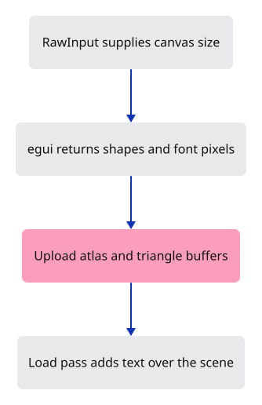

# 1.3.3 · Paint command text over the scene

**Chapter 1 · Browser, Rust and the GPU · Section 1.3 · Shaders and the command dock** · [Contents](contents.md)

**Typing: 25–49 minutes.** [Estimate](typing-load.md).

Draw the Command label after the triangle and before presenting the image. `RawInput` gives egui the available canvas size. `run_ui` calls our layout closure and returns shapes plus changed font-atlas pixels.

## Type

Continue from [Prepare the command fonts and painter](03a-fonts.md). [Save or recover your work](recovery.md).

### 1. `src/panel.rs`

Lay out the label, upload its font atlas and draw over the scene.

<details>
<summary>Locate the existing block</summary>

```rust
        Self { context, painter }
    }

}
```

</details>

Edit the existing block to match this code; keep unchanged lines:

```rust
--8<-- "journey/code/03a-paint-01.rs"
```

### 2. `src/browser.rs`

Create the panel and pass it into presentation. Draw the panel over the scene before presenting.

Edit these blocks from bottom to top. Keep the surrounding lines unchanged.

<details>
<summary>Locate this block</summary>

```rust
        ..Default::default()
    });
    renderer.draw(&view);
    frame.present();
    Ok(())
}
```

</details>

Replace it with:

```rust
        ..Default::default()
    });
    renderer.draw(&view);
    panel.draw(renderer, &view);
    frame.present();
    Ok(())
}
```

<details>
<summary>Locate this block</summary>

```rust
    config.view_formats = vec![config.format.add_srgb_suffix()];
    surface.configure(&device, &config);
    let renderer = Renderer::new(device, queue, config.format.add_srgb_suffix());
    let _panel = crate::panel::Panel::new(&renderer, config.format.add_srgb_suffix());
    present(&surface, &renderer)?;
    report("Three corners became a triangle.");
    Ok(())
}

fn present(surface: &wgpu::Surface<'_>, renderer: &Renderer) -> Result<(), JsValue> {
    let frame = match surface.get_current_texture() {
        wgpu::CurrentSurfaceTexture::Success(frame)
        | wgpu::CurrentSurfaceTexture::Suboptimal(frame) => frame,
```

</details>

Replace it with:

```rust
    config.view_formats = vec![config.format.add_srgb_suffix()];
    surface.configure(&device, &config);
    let renderer = Renderer::new(device, queue, config.format.add_srgb_suffix());
    let mut panel = crate::panel::Panel::new(&renderer, config.format.add_srgb_suffix());
    present(&surface, &renderer, &mut panel)?;
    report("Our command line is drawn. Input comes next.");
    Ok(())
}

fn present(surface: &wgpu::Surface<'_>, renderer: &Renderer, panel: &mut crate::panel::Panel) -> Result<(), JsValue> {
    let frame = match surface.get_current_texture() {
        wgpu::CurrentSurfaceTexture::Success(frame)
        | wgpu::CurrentSurfaceTexture::Suboptimal(frame) => frame,
```

<details>
<summary>Complete updated block reference</summary>

```rust
use crate::renderer::Renderer;
use wasm_bindgen::{JsCast, JsValue};

pub fn report(message: &str) {
    if let Some(document) = web_sys::window().and_then(|window| window.document()) {
        if let Some(status) = document.get_element_by_id("status") {
            status.set_text_content(Some(message));
            if message.starts_with("Cannot") { let _ = status.remove_attribute("hidden"); }
        }
    }
}

pub async fn run() -> Result<(), JsValue> {
    let window = web_sys::window().ok_or("No browser window")?;
    let document = window.document().ok_or("No document")?;
    let canvas: web_sys::HtmlCanvasElement = document
        .get_element_by_id("canvas").ok_or("Missing canvas")?.dyn_into()?;
    let instance = wgpu::Instance::new(wgpu::InstanceDescriptor {
        backends: wgpu::Backends::BROWSER_WEBGPU,
        flags: Default::default(),
        memory_budget_thresholds: Default::default(),
        backend_options: Default::default(),
        display: None,
    });
    let surface = instance.create_surface(wgpu::SurfaceTarget::Canvas(canvas.clone()))
        .map_err(|error| JsValue::from_str(&error.to_string()))?;
    let adapter = instance.request_adapter(&wgpu::RequestAdapterOptions {
        compatible_surface: Some(&surface),
        ..Default::default()
    }).await.map_err(|error| JsValue::from_str(&error.to_string()))?;
    let (device, queue) = adapter.request_device(&wgpu::DeviceDescriptor::default())
        .await.map_err(|error| JsValue::from_str(&error.to_string()))?;
    device.on_uncaptured_error(std::sync::Arc::new(|error| report(&error.to_string())));
    let limit = device.limits().max_texture_dimension_2d;
    let width = (window.inner_width()?.as_f64().ok_or("No window width")? as u32).clamp(1, limit);
    let height = (window.inner_height()?.as_f64().ok_or("No window height")? as u32).clamp(1, limit);
    canvas.set_width(width);
    canvas.set_height(height);
    let mut config = surface.get_default_config(&adapter, width, height)
        .ok_or("No compatible surface format")?;
    config.view_formats = vec![config.format.add_srgb_suffix()];
    surface.configure(&device, &config);
    let renderer = Renderer::new(device, queue, config.format.add_srgb_suffix());
    let mut panel = crate::panel::Panel::new(&renderer, config.format.add_srgb_suffix());
    present(&surface, &renderer, &mut panel)?;
    report("Our command line is drawn. Input comes next.");
    Ok(())
}

fn present(surface: &wgpu::Surface<'_>, renderer: &Renderer, panel: &mut crate::panel::Panel) -> Result<(), JsValue> {
    let frame = match surface.get_current_texture() {
        wgpu::CurrentSurfaceTexture::Success(frame)
        | wgpu::CurrentSurfaceTexture::Suboptimal(frame) => frame,
        other => return Err(JsValue::from_str(&format!("Surface unavailable: {other:?}"))),
    };
    let view = frame.texture.create_view(&wgpu::TextureViewDescriptor {
        format: Some(frame.texture.format().add_srgb_suffix()),
        ..Default::default()
    });
    renderer.draw(&view);
    panel.draw(renderer, &view);
    frame.present();
    Ok(())
}
```

</details>

<details>
<summary>Optional patch references</summary>

Use these original edit fragments when comparing a saved checkpoint. Apply the complete blocks above.

```text
--8<-- "journey/code/03a-paint-02.rs"
```

```text
--8<-- "journey/code/03a-paint-03.rs"
```

</details>

## Run and check

In your project:

```sh
cd workspace/journey
cargo build --lib --locked --target wasm32-unknown-unknown -j1
CARGO_BUILD_JOBS=1 trunk serve --port 8780
```

Open `http://127.0.0.1:8780/`. Keep an existing Trunk server running; saving rebuilds it.

Command: appears at the bottom of the full-window canvas. The triangle remains unchanged above it. Keyboard input is not connected yet.

### Recorded visual result

**Previous native render — current verification pending.**

The native image checks the scene renderer; actual Chrome separately checks the interface drawing.


*This recorded image predates a source or checker change. Rebuild this checkpoint before using it as current evidence; browser controls require separate acceptance.*

This reference image is shared with [1.3.1 · Give the GPU three corners](03-triangle.md). It does not demonstrate a new feature by itself.

<details>
<summary>Code explanation and diagram</summary>

Upload those pixels, turn the shapes into triangle jobs and update their GPU buffers. The second render pass uses `Load`, so it keeps the scene pixels already drawn. The panel uses a white frame and the production margins.

`forget_lifetime` removes the pass’s compile-time link to the encoder. The pass still must end before we finish the encoder. Submit its buffers, then release textures egui no longer needs.

RawInput → egui shapes and font atlas → GPU upload → Load pass → present.



Why does the interface pass use Load?

The triangle is already in the target image. Load keeps those pixels while the interface draws over them; another Clear would erase the scene.

Study estimate, including typing and experiments: 1–2 hours.

</details>

<details>
<summary>Optional experiment</summary>

Change only Load to a white Clear, rebuild and see which earlier drawing disappears. Restore Load.

</details>

<details>
<summary>Check and save your work</summary>

Restore experimental edits, then run from `session_viewer`:

```sh
npm --prefix ../session_tests run course -- check 1.3.3
npm --prefix ../session_tests run course -- save 1.3.3
```

Source comparison leaves your project untouched. [Save and recovery instructions](recovery.md).

</details>

<details>
<summary>Viewer coverage and verification</summary>

This introduces the interface upload and second GPU pass that the full command dock keeps.

Chrome verifies visible Noto label ink, white panel pixels and exact preservation of the scene above the dock. Keyboard input is not connected.

[Full validation scope](release.md).

To reproduce the scripted acceptance of the reference checkpoint, run from `session_viewer` with the [course bundle server](release.md#reproduce) running on port 8781:

```sh
npm --prefix ../session_tests run course -- capture 1.3.3
```

This uses the verified reference bundle; it does not check or change your typed project.

</details>
