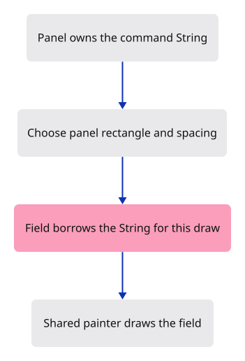

# 1.3.4 · Lay out the command field

**Chapter 1 · Browser, Rust and the GPU · Section 1.3 · Shaders and the command dock** · [Contents](contents.md)

**Typing: 30–60 minutes.** [Estimate](typing-load.md).

Add the command field beside its label. Keep panel sizing, shared spacing and field styling in the view module so later command behaviour can reuse them.

## Type

Continue from [Paint command text over the scene](03a-paint.md). [Save or recover your work](recovery.md).

### 1. `src/panel.rs`

Own the field text in Panel and import its layout helpers. Initialize empty text and limit input to one layout pass. Lay out the command label, field and history fold control.

Edit these blocks from bottom to top. Keep the surrounding lines unchanged.

<details>
<summary>Locate this block</summary>

```rust
            ..Default::default()
        };
        input.viewports.get_mut(&egui::ViewportId::ROOT).unwrap().native_pixels_per_point=Some(density);
        let output = self.context.run_ui(input, |root| {
            egui::Panel::bottom("command-line-collapsed").exact_size(30.0)
                .frame(egui::Frame::new().fill(egui::Color32::WHITE)
                    .inner_margin(egui::Margin::symmetric(6, 4)))
                .show_inside(root, |ui| {
                ui.label("Command:");
            });
        });
        // The font atlas is a texture: upload its changed pixels before drawing the letters.
```

</details>

Replace it with:

```rust
            ..Default::default()
        };
        input.viewports.get_mut(&egui::ViewportId::ROOT).unwrap().native_pixels_per_point=Some(density);
        let output = self.context.run_ui(input, |root| {
            view::panel(root, false, 0.0).show_inside(root, |ui| {
                view::prepare(ui);
                ui.horizontal(|ui| {
                    ui.set_max_width((ui.available_width() - 26.0).max(80.0));
                    ui.label("Command:");
                    view::field(ui, &mut self.line, "Type a command", 0.0, false);
                    let _ = ui.button("+").on_hover_text("Collapse or expand history");
                });
            });
        });
        // The font atlas is a texture: upload its changed pixels before drawing the letters.
```

<details>
<summary>Locate this block</summary>

```rust
        // One layout pass prevents a future text event from being replayed.
        context.options_mut(|options| options.max_passes = 1.try_into().unwrap());
        let painter = egui_wgpu::Renderer::new(&renderer.device, format, Default::default());
        Self { context, painter }
    }

    pub fn draw(&mut self, renderer: &Renderer, target: &wgpu::TextureView) {
```

</details>

Replace it with:

```rust
        // One layout pass prevents a future text event from being replayed.
        context.options_mut(|options| options.max_passes = 1.try_into().unwrap());
        let painter = egui_wgpu::Renderer::new(&renderer.device, format, Default::default());
        Self { context, painter, line: String::new() }
    }

    pub fn draw(&mut self, renderer: &Renderer, target: &wgpu::TextureView) {
```

<details>
<summary>Locate this block</summary>

```rust
use crate::command_dock::theme;
use crate::renderer::Renderer;

pub struct Panel {
    context: egui::Context,
    painter: egui_wgpu::Renderer,
}

impl Panel {
```

</details>

Replace it with:

```rust
use crate::command_dock::{theme, view};
use crate::renderer::Renderer;

pub struct Panel {
    context: egui::Context,
    painter: egui_wgpu::Renderer,
    line: String,
}

impl Panel {
```

<details>
<summary>Complete updated block reference</summary>

```rust
use crate::command_dock::{theme, view};
use crate::renderer::Renderer;

pub struct Panel {
    context: egui::Context,
    painter: egui_wgpu::Renderer,
    line: String,
}

impl Panel {
    pub fn new(renderer: &Renderer, format: wgpu::TextureFormat) -> Self {
        let context = egui::Context::default();
        context.set_fonts(theme::fonts([
            include_bytes!("../assets/text/NotoSans-Regular.subset.ttf"),
            include_bytes!("../assets/text/NotoSansSymbols2-Regular.subset.ttf"),
            include_bytes!("../assets/text/NotoSansSymbols-Regular.subset.ttf"),
        ]));
        context.set_theme(egui::Theme::Light);
        context.set_visuals(theme::visuals());
        // One layout pass prevents a future text event from being replayed.
        context.options_mut(|options| options.max_passes = 1.try_into().unwrap());
        let painter = egui_wgpu::Renderer::new(&renderer.device, format, Default::default());
        Self { context, painter, line: String::new() }
    }

    pub fn draw(&mut self, renderer: &Renderer, target: &wgpu::TextureView) {
        let size = [target.texture().width(), target.texture().height()];
        let screen = egui_wgpu::ScreenDescriptor { size_in_pixels: size, pixels_per_point: 1.0 };
        let input = egui::RawInput {
            screen_rect: Some(egui::Rect::from_min_size(
                egui::Pos2::ZERO, egui::vec2(size[0] as f32, size[1] as f32),
            )),
            ..Default::default()
        };
        input.viewports.get_mut(&egui::ViewportId::ROOT).unwrap().native_pixels_per_point=Some(density);
        let output = self.context.run_ui(input, |root| {
            view::panel(root, false, 0.0).show_inside(root, |ui| {
                view::prepare(ui);
                ui.horizontal(|ui| {
                    ui.set_max_width((ui.available_width() - 26.0).max(80.0));
                    ui.label("Command:");
                    view::field(ui, &mut self.line, "Type a command", 0.0, false);
                    let _ = ui.button("+").on_hover_text("Collapse or expand history");
                });
            });
        });
        // The font atlas is a texture: upload its changed pixels before drawing the letters.
        for (id, delta) in &output.textures_delta.set {
            self.painter.update_texture(&renderer.device, &renderer.queue, *id, delta);
        }
        let jobs = self.context.tessellate(output.shapes, output.pixels_per_point);
        let mut encoder = renderer.device.create_command_encoder(&Default::default());
        let mut buffers = self.painter.update_buffers(
            &renderer.device, &renderer.queue, &mut encoder, &jobs, &screen,
        );
        let pass = encoder.begin_render_pass(&wgpu::RenderPassDescriptor {
            label: Some("command panel"),
            color_attachments: &[Some(wgpu::RenderPassColorAttachment {
                view: target, resolve_target: None, depth_slice: None,
                ops: wgpu::Operations { load: wgpu::LoadOp::Load, store: wgpu::StoreOp::Store },
            })],
            ..Default::default()
        });
        self.painter.render(&mut pass.forget_lifetime(), &jobs, &screen);
        buffers.push(encoder.finish());
        renderer.queue.submit(buffers);
        for id in output.textures_delta.free { self.painter.free_texture(&id); }
    }
}
```

</details>

<details>
<summary>Optional patch references</summary>

Use these original edit fragments when comparing a saved checkpoint. Apply the complete blocks above.

```text
--8<-- "journey/code/03a-panel-01.rs"
```

```text
--8<-- "journey/code/03a-panel-02.rs"
```

```text
--8<-- "journey/code/03a-panel-03.rs"
```

</details>

### 2. `src/command_dock/theme.rs`

Style selection and the caret for the command field.

<details>
<summary>Locate the existing block</summary>

```rust
    visuals.panel_fill = egui::Color32::from_gray(245);
    visuals.window_stroke = egui::Stroke::NONE;
    visuals.extreme_bg_color = egui::Color32::WHITE;
    visuals.text_cursor.blink = false; // frames are drawn on demand
    visuals.indent_has_left_vline = false;
```

</details>

Edit the existing block to match this code; keep unchanged lines:

```rust
--8<-- "journey/code/03a-panel-04.rs"
```

### 3. `src/command_dock/mod.rs`

Register the shared field layout.

<details>
<summary>Locate the existing block</summary>

```rust
pub(crate) mod theme;
```

</details>

After that block, type:

```rust
--8<-- "journey/code/03a-panel-05.rs" skip=22
```

### 4. `src/command_dock/view.rs`

Add reusable panel, spacing and field functions.

Create the file and type:

```rust
--8<-- "journey/code/03a-panel-06.rs"
```

## Run and check

In your project:

```sh
cd workspace/journey
cargo build --lib --locked --target wasm32-unknown-unknown -j1
CARGO_BUILD_JOBS=1 trunk serve --port 8780
```

Open `http://127.0.0.1:8780/`. Keep an existing Trunk server running; saving rebuilds it.

The production command field appears beside Command: over the triangle. Input handling comes in the next command-line steps.

### Recorded visual result

**Previous native render — current verification pending.**

The native image checks the scene renderer; actual Chrome separately checks the interface drawing.


*This recorded image predates a source or checker change. Rebuild this checkpoint before using it as current evidence; browser controls require separate acceptance.*

This reference image is shared with [1.3.1 · Give the GPU three corners](03-triangle.md). It does not demonstrate a new feature by itself.

<details>
<summary>Code explanation and diagram</summary>

The field receives `&mut String`: egui borrows the text for this draw instead of owning a separate copy. It returns a `Response` describing the widget. The current page still supplies no keyboard events, so drawing the field does not connect typing yet.

The panel keeps its white fill, thin top rule, Noto text and unframed field. The history expansion control arrives with its behaviour in later steps.

Panel rectangle → spacing and text style → local String → field response.



Why does the field receive &mut String?

The Panel owns the text. A mutable borrow lets the widget edit that same value during a draw without moving it or keeping a second copy.

Study estimate, including typing and experiments: 1–2 hours.

</details>

<details>
<summary>Optional experiment</summary>

Change the hint text, rebuild and check only the empty field hint changes. Restore it.

</details>

<details>
<summary>Check and save your work</summary>

Restore experimental edits, then run from `session_viewer`:

```sh
npm --prefix ../session_tests run course -- check 1.3.4
npm --prefix ../session_tests run course -- save 1.3.4
```

Source comparison leaves your project untouched. [Save and recovery instructions](recovery.md).

</details>

<details>
<summary>Viewer coverage and verification</summary>

The same panel, spacing and field functions are reused by the full viewer.

Chrome verifies the actual production field drawing over the preserved triangle. Keyboard event handling comes later.

[Full validation scope](release.md).

</details>
