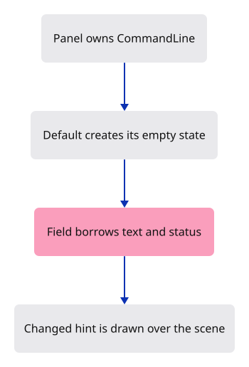

# 1.3.5 · Give the command field its memory

**Chapter 1 · Browser, Rust and the GPU · Section 1.3 · Shaders and the command dock** · [Contents](contents.md)

**Typing: 21–42 minutes.** [Estimate](typing-load.md).

Replace the panel’s local `String` with `CommandLine`. The field now reads and edits `model.command`; its empty hint comes from `model.status`.

## Type

Continue from [Lay out the command field](03a-panel.md). [Save or recover your work](recovery.md).

### 1. `src/panel.rs`

Replace the local String with an owned CommandLine. Give the model its initial status; keep all other fields at their defaults. Borrow the model text for editing and its status for the empty-field hint.

Edit these blocks from bottom to top. Keep the surrounding lines unchanged.

<details>
<summary>Locate this block</summary>

```rust
                ui.horizontal(|ui| {
                    ui.set_max_width((ui.available_width() - 26.0).max(80.0));
                    ui.label("Command:");
                    view::field(ui, &mut self.line, "Type a command", 0.0, false);
                    let _ = ui.button("+").on_hover_text("Collapse or expand history");
                });
            });
```

</details>

Replace it with:

```rust
                ui.horizontal(|ui| {
                    ui.set_max_width((ui.available_width() - 26.0).max(80.0));
                    ui.label("Command:");
                    view::field(ui, &mut self.model.command, placeholder("", &self.model.status, false), 0.0, false);
                    let _ = ui.button("+").on_hover_text("Collapse or expand history");
                });
            });
```

<details>
<summary>Locate this block</summary>

```rust
        // One layout pass prevents a future text event from being replayed.
        context.options_mut(|options| options.max_passes = 1.try_into().unwrap());
        let painter = egui_wgpu::Renderer::new(&renderer.device, format, Default::default());
        Self { context, painter, line: String::new() }
    }

    pub fn draw(&mut self, renderer: &Renderer, target: &wgpu::TextureView) {
```

</details>

Replace it with:

```rust
        // One layout pass prevents a future text event from being replayed.
        context.options_mut(|options| options.max_passes = 1.try_into().unwrap());
        let painter = egui_wgpu::Renderer::new(&renderer.device, format, Default::default());
        Self { context, painter, model: CommandLine {
            status: "The field now belongs to CommandLine.".into(),
            ..Default::default()
        } }
    }

    pub fn draw(&mut self, renderer: &Renderer, target: &wgpu::TextureView) {
```

<details>
<summary>Locate this block</summary>

```rust
use crate::command_dock::{theme, view};
use crate::renderer::Renderer;

pub struct Panel {
    context: egui::Context,
    painter: egui_wgpu::Renderer,
    line: String,
}

impl Panel {
```

</details>

Replace it with:

```rust
use crate::command_dock::{CommandLine, placeholder, theme, view};
use crate::renderer::Renderer;

pub struct Panel {
    context: egui::Context,
    painter: egui_wgpu::Renderer,
    model: CommandLine,
}

impl Panel {
```

<details>
<summary>Complete updated block reference</summary>

```rust
use crate::command_dock::{CommandLine, placeholder, theme, view};
use crate::renderer::Renderer;

pub struct Panel {
    context: egui::Context,
    painter: egui_wgpu::Renderer,
    model: CommandLine,
}

impl Panel {
    pub fn new(renderer: &Renderer, format: wgpu::TextureFormat) -> Self {
        let context = egui::Context::default();
        context.set_fonts(theme::fonts([
            include_bytes!("../assets/text/NotoSans-Regular.subset.ttf"),
            include_bytes!("../assets/text/NotoSansSymbols2-Regular.subset.ttf"),
            include_bytes!("../assets/text/NotoSansSymbols-Regular.subset.ttf"),
        ]));
        context.set_theme(egui::Theme::Light);
        context.set_visuals(theme::visuals());
        // One layout pass prevents a future text event from being replayed.
        context.options_mut(|options| options.max_passes = 1.try_into().unwrap());
        let painter = egui_wgpu::Renderer::new(&renderer.device, format, Default::default());
        Self { context, painter, model: CommandLine {
            status: "The field now belongs to CommandLine.".into(),
            ..Default::default()
        } }
    }

    pub fn draw(&mut self, renderer: &Renderer, target: &wgpu::TextureView) {
        let size = [target.texture().width(), target.texture().height()];
        let screen = egui_wgpu::ScreenDescriptor { size_in_pixels: size, pixels_per_point: 1.0 };
        let input = egui::RawInput {
            screen_rect: Some(egui::Rect::from_min_size(
                egui::Pos2::ZERO, egui::vec2(size[0] as f32, size[1] as f32),
            )),
            ..Default::default()
        };
        let output = self.context.run_ui(input, |root| {
            view::panel(root, false, 0.0).show_inside(root, |ui| {
                view::prepare(ui);
                ui.horizontal(|ui| {
                    ui.set_max_width((ui.available_width() - 26.0).max(80.0));
                    ui.label("Command:");
                    view::field(ui, &mut self.model.command, placeholder("", &self.model.status, false), 0.0, false);
                    let _ = ui.button("+").on_hover_text("Collapse or expand history");
                });
            });
        });
        // The font atlas is a texture: upload its changed pixels before drawing the letters.
        for (id, delta) in &output.textures_delta.set {
            self.painter.update_texture(&renderer.device, &renderer.queue, *id, delta);
        }
        let jobs = self.context.tessellate(output.shapes, output.pixels_per_point);
        let mut encoder = renderer.device.create_command_encoder(&Default::default());
        let mut buffers = self.painter.update_buffers(
            &renderer.device, &renderer.queue, &mut encoder, &jobs, &screen,
        );
        let pass = encoder.begin_render_pass(&wgpu::RenderPassDescriptor {
            label: Some("command panel"),
            color_attachments: &[Some(wgpu::RenderPassColorAttachment {
                view: target, resolve_target: None, depth_slice: None,
                ops: wgpu::Operations { load: wgpu::LoadOp::Load, store: wgpu::StoreOp::Store },
            })],
            ..Default::default()
        });
        self.painter.render(&mut pass.forget_lifetime(), &jobs, &screen);
        buffers.push(encoder.finish());
        renderer.queue.submit(buffers);
        for id in output.textures_delta.free { self.painter.free_texture(&id); }
    }
}
```

</details>

<details>
<summary>Optional patch references</summary>

Use these original edit fragments when comparing a saved checkpoint. Apply the complete blocks above.

```text
--8<-- "journey/code/03b-memory-01.rs"
```

```text
--8<-- "journey/code/03b-memory-02.rs"
```

```text
--8<-- "journey/code/03b-memory-03.rs"
```

</details>

### 2. `src/browser.rs`

Report that the field now uses the command model.

<details>
<summary>Locate the existing block</summary>

```rust
    let renderer = Renderer::new(device, queue, config.format.add_srgb_suffix());
    let mut panel = crate::panel::Panel::new(&renderer, config.format.add_srgb_suffix());
    present(&surface, &renderer, &mut panel)?;
    report("Our command line is drawn. Input comes next.");
    Ok(())
}
```

</details>

Edit the existing block to match this code; keep unchanged lines:

```rust
--8<-- "journey/code/03b-memory-04.rs"
```

### 3. `src/command_dock/mod.rs`

Define the state and choose the empty-field hint from borrowed text.

<details>
<summary>Locate the existing block</summary>

```rust
pub(crate) mod theme;
pub(crate) mod view;
```

</details>

Edit the existing block to match this code; keep unchanged lines:

```rust
--8<-- "journey/code/03b-memory-05.rs"
```

## Run and check

In your project:

```sh
cd workspace/journey
cargo build --lib --locked --target wasm32-unknown-unknown -j1
CARGO_BUILD_JOBS=1 trunk serve --port 8780
```

Open `http://127.0.0.1:8780/`. Keep an existing Trunk server running; saving rebuilds it.

The empty field now shows “The field now belongs to CommandLine.” Change that initial status, save, and check the hint changes. Restore it. Keyboard input comes later.

### Recorded visual result

**Previous native render — current verification pending.**


*This recorded image predates a source or checker change. Rebuild this checkpoint before using it as current evidence; browser controls require separate acceptance.*

This reference image is shared with [1.3.1 · Give the GPU three corners](03-triangle.md). It does not demonstrate a new feature by itself.

<details>
<summary>Code explanation and diagram</summary>

`String` owns editable text. `VecDeque<String>` retains ordered history and can remove the oldest entry from the front. `Option` represents values that do not exist yet, such as an undrawn widget’s rectangle. `Default` starts strings and queues empty, flags false and optional values absent.

`placeholder` returns borrowed text. Its lifetime keeps that slice tied to the supplied prompt or status. Rust allows the field to borrow command mutably and status immutably because they are separate fields.

The model also reserves completion and input state used by the next lessons. Keyboard events are connected later.

Panel owns CommandLine → field borrows text → placeholder borrows status.



Which value keeps the command text between draws?

CommandLine inside Panel owns it. The field borrows model.command during layout; finishing the draw does not discard that String.

Study estimate, including typing and experiments: 1–2 hours.

</details>

<details>
<summary>Optional experiment</summary>

Change only the initial status. Predict which part of the dock changes, then rebuild and restore it.

</details>

<details>
<summary>Check and save your work</summary>

Restore experimental edits, then run from `session_viewer`:

```sh
npm --prefix ../session_tests run course -- check 1.3.5
npm --prefix ../session_tests run course -- save 1.3.5
```

Source comparison leaves your project untouched. [Save and recovery instructions](recovery.md).

</details>

<details>
<summary>Viewer coverage and verification</summary>

This is the production command dock and styling. Its vocabulary grows with the course; the scene renderer stays independent of text editing.

Native checks exercise retained text/history and every placeholder priority branch. Chrome checks the changed dock hint and preserves every scene pixel above it.

Actual browser drawing of the connected model. Keyboard event handling is still absent.

[Full validation scope](release.md).

To reproduce the scripted acceptance of the reference checkpoint, run from `session_viewer` with the [course bundle server](release.md#reproduce) running on port 8781:

```sh
npm --prefix ../session_tests run course -- capture 1.3.5
```

This uses the verified reference bundle; it does not check or change your typed project.

</details>
