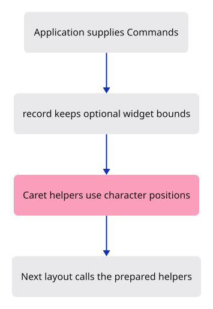

# 1.3.6 · Prepare the dock completion helpers

**Chapter 1 · Browser, Rust and the GPU · Section 1.3 · Shaders and the command dock** · [Contents](contents.md)

**Typing: 29–57 minutes.** [Estimate](typing-load.md).

The upcoming dock layout needs command names without knowing our scene types. `Commands` defines the methods the application will supply. Static string slices refer to its fixed vocabulary.

## Type

Continue from [Give the command field its memory](03b-memory.md). [Save or recover your work](recovery.md).

### 1. `Cargo.toml`

Enable the browser event, canvas geometry and focus bindings. Add serde serialization and JSON inspection dependencies.

<details>
<summary>Locate the existing block</summary>

```toml
[package]
name = "viewer_journey"
version = "0.1.0"
edition = "2024"

[lib]
crate-type = ["cdylib", "rlib"]

[workspace]

[dependencies]
wasm-bindgen = "=0.2.128"
web-sys = { version = "=0.3.105", features = ["Window", "Document", "Element", "HtmlCanvasElement", "EventTarget", "Event"] }
console_error_panic_hook = "=0.1.7"
wasm-bindgen-futures = "=0.4.78"
wgpu = "=29.0.4"

egui = { version = "=0.34.3", default-features = false }
egui-wgpu = { version = "=0.34.3", default-features = false }

[dev-dependencies]
pollster = "=0.4.0"
log = "=0.4.34"
```

</details>

Edit the existing block to match this code; keep unchanged lines:

```toml
[package]
name = "viewer_journey"
version = "0.1.0"
edition = "2024"

[lib]
crate-type = ["cdylib", "rlib"]

[workspace]

[dependencies]
wasm-bindgen = "=0.2.128"
web-sys = { version = "=0.3.105", features = ["Window", "Document", "Element", "HtmlCanvasElement", "EventTarget", "AddEventListenerOptions", "Event", "PointerEvent", "MouseEvent", "KeyboardEvent", "WheelEvent", "FocusOptions", "DomRect", "HtmlElement"] }
console_error_panic_hook = "=0.1.7"
wasm-bindgen-futures = "=0.4.78"
wgpu = "=29.0.4"

egui = { version = "=0.34.3", default-features = false }
egui-wgpu = { version = "=0.34.3", default-features = false }

serde = { version = "1.0", features = ["derive"] }
serde_json = "1.0"

[dev-dependencies]
pollster = "=0.4.0"
log = "=0.4.34"
```

<details>
<summary>Optional patch references</summary>

Use these original edit fragments when comparing a saved checkpoint. Apply the complete blocks above.

```text
--8<-- "journey/code/03b-state-01.toml"
```

```text
--8<-- "journey/code/03b-state-02.toml"
```

</details>

### 2. `src/command_dock/mod.rs`

Define the application vocabulary contract without coupling the dock to scene types. Record actual widget bounds only when inspection is enabled. Add character-based caret and prefix helpers for the dock. Keep the helper declarations separated by a blank line.

<details>
<summary>Locate the existing block</summary>

```rust
use std::collections::VecDeque;

pub(crate) mod theme;
pub(crate) mod view;

/// What the command line shows and remembers between frames.
#[derive(Default)]
pub struct CommandLine {
    pub(crate) command_open: bool,                  // command line shown
    pub(crate) command: String,                     // text in the command field
    pub(crate) drawing_prompt: String,              // prompt while drawing
    pub(crate) focus_command: bool,                 // give the field focus next frame
    pub(crate) status: String,                      // status line text
    pub(crate) history: VecDeque<String>,           // past commands and answers
    pub(crate) command_expanded: bool,              // history shown above the field
    pub(crate) completion: usize,                   // highlighted completion index
    pub(crate) completion_prefix: String,           // text the completions match
    pub(crate) inline_suffix: bool,                 // completion suffix shown in the field
    pub(crate) completion_visible: bool,            // completion list shown
    pub(crate) completion_rect: Option<egui::Rect>, // where the list is, for taps
    pub(crate) command_rect: Option<egui::Rect>,    // where the field is, for taps
    pub(crate) agent_edit: Option<bool>,            // phone keyboard set the text, true on delete
}

/// The grey text of the empty field: the prompt, else the last answer when the history is folded away.
pub(crate) fn placeholder<'a>(prompt: &'a str, status: &'a str, expanded: bool) -> &'a str {
    if !prompt.is_empty() {
        return prompt;
    }

    if !expanded && !status.is_empty() {
        return status;
    }

    "Type a command"
}
```

</details>

Edit the existing block to match this code; keep unchanged lines:

```rust
use std::collections::VecDeque;

pub(crate) mod theme;
pub(crate) mod view;

/// The command vocabulary supplied by the application using the dock.
pub trait Commands {
    fn canonical(&self, line: &str) -> String;
    fn choosing_option(&self, line: &str) -> bool;
    fn accept(&self, line: &str) -> (String, bool);
    fn completions(&self, line: &str) -> Vec<&'static str>;
    fn browse(&self, line: &str) -> Vec<&'static str>;
}

/// What the command line shows and remembers between frames.
#[derive(Default)]
pub struct CommandLine {
    pub(crate) command_open: bool,                  // command line shown
    pub(crate) command: String,                     // text in the command field
    pub(crate) drawing_prompt: String,              // prompt while drawing
    pub(crate) focus_command: bool,                 // give the field focus next frame
    pub(crate) status: String,                      // status line text
    pub(crate) history: VecDeque<String>,           // past commands and answers
    pub(crate) command_expanded: bool,              // history shown above the field
    pub(crate) completion: usize,                   // highlighted completion index
    pub(crate) completion_prefix: String,           // text the completions match
    pub(crate) inline_suffix: bool,                 // completion suffix shown in the field
    pub(crate) completion_visible: bool,            // completion list shown
    pub(crate) completion_rect: Option<egui::Rect>, // where the list is, for taps
    pub(crate) command_rect: Option<egui::Rect>,    // where the field is, for taps
    pub(crate) agent_edit: Option<bool>,            // phone keyboard set the text, true on delete
    pub(crate) options: Vec<(String, String)>,      // the running command's buttons: label, line it runs
    pub(crate) options_rect: Option<egui::Rect>,    // where those buttons are, for taps
}

/// One clickable control and where it was drawn, for browser tests.
#[derive(serde::Serialize)]
pub struct Control {
    pub(crate) key: String,    // what it does
    pub(crate) label: String,  // text shown
    pub(crate) rect: [f32; 4], // left, top, right, bottom
}

/// Remember one control's rectangle, when inspecting.
pub(crate) fn record(
    controls: &mut Option<Vec<Control>>,
    key: &str,
    label: &str,
    response: &egui::Response,
) {
    let Some(controls) = controls.as_mut() else {
        return;
    };
    let r = response.rect;
    controls.push(Control {
        key: key.to_string(),
        label: label.to_string(),
        rect: [r.min.x, r.min.y, r.max.x, r.max.y],
    });
}

/// Put the caret at the end of the field.
pub(crate) fn command_cursor_end(context: &egui::Context, id: egui::Id, command: &str) {
    let end = command.chars().count();
    command_cursor_select(context, id, end, end);
}

/// The characters of `name` that spell `typed`, spaces aside: `orient3p` is `Orient 3 P`.
pub(crate) fn spelled(name: &str, typed: &str) -> usize {
    let typed = typed.chars().filter(|c| !c.is_whitespace()).count();
    let (mut prefix, mut letters) = (0, 0);

    for c in name.chars() {
        if letters == typed {
            break;
        }

        prefix += 1;
        letters += usize::from(!c.is_whitespace());
    }

    prefix
}

/// The grey text of the empty field: the prompt, else the last answer when the history is folded away.
pub(crate) fn placeholder<'a>(prompt: &'a str, status: &'a str, expanded: bool) -> &'a str {
    if !prompt.is_empty() {
        return prompt;
    }

    if !expanded && !status.is_empty() {
        return status;
    }

    "Type a command"
}

/// Select `start..end` in the field.
pub(crate) fn command_cursor_select(
    context: &egui::Context,
    id: egui::Id,
    start: usize,
    end: usize,
) {
    if let Some(mut state) = egui::TextEdit::load_state(context, id) {
        state
            .cursor
            .set_char_range(Some(egui::text::CCursorRange::two(
                egui::text::CCursor::new(start),
                egui::text::CCursor::new(end),
            )));
        egui::TextEdit::store_state(context, id, state);
    }
}
```

<details>
<summary>Optional patch references</summary>

Use these original edit fragments when comparing a saved checkpoint. Apply the complete blocks above.

```text
--8<-- "journey/code/03b-state-03.rs"
```

```text
--8<-- "journey/code/03b-state-04.rs"
```

```text
--8<-- "journey/code/03b-state-05.rs"
```

```text
--8<-- "journey/code/03b-state-direct-03.rs"
```

</details>

### 3. `src/panel.rs`

Import the module name for the following shared helper calls.

<details>
<summary>Locate the existing block</summary>

```rust
use crate::command_dock::{CommandLine, placeholder, theme, view};
use crate::renderer::Renderer;
```

</details>

Edit the existing block to match this code; keep unchanged lines:

```rust
--8<-- "journey/code/03b-state-direct-04.rs"
```

## Run and check

Run this from `session_viewer` to select the fixed dependency versions and install supplied binary assets. It updates Cargo.lock and preserves the previous lock. It does not write implementation code:

```sh
npm --prefix ../session_tests run course -- dependencies 1.3.6
```

In your project:

```sh
cd workspace/journey
cargo build --lib --locked --target wasm32-unknown-unknown -j1
CARGO_BUILD_JOBS=1 trunk serve --port 8780
```

Open `http://127.0.0.1:8780/`. Keep an existing Trunk server running; saving rebuilds it.

The connected field looks exactly as before. The vocabulary, inspection and caret helpers are ready for the following layout and input lessons.

### Recorded visual result

**Previous native render — current verification pending.**


*This recorded image predates a source or checker change. Rebuild this checkpoint before using it as current evidence; browser controls require separate acceptance.*

This reference image is shared with [1.3.1 · Give the GPU three corners](03-triangle.md). It does not demonstrate a new feature by itself.

<details>
<summary>Code explanation and diagram</summary>

`Control` stores an inspection key, label and rectangle. `record` appends actual egui response bounds through a mutable borrow. If inspection is absent, let-else returns immediately. `serde::Serialize` lets the inspector describe the record as JSON.

Caret positions count characters rather than UTF-8 bytes: `é🙂x` has three scalar values. The helpers load a field’s stored egui state, change its range and store it back. An absent field state is left alone. `spelled` counts the displayed completion prefix while ignoring typed spaces.

These helpers are preparation for the following layout and input lessons. They add no controls or keyboard handling; the picture stays the same.

Commands contract → optional inspection → character-based caret positions.



Why does the caret helper use chars().count()?

String::len counts UTF-8 bytes. egui caret ranges use character indices, so é🙂x needs position 3 rather than its byte length.

Study estimate, including typing and experiments: 1–2 hours.

</details>

<details>
<summary>Optional experiment</summary>

For é🙂x, predict the byte length and character count. Compare len() with chars().count() in a small Rust scratch program.

</details>

<details>
<summary>Check and save your work</summary>

Restore experimental edits, then run from `session_viewer`:

```sh
npm --prefix ../session_tests run course -- check 1.3.6
npm --prefix ../session_tests run course -- save 1.3.6
```

Source comparison leaves your project untouched. [Save and recovery instructions](recovery.md).

</details>

<details>
<summary>Viewer coverage and verification</summary>

This is the production command dock and styling. Its vocabulary grows with the course; the scene renderer stays independent of text editing.

Native checks use actual egui layout bounds and serialized inspection data, spaced/Unicode prefixes, absent field state and stored caret/selection ranges. The trait is compile-checked; application command behavior arrives later.

Chrome verifies the complete frame remains identical to 03b-memory.

[Full validation scope](release.md).

To reproduce the scripted acceptance of the reference checkpoint, run from `session_viewer` with the [course bundle server](release.md#reproduce) running on port 8781:

```sh
npm --prefix ../session_tests run course -- capture 1.3.6
```

This uses the verified reference bundle; it does not check or change your typed project.

</details>
