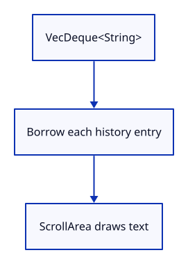

# 1.3.7 · Draw retained command history

**Chapter 1 · Browser, Rust and the GPU · Section 1.3 · Shaders and the command dock** · [Contents](contents.md)

**Typing: 22–43 minutes.** [Estimate](typing-load.md).

Draw each retained String above the command field. ScrollArea borrows the entries; the model keeps them after drawing.

## Type

Continue from [Prepare the dock completion helpers](03b-state.md). [Save or recover your work](recovery.md).

### 1. `src/browser.rs`

Report that history is drawn.

<details>
<summary>Locate the existing block</summary>

```rust
    present(&surface, &renderer, &mut panel)?;
    report("The command model owns the text and history.");
    Ok(())
```

</details>

Edit the existing block to match this code; keep unchanged lines:

```rust
--8<-- "journey/code/03c-history-direct-01.rs"
```

### 2. `src/command_dock/mod.rs`

Draw retained history and its divider.

<details>
<summary>Locate the existing block</summary>

```rust
    }
}
```

</details>

After that block, type:

```rust
--8<-- "journey/code/03c-history-direct-02.rs" skip=9
```

### 3. `src/panel.rs`

Start with expanded history and one retained sentence. Choose panel height from the expanded state. Draw history before laying out the field. Use the expanded state for the hint and fold symbol.

Edit these blocks from bottom to top. Keep the surrounding lines unchanged.

<details>
<summary>Locate this block</summary>

```rust
            ..Default::default()
        };
        let output = self.context.run_ui(input, |root| {
            view::panel(root, false, 0.0).show_inside(root, |ui| {
                view::prepare(ui);
                ui.horizontal(|ui| {
                    ui.set_max_width((ui.available_width() - 26.0).max(80.0));
                    ui.label("Command:");
                    view::field(ui, &mut self.model.command, placeholder("", &self.model.status, false), 0.0, false);
                    let _ = ui.button("+").on_hover_text("Collapse or expand history");
                });
            });
        });
```

</details>

Replace it with:

```rust
            ..Default::default()
        };
        let output = self.context.run_ui(input, |root| {
            view::panel(root, self.model.command_expanded, 0.0).show_inside(root, |ui| {
                view::prepare(ui);
                command_dock::history(ui, &self.model, &mut None);
                ui.horizontal(|ui| {
                    ui.set_max_width((ui.available_width() - 26.0).max(80.0));
                    ui.label("Command:");
                    view::field(ui, &mut self.model.command, placeholder("", &self.model.status, self.model.command_expanded), 0.0, false);
                    let _ = ui.button(if self.model.command_expanded { "–" } else { "+" }).on_hover_text("Collapse or expand history");
                });
            });
        });
```

<details>
<summary>Locate this block</summary>

```rust
        context.options_mut(|options| options.max_passes = 1.try_into().unwrap());
        let painter = egui_wgpu::Renderer::new(&renderer.device, format, Default::default());
        Self { context, painter, model: CommandLine {
            status: "The field now belongs to CommandLine.".into(),
            ..Default::default()
        } }
    }
```

</details>

Replace it with:

```rust
        context.options_mut(|options| options.max_passes = 1.try_into().unwrap());
        let painter = egui_wgpu::Renderer::new(&renderer.device, format, Default::default());
        Self { context, painter, model: CommandLine {
            command_expanded: true,
            history: ["Command history lives here.".into()].into(),
            ..Default::default()
        } }
    }
```

<details>
<summary>Complete updated block reference</summary>

```rust
use crate::command_dock::{self, CommandLine, placeholder, theme, view};
use crate::renderer::Renderer;

pub struct Panel {
    context: egui::Context,
    painter: egui_wgpu::Renderer,
    model: CommandLine,
}

impl Panel {
    pub fn new(renderer: &Renderer, format: wgpu::TextureFormat) -> Self {
        let context = egui::Context::default();
        context.set_fonts(theme::fonts([
            include_bytes!("../assets/text/NotoSans-Regular.subset.ttf"),
            include_bytes!("../assets/text/NotoSansSymbols2-Regular.subset.ttf"),
            include_bytes!("../assets/text/NotoSansSymbols-Regular.subset.ttf"),
        ]));
        context.set_theme(egui::Theme::Light);
        context.set_visuals(theme::visuals());
        // One layout pass prevents a future text event from being replayed.
        context.options_mut(|options| options.max_passes = 1.try_into().unwrap());
        let painter = egui_wgpu::Renderer::new(&renderer.device, format, Default::default());
        Self { context, painter, model: CommandLine {
            command_expanded: true,
            history: ["Command history lives here.".into()].into(),
            ..Default::default()
        } }
    }

    pub fn draw(&mut self, renderer: &Renderer, target: &wgpu::TextureView) {
        let size = [target.texture().width(), target.texture().height()];
        let screen = egui_wgpu::ScreenDescriptor { size_in_pixels: size, pixels_per_point: 1.0 };
        let input = egui::RawInput {
            screen_rect: Some(egui::Rect::from_min_size(
                egui::Pos2::ZERO, egui::vec2(size[0] as f32, size[1] as f32),
            )),
            ..Default::default()
        };
        let output = self.context.run_ui(input, |root| {
            view::panel(root, self.model.command_expanded, 0.0).show_inside(root, |ui| {
                view::prepare(ui);
                command_dock::history(ui, &self.model, &mut None);
                ui.horizontal(|ui| {
                    ui.set_max_width((ui.available_width() - 26.0).max(80.0));
                    ui.label("Command:");
                    view::field(ui, &mut self.model.command, placeholder("", &self.model.status, self.model.command_expanded), 0.0, false);
                    let _ = ui.button(if self.model.command_expanded { "–" } else { "+" }).on_hover_text("Collapse or expand history");
                });
            });
        });
        // The font atlas is a texture: upload its changed pixels before drawing the letters.
        for (id, delta) in &output.textures_delta.set {
            self.painter.update_texture(&renderer.device, &renderer.queue, *id, delta);
        }
        let jobs = self.context.tessellate(output.shapes, output.pixels_per_point);
        let mut encoder = renderer.device.create_command_encoder(&Default::default());
        let mut buffers = self.painter.update_buffers(
            &renderer.device, &renderer.queue, &mut encoder, &jobs, &screen,
        );
        let pass = encoder.begin_render_pass(&wgpu::RenderPassDescriptor {
            label: Some("command panel"),
            color_attachments: &[Some(wgpu::RenderPassColorAttachment {
                view: target, resolve_target: None, depth_slice: None,
                ops: wgpu::Operations { load: wgpu::LoadOp::Load, store: wgpu::StoreOp::Store },
            })],
            ..Default::default()
        });
        self.painter.render(&mut pass.forget_lifetime(), &jobs, &screen);
        buffers.push(encoder.finish());
        renderer.queue.submit(buffers);
        for id in output.textures_delta.free { self.painter.free_texture(&id); }
    }
}
```

</details>

<details>
<summary>Optional patch references</summary>

Use these original edit fragments when comparing a saved checkpoint. Apply the complete blocks above.

```text
--8<-- "journey/code/03c-history-direct-03.rs"
```

```text
--8<-- "journey/code/03c-history-direct-04.rs"
```

```text
--8<-- "journey/code/03c-history-direct-05.rs"
```

```text
--8<-- "journey/code/03c-history-direct-06.rs"
```

</details>

## Run and check

In your project:

```sh
cd workspace/journey
cargo build --lib --locked --target wasm32-unknown-unknown -j1
CARGO_BUILD_JOBS=1 trunk serve --port 8780
```

Open `http://127.0.0.1:8780/`. Keep an existing Trunk server running; saving rebuilds it.

The history sentence appears above the field.

### Recorded visual result

**Previous native render — current verification pending.**

This checkpoint was rendered independently and has the same native comparison frame as [Prepare the dock completion helpers](03b-state.md). Use its state checks and browser exercise to assess the changed behavior.


*This recorded image predates a source or checker change. Rebuild this checkpoint before using it as current evidence; browser controls require separate acceptance.*

This reference image is shared with [1.3.1 · Give the GPU three corners](03-triangle.md). It does not demonstrate a new feature by itself.

<details>
<summary>Code explanation and diagram</summary>


Draw retained history above the field.



Does drawing move the retained strings?

No. The loop borrows each entry.

Study estimate, including typing and experiments: 0.5–1 hours.

</details>

<details>
<summary>Optional experiment</summary>

Change the initial history sentence and rebuild. The new sentence should appear above the field. Restore the original sentence afterward.

</details>

<details>
<summary>Check and save your work</summary>

Restore experimental edits, then run from `session_viewer`:

```sh
npm --prefix ../session_tests run course -- check 1.3.7
npm --prefix ../session_tests run course -- save 1.3.7
```

Source comparison leaves your project untouched. [Save and recovery instructions](recovery.md).

</details>

<details>
<summary>Viewer coverage and verification</summary>

This step connects one responsibility of the production command dock. Scene commands are added in the following lessons.


[Full validation scope](release.md).

To reproduce the scripted acceptance of the reference checkpoint, run from `session_viewer` with the [course bundle server](release.md#reproduce) running on port 8781:

```sh
npm --prefix ../session_tests run course -- capture 1.3.7
```

This uses the verified reference bundle; it does not check or change your typed project.

</details>
