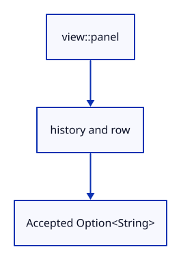

# 1.3.21 · Share the production dock layout

**Chapter 1 · Browser, Rust and the GPU · Section 1.3 · Shaders and the command dock** · [Contents](contents.md)

**Typing: 29–58 minutes.** [Estimate](typing-load.md).

Put the already connected helpers into one row and layout. The same command_dock source now draws both this lesson and the production viewer.

## Type

Continue from [Scroll through command names](03cl-wheel.md). [Save or recover your work](recovery.md).

### 1. `src/browser.rs`

Report that the shared production layout is connected.

<details>
<summary>Locate the existing block</summary>

```rust
    redraw.forget();
    report("Scrolling selects a command name.");
    Ok(())
```

</details>

Edit the existing block to match this code; keep unchanged lines:

```rust
--8<-- "journey/code/03c-layout-direct-01.rs"
```

### 2. `src/command_dock/mod.rs`

Combine the connected field, history and controls into row and draw.

<details>
<summary>Locate the existing block</summary>

```rust
        ui.ctx().request_repaint();
    }
}
```

</details>

After that block, type:

```rust
--8<-- "journey/code/03c-layout-direct-04.rs" skip=44
```

### 3. `src/panel.rs`

Remove imports now owned by the shared layout. Remove inline setup handled by command_dock::draw. Retain an accepted command for this layout. Call the same command_dock layout as production. Read the drawn top edge and answer accepted commands.

Edit these blocks from bottom to top. Keep the surrounding lines unchanged.

<details>
<summary>Locate this block</summary>

```rust
            )),
            ..Default::default()
        };
        let previous = self.model.completion_rect.take();
        self.controls = Some(Vec::new());
        let output = self.context.run_ui(input, |root| {
            let panel = view::panel(root, self.model.command_expanded, 0.0).show_inside(root, |ui| {
                view::prepare(ui);
                command_dock::history(ui, &self.model, &mut self.controls);
                ui.horizontal(|ui| {
                    ui.set_max_width((ui.available_width() - 26.0).max(80.0));
                    ui.label("Command:");
                    let id = egui::Id::new("command-input");
                    let keys = command_dock::keys(ui, &mut self.model, previous, id);
                    let response = view::field(ui, &mut self.model.command, placeholder("", &self.model.status, self.model.command_expanded), 0.0, self.model.command_open);
                    self.model.command_rect = Some(response.rect);
                    command_dock::record(&mut self.controls, "command/input", "Command", &response);
                    command_dock::refresh(ui, &mut self.model, &response, &self.commands, id, keys.deletes);
                    let mut line = None;
                    let complete = command_dock::browse(ui, &mut self.model, &mut self.controls, &self.commands, &response, &keys, id);
                    command_dock::finish(ui, &mut self.model, &response, &mut line, &self.commands, complete, &keys, true);
                    if let Some(line) = line { if line != "Escape" { self.commands.reply(&mut self.model, &line); } }
                    command_dock::collapse(ui, &mut self.model, &mut self.controls);
                });
            });
            self.top = panel.response.rect.top() - 4.0;
        });
        if let Some(previous) = self.output.as_mut() { previous.append(output); }
        else { self.output = Some(output); }
    }
```

</details>

Replace it with:

```rust
            )),
            ..Default::default()
        };
        self.controls = Some(Vec::new());
        let mut line = None;
        let output = self.context.run_ui(input, |root| {
            command_dock::draw(root, &mut self.model, &mut self.controls, &mut line, &self.commands, true);
        });
        if let Some(control) = self.controls.as_ref().and_then(|items| items.iter().find(|item| item.key == "command/resize")) {
            self.top = control.rect[1];
        }
        if let Some(line) = line { if line != "Escape" { self.commands.reply(&mut self.model, &line); } }
        if let Some(previous) = self.output.as_mut() { previous.append(output); }
        else { self.output = Some(output); }
    }
```

<details>
<summary>Locate this block</summary>

```rust
use crate::command_dock::{self, CommandLine, Commands as _, placeholder, theme, view};
use crate::renderer::Renderer;

struct Commands(&'static [&'static str]);
```

</details>

Replace it with:

```rust
use crate::command_dock::{self, CommandLine, Commands as _, theme};
use crate::renderer::Renderer;

struct Commands(&'static [&'static str]);
```

<details>
<summary>Complete updated block reference</summary>

```rust
use crate::command_dock::{self, CommandLine, Commands as _, theme};
use crate::renderer::Renderer;

struct Commands(&'static [&'static str]);

impl command_dock::Commands for Commands {
    fn canonical(&self, line: &str) -> String {
        let line = line.split_whitespace().collect::<Vec<_>>().join(" ");
        self.0
            .iter()
            .find(|name| name.eq_ignore_ascii_case(&line))
            .map_or(line.clone(), |name| (*name).into())
    }
    fn choosing_option(&self, _: &str) -> bool {
        false
    }
    fn accept(&self, line: &str) -> (String, bool) {
        (self.canonical(line), true)
    }
    fn completions(&self, line: &str) -> Vec<&'static str> {
        crate::command_vocabulary::ranked(self.0.as_ref(), line)
    }
    fn browse(&self, line: &str) -> Vec<&'static str> {
        self.completions(line)
    }
}

impl Commands {
    fn reply(&self, model: &mut CommandLine, line: &str) {
        let line = self.canonical(line);
        let message = if line.eq_ignore_ascii_case("Help") { self.0.join(" · ") }
            else { "Unknown command. Type Help.".into() };
        model.status = message;
        model.remember(format!("> {line}\n{}", model.status));
    }
}

pub struct Panel {
    commands: Commands,
    pointer_owned: bool,
    top: f32,
    controls: Option<Vec<command_dock::Control>>,
    context: egui::Context,
    painter: egui_wgpu::Renderer,
    model: CommandLine,
    events: Vec<egui::Event>,
    output: Option<egui::FullOutput>,
    screen: egui_wgpu::ScreenDescriptor,
}

impl Panel {
    pub fn new(renderer: &Renderer, format: wgpu::TextureFormat, commands: &'static [&'static str]) -> Self {
        let context = egui::Context::default();
        context.set_fonts(theme::fonts([
            include_bytes!("../assets/text/NotoSans-Regular.subset.ttf"),
            include_bytes!("../assets/text/NotoSansSymbols2-Regular.subset.ttf"),
            include_bytes!("../assets/text/NotoSansSymbols-Regular.subset.ttf"),
        ]));
        context.set_theme(egui::Theme::Light);
        context.set_visuals(theme::visuals());
        // One layout pass prevents a future text event from being replayed.
        context.options_mut(|options| options.max_passes = 1.try_into().unwrap());
        let painter = egui_wgpu::Renderer::new(&renderer.device, format, Default::default());
        Self { commands: Commands(commands), pointer_owned: false, top: f32::INFINITY, controls: None, context, painter, events: Vec::new(), output: None,
            screen: egui_wgpu::ScreenDescriptor { size_in_pixels: [640, 480], pixels_per_point: 1.0 }, model: CommandLine {
            command_expanded: true,
            history: ["Command history lives here.".into()].into(),
            ..Default::default()
        } }
    }

    pub fn command(&self) -> &str { &self.model.command }

    pub fn history(&self) -> &std::collections::VecDeque<String> { &self.model.history }

    pub fn key(&mut self, event: &web_sys::KeyboardEvent) -> bool {
        if event.is_composing() { return false; }
        let modifiers = egui::Modifiers {
            alt: event.alt_key(), ctrl: event.ctrl_key(), shift: event.shift_key(),
            mac_cmd: event.meta_key(), command: event.ctrl_key() || event.meta_key(),
        };
        let text = event.type_() == "keydown" && event.key().chars().count() == 1
            && !modifiers.command && !modifiers.alt;
        if text {
            if !self.context.egui_wants_keyboard_input() { self.model.focus_command = true; }
            self.context.memory_mut(|memory| memory.request_focus(egui::Id::new("command-input")));
            self.model.command_open = true;
        }
        if !self.context.egui_wants_keyboard_input() { return false; }
        if let Some(key) = egui::Key::from_name(&event.key()) {
            self.events.push(egui::Event::Key {
                key, physical_key: None, pressed: event.type_() == "keydown",
                repeat: event.repeat(), modifiers,
            });
        }
        if text { self.events.push(egui::Event::Text(event.key())); }
        event.prevent_default();
        true
    }

    pub fn pointer(&mut self, event: &web_sys::PointerEvent, canvas: &web_sys::HtmlCanvasElement) -> bool {
        let rect = canvas.get_bounding_client_rect();
        let pos = egui::pos2((event.client_x() as f64 - rect.left()) as f32, (event.client_y() as f64 - rect.top()) as f32);
        let over = pos.y >= self.top || self.model.completion_rect.is_some_and(|r| r.contains(pos));
        let owned = over || self.pointer_owned;
        if event.type_() == "pointerdown" {
            self.pointer_owned = over;
            if !over {
                self.model.command_open = false;
                self.model.focus_command = false;
                self.context.memory_mut(|memory| memory.surrender_focus(egui::Id::new("command-input")));
            }
        }
        self.events.push(egui::Event::PointerMoved(pos));
        if matches!(event.type_().as_str(), "pointercancel" | "lostpointercapture") {
            for button in [egui::PointerButton::Primary, egui::PointerButton::Middle, egui::PointerButton::Secondary] {
                self.events.push(egui::Event::PointerButton { pos, button, pressed: false, modifiers: Default::default() });
            }
            self.events.push(egui::Event::PointerGone);
        } else if matches!(event.type_().as_str(), "pointerdown" | "pointerup") {
            let button = match event.button() { 0 => egui::PointerButton::Primary, 1 => egui::PointerButton::Middle, _ => egui::PointerButton::Secondary };
            self.events.push(egui::Event::PointerButton { pos, button, pressed: event.type_() == "pointerdown", modifiers: Default::default() });
        }
        if matches!(event.type_().as_str(), "pointerup" | "pointercancel" | "lostpointercapture") { self.pointer_owned = false; }
        if owned { event.prevent_default(); }
        owned
    }

    pub fn wheel(&mut self, event: &web_sys::WheelEvent, canvas: &web_sys::HtmlCanvasElement) -> bool {
        let rect = canvas.get_bounding_client_rect();
        let pos = egui::pos2((event.client_x() as f64 - rect.left()) as f32, (event.client_y() as f64 - rect.top()) as f32);
        self.events.push(egui::Event::PointerMoved(pos));
        self.events.push(egui::Event::MouseWheel {
            unit: match event.delta_mode() { 1 => egui::MouseWheelUnit::Line, 2 => egui::MouseWheelUnit::Page, _ => egui::MouseWheelUnit::Point },
            phase: egui::TouchPhase::Move, delta: egui::vec2(-event.delta_x() as f32, -event.delta_y() as f32), modifiers: Default::default(),
        });
        let over = pos.y >= self.top || self.model.completion_rect.is_some_and(|r| r.contains(pos));
        if over { event.prevent_default(); }
        over
    }

    pub fn inspect(&self) -> String {
        serde_json::json!({"controls": self.controls, "command": self.model.command, "history": self.model.history,
            "pointer_owned": self.pointer_owned,
            "top": self.top, "focused": self.context.egui_wants_keyboard_input(),
            "completion_rect": self.model.completion_rect.map(|r| [r.min.x, r.min.y, r.max.x, r.max.y])}).to_string()
    }

    fn prepare(&mut self) {
        let size = self.screen.size_in_pixels;
        let input = egui::RawInput {
            focused: true,
            events: std::mem::take(&mut self.events),
            screen_rect: Some(egui::Rect::from_min_size(
                egui::Pos2::ZERO, egui::vec2(size[0] as f32, size[1] as f32) / self.screen.pixels_per_point,
            )),
            ..Default::default()
        };
        self.controls = Some(Vec::new());
        let mut line = None;
        let output = self.context.run_ui(input, |root| {
            command_dock::draw(root, &mut self.model, &mut self.controls, &mut line, &self.commands, true);
        });
        if let Some(control) = self.controls.as_ref().and_then(|items| items.iter().find(|item| item.key == "command/resize")) {
            self.top = control.rect[1];
        }
        if let Some(line) = line { if line != "Escape" { self.commands.reply(&mut self.model, &line); } }
        if let Some(previous) = self.output.as_mut() { previous.append(output); }
        else { self.output = Some(output); }
    }

    pub fn draw(&mut self, renderer: &Renderer, target: &wgpu::TextureView) {
        self.screen.size_in_pixels = [target.texture().width(), target.texture().height()];
        self.prepare();
        self.prepare();
        let Some(output) = self.output.take() else { return; };
        // The font atlas is a texture: upload its changed pixels before drawing the letters.
        for (id, delta) in &output.textures_delta.set {
            self.painter.update_texture(&renderer.device, &renderer.queue, *id, delta);
        }
        let jobs = self.context.tessellate(output.shapes, output.pixels_per_point);
        let mut encoder = renderer.device.create_command_encoder(&Default::default());
        let mut buffers = self.painter.update_buffers(
            &renderer.device, &renderer.queue, &mut encoder, &jobs, &self.screen,
        );
        let pass = encoder.begin_render_pass(&wgpu::RenderPassDescriptor {
            label: Some("command panel"),
            color_attachments: &[Some(wgpu::RenderPassColorAttachment {
                view: target, resolve_target: None, depth_slice: None,
                ops: wgpu::Operations { load: wgpu::LoadOp::Load, store: wgpu::StoreOp::Store },
            })],
            ..Default::default()
        });
        self.painter.render(&mut pass.forget_lifetime(), &jobs, &self.screen);
        buffers.push(encoder.finish());
        renderer.queue.submit(buffers);
        for id in output.textures_delta.free { self.painter.free_texture(&id); }
    }
}
```

</details>

<details>
<summary>Optional patch references</summary>

Use these original edit fragments when comparing a saved checkpoint. Apply the complete blocks above.

```text
--8<-- "journey/code/03c-layout-direct-05.rs"
```

```text
--8<-- "journey/code/03c-layout-direct-06.rs"
```

```text
--8<-- "journey/code/03c-layout-direct-07.rs"
```

```text
--8<-- "journey/code/03c-layout-direct-08.rs"
```

```text
--8<-- "journey/code/03c-layout-direct-09.rs"
```

</details>

## Run and check

In your project:

```sh
cd workspace/journey
cargo build --lib --locked --target wasm32-unknown-unknown -j1
CARGO_BUILD_JOBS=1 trunk serve --port 8780
```

Open `http://127.0.0.1:8780/`. Keep an existing Trunk server running; saving rebuilds it.

Type Help and press Enter. The shared dock clears the field and adds one answer.

### Recorded visual result

**Previous native render — current verification pending.**


*This recorded image predates a source or checker change. Rebuild this checkpoint before using it as current evidence; browser controls require separate acceptance.*

This reference image is shared with [1.3.1 · Give the GPU three corners](03-triangle.md). It does not demonstrate a new feature by itself.

<details>
<summary>Code explanation and diagram</summary>


Connect the existing row and history to one shared layout.



Does sharing the layout give it ownership of the scene?

No. It edits the model and returns an accepted command to its caller.

Study estimate, including typing and experiments: 0.75–1.25 hours.

</details>

<details>
<summary>Optional experiment</summary>

Submit Help, fold history, then expand it. The retained answer should return.

</details>

<details>
<summary>Check and save your work</summary>

Restore experimental edits, then run from `session_viewer`:

```sh
npm --prefix ../session_tests run course -- check 1.3.21
npm --prefix ../session_tests run course -- save 1.3.21
```

Source comparison leaves your project untouched. [Save and recovery instructions](recovery.md).

</details>

<details>
<summary>Viewer coverage and verification</summary>

This step connects one responsibility of the production command dock. Scene commands are added in the following lessons.


[Full validation scope](release.md).

To reproduce the scripted acceptance of the reference checkpoint, run from `session_viewer` with the [course bundle server](release.md#reproduce) running on port 8781:

```sh
npm --prefix ../session_tests run course -- capture 1.3.21
```

This uses the verified reference bundle; it does not check or change your typed project.

</details>
