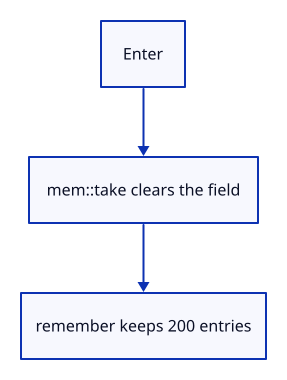

# 1.3.9 · Submit command text once

**Chapter 1 · Browser, Rust and the GPU · Section 1.3 · Shaders and the command dock** · [Contents](contents.md)

**Typing: 14–27 minutes.** [Estimate](typing-load.md).

Consume Enter before drawing the field. take_command moves a nonblank String out and leaves an empty String. remember retains at most 200 entries.

## Type

Continue from [Type directly into the command field](03ca-typing.md). [Save or recover your work](recovery.md).

### 1. `src/browser.rs`

Expose the actual retained history to browser inspection. Report that Enter submits text.

Edit these blocks from bottom to top. Keep the surrounding lines unchanged.

<details>
<summary>Locate this block</summary>

```rust
            if let Err(error) = input_canvas.set_attribute("data-command", panel.command()) {
                report(&format!("Cannot inspect text: {error:?}"));
            }
        }
    });
    for name in ["keydown", "keyup"] {
        window.add_event_listener_with_callback(name, redraw.as_ref().unchecked_ref())?;
    }
    redraw.forget();
    report("Typing goes directly into the command field.");
    Ok(())
}
```

</details>

Replace it with:

```rust
            if let Err(error) = input_canvas.set_attribute("data-command", panel.command()) {
                report(&format!("Cannot inspect text: {error:?}"));
            }
            if let Err(error) = input_canvas.set_attribute("data-history", &serde_json::to_string(panel.history()).unwrap()) {
                report(&format!("Cannot inspect history: {error:?}"));
            }
        }
    });
    for name in ["keydown", "keyup"] {
        window.add_event_listener_with_callback(name, redraw.as_ref().unchecked_ref())?;
    }
    redraw.forget();
    report("Enter submits the owned command text.");
    Ok(())
}
```

<details>
<summary>Complete updated block reference</summary>

```rust
use crate::renderer::Renderer;
use wasm_bindgen::{JsCast, JsValue};

pub fn report(message: &str) {
    if let Some(document) = web_sys::window().and_then(|window| window.document()) {
        if let Some(status) = document.get_element_by_id("status") {
            status.set_text_content(Some(message));
            if message.starts_with("Cannot") { let _ = status.remove_attribute("hidden"); }
        }
    }
}

pub async fn run() -> Result<(), JsValue> {
    let window = web_sys::window().ok_or("No browser window")?;
    let document = window.document().ok_or("No document")?;
    let canvas: web_sys::HtmlCanvasElement = document
        .get_element_by_id("canvas").ok_or("Missing canvas")?.dyn_into()?;
    let instance = wgpu::Instance::new(wgpu::InstanceDescriptor {
        backends: wgpu::Backends::BROWSER_WEBGPU,
        flags: Default::default(),
        memory_budget_thresholds: Default::default(),
        backend_options: Default::default(),
        display: None,
    });
    let surface = instance.create_surface(wgpu::SurfaceTarget::Canvas(canvas.clone()))
        .map_err(|error| JsValue::from_str(&error.to_string()))?;
    let adapter = instance.request_adapter(&wgpu::RequestAdapterOptions {
        compatible_surface: Some(&surface),
        ..Default::default()
    }).await.map_err(|error| JsValue::from_str(&error.to_string()))?;
    let (device, queue) = adapter.request_device(&wgpu::DeviceDescriptor::default())
        .await.map_err(|error| JsValue::from_str(&error.to_string()))?;
    device.on_uncaptured_error(std::sync::Arc::new(|error| report(&error.to_string())));
    let limit = device.limits().max_texture_dimension_2d;
    let width = (window.inner_width()?.as_f64().ok_or("No window width")? as u32).clamp(1, limit);
    let height = (window.inner_height()?.as_f64().ok_or("No window height")? as u32).clamp(1, limit);
    canvas.set_width(width);
    canvas.set_height(height);
    let mut config = surface.get_default_config(&adapter, width, height)
        .ok_or("No compatible surface format")?;
    config.view_formats = vec![config.format.add_srgb_suffix()];
    surface.configure(&device, &config);
    let renderer = Renderer::new(device, queue, config.format.add_srgb_suffix());
    let mut panel = crate::panel::Panel::new(&renderer, config.format.add_srgb_suffix());
    present(&surface, &renderer, &mut panel)?;
    let input_canvas = canvas.clone();
    let redraw = wasm_bindgen::closure::Closure::<dyn FnMut(web_sys::KeyboardEvent)>::new(move |event| {
        if panel.key(&event) {
            if let Err(error) = present(&surface, &renderer, &mut panel) {
                report(&format!("Cannot redraw: {error:?}"));
            }
            if let Err(error) = input_canvas.set_attribute("data-command", panel.command()) {
                report(&format!("Cannot inspect text: {error:?}"));
            }
            if let Err(error) = input_canvas.set_attribute("data-history", &serde_json::to_string(panel.history()).unwrap()) {
                report(&format!("Cannot inspect history: {error:?}"));
            }
        }
    });
    for name in ["keydown", "keyup"] {
        window.add_event_listener_with_callback(name, redraw.as_ref().unchecked_ref())?;
    }
    redraw.forget();
    report("Enter submits the owned command text.");
    Ok(())
}

fn present(surface: &wgpu::Surface<'_>, renderer: &Renderer, panel: &mut crate::panel::Panel) -> Result<(), JsValue> {
    let frame = match surface.get_current_texture() {
        wgpu::CurrentSurfaceTexture::Success(frame)
        | wgpu::CurrentSurfaceTexture::Suboptimal(frame) => frame,
        other => return Err(JsValue::from_str(&format!("Surface unavailable: {other:?}"))),
    };
    let view = frame.texture.create_view(&wgpu::TextureViewDescriptor {
        format: Some(frame.texture.format().add_srgb_suffix()),
        ..Default::default()
    });
    renderer.draw(&view);
    panel.draw(renderer, &view);
    frame.present();
    Ok(())
}
```

</details>

<details>
<summary>Optional patch references</summary>

Use these original edit fragments when comparing a saved checkpoint. Apply the complete blocks above.

```text
--8<-- "journey/code/03cb-submit-direct-01.rs"
```

```text
--8<-- "journey/code/03cb-submit-direct-02.rs"
```

</details>

### 2. `src/command_dock/mod.rs`

Take nonblank owned text and retain at most 200 history entries.

<details>
<summary>Locate the existing block</summary>

```rust
        );
    }
}
```

</details>

After that block, type:

```rust
--8<-- "journey/code/03cb-submit-direct-03.rs" skip=19
```

### 3. `src/panel.rs`

Expose the model’s retained history by reference. Recognize Enter as an editing key. Queue the corresponding Enter or Backspace event. Consume Enter once; retain the submitted line and answer.

Edit these blocks from bottom to top. Keep the surrounding lines unchanged.

<details>
<summary>Locate this block</summary>

```rust
        let output = self.context.run_ui(input, |root| {
            view::panel(root, self.model.command_expanded, 0.0).show_inside(root, |ui| {
                view::prepare(ui);
                command_dock::history(ui, &self.model, &mut None);
                ui.horizontal(|ui| {
                    ui.set_max_width((ui.available_width() - 26.0).max(80.0));
```

</details>

Replace it with:

```rust
        let output = self.context.run_ui(input, |root| {
            view::panel(root, self.model.command_expanded, 0.0).show_inside(root, |ui| {
                view::prepare(ui);
                if ui.input_mut(|input| input.consume_key(egui::Modifiers::NONE, egui::Key::Enter)) {
                    if let Some(line) = self.model.take_command() {
                        self.model.status = "Command submitted.".into();
                        self.model.remember(format!("> {line}\n{}", self.model.status));
                    }
                }
                command_dock::history(ui, &self.model, &mut None);
                ui.horizontal(|ui| {
                    ui.set_max_width((ui.available_width() - 26.0).max(80.0));
```

<details>
<summary>Locate this block</summary>

```rust

    pub fn command(&self) -> &str { &self.model.command }

    pub fn key(&mut self, event: &web_sys::KeyboardEvent) -> bool {
        if event.ctrl_key() || event.alt_key() || event.meta_key() { return false; }
        let key = event.key();
        let down = event.type_() == "keydown";
        let input = if key == "Backspace" {
            egui::Event::Key {
                key: egui::Key::Backspace, physical_key: None,
                pressed: down, repeat: event.repeat(), modifiers: Default::default(),
            }
        } else if down && key.chars().count() == 1 {
```

</details>

Replace it with:

```rust

    pub fn command(&self) -> &str { &self.model.command }

    pub fn history(&self) -> &std::collections::VecDeque<String> { &self.model.history }

    pub fn key(&mut self, event: &web_sys::KeyboardEvent) -> bool {
        if event.ctrl_key() || event.alt_key() || event.meta_key() { return false; }
        let key = event.key();
        let down = event.type_() == "keydown";
        let input = if key == "Backspace" || key == "Enter" {
            egui::Event::Key {
                key: if key == "Enter" { egui::Key::Enter } else { egui::Key::Backspace }, physical_key: None,
                pressed: down, repeat: event.repeat(), modifiers: Default::default(),
            }
        } else if down && key.chars().count() == 1 {
```

<details>
<summary>Complete updated block reference</summary>

```rust
use crate::command_dock::{self, CommandLine, placeholder, theme, view};
use crate::renderer::Renderer;

pub struct Panel {
    context: egui::Context,
    painter: egui_wgpu::Renderer,
    model: CommandLine,
    events: Vec<egui::Event>,
}

impl Panel {
    pub fn new(renderer: &Renderer, format: wgpu::TextureFormat) -> Self {
        let context = egui::Context::default();
        context.set_fonts(theme::fonts([
            include_bytes!("../assets/text/NotoSans-Regular.subset.ttf"),
            include_bytes!("../assets/text/NotoSansSymbols2-Regular.subset.ttf"),
            include_bytes!("../assets/text/NotoSansSymbols-Regular.subset.ttf"),
        ]));
        context.set_theme(egui::Theme::Light);
        context.set_visuals(theme::visuals());
        // One layout pass prevents a future text event from being replayed.
        context.options_mut(|options| options.max_passes = 1.try_into().unwrap());
        let painter = egui_wgpu::Renderer::new(&renderer.device, format, Default::default());
        Self { context, painter, events: Vec::new(), model: CommandLine {
            command_expanded: true,
            history: ["Command history lives here.".into()].into(),
            ..Default::default()
        } }
    }

    pub fn command(&self) -> &str { &self.model.command }

    pub fn history(&self) -> &std::collections::VecDeque<String> { &self.model.history }

    pub fn key(&mut self, event: &web_sys::KeyboardEvent) -> bool {
        if event.ctrl_key() || event.alt_key() || event.meta_key() { return false; }
        let key = event.key();
        let down = event.type_() == "keydown";
        let input = if key == "Backspace" || key == "Enter" {
            egui::Event::Key {
                key: if key == "Enter" { egui::Key::Enter } else { egui::Key::Backspace }, physical_key: None,
                pressed: down, repeat: event.repeat(), modifiers: Default::default(),
            }
        } else if down && key.chars().count() == 1 {
            egui::Event::Text(key)
        } else { return false; };
        self.context.memory_mut(|memory| memory.request_focus(egui::Id::new("command-input")));
        self.model.command_open = true;
        self.events.push(input);
        event.prevent_default();
        true
    }

    pub fn draw(&mut self, renderer: &Renderer, target: &wgpu::TextureView) {
        let size = [target.texture().width(), target.texture().height()];
        let screen = egui_wgpu::ScreenDescriptor { size_in_pixels: size, pixels_per_point: 1.0 };
        let input = egui::RawInput {
            focused: true,
            events: std::mem::take(&mut self.events),
            screen_rect: Some(egui::Rect::from_min_size(
                egui::Pos2::ZERO, egui::vec2(size[0] as f32, size[1] as f32),
            )),
            ..Default::default()
        };
        let output = self.context.run_ui(input, |root| {
            view::panel(root, self.model.command_expanded, 0.0).show_inside(root, |ui| {
                view::prepare(ui);
                if ui.input_mut(|input| input.consume_key(egui::Modifiers::NONE, egui::Key::Enter)) {
                    if let Some(line) = self.model.take_command() {
                        self.model.status = "Command submitted.".into();
                        self.model.remember(format!("> {line}\n{}", self.model.status));
                    }
                }
                command_dock::history(ui, &self.model, &mut None);
                ui.horizontal(|ui| {
                    ui.set_max_width((ui.available_width() - 26.0).max(80.0));
                    ui.label("Command:");
                    view::field(ui, &mut self.model.command, placeholder("", &self.model.status, self.model.command_expanded), 0.0, self.model.command_open);
                    let _ = ui.button(if self.model.command_expanded { "–" } else { "+" }).on_hover_text("Collapse or expand history");
                });
            });
        });
        // The font atlas is a texture: upload its changed pixels before drawing the letters.
        for (id, delta) in &output.textures_delta.set {
            self.painter.update_texture(&renderer.device, &renderer.queue, *id, delta);
        }
        let jobs = self.context.tessellate(output.shapes, output.pixels_per_point);
        let mut encoder = renderer.device.create_command_encoder(&Default::default());
        let mut buffers = self.painter.update_buffers(
            &renderer.device, &renderer.queue, &mut encoder, &jobs, &screen,
        );
        let pass = encoder.begin_render_pass(&wgpu::RenderPassDescriptor {
            label: Some("command panel"),
            color_attachments: &[Some(wgpu::RenderPassColorAttachment {
                view: target, resolve_target: None, depth_slice: None,
                ops: wgpu::Operations { load: wgpu::LoadOp::Load, store: wgpu::StoreOp::Store },
            })],
            ..Default::default()
        });
        self.painter.render(&mut pass.forget_lifetime(), &jobs, &screen);
        buffers.push(encoder.finish());
        renderer.queue.submit(buffers);
        for id in output.textures_delta.free { self.painter.free_texture(&id); }
    }
}
```

</details>

<details>
<summary>Optional patch references</summary>

Use these original edit fragments when comparing a saved checkpoint. Apply the complete blocks above.

```text
--8<-- "journey/code/03cb-submit-direct-04.rs"
```

```text
--8<-- "journey/code/03cb-submit-direct-05.rs"
```

```text
--8<-- "journey/code/03cb-submit-direct-06.rs"
```

```text
--8<-- "journey/code/03cb-submit-direct-07.rs"
```

</details>

## Run and check

In your project:

```sh
cd workspace/journey
cargo build --lib --locked --target wasm32-unknown-unknown -j1
CARGO_BUILD_JOBS=1 trunk serve --port 8780
```

Open `http://127.0.0.1:8780/`. Keep an existing Trunk server running; saving rebuilds it.

Type Help and press Enter. One entry appears and the field clears. Empty Enter adds nothing.

### Recorded visual result

**Previous native render — current verification pending.**

This checkpoint was rendered independently and has the same native comparison frame as [Type directly into the command field](03ca-typing.md). Use its state checks and browser exercise to assess the changed behavior.


*This recorded image predates a source or checker change. Rebuild this checkpoint before using it as current evidence; browser controls require separate acceptance.*

This reference image is shared with [1.3.1 · Give the GPU three corners](03-triangle.md). It does not demonstrate a new feature by itself.

<details>
<summary>Code explanation and diagram</summary>


Clear submitted text and retain one history entry.



Why take rather than clone the String?

Submission transfers its ownership once and clears the source.

Study estimate, including typing and experiments: 0.5–0.75 hours.

</details>

<details>
<summary>Optional experiment</summary>

Submit Help twice. Two entries should appear; pressing Enter with an empty field should add none.

</details>

<details>
<summary>Check and save your work</summary>

Restore experimental edits, then run from `session_viewer`:

```sh
npm --prefix ../session_tests run course -- check 1.3.9
npm --prefix ../session_tests run course -- save 1.3.9
```

Source comparison leaves your project untouched. [Save and recovery instructions](recovery.md).

</details>

<details>
<summary>Viewer coverage and verification</summary>

This step connects one responsibility of the production command dock. Scene commands are added in the following lessons.


[Full validation scope](release.md).

To reproduce the scripted acceptance of the reference checkpoint, run from `session_viewer` with the [course bundle server](release.md#reproduce) running on port 8781:

```sh
npm --prefix ../session_tests run course -- capture 1.3.9
```

This uses the verified reference bundle; it does not check or change your typed project.

</details>
