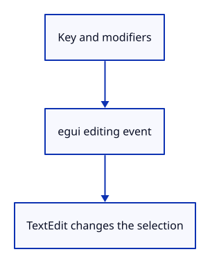

# 1.3.10 · Edit the command text

**Chapter 1 · Browser, Rust and the GPU · Section 1.3 · Shaders and the command dock** · [Contents](contents.md)

**Typing: 14–28 minutes.** [Estimate](typing-load.md).

Translate modifiers and editing keys into egui events. Ctrl+A selects text; Backspace deletes it; Escape clears and closes the field.

## Type

Continue from [Submit command text once](03cb-submit.md). [Save or recover your work](recovery.md).

### 1. `src/browser.rs`

Report that editing stays in the field.

<details>
<summary>Locate the existing block</summary>

```rust
    redraw.forget();
    report("Enter submits the owned command text.");
    Ok(())
```

</details>

Edit the existing block to match this code; keep unchanged lines:

```rust
--8<-- "journey/code/03cc-edit-direct-01.rs"
```

### 2. `src/command_dock/mod.rs`

Separate the model helpers with a blank line.

<details>
<summary>Locate the existing block</summary>

```rust
        self.history.push_back(line);
    }
}
```

</details>

After that block, type:

```rust
--8<-- "journey/code/03cc-edit-direct-02.rs" skip=46
```

### 3. `src/panel.rs`

Translate modifiers and named editing keys; ignore composing text. Consume Escape, clear text and surrender field focus.

Edit these blocks from bottom to top. Keep the surrounding lines unchanged.

<details>
<summary>Locate this block</summary>

```rust
                        self.model.remember(format!("> {line}\n{}", self.model.status));
                    }
                }
                command_dock::history(ui, &self.model, &mut None);
                ui.horizontal(|ui| {
                    ui.set_max_width((ui.available_width() - 26.0).max(80.0));
```

</details>

Replace it with:

```rust
                        self.model.remember(format!("> {line}\n{}", self.model.status));
                    }
                }
                if self.model.command_open && ui.input_mut(|input| input.consume_key(egui::Modifiers::NONE, egui::Key::Escape)) {
                    self.model.command.clear();
                    self.model.command_open = false;
                    ui.memory_mut(|memory| memory.surrender_focus(egui::Id::new("command-input")));
                }
                command_dock::history(ui, &self.model, &mut None);
                ui.horizontal(|ui| {
                    ui.set_max_width((ui.available_width() - 26.0).max(80.0));
```

<details>
<summary>Locate this block</summary>

```rust
    pub fn history(&self) -> &std::collections::VecDeque<String> { &self.model.history }

    pub fn key(&mut self, event: &web_sys::KeyboardEvent) -> bool {
        if event.ctrl_key() || event.alt_key() || event.meta_key() { return false; }
        let key = event.key();
        let down = event.type_() == "keydown";
        let input = if key == "Backspace" || key == "Enter" {
            egui::Event::Key {
                key: if key == "Enter" { egui::Key::Enter } else { egui::Key::Backspace }, physical_key: None,
                pressed: down, repeat: event.repeat(), modifiers: Default::default(),
            }
        } else if down && key.chars().count() == 1 {
            egui::Event::Text(key)
        } else { return false; };
        self.context.memory_mut(|memory| memory.request_focus(egui::Id::new("command-input")));
        self.model.command_open = true;
        self.events.push(input);
        event.prevent_default();
        true
    }
```

</details>

Replace it with:

```rust
    pub fn history(&self) -> &std::collections::VecDeque<String> { &self.model.history }

    pub fn key(&mut self, event: &web_sys::KeyboardEvent) -> bool {
        if event.is_composing() { return false; }
        let modifiers = egui::Modifiers {
            alt: event.alt_key(), ctrl: event.ctrl_key(), shift: event.shift_key(),
            mac_cmd: event.meta_key(), command: event.ctrl_key() || event.meta_key(),
        };
        let text = event.type_() == "keydown" && event.key().chars().count() == 1
            && !modifiers.command && !modifiers.alt;
        if text {
            self.context.memory_mut(|memory| memory.request_focus(egui::Id::new("command-input")));
            self.model.command_open = true;
        }
        if !self.context.egui_wants_keyboard_input() { return false; }
        if let Some(key) = egui::Key::from_name(&event.key()) {
            self.events.push(egui::Event::Key {
                key, physical_key: None, pressed: event.type_() == "keydown",
                repeat: event.repeat(), modifiers,
            });
        }
        if text { self.events.push(egui::Event::Text(event.key())); }
        event.prevent_default();
        true
    }
```

<details>
<summary>Complete updated block reference</summary>

```rust
use crate::command_dock::{self, CommandLine, placeholder, theme, view};
use crate::renderer::Renderer;

pub struct Panel {
    context: egui::Context,
    painter: egui_wgpu::Renderer,
    model: CommandLine,
    events: Vec<egui::Event>,
}

impl Panel {
    pub fn new(renderer: &Renderer, format: wgpu::TextureFormat) -> Self {
        let context = egui::Context::default();
        context.set_fonts(theme::fonts([
            include_bytes!("../assets/text/NotoSans-Regular.subset.ttf"),
            include_bytes!("../assets/text/NotoSansSymbols2-Regular.subset.ttf"),
            include_bytes!("../assets/text/NotoSansSymbols-Regular.subset.ttf"),
        ]));
        context.set_theme(egui::Theme::Light);
        context.set_visuals(theme::visuals());
        // One layout pass prevents a future text event from being replayed.
        context.options_mut(|options| options.max_passes = 1.try_into().unwrap());
        let painter = egui_wgpu::Renderer::new(&renderer.device, format, Default::default());
        Self { context, painter, events: Vec::new(), model: CommandLine {
            command_expanded: true,
            history: ["Command history lives here.".into()].into(),
            ..Default::default()
        } }
    }

    pub fn command(&self) -> &str { &self.model.command }

    pub fn history(&self) -> &std::collections::VecDeque<String> { &self.model.history }

    pub fn key(&mut self, event: &web_sys::KeyboardEvent) -> bool {
        if event.is_composing() { return false; }
        let modifiers = egui::Modifiers {
            alt: event.alt_key(), ctrl: event.ctrl_key(), shift: event.shift_key(),
            mac_cmd: event.meta_key(), command: event.ctrl_key() || event.meta_key(),
        };
        let text = event.type_() == "keydown" && event.key().chars().count() == 1
            && !modifiers.command && !modifiers.alt;
        if text {
            self.context.memory_mut(|memory| memory.request_focus(egui::Id::new("command-input")));
            self.model.command_open = true;
        }
        if !self.context.egui_wants_keyboard_input() { return false; }
        if let Some(key) = egui::Key::from_name(&event.key()) {
            self.events.push(egui::Event::Key {
                key, physical_key: None, pressed: event.type_() == "keydown",
                repeat: event.repeat(), modifiers,
            });
        }
        if text { self.events.push(egui::Event::Text(event.key())); }
        event.prevent_default();
        true
    }

    pub fn draw(&mut self, renderer: &Renderer, target: &wgpu::TextureView) {
        let size = [target.texture().width(), target.texture().height()];
        let screen = egui_wgpu::ScreenDescriptor { size_in_pixels: size, pixels_per_point: 1.0 };
        let input = egui::RawInput {
            focused: true,
            events: std::mem::take(&mut self.events),
            screen_rect: Some(egui::Rect::from_min_size(
                egui::Pos2::ZERO, egui::vec2(size[0] as f32, size[1] as f32),
            )),
            ..Default::default()
        };
        let output = self.context.run_ui(input, |root| {
            view::panel(root, self.model.command_expanded, 0.0).show_inside(root, |ui| {
                view::prepare(ui);
                if ui.input_mut(|input| input.consume_key(egui::Modifiers::NONE, egui::Key::Enter)) {
                    if let Some(line) = self.model.take_command() {
                        self.model.status = "Command submitted.".into();
                        self.model.remember(format!("> {line}\n{}", self.model.status));
                    }
                }
                if self.model.command_open && ui.input_mut(|input| input.consume_key(egui::Modifiers::NONE, egui::Key::Escape)) {
                    self.model.command.clear();
                    self.model.command_open = false;
                    ui.memory_mut(|memory| memory.surrender_focus(egui::Id::new("command-input")));
                }
                command_dock::history(ui, &self.model, &mut None);
                ui.horizontal(|ui| {
                    ui.set_max_width((ui.available_width() - 26.0).max(80.0));
                    ui.label("Command:");
                    view::field(ui, &mut self.model.command, placeholder("", &self.model.status, self.model.command_expanded), 0.0, self.model.command_open);
                    let _ = ui.button(if self.model.command_expanded { "–" } else { "+" }).on_hover_text("Collapse or expand history");
                });
            });
        });
        // The font atlas is a texture: upload its changed pixels before drawing the letters.
        for (id, delta) in &output.textures_delta.set {
            self.painter.update_texture(&renderer.device, &renderer.queue, *id, delta);
        }
        let jobs = self.context.tessellate(output.shapes, output.pixels_per_point);
        let mut encoder = renderer.device.create_command_encoder(&Default::default());
        let mut buffers = self.painter.update_buffers(
            &renderer.device, &renderer.queue, &mut encoder, &jobs, &screen,
        );
        let pass = encoder.begin_render_pass(&wgpu::RenderPassDescriptor {
            label: Some("command panel"),
            color_attachments: &[Some(wgpu::RenderPassColorAttachment {
                view: target, resolve_target: None, depth_slice: None,
                ops: wgpu::Operations { load: wgpu::LoadOp::Load, store: wgpu::StoreOp::Store },
            })],
            ..Default::default()
        });
        self.painter.render(&mut pass.forget_lifetime(), &jobs, &screen);
        buffers.push(encoder.finish());
        renderer.queue.submit(buffers);
        for id in output.textures_delta.free { self.painter.free_texture(&id); }
    }
}
```

</details>

<details>
<summary>Optional patch references</summary>

Use these original edit fragments when comparing a saved checkpoint. Apply the complete blocks above.

```text
--8<-- "journey/code/03cc-edit-direct-03.rs"
```

```text
--8<-- "journey/code/03cc-edit-direct-04.rs"
```

</details>

## Run and check

In your project:

```sh
cd workspace/journey
cargo build --lib --locked --target wasm32-unknown-unknown -j1
CARGO_BUILD_JOBS=1 trunk serve --port 8780
```

Open `http://127.0.0.1:8780/`. Keep an existing Trunk server running; saving rebuilds it.

Type abc, press Ctrl+A, type x, then Escape. The field clears.

### Recorded visual result

**Previous native render — current verification pending.**


*This recorded image predates a source or checker change. Rebuild this checkpoint before using it as current evidence; browser controls require separate acceptance.*

This reference image is shared with [1.3.1 · Give the GPU three corners](03-triangle.md). It does not demonstrate a new feature by itself.

<details>
<summary>Code explanation and diagram</summary>


Keep text selection, deletion and Escape in the field.



Why skip text when Ctrl or Alt is held?

Those keys modify an editing action rather than insert ordinary text.

Study estimate, including typing and experiments: 0.5–0.75 hours.

</details>

<details>
<summary>Optional experiment</summary>

Type abc, press Backspace once, then Enter. History should contain ab. Escape should clear any unfinished text.

</details>

<details>
<summary>Check and save your work</summary>

Restore experimental edits, then run from `session_viewer`:

```sh
npm --prefix ../session_tests run course -- check 1.3.10
npm --prefix ../session_tests run course -- save 1.3.10
```

Source comparison leaves your project untouched. [Save and recovery instructions](recovery.md).

</details>

<details>
<summary>Viewer coverage and verification</summary>

This step connects one responsibility of the production command dock. Scene commands are added in the following lessons.


[Full validation scope](release.md).

To reproduce the scripted acceptance of the reference checkpoint, run from `session_viewer` with the [course bundle server](release.md#reproduce) running on port 8781:

```sh
npm --prefix ../session_tests run course -- capture 1.3.10
```

This uses the verified reference bundle; it does not check or change your typed project.

</details>
