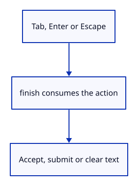

# 1.3.13 · Accept or cancel a completion

**Chapter 1 · Browser, Rust and the GPU · Section 1.3 · Shaders and the command dock** · [Contents](contents.md)

**Typing: 30–60 minutes.** [Estimate](typing-load.md).

Read Enter and Tab before the field. finish accepts a completion, submits a nonblank command, or cancels with Escape.

## Type

Continue from [Complete a command name](03ce-complete.md). [Save or recover your work](recovery.md).

### 1. `src/command_dock/mod.rs`

Retain the editing-key results for this frame. Accept completion, submit Enter or cancel Escape once.

Edit these blocks from bottom to top. Keep the surrounding lines unchanged.

<details>
<summary>Locate this block</summary>

```rust
        model.completion_prefix.clone_from(&model.command);
    }
}
```

</details>

Replace it with:

```rust
        model.completion_prefix.clone_from(&model.command);
    }
}

pub(crate) fn finish(
    ui: &egui::Ui,
    model: &mut CommandLine,
    response: &egui::Response,
    command: &mut Option<String>,
    commands: &impl Commands,
    complete: Option<&str>,
    keys: &Keys,
    escape_allowed: bool,
) -> bool {
    if let Some(name) = complete {
        let (text, run) = commands.accept(name);
        if run && !keys.tab {
            *command = Some(text);
            model.command.clear();
        } else {
            model.command = if run { format!("{text} ") } else { text };
        }
        model.completion_visible = false;
        model.inline_suffix = false;
        model.focus_command = true;
    }
    if keys.enter && (!model.command.trim().is_empty() || !model.drawing_prompt.is_empty()) {
        let line = model
            .take_command()
            .unwrap_or_else(|| std::mem::take(&mut model.command));
        let (text, run) = commands.accept(&line);
        // a verb waiting for one of many options opens their list
        let waits = !run && commands.choosing_option(&text);
        if run {
            *command = Some(text);
        } else {
            model.completion_prefix.clone_from(&text);
            model.completion = 0;
            model.command = text;
        }
        model.completion_visible = waits;
        model.inline_suffix = false;
        model.focus_command = true;
    }
    let focused = model.command_open || response.has_focus() || response.lost_focus();
    if focused && ui.input(|input| input.key_pressed(egui::Key::Escape)) && escape_allowed {
        model.command.clear();
        model.completion_visible = false;
        model.inline_suffix = false;
        model.command_open = false;
        model.focus_command = false;
        response.surrender_focus();
        *command = Some("Escape".into());
        return true;
    }
    false
}
```

<details>
<summary>Locate this block</summary>

```rust
    }
}

pub(crate) fn refresh(
    ui: &egui::Ui,
    model: &mut CommandLine,
```

</details>

Replace it with:

```rust
    }
}

#[derive(Default)]
pub(crate) struct Keys {
    pub(crate) browse: isize,
    pub(crate) enter: bool,
    pub(crate) tab: bool,
    pub(crate) deletes: bool,
}

pub(crate) fn refresh(
    ui: &egui::Ui,
    model: &mut CommandLine,
```

<details>
<summary>Complete updated block reference</summary>

```rust
use std::collections::VecDeque;

pub(crate) mod theme;
pub(crate) mod view;

/// The command vocabulary supplied by the application using the dock.
pub trait Commands {
    fn canonical(&self, line: &str) -> String;
    fn choosing_option(&self, line: &str) -> bool;
    fn accept(&self, line: &str) -> (String, bool);
    fn completions(&self, line: &str) -> Vec<&'static str>;
    fn browse(&self, line: &str) -> Vec<&'static str>;
}

/// What the command line shows and remembers between frames.
#[derive(Default)]
pub struct CommandLine {
    pub(crate) command_open: bool,                  // command line shown
    pub(crate) command: String,                     // text in the command field
    pub(crate) drawing_prompt: String,              // prompt while drawing
    pub(crate) focus_command: bool,                 // give the field focus next frame
    pub(crate) status: String,                      // status line text
    pub(crate) history: VecDeque<String>,           // past commands and answers
    pub(crate) command_expanded: bool,              // history shown above the field
    pub(crate) completion: usize,                   // highlighted completion index
    pub(crate) completion_prefix: String,           // text the completions match
    pub(crate) inline_suffix: bool,                 // completion suffix shown in the field
    pub(crate) completion_visible: bool,            // completion list shown
    pub(crate) completion_rect: Option<egui::Rect>, // where the list is, for taps
    pub(crate) command_rect: Option<egui::Rect>,    // where the field is, for taps
    pub(crate) agent_edit: Option<bool>,            // phone keyboard set the text, true on delete
    pub(crate) options: Vec<(String, String)>,      // the running command's buttons: label, line it runs
    pub(crate) options_rect: Option<egui::Rect>,    // where those buttons are, for taps
}

/// One clickable control and where it was drawn, for browser tests.
#[derive(serde::Serialize)]
pub struct Control {
    pub(crate) key: String,    // what it does
    pub(crate) label: String,  // text shown
    pub(crate) rect: [f32; 4], // left, top, right, bottom
}

/// Remember one control's rectangle, when inspecting.
pub(crate) fn record(
    controls: &mut Option<Vec<Control>>,
    key: &str,
    label: &str,
    response: &egui::Response,
) {
    let Some(controls) = controls.as_mut() else {
        return;
    };
    let r = response.rect;
    controls.push(Control {
        key: key.to_string(),
        label: label.to_string(),
        rect: [r.min.x, r.min.y, r.max.x, r.max.y],
    });
}

/// Put the caret at the end of the field.
pub(crate) fn command_cursor_end(context: &egui::Context, id: egui::Id, command: &str) {
    let end = command.chars().count();
    command_cursor_select(context, id, end, end);
}

/// The characters of `name` that spell `typed`, spaces aside: `orient3p` is `Orient 3 P`.
pub(crate) fn spelled(name: &str, typed: &str) -> usize {
    let typed = typed.chars().filter(|c| !c.is_whitespace()).count();
    let (mut prefix, mut letters) = (0, 0);

    for c in name.chars() {
        if letters == typed {
            break;
        }

        prefix += 1;
        letters += usize::from(!c.is_whitespace());
    }

    prefix
}

/// The grey text of the empty field: the prompt, else the last answer when the history is folded away.
pub(crate) fn placeholder<'a>(prompt: &'a str, status: &'a str, expanded: bool) -> &'a str {
    if !prompt.is_empty() {
        return prompt;
    }

    if !expanded && !status.is_empty() {
        return status;
    }

    "Type a command"
}

/// Select `start..end` in the field.
pub(crate) fn command_cursor_select(
    context: &egui::Context,
    id: egui::Id,
    start: usize,
    end: usize,
) {
    if let Some(mut state) = egui::TextEdit::load_state(context, id) {
        state
            .cursor
            .set_char_range(Some(egui::text::CCursorRange::two(
                egui::text::CCursor::new(start),
                egui::text::CCursor::new(end),
            )));
        egui::TextEdit::store_state(context, id, state);
    }
}

/// Draw retained history above the field.
pub(crate) fn history(ui: &mut egui::Ui, model: &CommandLine, controls: &mut Option<Vec<Control>>) {
    if model.command_expanded {
        egui::ScrollArea::vertical()
            .id_salt("command-history")
            .auto_shrink([false, false])
            .stick_to_bottom(true)
            .min_scrolled_height(0.0)
            .max_height((ui.available_height() - 38.0).max(0.0))
            .show(ui, |ui| {
                ui.set_max_width(ui.available_width());
                for text in &model.history {
                    ui.add(egui::Label::new(text).wrap());
                }
                if !model.status.is_empty()
                    && !model
                        .history
                        .back()
                        .is_some_and(|text| text.ends_with(&model.status))
                {
                    ui.label(&model.status);
                }
                if !model.drawing_prompt.is_empty() {
                    let response = ui.add(egui::Label::new(&model.drawing_prompt).wrap());
                    record(controls, "command/hint", &model.drawing_prompt, &response);
                }
            });
        // divider between history and the field
        let (rect, _) =
            ui.allocate_exact_size(egui::vec2(ui.available_width(), 1.0), egui::Sense::hover());
        ui.painter().hline(
            ui.max_rect().x_range().expand(6.0),
            rect.center().y,
            egui::Stroke::new(1.0_f32, egui::Color32::from_gray(210)),
        );
    }
}

impl CommandLine {
    pub(crate) fn take_command(&mut self) -> Option<String> {
        if self.command.trim().is_empty() {
            return None;
        }
        Some(std::mem::take(&mut self.command))
    }

    pub(crate) fn remember(&mut self, line: String) {
        if self.history.len() == 200 {
            self.history.pop_front();
        }
        self.history.push_back(line);
    }
}

#[derive(Default)]
pub(crate) struct Keys {
    pub(crate) browse: isize,
    pub(crate) enter: bool,
    pub(crate) tab: bool,
    pub(crate) deletes: bool,
}

pub(crate) fn refresh(
    ui: &egui::Ui,
    model: &mut CommandLine,
    response: &egui::Response,
    commands: &impl Commands,
    id: egui::Id,
    deletes: bool,
) {
    if response.gained_focus() {
        model.command_open = true;
    }
    let agent_edit = model.agent_edit.take();
    if (response.changed() || agent_edit.is_some()) && model.command.starts_with(':') {
        model.command.remove(0);
    }
    if response.changed() || agent_edit.is_some() {
        model.completion = 0;
        model.completion_visible = !model.command.is_empty();
        model.completion_prefix.clone_from(&model.command);
        model.inline_suffix = false;
        let at_end = egui::TextEdit::load_state(ui.ctx(), id)
            .and_then(|state| state.cursor.char_range())
            .is_some_and(|range| {
                range.is_empty() && range.primary.index == model.command.chars().count()
            });
        if !deletes
            && model.options.is_empty()
            && agent_edit != Some(true)
            && at_end
            && !model.command.is_empty()
            && !model.command.ends_with(' ')
            && let Some(name) = commands.completions(&model.command).first()
        {
            let prefix = spelled(name, &commands.canonical(&model.command));
            if name.chars().count() > prefix {
                model.command = (*name).into();
                command_cursor_select(ui.ctx(), id, prefix, model.command.chars().count());
                model.inline_suffix = true;
                ui.ctx().request_repaint();
            }
        }
    } else if !model.inline_suffix {
        model.completion_prefix.clone_from(&model.command);
    }
}

pub(crate) fn finish(
    ui: &egui::Ui,
    model: &mut CommandLine,
    response: &egui::Response,
    command: &mut Option<String>,
    commands: &impl Commands,
    complete: Option<&str>,
    keys: &Keys,
    escape_allowed: bool,
) -> bool {
    if let Some(name) = complete {
        let (text, run) = commands.accept(name);
        if run && !keys.tab {
            *command = Some(text);
            model.command.clear();
        } else {
            model.command = if run { format!("{text} ") } else { text };
        }
        model.completion_visible = false;
        model.inline_suffix = false;
        model.focus_command = true;
    }
    if keys.enter && (!model.command.trim().is_empty() || !model.drawing_prompt.is_empty()) {
        let line = model
            .take_command()
            .unwrap_or_else(|| std::mem::take(&mut model.command));
        let (text, run) = commands.accept(&line);
        // a verb waiting for one of many options opens their list
        let waits = !run && commands.choosing_option(&text);
        if run {
            *command = Some(text);
        } else {
            model.completion_prefix.clone_from(&text);
            model.completion = 0;
            model.command = text;
        }
        model.completion_visible = waits;
        model.inline_suffix = false;
        model.focus_command = true;
    }
    let focused = model.command_open || response.has_focus() || response.lost_focus();
    if focused && ui.input(|input| input.key_pressed(egui::Key::Escape)) && escape_allowed {
        model.command.clear();
        model.completion_visible = false;
        model.inline_suffix = false;
        model.command_open = false;
        model.focus_command = false;
        response.surrender_focus();
        *command = Some("Escape".into());
        return true;
    }
    false
}
```

</details>

<details>
<summary>Optional patch references</summary>

Use these original edit fragments when comparing a saved checkpoint. Apply the complete blocks above.

```text
--8<-- "journey/code/03cf-accept-direct-02.rs"
```

```text
--8<-- "journey/code/03cf-accept-direct-03.rs"
```

</details>

### 2. `src/panel.rs`

Consume Enter and Tab before the field handles input. Route completion and submission through finish.

Edit these blocks from bottom to top. Keep the surrounding lines unchanged.

<details>
<summary>Locate this block</summary>

```rust
        let output = self.context.run_ui(input, |root| {
            view::panel(root, self.model.command_expanded, 0.0).show_inside(root, |ui| {
                view::prepare(ui);
                if ui.input_mut(|input| input.consume_key(egui::Modifiers::NONE, egui::Key::Enter)) {
                    if let Some(line) = self.model.take_command() {
                        self.commands.reply(&mut self.model, &line);
                    }
                }
                if self.model.command_open && ui.input_mut(|input| input.consume_key(egui::Modifiers::NONE, egui::Key::Escape)) {
                    self.model.command.clear();
                    self.model.command_open = false;
                    ui.memory_mut(|memory| memory.surrender_focus(egui::Id::new("command-input")));
                }
                command_dock::history(ui, &self.model, &mut None);
                ui.horizontal(|ui| {
                    ui.set_max_width((ui.available_width() - 26.0).max(80.0));
                    ui.label("Command:");
                    let id = egui::Id::new("command-input");
                    let response = view::field(ui, &mut self.model.command, placeholder("", &self.model.status, self.model.command_expanded), 0.0, self.model.command_open);
                    command_dock::refresh(ui, &mut self.model, &response, &self.commands, id, ui.input(|input| input.key_pressed(egui::Key::Backspace) || input.key_pressed(egui::Key::Delete)));
                    let _ = ui.button(if self.model.command_expanded { "–" } else { "+" }).on_hover_text("Collapse or expand history");
                });
            });
```

</details>

Replace it with:

```rust
        let output = self.context.run_ui(input, |root| {
            view::panel(root, self.model.command_expanded, 0.0).show_inside(root, |ui| {
                view::prepare(ui);
                let keys = command_dock::Keys {
                    enter: ui.input_mut(|input| input.consume_key(egui::Modifiers::NONE, egui::Key::Enter)),
                    tab: ui.input_mut(|input| input.consume_key(egui::Modifiers::NONE, egui::Key::Tab)),
                    deletes: ui.input(|input| input.key_pressed(egui::Key::Backspace) || input.key_pressed(egui::Key::Delete)),
                    ..Default::default()
                };
                command_dock::history(ui, &self.model, &mut None);
                ui.horizontal(|ui| {
                    ui.set_max_width((ui.available_width() - 26.0).max(80.0));
                    ui.label("Command:");
                    let id = egui::Id::new("command-input");
                    let response = view::field(ui, &mut self.model.command, placeholder("", &self.model.status, self.model.command_expanded), 0.0, self.model.command_open);
                    command_dock::refresh(ui, &mut self.model, &response, &self.commands, id, keys.deletes);
                    let mut line = None;
                    let complete = keys.tab.then(|| self.commands.completions(&self.model.completion_prefix).first().copied()).flatten();
                    command_dock::finish(ui, &mut self.model, &response, &mut line, &self.commands, complete, &keys, true);
                    if let Some(line) = line { if line != "Escape" { self.commands.reply(&mut self.model, &line); } }
                    let _ = ui.button(if self.model.command_expanded { "–" } else { "+" }).on_hover_text("Collapse or expand history");
                });
            });
```

<details>
<summary>Complete updated block reference</summary>

```rust
use crate::command_dock::{self, CommandLine, Commands as _, placeholder, theme, view};
use crate::renderer::Renderer;

struct Commands(&'static [&'static str]);

impl command_dock::Commands for Commands {
    fn canonical(&self, line: &str) -> String {
        let line = line.split_whitespace().collect::<Vec<_>>().join(" ");
        self.0
            .iter()
            .find(|name| name.eq_ignore_ascii_case(&line))
            .map_or(line.clone(), |name| (*name).into())
    }
    fn choosing_option(&self, _: &str) -> bool {
        false
    }
    fn accept(&self, line: &str) -> (String, bool) {
        (self.canonical(line), true)
    }
    fn completions(&self, line: &str) -> Vec<&'static str> {
        crate::command_vocabulary::ranked(self.0.as_ref(), line)
    }
    fn browse(&self, line: &str) -> Vec<&'static str> {
        self.completions(line)
    }
}

impl Commands {
    fn reply(&self, model: &mut CommandLine, line: &str) {
        let line = self.canonical(line);
        let message = if line.eq_ignore_ascii_case("Help") { self.0.join(" · ") }
            else { "Unknown command. Type Help.".into() };
        model.status = message;
        model.remember(format!("> {line}\n{}", model.status));
    }
}

pub struct Panel {
    commands: Commands,
    context: egui::Context,
    painter: egui_wgpu::Renderer,
    model: CommandLine,
    events: Vec<egui::Event>,
}

impl Panel {
    pub fn new(renderer: &Renderer, format: wgpu::TextureFormat, commands: &'static [&'static str]) -> Self {
        let context = egui::Context::default();
        context.set_fonts(theme::fonts([
            include_bytes!("../assets/text/NotoSans-Regular.subset.ttf"),
            include_bytes!("../assets/text/NotoSansSymbols2-Regular.subset.ttf"),
            include_bytes!("../assets/text/NotoSansSymbols-Regular.subset.ttf"),
        ]));
        context.set_theme(egui::Theme::Light);
        context.set_visuals(theme::visuals());
        // One layout pass prevents a future text event from being replayed.
        context.options_mut(|options| options.max_passes = 1.try_into().unwrap());
        let painter = egui_wgpu::Renderer::new(&renderer.device, format, Default::default());
        Self { commands: Commands(commands), context, painter, events: Vec::new(), model: CommandLine {
            command_expanded: true,
            history: ["Command history lives here.".into()].into(),
            ..Default::default()
        } }
    }

    pub fn command(&self) -> &str { &self.model.command }

    pub fn history(&self) -> &std::collections::VecDeque<String> { &self.model.history }

    pub fn key(&mut self, event: &web_sys::KeyboardEvent) -> bool {
        if event.is_composing() { return false; }
        let modifiers = egui::Modifiers {
            alt: event.alt_key(), ctrl: event.ctrl_key(), shift: event.shift_key(),
            mac_cmd: event.meta_key(), command: event.ctrl_key() || event.meta_key(),
        };
        let text = event.type_() == "keydown" && event.key().chars().count() == 1
            && !modifiers.command && !modifiers.alt;
        if text {
            self.context.memory_mut(|memory| memory.request_focus(egui::Id::new("command-input")));
            self.model.command_open = true;
        }
        if !self.context.egui_wants_keyboard_input() { return false; }
        if let Some(key) = egui::Key::from_name(&event.key()) {
            self.events.push(egui::Event::Key {
                key, physical_key: None, pressed: event.type_() == "keydown",
                repeat: event.repeat(), modifiers,
            });
        }
        if text { self.events.push(egui::Event::Text(event.key())); }
        event.prevent_default();
        true
    }

    pub fn draw(&mut self, renderer: &Renderer, target: &wgpu::TextureView) {
        let size = [target.texture().width(), target.texture().height()];
        let screen = egui_wgpu::ScreenDescriptor { size_in_pixels: size, pixels_per_point: 1.0 };
        let input = egui::RawInput {
            focused: true,
            events: std::mem::take(&mut self.events),
            screen_rect: Some(egui::Rect::from_min_size(
                egui::Pos2::ZERO, egui::vec2(size[0] as f32, size[1] as f32),
            )),
            ..Default::default()
        };
        let output = self.context.run_ui(input, |root| {
            view::panel(root, self.model.command_expanded, 0.0).show_inside(root, |ui| {
                view::prepare(ui);
                let keys = command_dock::Keys {
                    enter: ui.input_mut(|input| input.consume_key(egui::Modifiers::NONE, egui::Key::Enter)),
                    tab: ui.input_mut(|input| input.consume_key(egui::Modifiers::NONE, egui::Key::Tab)),
                    deletes: ui.input(|input| input.key_pressed(egui::Key::Backspace) || input.key_pressed(egui::Key::Delete)),
                    ..Default::default()
                };
                command_dock::history(ui, &self.model, &mut None);
                ui.horizontal(|ui| {
                    ui.set_max_width((ui.available_width() - 26.0).max(80.0));
                    ui.label("Command:");
                    let id = egui::Id::new("command-input");
                    let response = view::field(ui, &mut self.model.command, placeholder("", &self.model.status, self.model.command_expanded), 0.0, self.model.command_open);
                    command_dock::refresh(ui, &mut self.model, &response, &self.commands, id, keys.deletes);
                    let mut line = None;
                    let complete = keys.tab.then(|| self.commands.completions(&self.model.completion_prefix).first().copied()).flatten();
                    command_dock::finish(ui, &mut self.model, &response, &mut line, &self.commands, complete, &keys, true);
                    if let Some(line) = line { if line != "Escape" { self.commands.reply(&mut self.model, &line); } }
                    let _ = ui.button(if self.model.command_expanded { "–" } else { "+" }).on_hover_text("Collapse or expand history");
                });
            });
        });
        // The font atlas is a texture: upload its changed pixels before drawing the letters.
        for (id, delta) in &output.textures_delta.set {
            self.painter.update_texture(&renderer.device, &renderer.queue, *id, delta);
        }
        let jobs = self.context.tessellate(output.shapes, output.pixels_per_point);
        let mut encoder = renderer.device.create_command_encoder(&Default::default());
        let mut buffers = self.painter.update_buffers(
            &renderer.device, &renderer.queue, &mut encoder, &jobs, &screen,
        );
        let pass = encoder.begin_render_pass(&wgpu::RenderPassDescriptor {
            label: Some("command panel"),
            color_attachments: &[Some(wgpu::RenderPassColorAttachment {
                view: target, resolve_target: None, depth_slice: None,
                ops: wgpu::Operations { load: wgpu::LoadOp::Load, store: wgpu::StoreOp::Store },
            })],
            ..Default::default()
        });
        self.painter.render(&mut pass.forget_lifetime(), &jobs, &screen);
        buffers.push(encoder.finish());
        renderer.queue.submit(buffers);
        for id in output.textures_delta.free { self.painter.free_texture(&id); }
    }
}
```

</details>

<details>
<summary>Optional patch references</summary>

Use these original edit fragments when comparing a saved checkpoint. Apply the complete blocks above.

```text
--8<-- "journey/code/03cf-accept-direct-04.rs"
```

```text
--8<-- "journey/code/03cf-accept-direct-05.rs"
```

</details>

## Run and check

In your project:

```sh
cd workspace/journey
cargo build --lib --locked --target wasm32-unknown-unknown -j1
CARGO_BUILD_JOBS=1 trunk serve --port 8780
```

Open `http://127.0.0.1:8780/`. Keep an existing Trunk server running; saving rebuilds it.

Type He, then Tab. Help gains a trailing space. Escape clears it.

### Recorded visual result

**Native render check — not a browser screenshot.**

This checkpoint was rendered independently and has the same native comparison frame as [Complete a command name](03ce-complete.md). Use its state checks and browser exercise to assess the changed behavior.


*Read directly from this checkpoint’s GPU texture. Browser controls and event delivery remain unverified until the browser check passes.*

This reference image is shared with [1.3.1 · Give the GPU three corners](03-triangle.md). It does not demonstrate a new feature by itself.

<details>
<summary>Code explanation and diagram</summary>


Use Tab, Enter and Escape without losing input ownership.



Why consume Enter once?

The field and command dispatcher must not both submit the same event.

Study estimate, including typing and experiments: 0.75–1.25 hours.

</details>

<details>
<summary>Optional experiment</summary>

Type He and press Tab. Check that history stays unchanged until you press Enter.

</details>

<details>
<summary>Check and save your work</summary>

Restore experimental edits, then run from `session_viewer`:

```sh
npm --prefix ../session_tests run course -- check 1.3.13
npm --prefix ../session_tests run course -- save 1.3.13
```

Source comparison leaves your project untouched. [Save and recovery instructions](recovery.md).

</details>

<details>
<summary>Viewer coverage and verification</summary>

This step connects one responsibility of the production command dock. Scene commands are added in the following lessons.


[Full validation scope](release.md).

To reproduce the scripted acceptance of the reference checkpoint, run from `session_viewer` with the [course bundle server](release.md#reproduce) running on port 8781:

```sh
npm --prefix ../session_tests run course -- capture 1.3.13
```

This uses the verified reference bundle; it does not check or change your typed project.

</details>
