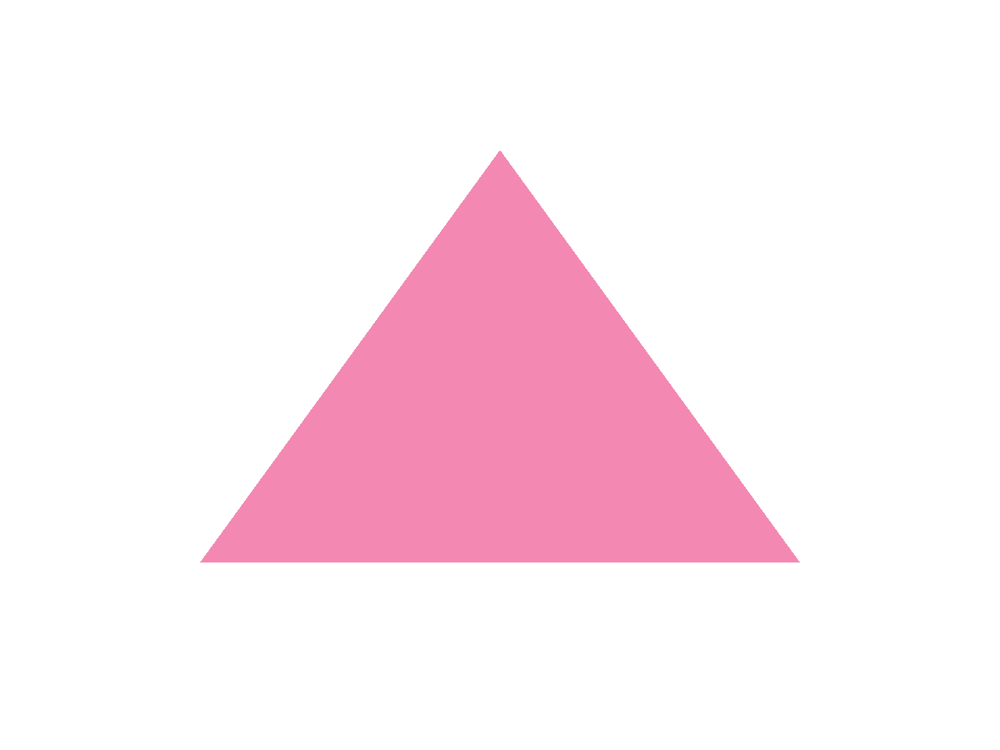
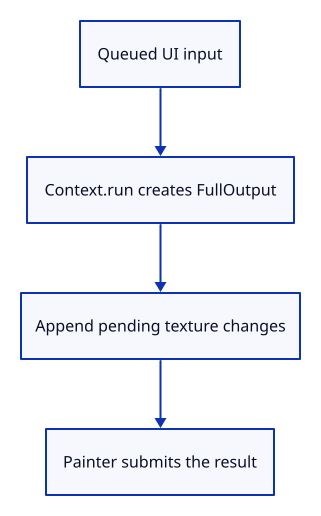

# 1.3.17 · Prepare the dock before painting

**Chapter 1 · Browser, Rust and the GPU · Section 1.3 · Shaders and the command dock** · [Contents](contents.md)

**Typing: 11–22 minutes.** [Estimate](typing-load.md).

Prepare UI output before painting. Append any additional layout output so changed font textures survive until the single GPU submission.

## Type

Continue from [Browse matching names](03ci-browse.md). [Save or recover your work](recovery.md).

### 1. `src/browser.rs`

Report that prepared UI is painted once.

<details>
<summary>Locate the existing block</summary>

```rust
    redraw.forget();
    report("Arrow keys browse matching commands.");
    Ok(())
```

</details>

Edit the existing block to match this code; keep unchanged lines:

```rust
--8<-- "journey/code/03cj-prepare-direct-01.rs"
```

### 2. `src/panel.rs`

Own prepared output and the screen descriptor. Initialize pending output and screen size. Move input and layout into prepare. Convert physical dimensions into egui points. Append prepared output; take it once for GPU painting. Use the retained screen descriptor when uploading UI buffers. Use the same screen descriptor when painting UI.

Edit these blocks from bottom to top. Keep the surrounding lines unchanged.

<details>
<summary>Locate this block</summary>

```rust
            })],
            ..Default::default()
        });
        self.painter.render(&mut pass.forget_lifetime(), &jobs, &screen);
        buffers.push(encoder.finish());
        renderer.queue.submit(buffers);
        for id in output.textures_delta.free { self.painter.free_texture(&id); }
```

</details>

Replace it with:

```rust
            })],
            ..Default::default()
        });
        self.painter.render(&mut pass.forget_lifetime(), &jobs, &self.screen);
        buffers.push(encoder.finish());
        renderer.queue.submit(buffers);
        for id in output.textures_delta.free { self.painter.free_texture(&id); }
```

<details>
<summary>Locate this block</summary>

```rust
        let jobs = self.context.tessellate(output.shapes, output.pixels_per_point);
        let mut encoder = renderer.device.create_command_encoder(&Default::default());
        let mut buffers = self.painter.update_buffers(
            &renderer.device, &renderer.queue, &mut encoder, &jobs, &screen,
        );
        let pass = encoder.begin_render_pass(&wgpu::RenderPassDescriptor {
            label: Some("command panel"),
```

</details>

Replace it with:

```rust
        let jobs = self.context.tessellate(output.shapes, output.pixels_per_point);
        let mut encoder = renderer.device.create_command_encoder(&Default::default());
        let mut buffers = self.painter.update_buffers(
            &renderer.device, &renderer.queue, &mut encoder, &jobs, &self.screen,
        );
        let pass = encoder.begin_render_pass(&wgpu::RenderPassDescriptor {
            label: Some("command panel"),
```

<details>
<summary>Locate this block</summary>

```rust
                });
            });
        });
        // The font atlas is a texture: upload its changed pixels before drawing the letters.
        for (id, delta) in &output.textures_delta.set {
            self.painter.update_texture(&renderer.device, &renderer.queue, *id, delta);
```

</details>

Replace it with:

```rust
                });
            });
        });
        if let Some(previous) = self.output.as_mut() { previous.append(output); }
        else { self.output = Some(output); }
    }

    pub fn draw(&mut self, renderer: &Renderer, target: &wgpu::TextureView) {
        self.screen.size_in_pixels = [target.texture().width(), target.texture().height()];
        self.prepare();
        let Some(output) = self.output.take() else { return; };
        // The font atlas is a texture: upload its changed pixels before drawing the letters.
        for (id, delta) in &output.textures_delta.set {
            self.painter.update_texture(&renderer.device, &renderer.queue, *id, delta);
```

<details>
<summary>Locate this block</summary>

```rust
        true
    }

    pub fn draw(&mut self, renderer: &Renderer, target: &wgpu::TextureView) {
        let size = [target.texture().width(), target.texture().height()];
        #[cfg(target_arch="wasm32")]
        let density=web_sys::window().map_or(1.0,|window|window.device_pixel_ratio() as f32);
        #[cfg(not(target_arch="wasm32"))]
        let density=1.0;
        let screen = egui_wgpu::ScreenDescriptor { size_in_pixels: size, pixels_per_point: density };
        let mut input = egui::RawInput {
            focused: true,
            events: std::mem::take(&mut self.events),
            screen_rect: Some(egui::Rect::from_min_size(
                egui::Pos2::ZERO, egui::vec2(size[0] as f32, size[1] as f32) / density,
            )),
            ..Default::default()
        };
```

</details>

Replace it with:

```rust
        true
    }

    fn prepare(&mut self) {
        let size = self.screen.size_in_pixels;
        #[cfg(target_arch="wasm32")]
        let density=web_sys::window().map_or(1.0,|window|window.device_pixel_ratio() as f32);
        #[cfg(not(target_arch="wasm32"))]
        let density=1.0;
        self.screen.pixels_per_point=density;
        let mut input = egui::RawInput {
            focused: true,
            events: std::mem::take(&mut self.events),
            screen_rect: Some(egui::Rect::from_min_size(
                egui::Pos2::ZERO, egui::vec2(size[0] as f32, size[1] as f32) / self.screen.pixels_per_point,
            )),
            ..Default::default()
        };
```

<details>
<summary>Locate this block</summary>

```rust
        // One layout pass prevents a future text event from being replayed.
        context.options_mut(|options| options.max_passes = 1.try_into().unwrap());
        let painter = egui_wgpu::Renderer::new(&renderer.device, format, Default::default());
        Self { commands: Commands(commands), context, painter, events: Vec::new(), model: CommandLine {
            command_expanded: true,
            history: ["Command history lives here.".into()].into(),
            ..Default::default()
```

</details>

Replace it with:

```rust
        // One layout pass prevents a future text event from being replayed.
        context.options_mut(|options| options.max_passes = 1.try_into().unwrap());
        let painter = egui_wgpu::Renderer::new(&renderer.device, format, Default::default());
        Self { commands: Commands(commands), context, painter, events: Vec::new(), output: None,
            screen: egui_wgpu::ScreenDescriptor { size_in_pixels: [640, 480], pixels_per_point: 1.0 }, model: CommandLine {
            command_expanded: true,
            history: ["Command history lives here.".into()].into(),
            ..Default::default()
```

<details>
<summary>Locate this block</summary>

```rust
    painter: egui_wgpu::Renderer,
    model: CommandLine,
    events: Vec<egui::Event>,
}

impl Panel {
```

</details>

Replace it with:

```rust
    painter: egui_wgpu::Renderer,
    model: CommandLine,
    events: Vec<egui::Event>,
    output: Option<egui::FullOutput>,
    screen: egui_wgpu::ScreenDescriptor,
}

impl Panel {
```

<details>
<summary>Complete updated block reference</summary>

```rust
use crate::command_dock::{self, CommandLine, Commands as _, placeholder, theme, view};
use crate::renderer::Renderer;

struct Commands(&'static [&'static str]);

impl command_dock::Commands for Commands {
    fn canonical(&self, line: &str) -> String {
        let line = line.split_whitespace().collect::<Vec<_>>().join(" ");
        self.0
            .iter()
            .find(|name| name.eq_ignore_ascii_case(&line))
            .map_or(line.clone(), |name| (*name).into())
    }
    fn choosing_option(&self, _: &str) -> bool {
        false
    }
    fn accept(&self, line: &str) -> (String, bool) {
        (self.canonical(line), true)
    }
    fn completions(&self, line: &str) -> Vec<&'static str> {
        crate::command_vocabulary::ranked(self.0.as_ref(), line)
    }
    fn browse(&self, line: &str) -> Vec<&'static str> {
        self.completions(line)
    }
}

impl Commands {
    fn reply(&self, model: &mut CommandLine, line: &str) {
        let line = self.canonical(line);
        let message = if line.eq_ignore_ascii_case("Help") { self.0.join(" · ") }
            else { "Unknown command. Type Help.".into() };
        model.status = message;
        model.remember(format!("> {line}\n{}", model.status));
    }
}

pub struct Panel {
    commands: Commands,
    context: egui::Context,
    painter: egui_wgpu::Renderer,
    model: CommandLine,
    events: Vec<egui::Event>,
    output: Option<egui::FullOutput>,
    screen: egui_wgpu::ScreenDescriptor,
}

impl Panel {
    pub fn new(renderer: &Renderer, format: wgpu::TextureFormat, commands: &'static [&'static str]) -> Self {
        let context = egui::Context::default();
        context.set_fonts(theme::fonts([
            include_bytes!("../assets/text/NotoSans-Regular.subset.ttf"),
            include_bytes!("../assets/text/NotoSansSymbols2-Regular.subset.ttf"),
            include_bytes!("../assets/text/NotoSansSymbols-Regular.subset.ttf"),
        ]));
        context.set_theme(egui::Theme::Light);
        context.set_visuals(theme::visuals());
        // One layout pass prevents a future text event from being replayed.
        context.options_mut(|options| options.max_passes = 1.try_into().unwrap());
        let painter = egui_wgpu::Renderer::new(&renderer.device, format, Default::default());
        Self { commands: Commands(commands), context, painter, events: Vec::new(), output: None,
            screen: egui_wgpu::ScreenDescriptor { size_in_pixels: [640, 480], pixels_per_point: 1.0 }, model: CommandLine {
            command_expanded: true,
            history: ["Command history lives here.".into()].into(),
            ..Default::default()
        } }
    }

    pub fn command(&self) -> &str { &self.model.command }

    pub fn history(&self) -> &std::collections::VecDeque<String> { &self.model.history }

    pub fn key(&mut self, event: &web_sys::KeyboardEvent) -> bool {
        if event.is_composing() { return false; }
        let modifiers = egui::Modifiers {
            alt: event.alt_key(), ctrl: event.ctrl_key(), shift: event.shift_key(),
            mac_cmd: event.meta_key(), command: event.ctrl_key() || event.meta_key(),
        };
        let text = event.type_() == "keydown" && event.key().chars().count() == 1
            && !modifiers.command && !modifiers.alt;
        if text {
            if !self.context.egui_wants_keyboard_input() { self.model.focus_command = true; }
            self.context.memory_mut(|memory| memory.request_focus(egui::Id::new("command-input")));
            self.model.command_open = true;
        }
        if !self.context.egui_wants_keyboard_input() { return false; }
        if let Some(key) = egui::Key::from_name(&event.key()) {
            self.events.push(egui::Event::Key {
                key, physical_key: None, pressed: event.type_() == "keydown",
                repeat: event.repeat(), modifiers,
            });
        }
        if text { self.events.push(egui::Event::Text(event.key())); }
        event.prevent_default();
        true
    }

    fn prepare(&mut self) {
        let size = self.screen.size_in_pixels;
        #[cfg(target_arch="wasm32")]
        let density=web_sys::window().map_or(1.0,|window|window.device_pixel_ratio() as f32);
        #[cfg(not(target_arch="wasm32"))]
        let density=1.0;
        self.screen.pixels_per_point=density;
        let mut input = egui::RawInput {
            focused: true,
            events: std::mem::take(&mut self.events),
            screen_rect: Some(egui::Rect::from_min_size(
                egui::Pos2::ZERO, egui::vec2(size[0] as f32, size[1] as f32) / self.screen.pixels_per_point,
            )),
            ..Default::default()
        };
        self.model.completion_rect = None;
        let output = self.context.run_ui(input, |root| {
            view::panel(root, self.model.command_expanded, 0.0).show_inside(root, |ui| {
                view::prepare(ui);
                command_dock::history(ui, &self.model, &mut None);
                ui.horizontal(|ui| {
                    ui.set_max_width((ui.available_width() - 26.0).max(80.0));
                    ui.label("Command:");
                    let id = egui::Id::new("command-input");
                    let keys = command_dock::keys(ui, &mut self.model, None, id);
                    let response = view::field(ui, &mut self.model.command, placeholder("", &self.model.status, self.model.command_expanded), 0.0, self.model.command_open);
                    command_dock::refresh(ui, &mut self.model, &response, &self.commands, id, keys.deletes);
                    let mut line = None;
                    let complete = command_dock::browse(ui, &mut self.model, &mut None, &self.commands, &response, &keys, id);
                    command_dock::finish(ui, &mut self.model, &response, &mut line, &self.commands, complete, &keys, true);
                    if let Some(line) = line { if line != "Escape" { self.commands.reply(&mut self.model, &line); } }
                    let _ = ui.button(if self.model.command_expanded { "–" } else { "+" }).on_hover_text("Collapse or expand history");
                });
            });
        });
        if let Some(previous) = self.output.as_mut() { previous.append(output); }
        else { self.output = Some(output); }
    }

    pub fn draw(&mut self, renderer: &Renderer, target: &wgpu::TextureView) {
        self.screen.size_in_pixels = [target.texture().width(), target.texture().height()];
        self.prepare();
        let Some(output) = self.output.take() else { return; };
        // The font atlas is a texture: upload its changed pixels before drawing the letters.
        for (id, delta) in &output.textures_delta.set {
            self.painter.update_texture(&renderer.device, &renderer.queue, *id, delta);
        }
        let jobs = self.context.tessellate(output.shapes, output.pixels_per_point);
        let mut encoder = renderer.device.create_command_encoder(&Default::default());
        let mut buffers = self.painter.update_buffers(
            &renderer.device, &renderer.queue, &mut encoder, &jobs, &self.screen,
        );
        let pass = encoder.begin_render_pass(&wgpu::RenderPassDescriptor {
            label: Some("command panel"),
            color_attachments: &[Some(wgpu::RenderPassColorAttachment {
                view: target, resolve_target: None, depth_slice: None,
                ops: wgpu::Operations { load: wgpu::LoadOp::Load, store: wgpu::StoreOp::Store },
            })],
            ..Default::default()
        });
        self.painter.render(&mut pass.forget_lifetime(), &jobs, &self.screen);
        buffers.push(encoder.finish());
        renderer.queue.submit(buffers);
        for id in output.textures_delta.free { self.painter.free_texture(&id); }
    }
}
```

</details>

<details>
<summary>Optional patch references</summary>

Use these original edit fragments when comparing a saved checkpoint. Apply the complete blocks above.

```text
--8<-- "journey/code/03cj-prepare-direct-02.rs"
```

```text
--8<-- "journey/code/03cj-prepare-direct-03.rs"
```

```text
--8<-- "journey/code/03cj-prepare-direct-04.rs"
```

```text
--8<-- "journey/code/03cj-prepare-direct-05.rs"
```

```text
--8<-- "journey/code/03cj-prepare-direct-06.rs"
```

```text
--8<-- "journey/code/03cj-prepare-direct-07.rs"
```

```text
--8<-- "journey/code/03cj-prepare-direct-08.rs"
```

</details>

## Run and check

In your project:

```sh
cd workspace/journey
cargo build --lib --locked --target wasm32-unknown-unknown -j1
CARGO_BUILD_JOBS=1 trunk serve --port 8780
```

Open `http://127.0.0.1:8780/`. Keep an existing Trunk server running; saving rebuilds it.

Type Help. Text and the triangle remain visible after repeated key events.

### Recorded visual result

**Previous native render — current verification pending.**



*This recorded image predates a source or checker change. Rebuild this checkpoint before using it as current evidence; browser controls require separate acceptance.*

This reference image is shared with [1.3.1 · Give the GPU three corners](03-triangle.md). It does not demonstrate a new feature by itself.

<details>
<summary>Code explanation and diagram</summary>


Keep UI output owned until one GPU submission.



Why append output before painting?

Another layout may add texture changes that the renderer still needs.

Study estimate, including typing and experiments: 0.5–0.75 hours.

</details>

<details>
<summary>Optional experiment</summary>

Type and delete Help repeatedly. The triangle and command text should remain visible throughout.

</details>

<details>
<summary>Check and save your work</summary>

Restore experimental edits, then run from `session_viewer`:

```sh
npm --prefix ../session_tests run course -- check 1.3.17
npm --prefix ../session_tests run course -- save 1.3.17
```

Source comparison leaves your project untouched. [Save and recovery instructions](recovery.md).

</details>

<details>
<summary>Viewer coverage and verification</summary>

This step connects one responsibility of the production command dock. Scene commands are added in the following lessons.


[Full validation scope](release.md).

To reproduce the scripted acceptance of the reference checkpoint, run from `session_viewer` with the [course bundle server](release.md#reproduce) running on port 8781:

```sh
npm --prefix ../session_tests run course -- capture 1.3.17
```

This uses the verified reference bundle; it does not check or change your typed project.

</details>
