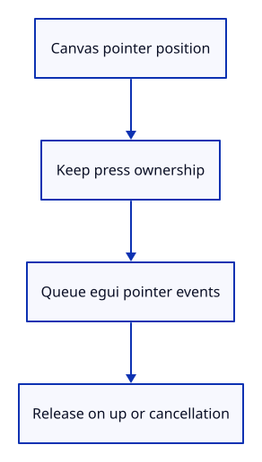

# 1.3.19 · Click the command dock

**Chapter 1 · Browser, Rust and the GPU · Section 1.3 · Shaders and the command dock** · [Contents](contents.md)

**Typing: 26–51 minutes.** [Estimate](typing-load.md).

Translate mouse positions into canvas coordinates. Keep a press owned until release or cancellation. collapse changes layout while retained history stays in the model.

## Type

Continue from [Remember where the dock is drawn](03ck-rects.md). [Save or recover your work](recovery.md).

### 1. `src/browser.rs`

Dispatch keyboard and pointer events through one retained callback. Register pointer press, movement, release and cancellation. Report that mouse input is connected.

Edit these blocks from bottom to top. Keep the surrounding lines unchanged.

<details>
<summary>Locate this block</summary>

```rust
            }
        }
    });
    for name in ["keydown", "keyup"] {
        window.add_event_listener_with_callback(name, redraw.as_ref().unchecked_ref())?;
    }
    redraw.forget();
    report("The dock records its actual rectangles.");
    Ok(())
}
```

</details>

Replace it with:

```rust
            }
        }
    });
    for name in ["keydown", "keyup", "pointerdown", "pointermove", "pointerup", "pointercancel"] {
        window.add_event_listener_with_callback(name, redraw.as_ref().unchecked_ref())?;
    }
    redraw.forget();
    report("The mouse operates the command dock.");
    Ok(())
}
```

<details>
<summary>Locate this block</summary>

```rust
    let mut panel = crate::panel::Panel::new(&renderer, config.format.add_srgb_suffix(), &["Help"]);
    present(&surface, &renderer, &mut panel)?;
    let input_canvas = canvas.clone();
    let redraw = wasm_bindgen::closure::Closure::<dyn FnMut(web_sys::KeyboardEvent)>::new(move |event| {
        if panel.key(&event) {
            if let Err(error) = present(&surface, &renderer, &mut panel) {
                report(&format!("Cannot redraw: {error:?}"));
            }
```

</details>

Replace it with:

```rust
    let mut panel = crate::panel::Panel::new(&renderer, config.format.add_srgb_suffix(), &["Help"]);
    present(&surface, &renderer, &mut panel)?;
    let input_canvas = canvas.clone();
    let redraw = wasm_bindgen::closure::Closure::<dyn FnMut(web_sys::Event)>::new(move |event: web_sys::Event| {
        if let Some(key) = event.dyn_ref::<web_sys::KeyboardEvent>() { panel.key(key); }
        if let Some(pointer) = event.dyn_ref::<web_sys::PointerEvent>() { panel.pointer(pointer, &input_canvas); }
        {
            if let Err(error) = present(&surface, &renderer, &mut panel) {
                report(&format!("Cannot redraw: {error:?}"));
            }
```

<details>
<summary>Complete updated block reference</summary>

```rust
use crate::renderer::Renderer;
use wasm_bindgen::{JsCast, JsValue};

pub fn report(message: &str) {
    if let Some(document) = web_sys::window().and_then(|window| window.document()) {
        if let Some(status) = document.get_element_by_id("status") {
            status.set_text_content(Some(message));
            if message.starts_with("Cannot") { let _ = status.remove_attribute("hidden"); }
        }
    }
}

pub async fn run() -> Result<(), JsValue> {
    let window = web_sys::window().ok_or("No browser window")?;
    let document = window.document().ok_or("No document")?;
    let canvas: web_sys::HtmlCanvasElement = document
        .get_element_by_id("canvas").ok_or("Missing canvas")?.dyn_into()?;
    let instance = wgpu::Instance::new(wgpu::InstanceDescriptor {
        backends: wgpu::Backends::BROWSER_WEBGPU,
        flags: Default::default(),
        memory_budget_thresholds: Default::default(),
        backend_options: Default::default(),
        display: None,
    });
    let surface = instance.create_surface(wgpu::SurfaceTarget::Canvas(canvas.clone()))
        .map_err(|error| JsValue::from_str(&error.to_string()))?;
    let adapter = instance.request_adapter(&wgpu::RequestAdapterOptions {
        compatible_surface: Some(&surface),
        ..Default::default()
    }).await.map_err(|error| JsValue::from_str(&error.to_string()))?;
    let (device, queue) = adapter.request_device(&wgpu::DeviceDescriptor::default())
        .await.map_err(|error| JsValue::from_str(&error.to_string()))?;
    device.on_uncaptured_error(std::sync::Arc::new(|error| report(&error.to_string())));
    let limit = device.limits().max_texture_dimension_2d;
    let width = (window.inner_width()?.as_f64().ok_or("No window width")? as u32).clamp(1, limit);
    let height = (window.inner_height()?.as_f64().ok_or("No window height")? as u32).clamp(1, limit);
    canvas.set_width(width);
    canvas.set_height(height);
    let mut config = surface.get_default_config(&adapter, width, height)
        .ok_or("No compatible surface format")?;
    config.view_formats = vec![config.format.add_srgb_suffix()];
    surface.configure(&device, &config);
    let renderer = Renderer::new(device, queue, config.format.add_srgb_suffix());
    let mut panel = crate::panel::Panel::new(&renderer, config.format.add_srgb_suffix(), &["Help"]);
    present(&surface, &renderer, &mut panel)?;
    let input_canvas = canvas.clone();
    let redraw = wasm_bindgen::closure::Closure::<dyn FnMut(web_sys::Event)>::new(move |event: web_sys::Event| {
        if let Some(key) = event.dyn_ref::<web_sys::KeyboardEvent>() { panel.key(key); }
        if let Some(pointer) = event.dyn_ref::<web_sys::PointerEvent>() { panel.pointer(pointer, &input_canvas); }
        {
            if let Err(error) = present(&surface, &renderer, &mut panel) {
                report(&format!("Cannot redraw: {error:?}"));
            }
            if let Err(error) = input_canvas.set_attribute("data-command-ui", &panel.inspect()) {
                report(&format!("Cannot inspect dock: {error:?}"));
            }
            if let Err(error) = input_canvas.set_attribute("data-command", panel.command()) {
                report(&format!("Cannot inspect text: {error:?}"));
            }
            if let Err(error) = input_canvas.set_attribute("data-history", &serde_json::to_string(panel.history()).unwrap()) {
                report(&format!("Cannot inspect history: {error:?}"));
            }
        }
    });
    for name in ["keydown", "keyup", "pointerdown", "pointermove", "pointerup", "pointercancel"] {
        window.add_event_listener_with_callback(name, redraw.as_ref().unchecked_ref())?;
    }
    redraw.forget();
    report("The mouse operates the command dock.");
    Ok(())
}

fn present(surface: &wgpu::Surface<'_>, renderer: &Renderer, panel: &mut crate::panel::Panel) -> Result<(), JsValue> {
    let frame = match surface.get_current_texture() {
        wgpu::CurrentSurfaceTexture::Success(frame)
        | wgpu::CurrentSurfaceTexture::Suboptimal(frame) => frame,
        other => return Err(JsValue::from_str(&format!("Surface unavailable: {other:?}"))),
    };
    let view = frame.texture.create_view(&wgpu::TextureViewDescriptor {
        format: Some(frame.texture.format().add_srgb_suffix()),
        ..Default::default()
    });
    renderer.draw(&view);
    panel.draw(renderer, &view);
    frame.present();
    Ok(())
}
```

</details>

<details>
<summary>Optional patch references</summary>

Use these original edit fragments when comparing a saved checkpoint. Apply the complete blocks above.

```text
--8<-- "journey/code/03ck-pointer-direct-01.rs"
```

```text
--8<-- "journey/code/03ck-pointer-direct-02.rs"
```

```text
--8<-- "journey/code/03ck-pointer-direct-03.rs"
```

</details>

### 2. `src/panel.rs`

Retain pointer ownership between press and release. Initialize pointer ownership. Translate canvas coordinates, preserve drag ownership and release cancelled buttons. Expose pointer ownership so cancellation can be checked against the actual event handler.

Edit these blocks from bottom to top. Keep the surrounding lines unchanged.

<details>
<summary>Locate this block</summary>

```rust
        true
    }

    pub fn inspect(&self) -> String {
        serde_json::json!({"controls": self.controls, "command": self.model.command, "history": self.model.history,
            "top": self.top, "focused": self.context.egui_wants_keyboard_input(),
            "completion_rect": self.model.completion_rect.map(|r| [r.min.x, r.min.y, r.max.x, r.max.y])}).to_string()
    }
```

</details>

Replace it with:

```rust
        true
    }

    pub fn pointer(&mut self, event: &web_sys::PointerEvent, canvas: &web_sys::HtmlCanvasElement) -> bool {
        let rect = canvas.get_bounding_client_rect();
        let pos = egui::pos2((event.client_x() as f64 - rect.left()) as f32, (event.client_y() as f64 - rect.top()) as f32);
        let over = pos.y >= self.top || self.model.completion_rect.is_some_and(|r| r.contains(pos));
        let owned = over || self.pointer_owned;
        if event.type_() == "pointerdown" {
            self.pointer_owned = over;
            if !over {
                self.model.command_open = false;
                self.model.focus_command = false;
                self.context.memory_mut(|memory| memory.surrender_focus(egui::Id::new("command-input")));
            }
        }
        self.events.push(egui::Event::PointerMoved(pos));
        if matches!(event.type_().as_str(), "pointercancel" | "lostpointercapture") {
            for button in [egui::PointerButton::Primary, egui::PointerButton::Middle, egui::PointerButton::Secondary] {
                self.events.push(egui::Event::PointerButton { pos, button, pressed: false, modifiers: Default::default() });
            }
            self.events.push(egui::Event::PointerGone);
        } else if matches!(event.type_().as_str(), "pointerdown" | "pointerup") {
            let button = match event.button() { 0 => egui::PointerButton::Primary, 1 => egui::PointerButton::Middle, _ => egui::PointerButton::Secondary };
            self.events.push(egui::Event::PointerButton { pos, button, pressed: event.type_() == "pointerdown", modifiers: Default::default() });
        }
        if matches!(event.type_().as_str(), "pointerup" | "pointercancel" | "lostpointercapture") { self.pointer_owned = false; }
        if owned { event.prevent_default(); }
        owned
    }

    pub fn inspect(&self) -> String {
        serde_json::json!({"controls": self.controls, "command": self.model.command, "history": self.model.history,
            "pointer_owned": self.pointer_owned,
            "top": self.top, "focused": self.context.egui_wants_keyboard_input(),
            "completion_rect": self.model.completion_rect.map(|r| [r.min.x, r.min.y, r.max.x, r.max.y])}).to_string()
    }
```

<details>
<summary>Locate this block</summary>

```rust
        // One layout pass prevents a future text event from being replayed.
        context.options_mut(|options| options.max_passes = 1.try_into().unwrap());
        let painter = egui_wgpu::Renderer::new(&renderer.device, format, Default::default());
        Self { commands: Commands(commands), top: f32::INFINITY, controls: None, context, painter, events: Vec::new(), output: None,
            screen: egui_wgpu::ScreenDescriptor { size_in_pixels: [640, 480], pixels_per_point: 1.0 }, model: CommandLine {
            command_expanded: true,
            history: ["Command history lives here.".into()].into(),
```

</details>

Replace it with:

```rust
        // One layout pass prevents a future text event from being replayed.
        context.options_mut(|options| options.max_passes = 1.try_into().unwrap());
        let painter = egui_wgpu::Renderer::new(&renderer.device, format, Default::default());
        Self { commands: Commands(commands), pointer_owned: false, top: f32::INFINITY, controls: None, context, painter, events: Vec::new(), output: None,
            screen: egui_wgpu::ScreenDescriptor { size_in_pixels: [640, 480], pixels_per_point: 1.0 }, model: CommandLine {
            command_expanded: true,
            history: ["Command history lives here.".into()].into(),
```

<details>
<summary>Locate this block</summary>

```rust

pub struct Panel {
    commands: Commands,
    top: f32,
    controls: Option<Vec<command_dock::Control>>,
    context: egui::Context,
```

</details>

Replace it with:

```rust

pub struct Panel {
    commands: Commands,
    pointer_owned: bool,
    top: f32,
    controls: Option<Vec<command_dock::Control>>,
    context: egui::Context,
```

<details>
<summary>Complete updated block reference</summary>

```rust
use crate::command_dock::{self, CommandLine, Commands as _, placeholder, theme, view};
use crate::renderer::Renderer;

struct Commands(&'static [&'static str]);

impl command_dock::Commands for Commands {
    fn canonical(&self, line: &str) -> String {
        let line = line.split_whitespace().collect::<Vec<_>>().join(" ");
        self.0
            .iter()
            .find(|name| name.eq_ignore_ascii_case(&line))
            .map_or(line.clone(), |name| (*name).into())
    }
    fn choosing_option(&self, _: &str) -> bool {
        false
    }
    fn accept(&self, line: &str) -> (String, bool) {
        (self.canonical(line), true)
    }
    fn completions(&self, line: &str) -> Vec<&'static str> {
        crate::command_vocabulary::ranked(self.0.as_ref(), line)
    }
    fn browse(&self, line: &str) -> Vec<&'static str> {
        self.completions(line)
    }
}

impl Commands {
    fn reply(&self, model: &mut CommandLine, line: &str) {
        let line = self.canonical(line);
        let message = if line.eq_ignore_ascii_case("Help") { self.0.join(" · ") }
            else { "Unknown command. Type Help.".into() };
        model.status = message;
        model.remember(format!("> {line}\n{}", model.status));
    }
}

pub struct Panel {
    commands: Commands,
    pointer_owned: bool,
    top: f32,
    controls: Option<Vec<command_dock::Control>>,
    context: egui::Context,
    painter: egui_wgpu::Renderer,
    model: CommandLine,
    events: Vec<egui::Event>,
    output: Option<egui::FullOutput>,
    screen: egui_wgpu::ScreenDescriptor,
}

impl Panel {
    pub fn new(renderer: &Renderer, format: wgpu::TextureFormat, commands: &'static [&'static str]) -> Self {
        let context = egui::Context::default();
        context.set_fonts(theme::fonts([
            include_bytes!("../assets/text/NotoSans-Regular.subset.ttf"),
            include_bytes!("../assets/text/NotoSansSymbols2-Regular.subset.ttf"),
            include_bytes!("../assets/text/NotoSansSymbols-Regular.subset.ttf"),
        ]));
        context.set_theme(egui::Theme::Light);
        context.set_visuals(theme::visuals());
        // One layout pass prevents a future text event from being replayed.
        context.options_mut(|options| options.max_passes = 1.try_into().unwrap());
        let painter = egui_wgpu::Renderer::new(&renderer.device, format, Default::default());
        Self { commands: Commands(commands), pointer_owned: false, top: f32::INFINITY, controls: None, context, painter, events: Vec::new(), output: None,
            screen: egui_wgpu::ScreenDescriptor { size_in_pixels: [640, 480], pixels_per_point: 1.0 }, model: CommandLine {
            command_expanded: true,
            history: ["Command history lives here.".into()].into(),
            ..Default::default()
        } }
    }

    pub fn command(&self) -> &str { &self.model.command }

    pub fn history(&self) -> &std::collections::VecDeque<String> { &self.model.history }

    pub fn key(&mut self, event: &web_sys::KeyboardEvent) -> bool {
        if event.is_composing() { return false; }
        let modifiers = egui::Modifiers {
            alt: event.alt_key(), ctrl: event.ctrl_key(), shift: event.shift_key(),
            mac_cmd: event.meta_key(), command: event.ctrl_key() || event.meta_key(),
        };
        let text = event.type_() == "keydown" && event.key().chars().count() == 1
            && !modifiers.command && !modifiers.alt;
        if text {
            if !self.context.egui_wants_keyboard_input() { self.model.focus_command = true; }
            self.context.memory_mut(|memory| memory.request_focus(egui::Id::new("command-input")));
            self.model.command_open = true;
        }
        if !self.context.egui_wants_keyboard_input() { return false; }
        if let Some(key) = egui::Key::from_name(&event.key()) {
            self.events.push(egui::Event::Key {
                key, physical_key: None, pressed: event.type_() == "keydown",
                repeat: event.repeat(), modifiers,
            });
        }
        if text { self.events.push(egui::Event::Text(event.key())); }
        event.prevent_default();
        true
    }

    pub fn pointer(&mut self, event: &web_sys::PointerEvent, canvas: &web_sys::HtmlCanvasElement) -> bool {
        let rect = canvas.get_bounding_client_rect();
        let pos = egui::pos2((event.client_x() as f64 - rect.left()) as f32, (event.client_y() as f64 - rect.top()) as f32);
        let over = pos.y >= self.top || self.model.completion_rect.is_some_and(|r| r.contains(pos));
        let owned = over || self.pointer_owned;
        if event.type_() == "pointerdown" {
            self.pointer_owned = over;
            if !over {
                self.model.command_open = false;
                self.model.focus_command = false;
                self.context.memory_mut(|memory| memory.surrender_focus(egui::Id::new("command-input")));
            }
        }
        self.events.push(egui::Event::PointerMoved(pos));
        if matches!(event.type_().as_str(), "pointercancel" | "lostpointercapture") {
            for button in [egui::PointerButton::Primary, egui::PointerButton::Middle, egui::PointerButton::Secondary] {
                self.events.push(egui::Event::PointerButton { pos, button, pressed: false, modifiers: Default::default() });
            }
            self.events.push(egui::Event::PointerGone);
        } else if matches!(event.type_().as_str(), "pointerdown" | "pointerup") {
            let button = match event.button() { 0 => egui::PointerButton::Primary, 1 => egui::PointerButton::Middle, _ => egui::PointerButton::Secondary };
            self.events.push(egui::Event::PointerButton { pos, button, pressed: event.type_() == "pointerdown", modifiers: Default::default() });
        }
        if matches!(event.type_().as_str(), "pointerup" | "pointercancel" | "lostpointercapture") { self.pointer_owned = false; }
        if owned { event.prevent_default(); }
        owned
    }

    pub fn inspect(&self) -> String {
        serde_json::json!({"controls": self.controls, "command": self.model.command, "history": self.model.history,
            "pointer_owned": self.pointer_owned,
            "top": self.top, "focused": self.context.egui_wants_keyboard_input(),
            "completion_rect": self.model.completion_rect.map(|r| [r.min.x, r.min.y, r.max.x, r.max.y])}).to_string()
    }

    fn prepare(&mut self) {
        let size = self.screen.size_in_pixels;
        let input = egui::RawInput {
            focused: true,
            events: std::mem::take(&mut self.events),
            screen_rect: Some(egui::Rect::from_min_size(
                egui::Pos2::ZERO, egui::vec2(size[0] as f32, size[1] as f32) / self.screen.pixels_per_point,
            )),
            ..Default::default()
        };
        self.model.completion_rect = None;
        self.controls = Some(Vec::new());
        let output = self.context.run_ui(input, |root| {
            let panel = view::panel(root, self.model.command_expanded, 0.0).show_inside(root, |ui| {
                view::prepare(ui);
                command_dock::history(ui, &self.model, &mut self.controls);
                ui.horizontal(|ui| {
                    ui.set_max_width((ui.available_width() - 26.0).max(80.0));
                    ui.label("Command:");
                    let id = egui::Id::new("command-input");
                    let keys = command_dock::keys(ui, &mut self.model, None, id);
                    let response = view::field(ui, &mut self.model.command, placeholder("", &self.model.status, self.model.command_expanded), 0.0, self.model.command_open);
                    self.model.command_rect = Some(response.rect);
                    command_dock::record(&mut self.controls, "command/input", "Command", &response);
                    command_dock::refresh(ui, &mut self.model, &response, &self.commands, id, keys.deletes);
                    let mut line = None;
                    let complete = command_dock::browse(ui, &mut self.model, &mut self.controls, &self.commands, &response, &keys, id);
                    command_dock::finish(ui, &mut self.model, &response, &mut line, &self.commands, complete, &keys, true);
                    if let Some(line) = line { if line != "Escape" { self.commands.reply(&mut self.model, &line); } }
                    command_dock::collapse(ui, &mut self.model, &mut self.controls);
                });
            });
            self.top = panel.response.rect.top() - 4.0;
        });
        if let Some(previous) = self.output.as_mut() { previous.append(output); }
        else { self.output = Some(output); }
    }

    pub fn draw(&mut self, renderer: &Renderer, target: &wgpu::TextureView) {
        self.screen.size_in_pixels = [target.texture().width(), target.texture().height()];
        self.prepare();
        self.prepare();
        let Some(output) = self.output.take() else { return; };
        // The font atlas is a texture: upload its changed pixels before drawing the letters.
        for (id, delta) in &output.textures_delta.set {
            self.painter.update_texture(&renderer.device, &renderer.queue, *id, delta);
        }
        let jobs = self.context.tessellate(output.shapes, output.pixels_per_point);
        let mut encoder = renderer.device.create_command_encoder(&Default::default());
        let mut buffers = self.painter.update_buffers(
            &renderer.device, &renderer.queue, &mut encoder, &jobs, &self.screen,
        );
        let pass = encoder.begin_render_pass(&wgpu::RenderPassDescriptor {
            label: Some("command panel"),
            color_attachments: &[Some(wgpu::RenderPassColorAttachment {
                view: target, resolve_target: None, depth_slice: None,
                ops: wgpu::Operations { load: wgpu::LoadOp::Load, store: wgpu::StoreOp::Store },
            })],
            ..Default::default()
        });
        self.painter.render(&mut pass.forget_lifetime(), &jobs, &self.screen);
        buffers.push(encoder.finish());
        renderer.queue.submit(buffers);
        for id in output.textures_delta.free { self.painter.free_texture(&id); }
    }
}
```

</details>

<details>
<summary>Optional patch references</summary>

Use these original edit fragments when comparing a saved checkpoint. Apply the complete blocks above.

```text
--8<-- "journey/code/03ck-pointer-direct-04.rs"
```

```text
--8<-- "journey/code/03ck-pointer-direct-05.rs"
```

```text
--8<-- "journey/code/03ck-pointer-direct-06.rs"
```

```text
--8<-- "journey/code/03ck-pointer-owned-inspection.rs"
```

</details>

## Run and check

In your project:

```sh
cd workspace/journey
cargo build --lib --locked --target wasm32-unknown-unknown -j1
CARGO_BUILD_JOBS=1 trunk serve --port 8780
```

Open `http://127.0.0.1:8780/`. Keep an existing Trunk server running; saving rebuilds it.

Click the history fold control. History folds away; click again to restore it.

### Recorded visual result

**Previous native render — current verification pending.**

This checkpoint was rendered independently and has the same native comparison frame as [Remember where the dock is drawn](03ck-rects.md). Use its state checks and browser exercise to assess the changed behavior.


*This recorded image predates a source or checker change. Rebuild this checkpoint before using it as current evidence; browser controls require separate acceptance.*

This reference image is shared with [1.3.1 · Give the GPU three corners](03-triangle.md). It does not demonstrate a new feature by itself.

<details>
<summary>Code explanation and diagram</summary>


Use pointer ownership to edit, choose a name and fold history.



Why retain pointer ownership?

A drag must stay with the widget even after leaving its rectangle.

Study estimate, including typing and experiments: 0.5–1.25 hours.

</details>

<details>
<summary>Optional experiment</summary>

Press the history fold control, drag outside it, and release. The cancelled click should leave history expanded.

</details>

<details>
<summary>Check and save your work</summary>

Restore experimental edits, then run from `session_viewer`:

```sh
npm --prefix ../session_tests run course -- check 1.3.19
npm --prefix ../session_tests run course -- save 1.3.19
```

Source comparison leaves your project untouched. [Save and recovery instructions](recovery.md).

</details>

<details>
<summary>Viewer coverage and verification</summary>

This step connects one responsibility of the production command dock. Scene commands are added in the following lessons.


[Full validation scope](release.md).

To reproduce the scripted acceptance of the reference checkpoint, run from `session_viewer` with the [course bundle server](release.md#reproduce) running on port 8781:

```sh
npm --prefix ../session_tests run course -- capture 1.3.19
```

This uses the verified reference bundle; it does not check or change your typed project.

</details>
