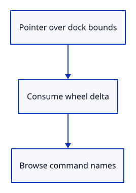

# 1.3.20 · Scroll through command names

**Chapter 1 · Browser, Rust and the GPU · Section 1.3 · Shaders and the command dock** · [Contents](contents.md)

**Typing: 25–50 minutes.** [Estimate](typing-load.md).

Queue wheel input with the pointer position. Consume scrolling over the field or previous suggestion rectangle before it can reach the scene.

## Type

Continue from [Click the command dock](03ck-pointer.md). [Save or recover your work](recovery.md).

### 1. `src/browser.rs`

Dispatch wheel events to Panel. Register wheel input with preventDefault enabled. Report that scrolling selects command names.

Edit these blocks from bottom to top. Keep the surrounding lines unchanged.

<details>
<summary>Locate this block</summary>

```rust
    for name in ["keydown", "keyup", "pointerdown", "pointermove", "pointerup", "pointercancel"] {
        window.add_event_listener_with_callback(name, redraw.as_ref().unchecked_ref())?;
    }
    redraw.forget();
    report("The mouse operates the command dock.");
    Ok(())
}
```

</details>

Replace it with:

```rust
    for name in ["keydown", "keyup", "pointerdown", "pointermove", "pointerup", "pointercancel"] {
        window.add_event_listener_with_callback(name, redraw.as_ref().unchecked_ref())?;
    }
    let options = web_sys::AddEventListenerOptions::new();
    options.set_passive(false);
    canvas.add_event_listener_with_callback_and_add_event_listener_options("wheel", redraw.as_ref().unchecked_ref(), &options)?;
    redraw.forget();
    report("Scrolling selects a command name.");
    Ok(())
}
```

<details>
<summary>Locate this block</summary>

```rust
    let input_canvas = canvas.clone();
    let redraw = wasm_bindgen::closure::Closure::<dyn FnMut(web_sys::Event)>::new(move |event: web_sys::Event| {
        if let Some(key) = event.dyn_ref::<web_sys::KeyboardEvent>() { panel.key(key); }
        if let Some(pointer) = event.dyn_ref::<web_sys::PointerEvent>() { panel.pointer(pointer, &input_canvas); }
        {
            if let Err(error) = present(&surface, &renderer, &mut panel) {
```

</details>

Replace it with:

```rust
    let input_canvas = canvas.clone();
    let redraw = wasm_bindgen::closure::Closure::<dyn FnMut(web_sys::Event)>::new(move |event: web_sys::Event| {
        if let Some(key) = event.dyn_ref::<web_sys::KeyboardEvent>() { panel.key(key); }
        if let Some(wheel) = event.dyn_ref::<web_sys::WheelEvent>() { panel.wheel(wheel, &input_canvas); }
        if let Some(pointer) = event.dyn_ref::<web_sys::PointerEvent>() { panel.pointer(pointer, &input_canvas); }
        {
            if let Err(error) = present(&surface, &renderer, &mut panel) {
```

<details>
<summary>Complete updated block reference</summary>

```rust
use crate::renderer::Renderer;
use wasm_bindgen::{JsCast, JsValue};

pub fn report(message: &str) {
    if let Some(document) = web_sys::window().and_then(|window| window.document()) {
        if let Some(status) = document.get_element_by_id("status") {
            status.set_text_content(Some(message));
            if message.starts_with("Cannot") { let _ = status.remove_attribute("hidden"); }
        }
    }
}

pub async fn run() -> Result<(), JsValue> {
    let window = web_sys::window().ok_or("No browser window")?;
    let document = window.document().ok_or("No document")?;
    let canvas: web_sys::HtmlCanvasElement = document
        .get_element_by_id("canvas").ok_or("Missing canvas")?.dyn_into()?;
    let instance = wgpu::Instance::new(wgpu::InstanceDescriptor {
        backends: wgpu::Backends::BROWSER_WEBGPU,
        flags: Default::default(),
        memory_budget_thresholds: Default::default(),
        backend_options: Default::default(),
        display: None,
    });
    let surface = instance.create_surface(wgpu::SurfaceTarget::Canvas(canvas.clone()))
        .map_err(|error| JsValue::from_str(&error.to_string()))?;
    let adapter = instance.request_adapter(&wgpu::RequestAdapterOptions {
        compatible_surface: Some(&surface),
        ..Default::default()
    }).await.map_err(|error| JsValue::from_str(&error.to_string()))?;
    let (device, queue) = adapter.request_device(&wgpu::DeviceDescriptor::default())
        .await.map_err(|error| JsValue::from_str(&error.to_string()))?;
    device.on_uncaptured_error(std::sync::Arc::new(|error| report(&error.to_string())));
    let limit = device.limits().max_texture_dimension_2d;
    let width = (window.inner_width()?.as_f64().ok_or("No window width")? as u32).clamp(1, limit);
    let height = (window.inner_height()?.as_f64().ok_or("No window height")? as u32).clamp(1, limit);
    canvas.set_width(width);
    canvas.set_height(height);
    let mut config = surface.get_default_config(&adapter, width, height)
        .ok_or("No compatible surface format")?;
    config.view_formats = vec![config.format.add_srgb_suffix()];
    surface.configure(&device, &config);
    let renderer = Renderer::new(device, queue, config.format.add_srgb_suffix());
    let mut panel = crate::panel::Panel::new(&renderer, config.format.add_srgb_suffix(), &["Help"]);
    present(&surface, &renderer, &mut panel)?;
    let input_canvas = canvas.clone();
    let redraw = wasm_bindgen::closure::Closure::<dyn FnMut(web_sys::Event)>::new(move |event: web_sys::Event| {
        if let Some(key) = event.dyn_ref::<web_sys::KeyboardEvent>() { panel.key(key); }
        if let Some(wheel) = event.dyn_ref::<web_sys::WheelEvent>() { panel.wheel(wheel, &input_canvas); }
        if let Some(pointer) = event.dyn_ref::<web_sys::PointerEvent>() { panel.pointer(pointer, &input_canvas); }
        {
            if let Err(error) = present(&surface, &renderer, &mut panel) {
                report(&format!("Cannot redraw: {error:?}"));
            }
            if let Err(error) = input_canvas.set_attribute("data-command-ui", &panel.inspect()) {
                report(&format!("Cannot inspect dock: {error:?}"));
            }
            if let Err(error) = input_canvas.set_attribute("data-command", panel.command()) {
                report(&format!("Cannot inspect text: {error:?}"));
            }
            if let Err(error) = input_canvas.set_attribute("data-history", &serde_json::to_string(panel.history()).unwrap()) {
                report(&format!("Cannot inspect history: {error:?}"));
            }
        }
    });
    for name in ["keydown", "keyup", "pointerdown", "pointermove", "pointerup", "pointercancel"] {
        window.add_event_listener_with_callback(name, redraw.as_ref().unchecked_ref())?;
    }
    let options = web_sys::AddEventListenerOptions::new();
    options.set_passive(false);
    canvas.add_event_listener_with_callback_and_add_event_listener_options("wheel", redraw.as_ref().unchecked_ref(), &options)?;
    redraw.forget();
    report("Scrolling selects a command name.");
    Ok(())
}

fn present(surface: &wgpu::Surface<'_>, renderer: &Renderer, panel: &mut crate::panel::Panel) -> Result<(), JsValue> {
    let frame = match surface.get_current_texture() {
        wgpu::CurrentSurfaceTexture::Success(frame)
        | wgpu::CurrentSurfaceTexture::Suboptimal(frame) => frame,
        other => return Err(JsValue::from_str(&format!("Surface unavailable: {other:?}"))),
    };
    let view = frame.texture.create_view(&wgpu::TextureViewDescriptor {
        format: Some(frame.texture.format().add_srgb_suffix()),
        ..Default::default()
    });
    renderer.draw(&view);
    panel.draw(renderer, &view);
    frame.present();
    Ok(())
}
```

</details>

<details>
<summary>Optional patch references</summary>

Use these original edit fragments when comparing a saved checkpoint. Apply the complete blocks above.

```text
--8<-- "journey/code/03cl-wheel-direct-01.rs"
```

```text
--8<-- "journey/code/03cl-wheel-direct-02.rs"
```

```text
--8<-- "journey/code/03cl-wheel-direct-03.rs"
```

</details>

### 2. `src/command_dock/mod.rs`

Consume wheel movement over the field or previous popup. Focus the field when scrolling its command names. Give wheel browsing priority over arrow browsing.

Edit these blocks from bottom to top. Keep the surrounding lines unchanged.

<details>
<summary>Locate this block</summary>

```rust
        }
        model.command_open = true;
    }
    let focused = ui.memory(|memory| memory.has_focus(id));
    let browse = if focused {
        ui.input_mut(|input| {
            if input.consume_key(egui::Modifiers::NONE, egui::Key::ArrowDown) {
                1
```

</details>

Replace it with:

```rust
        }
        model.command_open = true;
    }
    let wheel = wheel(ui, model, previous);
    if wheel != 0 {
        ui.memory_mut(|memory| memory.request_focus(id));
        model.command_open = true;
    }
    let focused = ui.memory(|memory| memory.has_focus(id));
    let browse = if wheel != 0 {
        wheel
    } else if focused {
        ui.input_mut(|input| {
            if input.consume_key(egui::Modifiers::NONE, egui::Key::ArrowDown) {
                1
```

<details>
<summary>Locate this block</summary>

```rust
    pub(crate) deletes: bool,
}

pub(crate) fn suffix_space(ui: &egui::Ui, model: &mut CommandLine, id: egui::Id, focused: bool) {
    if model.inline_suffix
        && focused
```

</details>

Replace it with:

```rust
    pub(crate) deletes: bool,
}

pub(crate) fn wheel(ui: &mut egui::Ui, model: &CommandLine, previous: Option<egui::Rect>) -> isize {
    ui.input_mut(|input| {
        let over = input.pointer.hover_pos().is_some_and(|point| {
            model.command_rect.is_some_and(|rect| rect.contains(point))
                || previous.is_some_and(|rect| rect.contains(point))
        });
        if !over {
            return 0;
        }
        let delta: f32 = input
            .events
            .iter()
            .filter_map(|event| match event {
                egui::Event::MouseWheel { delta, .. } => Some(delta.y),
                _ => None,
            })
            .sum();
        input.smooth_scroll_delta = egui::Vec2::ZERO;
        if delta > 0.0 {
            -1
        } else if delta < 0.0 {
            1
        } else {
            0
        }
    })
}

pub(crate) fn suffix_space(ui: &egui::Ui, model: &mut CommandLine, id: egui::Id, focused: bool) {
    if model.inline_suffix
        && focused
```

<details>
<summary>Complete updated block reference</summary>

```rust
use std::collections::VecDeque;

pub(crate) mod theme;
pub(crate) mod view;

/// The command vocabulary supplied by the application using the dock.
pub trait Commands {
    fn canonical(&self, line: &str) -> String;
    fn choosing_option(&self, line: &str) -> bool;
    fn accept(&self, line: &str) -> (String, bool);
    fn completions(&self, line: &str) -> Vec<&'static str>;
    fn browse(&self, line: &str) -> Vec<&'static str>;
}

/// What the command line shows and remembers between frames.
#[derive(Default)]
pub struct CommandLine {
    pub(crate) command_open: bool,                  // command line shown
    pub(crate) command: String,                     // text in the command field
    pub(crate) drawing_prompt: String,              // prompt while drawing
    pub(crate) focus_command: bool,                 // give the field focus next frame
    pub(crate) status: String,                      // status line text
    pub(crate) history: VecDeque<String>,           // past commands and answers
    pub(crate) command_expanded: bool,              // history shown above the field
    pub(crate) completion: usize,                   // highlighted completion index
    pub(crate) completion_prefix: String,           // text the completions match
    pub(crate) inline_suffix: bool,                 // completion suffix shown in the field
    pub(crate) completion_visible: bool,            // completion list shown
    pub(crate) completion_rect: Option<egui::Rect>, // where the list is, for taps
    pub(crate) command_rect: Option<egui::Rect>,    // where the field is, for taps
    pub(crate) agent_edit: Option<bool>,            // phone keyboard set the text, true on delete
    pub(crate) options: Vec<(String, String)>,      // the running command's buttons: label, line it runs
    pub(crate) options_rect: Option<egui::Rect>,    // where those buttons are, for taps
}

/// One clickable control and where it was drawn, for browser tests.
#[derive(serde::Serialize)]
pub struct Control {
    pub(crate) key: String,    // what it does
    pub(crate) label: String,  // text shown
    pub(crate) rect: [f32; 4], // left, top, right, bottom
}

/// Remember one control's rectangle, when inspecting.
pub(crate) fn record(
    controls: &mut Option<Vec<Control>>,
    key: &str,
    label: &str,
    response: &egui::Response,
) {
    let Some(controls) = controls.as_mut() else {
        return;
    };
    let r = response.rect;
    controls.push(Control {
        key: key.to_string(),
        label: label.to_string(),
        rect: [r.min.x, r.min.y, r.max.x, r.max.y],
    });
}

/// Put the caret at the end of the field.
pub(crate) fn command_cursor_end(context: &egui::Context, id: egui::Id, command: &str) {
    let end = command.chars().count();
    command_cursor_select(context, id, end, end);
}

/// The characters of `name` that spell `typed`, spaces aside: `orient3p` is `Orient 3 P`.
pub(crate) fn spelled(name: &str, typed: &str) -> usize {
    let typed = typed.chars().filter(|c| !c.is_whitespace()).count();
    let (mut prefix, mut letters) = (0, 0);

    for c in name.chars() {
        if letters == typed {
            break;
        }

        prefix += 1;
        letters += usize::from(!c.is_whitespace());
    }

    prefix
}

/// The grey text of the empty field: the prompt, else the last answer when the history is folded away.
pub(crate) fn placeholder<'a>(prompt: &'a str, status: &'a str, expanded: bool) -> &'a str {
    if !prompt.is_empty() {
        return prompt;
    }

    if !expanded && !status.is_empty() {
        return status;
    }

    "Type a command"
}

/// Select `start..end` in the field.
pub(crate) fn command_cursor_select(
    context: &egui::Context,
    id: egui::Id,
    start: usize,
    end: usize,
) {
    if let Some(mut state) = egui::TextEdit::load_state(context, id) {
        state
            .cursor
            .set_char_range(Some(egui::text::CCursorRange::two(
                egui::text::CCursor::new(start),
                egui::text::CCursor::new(end),
            )));
        egui::TextEdit::store_state(context, id, state);
    }
}

/// Draw retained history above the field.
pub(crate) fn history(ui: &mut egui::Ui, model: &CommandLine, controls: &mut Option<Vec<Control>>) {
    if model.command_expanded {
        egui::ScrollArea::vertical()
            .id_salt("command-history")
            .auto_shrink([false, false])
            .stick_to_bottom(true)
            .min_scrolled_height(0.0)
            .max_height((ui.available_height() - 38.0).max(0.0))
            .show(ui, |ui| {
                ui.set_max_width(ui.available_width());
                for text in &model.history {
                    ui.add(egui::Label::new(text).wrap());
                }
                if !model.status.is_empty()
                    && !model
                        .history
                        .back()
                        .is_some_and(|text| text.ends_with(&model.status))
                {
                    ui.label(&model.status);
                }
                if !model.drawing_prompt.is_empty() {
                    let response = ui.add(egui::Label::new(&model.drawing_prompt).wrap());
                    record(controls, "command/hint", &model.drawing_prompt, &response);
                }
            });
        // divider between history and the field
        let (rect, _) =
            ui.allocate_exact_size(egui::vec2(ui.available_width(), 1.0), egui::Sense::hover());
        ui.painter().hline(
            ui.max_rect().x_range().expand(6.0),
            rect.center().y,
            egui::Stroke::new(1.0_f32, egui::Color32::from_gray(210)),
        );
    }
}

impl CommandLine {
    pub(crate) fn take_command(&mut self) -> Option<String> {
        if self.command.trim().is_empty() {
            return None;
        }
        Some(std::mem::take(&mut self.command))
    }

    pub(crate) fn remember(&mut self, line: String) {
        if self.history.len() == 200 {
            self.history.pop_front();
        }
        self.history.push_back(line);
    }
}

#[derive(Default)]
pub(crate) struct Keys {
    pub(crate) browse: isize,
    pub(crate) enter: bool,
    pub(crate) tab: bool,
    pub(crate) deletes: bool,
}

pub(crate) fn wheel(ui: &mut egui::Ui, model: &CommandLine, previous: Option<egui::Rect>) -> isize {
    ui.input_mut(|input| {
        let over = input.pointer.hover_pos().is_some_and(|point| {
            model.command_rect.is_some_and(|rect| rect.contains(point))
                || previous.is_some_and(|rect| rect.contains(point))
        });
        if !over {
            return 0;
        }
        let delta: f32 = input
            .events
            .iter()
            .filter_map(|event| match event {
                egui::Event::MouseWheel { delta, .. } => Some(delta.y),
                _ => None,
            })
            .sum();
        input.smooth_scroll_delta = egui::Vec2::ZERO;
        if delta > 0.0 {
            -1
        } else if delta < 0.0 {
            1
        } else {
            0
        }
    })
}

pub(crate) fn suffix_space(ui: &egui::Ui, model: &mut CommandLine, id: egui::Id, focused: bool) {
    if model.inline_suffix
        && focused
        && model
            .command
            .chars()
            .nth(spelled(&model.command, &model.completion_prefix))
            != Some(' ')
        && ui.input(|input| {
            input
                .events
                .iter()
                .find_map(|event| match event {
                    egui::Event::Text(text) => Some(text),
                    _ => None,
                })
                .is_some_and(|text| text.starts_with(' '))
        })
    {
        command_cursor_end(ui.ctx(), id, &model.command);
        model.inline_suffix = false;
    }
}

pub(crate) fn keys(
    ui: &mut egui::Ui,
    model: &mut CommandLine,
    previous: Option<egui::Rect>,
    id: egui::Id,
) -> Keys {
    if model.focus_command || model.command_open {
        ui.memory_mut(|memory| memory.request_focus(id));
        if model.focus_command {
            command_cursor_end(ui.ctx(), id, &model.command);
            model.focus_command = false;
        }
        model.command_open = true;
    }
    let wheel = wheel(ui, model, previous);
    if wheel != 0 {
        ui.memory_mut(|memory| memory.request_focus(id));
        model.command_open = true;
    }
    let focused = ui.memory(|memory| memory.has_focus(id));
    let browse = if wheel != 0 {
        wheel
    } else if focused {
        ui.input_mut(|input| {
            if input.consume_key(egui::Modifiers::NONE, egui::Key::ArrowDown) {
                1
            } else if input.consume_key(egui::Modifiers::NONE, egui::Key::ArrowUp) {
                -1
            } else {
                0
            }
        })
    } else {
        0
    };
    let enter =
        focused && ui.input_mut(|input| input.consume_key(egui::Modifiers::NONE, egui::Key::Enter));
    let tab =
        focused && ui.input_mut(|input| input.consume_key(egui::Modifiers::NONE, egui::Key::Tab));
    let deletes = ui.input(|input| {
        input.key_pressed(egui::Key::Backspace) || input.key_pressed(egui::Key::Delete)
    });
    suffix_space(ui, model, id, focused);
    Keys {
        browse,
        enter,
        tab,
        deletes,
    }
}

pub(crate) fn refresh(
    ui: &egui::Ui,
    model: &mut CommandLine,
    response: &egui::Response,
    commands: &impl Commands,
    id: egui::Id,
    deletes: bool,
) {
    if response.gained_focus() {
        model.command_open = true;
    }
    let agent_edit = model.agent_edit.take();
    if (response.changed() || agent_edit.is_some()) && model.command.starts_with(':') {
        model.command.remove(0);
    }
    if response.changed() || agent_edit.is_some() {
        model.completion = 0;
        model.completion_visible = !model.command.is_empty();
        model.completion_prefix.clone_from(&model.command);
        model.inline_suffix = false;
        let at_end = egui::TextEdit::load_state(ui.ctx(), id)
            .and_then(|state| state.cursor.char_range())
            .is_some_and(|range| {
                range.is_empty() && range.primary.index == model.command.chars().count()
            });
        if !deletes
            && model.options.is_empty()
            && agent_edit != Some(true)
            && at_end
            && !model.command.is_empty()
            && !model.command.ends_with(' ')
            && let Some(name) = commands.completions(&model.command).first()
        {
            let prefix = spelled(name, &commands.canonical(&model.command));
            if name.chars().count() > prefix {
                model.command = (*name).into();
                command_cursor_select(ui.ctx(), id, prefix, model.command.chars().count());
                model.inline_suffix = true;
                ui.ctx().request_repaint();
            }
        }
    } else if !model.inline_suffix {
        model.completion_prefix.clone_from(&model.command);
    }
}

pub(crate) fn popup(
    ui: &egui::Ui,
    model: &mut CommandLine,
    controls: &mut Option<Vec<Control>>,
    choices: &[&'static str],
    response: &egui::Response,
    browse: isize,
) -> Option<&'static str> {
    let width = (ui.ctx().content_rect().right() - response.rect.left() - 12.0).clamp(60.0, 220.0);
    let height = (response.rect.top() - 12.0).clamp(22.0, 220.0);
    let mut complete = None;
    let popup = egui::Area::new(egui::Id::new("command-completions"))
        .pivot(egui::Align2::LEFT_BOTTOM)
        .fixed_pos(egui::pos2(response.rect.left(), response.rect.top()))
        .order(egui::Order::Foreground)
        .show(ui.ctx(), |ui| {
            egui::Frame::new()
                .fill(egui::Color32::WHITE)
                .stroke(egui::Stroke::new(1.0_f32, egui::Color32::from_gray(215)))
                .inner_margin(5)
                .show(ui, |ui| {
                    ui.set_width(width);
                    ui.style_mut().wrap_mode = Some(egui::TextWrapMode::Wrap);
                    egui::ScrollArea::vertical()
                        .id_salt("command-choices")
                        .max_height(height)
                        .show(ui, |ui| {
                            for (index, name) in choices.iter().enumerate() {
                                let item = ui.selectable_label(index == model.completion, *name);
                                record(
                                    controls,
                                    &format!("command/completion/{name}"),
                                    name,
                                    &item,
                                );
                                if index == model.completion && browse != 0 {
                                    item.scroll_to_me(None);
                                }
                                if item.clicked() {
                                    complete = Some(*name);
                                }
                            }
                        });
                });
        });
    model.completion_rect = Some(popup.response.rect);
    complete
}

pub(crate) fn browse(
    ui: &egui::Ui,
    model: &mut CommandLine,
    controls: &mut Option<Vec<Control>>,
    commands: &impl Commands,
    response: &egui::Response,
    keys: &Keys,
    id: egui::Id,
) -> Option<&'static str> {
    let choices = commands.browse(&model.completion_prefix);
    let opening = !model.completion_visible;
    if keys.browse != 0 || keys.tab {
        model.completion_visible = true;
    }
    let focused = model.command_open || response.has_focus() || response.lost_focus();
    if !focused || !model.completion_visible || choices.is_empty() || !model.options.is_empty() {
        return None;
    }
    model.completion = model.completion.min(choices.len() - 1);
    if commands.choosing_option(&model.completion_prefix)
        && let Some(index) = choices
            .iter()
            .position(|name| name.eq_ignore_ascii_case(model.command.trim()))
    {
        model.completion = index;
    }
    if keys.browse != 0 {
        model.completion = if opening && !commands.choosing_option(&model.completion_prefix) {
            if keys.browse < 0 {
                choices.len() - 1
            } else {
                0
            }
        } else {
            (model.completion as isize + keys.browse).rem_euclid(choices.len() as isize) as usize
        };
        model.command = choices[model.completion].into();
        let start = if model
            .command
            .to_ascii_lowercase()
            .starts_with(&model.completion_prefix.to_ascii_lowercase())
        {
            model.completion_prefix.chars().count()
        } else {
            0
        };
        command_cursor_select(ui.ctx(), id, start, model.command.chars().count());
        model.inline_suffix = true;
        ui.ctx().request_repaint();
    }
    let mut complete = if keys.tab {
        Some(choices[model.completion])
    } else {
        None
    };
    // the list shows the verbs, or the options of the verb typed
    complete = popup(ui, model, controls, &choices, response, keys.browse).or(complete);
    complete
}

pub(crate) fn finish(
    ui: &egui::Ui,
    model: &mut CommandLine,
    response: &egui::Response,
    command: &mut Option<String>,
    commands: &impl Commands,
    complete: Option<&str>,
    keys: &Keys,
    escape_allowed: bool,
) -> bool {
    if let Some(name) = complete {
        let (text, run) = commands.accept(name);
        if run && !keys.tab {
            *command = Some(text);
            model.command.clear();
        } else {
            model.command = if run { format!("{text} ") } else { text };
        }
        model.completion_visible = false;
        model.inline_suffix = false;
        model.focus_command = true;
    }
    if keys.enter && (!model.command.trim().is_empty() || !model.drawing_prompt.is_empty()) {
        let line = model
            .take_command()
            .unwrap_or_else(|| std::mem::take(&mut model.command));
        let (text, run) = commands.accept(&line);
        // a verb waiting for one of many options opens their list
        let waits = !run && commands.choosing_option(&text);
        if run {
            *command = Some(text);
        } else {
            model.completion_prefix.clone_from(&text);
            model.completion = 0;
            model.command = text;
        }
        model.completion_visible = waits;
        model.inline_suffix = false;
        model.focus_command = true;
    }
    let focused = model.command_open || response.has_focus() || response.lost_focus();
    if focused && ui.input(|input| input.key_pressed(egui::Key::Escape)) && escape_allowed {
        model.command.clear();
        model.completion_visible = false;
        model.inline_suffix = false;
        model.command_open = false;
        model.focus_command = false;
        response.surrender_focus();
        *command = Some("Escape".into());
        return true;
    }
    false
}

pub(crate) fn collapse(
    ui: &mut egui::Ui,
    model: &mut CommandLine,
    controls: &mut Option<Vec<Control>>,
) {
    let response = ui
        .button(if model.command_expanded { "–" } else { "+" })
        .on_hover_text("Collapse or expand history");
    record(
        controls,
        "command/collapse",
        "Collapse or expand history",
        &response,
    );
    if response.clicked() {
        model.command_expanded = !model.command_expanded;
        ui.ctx().request_repaint();
    }
}
```

</details>

<details>
<summary>Optional patch references</summary>

Use these original edit fragments when comparing a saved checkpoint. Apply the complete blocks above.

```text
--8<-- "journey/code/03cl-wheel-direct-04.rs"
```

```text
--8<-- "journey/code/03cl-wheel-direct-05.rs"
```

```text
--8<-- "journey/code/03cl-wheel-direct-06.rs"
```

</details>

### 3. `src/panel.rs`

Queue wheel units and deltas at the canvas pointer position. Take the previous popup rectangle before drawing. Pass previous popup bounds to key and wheel handling.

Edit these blocks from bottom to top. Keep the surrounding lines unchanged.

<details>
<summary>Locate this block</summary>

```rust
                    ui.set_max_width((ui.available_width() - 26.0).max(80.0));
                    ui.label("Command:");
                    let id = egui::Id::new("command-input");
                    let keys = command_dock::keys(ui, &mut self.model, None, id);
                    let response = view::field(ui, &mut self.model.command, placeholder("", &self.model.status, self.model.command_expanded), 0.0, self.model.command_open);
                    self.model.command_rect = Some(response.rect);
                    command_dock::record(&mut self.controls, "command/input", "Command", &response);
```

</details>

Replace it with:

```rust
                    ui.set_max_width((ui.available_width() - 26.0).max(80.0));
                    ui.label("Command:");
                    let id = egui::Id::new("command-input");
                    let keys = command_dock::keys(ui, &mut self.model, previous, id);
                    let response = view::field(ui, &mut self.model.command, placeholder("", &self.model.status, self.model.command_expanded), 0.0, self.model.command_open);
                    self.model.command_rect = Some(response.rect);
                    command_dock::record(&mut self.controls, "command/input", "Command", &response);
```

<details>
<summary>Locate this block</summary>

```rust
            )),
            ..Default::default()
        };
        input.viewports.get_mut(&egui::ViewportId::ROOT).unwrap().native_pixels_per_point=Some(density);
        self.model.completion_rect = None;
        self.controls = Some(Vec::new());
        let output = self.context.run_ui(input, |root| {
            let panel = view::panel(root, self.model.command_expanded, 0.0).show_inside(root, |ui| {
```

</details>

Replace it with:

```rust
            )),
            ..Default::default()
        };
        input.viewports.get_mut(&egui::ViewportId::ROOT).unwrap().native_pixels_per_point=Some(density);
        let previous = self.model.completion_rect.take();
        self.controls = Some(Vec::new());
        let output = self.context.run_ui(input, |root| {
            let panel = view::panel(root, self.model.command_expanded, 0.0).show_inside(root, |ui| {
```

<details>
<summary>Locate this block</summary>

```rust
        owned
    }

    pub fn inspect(&self) -> String {
        serde_json::json!({"controls": self.controls, "command": self.model.command, "history": self.model.history,
            "pointer_owned": self.pointer_owned,
```

</details>

Replace it with:

```rust
        owned
    }

    pub fn wheel(&mut self, event: &web_sys::WheelEvent, canvas: &web_sys::HtmlCanvasElement) -> bool {
        let rect = canvas.get_bounding_client_rect();
        let pos = egui::pos2((event.client_x() as f64 - rect.left()) as f32, (event.client_y() as f64 - rect.top()) as f32);
        self.events.push(egui::Event::PointerMoved(pos));
        self.events.push(egui::Event::MouseWheel {
            unit: match event.delta_mode() { 1 => egui::MouseWheelUnit::Line, 2 => egui::MouseWheelUnit::Page, _ => egui::MouseWheelUnit::Point },
            phase: egui::TouchPhase::Move, delta: egui::vec2(-event.delta_x() as f32, -event.delta_y() as f32), modifiers: Default::default(),
        });
        let over = pos.y >= self.top || self.model.completion_rect.is_some_and(|r| r.contains(pos));
        if over { event.prevent_default(); }
        over
    }

    pub fn inspect(&self) -> String {
        serde_json::json!({"controls": self.controls, "command": self.model.command, "history": self.model.history,
            "pointer_owned": self.pointer_owned,
```

<details>
<summary>Complete updated block reference</summary>

```rust
use crate::command_dock::{self, CommandLine, Commands as _, placeholder, theme, view};
use crate::renderer::Renderer;

struct Commands(&'static [&'static str]);

impl command_dock::Commands for Commands {
    fn canonical(&self, line: &str) -> String {
        let line = line.split_whitespace().collect::<Vec<_>>().join(" ");
        self.0
            .iter()
            .find(|name| name.eq_ignore_ascii_case(&line))
            .map_or(line.clone(), |name| (*name).into())
    }
    fn choosing_option(&self, _: &str) -> bool {
        false
    }
    fn accept(&self, line: &str) -> (String, bool) {
        (self.canonical(line), true)
    }
    fn completions(&self, line: &str) -> Vec<&'static str> {
        crate::command_vocabulary::ranked(self.0.as_ref(), line)
    }
    fn browse(&self, line: &str) -> Vec<&'static str> {
        self.completions(line)
    }
}

impl Commands {
    fn reply(&self, model: &mut CommandLine, line: &str) {
        let line = self.canonical(line);
        let message = if line.eq_ignore_ascii_case("Help") { self.0.join(" · ") }
            else { "Unknown command. Type Help.".into() };
        model.status = message;
        model.remember(format!("> {line}\n{}", model.status));
    }
}

pub struct Panel {
    commands: Commands,
    pointer_owned: bool,
    top: f32,
    controls: Option<Vec<command_dock::Control>>,
    context: egui::Context,
    painter: egui_wgpu::Renderer,
    model: CommandLine,
    events: Vec<egui::Event>,
    output: Option<egui::FullOutput>,
    screen: egui_wgpu::ScreenDescriptor,
}

impl Panel {
    pub fn new(renderer: &Renderer, format: wgpu::TextureFormat, commands: &'static [&'static str]) -> Self {
        let context = egui::Context::default();
        context.set_fonts(theme::fonts([
            include_bytes!("../assets/text/NotoSans-Regular.subset.ttf"),
            include_bytes!("../assets/text/NotoSansSymbols2-Regular.subset.ttf"),
            include_bytes!("../assets/text/NotoSansSymbols-Regular.subset.ttf"),
        ]));
        context.set_theme(egui::Theme::Light);
        context.set_visuals(theme::visuals());
        // One layout pass prevents a future text event from being replayed.
        context.options_mut(|options| options.max_passes = 1.try_into().unwrap());
        let painter = egui_wgpu::Renderer::new(&renderer.device, format, Default::default());
        Self { commands: Commands(commands), pointer_owned: false, top: f32::INFINITY, controls: None, context, painter, events: Vec::new(), output: None,
            screen: egui_wgpu::ScreenDescriptor { size_in_pixels: [640, 480], pixels_per_point: 1.0 }, model: CommandLine {
            command_expanded: true,
            history: ["Command history lives here.".into()].into(),
            ..Default::default()
        } }
    }

    pub fn command(&self) -> &str { &self.model.command }

    pub fn history(&self) -> &std::collections::VecDeque<String> { &self.model.history }

    pub fn key(&mut self, event: &web_sys::KeyboardEvent) -> bool {
        if event.is_composing() { return false; }
        let modifiers = egui::Modifiers {
            alt: event.alt_key(), ctrl: event.ctrl_key(), shift: event.shift_key(),
            mac_cmd: event.meta_key(), command: event.ctrl_key() || event.meta_key(),
        };
        let text = event.type_() == "keydown" && event.key().chars().count() == 1
            && !modifiers.command && !modifiers.alt;
        if text {
            if !self.context.egui_wants_keyboard_input() { self.model.focus_command = true; }
            self.context.memory_mut(|memory| memory.request_focus(egui::Id::new("command-input")));
            self.model.command_open = true;
        }
        if !self.context.egui_wants_keyboard_input() { return false; }
        if let Some(key) = egui::Key::from_name(&event.key()) {
            self.events.push(egui::Event::Key {
                key, physical_key: None, pressed: event.type_() == "keydown",
                repeat: event.repeat(), modifiers,
            });
        }
        if text { self.events.push(egui::Event::Text(event.key())); }
        event.prevent_default();
        true
    }

    pub fn pointer(&mut self, event: &web_sys::PointerEvent, canvas: &web_sys::HtmlCanvasElement) -> bool {
        let rect = canvas.get_bounding_client_rect();
        let pos = egui::pos2((event.client_x() as f64 - rect.left()) as f32, (event.client_y() as f64 - rect.top()) as f32);
        let over = pos.y >= self.top || self.model.completion_rect.is_some_and(|r| r.contains(pos));
        let owned = over || self.pointer_owned;
        if event.type_() == "pointerdown" {
            self.pointer_owned = over;
            if !over {
                self.model.command_open = false;
                self.model.focus_command = false;
                self.context.memory_mut(|memory| memory.surrender_focus(egui::Id::new("command-input")));
            }
        }
        self.events.push(egui::Event::PointerMoved(pos));
        if matches!(event.type_().as_str(), "pointercancel" | "lostpointercapture") {
            for button in [egui::PointerButton::Primary, egui::PointerButton::Middle, egui::PointerButton::Secondary] {
                self.events.push(egui::Event::PointerButton { pos, button, pressed: false, modifiers: Default::default() });
            }
            self.events.push(egui::Event::PointerGone);
        } else if matches!(event.type_().as_str(), "pointerdown" | "pointerup") {
            let button = match event.button() { 0 => egui::PointerButton::Primary, 1 => egui::PointerButton::Middle, _ => egui::PointerButton::Secondary };
            self.events.push(egui::Event::PointerButton { pos, button, pressed: event.type_() == "pointerdown", modifiers: Default::default() });
        }
        if matches!(event.type_().as_str(), "pointerup" | "pointercancel" | "lostpointercapture") { self.pointer_owned = false; }
        if owned { event.prevent_default(); }
        owned
    }

    pub fn wheel(&mut self, event: &web_sys::WheelEvent, canvas: &web_sys::HtmlCanvasElement) -> bool {
        let rect = canvas.get_bounding_client_rect();
        let pos = egui::pos2((event.client_x() as f64 - rect.left()) as f32, (event.client_y() as f64 - rect.top()) as f32);
        self.events.push(egui::Event::PointerMoved(pos));
        self.events.push(egui::Event::MouseWheel {
            unit: match event.delta_mode() { 1 => egui::MouseWheelUnit::Line, 2 => egui::MouseWheelUnit::Page, _ => egui::MouseWheelUnit::Point },
            phase: egui::TouchPhase::Move, delta: egui::vec2(-event.delta_x() as f32, -event.delta_y() as f32), modifiers: Default::default(),
        });
        let over = pos.y >= self.top || self.model.completion_rect.is_some_and(|r| r.contains(pos));
        if over { event.prevent_default(); }
        over
    }

    pub fn inspect(&self) -> String {
        serde_json::json!({"controls": self.controls, "command": self.model.command, "history": self.model.history,
            "pointer_owned": self.pointer_owned,
            "top": self.top, "focused": self.context.egui_wants_keyboard_input(),
            "completion_rect": self.model.completion_rect.map(|r| [r.min.x, r.min.y, r.max.x, r.max.y])}).to_string()
    }

    fn prepare(&mut self) {
        let size = self.screen.size_in_pixels;
        let input = egui::RawInput {
            focused: true,
            events: std::mem::take(&mut self.events),
            screen_rect: Some(egui::Rect::from_min_size(
                egui::Pos2::ZERO, egui::vec2(size[0] as f32, size[1] as f32) / self.screen.pixels_per_point,
            )),
            ..Default::default()
        };
        input.viewports.get_mut(&egui::ViewportId::ROOT).unwrap().native_pixels_per_point=Some(density);
        let previous = self.model.completion_rect.take();
        self.controls = Some(Vec::new());
        let output = self.context.run_ui(input, |root| {
            let panel = view::panel(root, self.model.command_expanded, 0.0).show_inside(root, |ui| {
                view::prepare(ui);
                command_dock::history(ui, &self.model, &mut self.controls);
                ui.horizontal(|ui| {
                    ui.set_max_width((ui.available_width() - 26.0).max(80.0));
                    ui.label("Command:");
                    let id = egui::Id::new("command-input");
                    let keys = command_dock::keys(ui, &mut self.model, previous, id);
                    let response = view::field(ui, &mut self.model.command, placeholder("", &self.model.status, self.model.command_expanded), 0.0, self.model.command_open);
                    self.model.command_rect = Some(response.rect);
                    command_dock::record(&mut self.controls, "command/input", "Command", &response);
                    command_dock::refresh(ui, &mut self.model, &response, &self.commands, id, keys.deletes);
                    let mut line = None;
                    let complete = command_dock::browse(ui, &mut self.model, &mut self.controls, &self.commands, &response, &keys, id);
                    command_dock::finish(ui, &mut self.model, &response, &mut line, &self.commands, complete, &keys, true);
                    if let Some(line) = line { if line != "Escape" { self.commands.reply(&mut self.model, &line); } }
                    command_dock::collapse(ui, &mut self.model, &mut self.controls);
                });
            });
            self.top = panel.response.rect.top() - 4.0;
        });
        if let Some(previous) = self.output.as_mut() { previous.append(output); }
        else { self.output = Some(output); }
    }

    pub fn draw(&mut self, renderer: &Renderer, target: &wgpu::TextureView) {
        self.screen.size_in_pixels = [target.texture().width(), target.texture().height()];
        self.prepare();
        self.prepare();
        let Some(output) = self.output.take() else { return; };
        // The font atlas is a texture: upload its changed pixels before drawing the letters.
        for (id, delta) in &output.textures_delta.set {
            self.painter.update_texture(&renderer.device, &renderer.queue, *id, delta);
        }
        let jobs = self.context.tessellate(output.shapes, output.pixels_per_point);
        let mut encoder = renderer.device.create_command_encoder(&Default::default());
        let mut buffers = self.painter.update_buffers(
            &renderer.device, &renderer.queue, &mut encoder, &jobs, &self.screen,
        );
        let pass = encoder.begin_render_pass(&wgpu::RenderPassDescriptor {
            label: Some("command panel"),
            color_attachments: &[Some(wgpu::RenderPassColorAttachment {
                view: target, resolve_target: None, depth_slice: None,
                ops: wgpu::Operations { load: wgpu::LoadOp::Load, store: wgpu::StoreOp::Store },
            })],
            ..Default::default()
        });
        self.painter.render(&mut pass.forget_lifetime(), &jobs, &self.screen);
        buffers.push(encoder.finish());
        renderer.queue.submit(buffers);
        for id in output.textures_delta.free { self.painter.free_texture(&id); }
    }
}
```

</details>

<details>
<summary>Optional patch references</summary>

Use these original edit fragments when comparing a saved checkpoint. Apply the complete blocks above.

```text
--8<-- "journey/code/03cl-wheel-direct-07.rs"
```

```text
--8<-- "journey/code/03cl-wheel-direct-08.rs"
```

```text
--8<-- "journey/code/03cl-wheel-direct-09.rs"
```

</details>

## Run and check

In your project:

```sh
cd workspace/journey
cargo build --lib --locked --target wasm32-unknown-unknown -j1
CARGO_BUILD_JOBS=1 trunk serve --port 8780
```

Open `http://127.0.0.1:8780/`. Keep an existing Trunk server running; saving rebuilds it.

Move the mouse over the field and scroll. Help is selected in the command list.

### Recorded visual result

**Previous native render — current verification pending.**


*This recorded image predates a source or checker change. Rebuild this checkpoint before using it as current evidence; browser controls require separate acceptance.*

This reference image is shared with [1.3.1 · Give the GPU three corners](03-triangle.md). It does not demonstrate a new feature by itself.

<details>
<summary>Code explanation and diagram</summary>


Keep scrolling over the dock inside the command list.



Why remember the previous popup rectangle?

Input arrives before this frame draws the new popup.

Study estimate, including typing and experiments: 0.5–1.25 hours.

</details>

<details>
<summary>Optional experiment</summary>

Scroll in both directions over the empty field. The one-item list should wrap to Help without submitting it.

</details>

<details>
<summary>Check and save your work</summary>

Restore experimental edits, then run from `session_viewer`:

```sh
npm --prefix ../session_tests run course -- check 1.3.20
npm --prefix ../session_tests run course -- save 1.3.20
```

Source comparison leaves your project untouched. [Save and recovery instructions](recovery.md).

</details>

<details>
<summary>Viewer coverage and verification</summary>

This step connects one responsibility of the production command dock. Scene commands are added in the following lessons.


[Full validation scope](release.md).

To reproduce the scripted acceptance of the reference checkpoint, run from `session_viewer` with the [course bundle server](release.md#reproduce) running on port 8781:

```sh
npm --prefix ../session_tests run course -- capture 1.3.20
```

This uses the verified reference bundle; it does not check or change your typed project.

</details>
