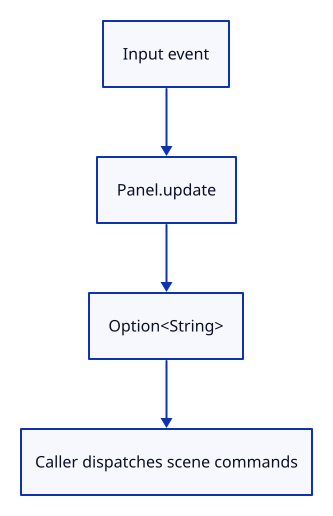

# 1.3.24 · Return accepted application commands

**Chapter 1 · Browser, Rust and the GPU · Section 1.3 · Shaders and the command dock** · [Contents](contents.md)

**Typing: 29–57 minutes.** [Estimate](typing-load.md).

Panel.update prepares input and returns an accepted application name. Help and unknown-command replies stay local; the caller will handle scene actions.

## Type

Continue from [Reserve command-row space for active tool values](03cp-options.md). [Save or recover your work](recovery.md).

### 1. `src/browser.rs`

Prepare the initial dock before presenting. Use Panel.update for input and the final layout pass. Remove inspection writes now handled inside update. Report that Panel returns application commands.

Edit these blocks from bottom to top. Keep the surrounding lines unchanged.

<details>
<summary>Locate this block</summary>

```rust
    options.set_passive(false);
    canvas.add_event_listener_with_callback_and_add_event_listener_options("wheel", redraw.as_ref().unchecked_ref(), &options)?;
    redraw.forget();
    report("The shared production dock is drawn.");
    Ok(())
}
```

</details>

Replace it with:

```rust
    options.set_passive(false);
    canvas.add_event_listener_with_callback_and_add_event_listener_options("wheel", redraw.as_ref().unchecked_ref(), &options)?;
    redraw.forget();
    report("Panel returns accepted application commands.");
    Ok(())
}
```

<details>
<summary>Locate this block</summary>

```rust
    surface.configure(&device, &config);
    let renderer = Renderer::new(device, queue, config.format.add_srgb_suffix());
    let mut panel = crate::panel::Panel::new(&renderer, config.format.add_srgb_suffix(), &["Help"]);
    present(&surface, &renderer, &mut panel)?;
    let input_canvas = canvas.clone();
    let redraw = wasm_bindgen::closure::Closure::<dyn FnMut(web_sys::Event)>::new(move |event: web_sys::Event| {
        if let Some(key) = event.dyn_ref::<web_sys::KeyboardEvent>() { panel.key(key); }
        if let Some(wheel) = event.dyn_ref::<web_sys::WheelEvent>() { panel.wheel(wheel, &input_canvas); }
        if let Some(pointer) = event.dyn_ref::<web_sys::PointerEvent>() { panel.pointer(pointer, &input_canvas); }
        {
            if let Err(error) = present(&surface, &renderer, &mut panel) {
                report(&format!("Cannot redraw: {error:?}"));
            }
            if let Err(error) = input_canvas.set_attribute("data-command-ui", &panel.inspect()) {
                report(&format!("Cannot inspect dock: {error:?}"));
            }
            if let Err(error) = input_canvas.set_attribute("data-command", panel.command()) {
                report(&format!("Cannot inspect text: {error:?}"));
            }
            if let Err(error) = input_canvas.set_attribute("data-history", &serde_json::to_string(panel.history()).unwrap()) {
                report(&format!("Cannot inspect history: {error:?}"));
            }
        }
    });
    for name in ["keydown", "keyup", "pointerdown", "pointermove", "pointerup", "pointercancel"] {
```

</details>

Replace it with:

```rust
    surface.configure(&device, &config);
    let renderer = Renderer::new(device, queue, config.format.add_srgb_suffix());
    let mut panel = crate::panel::Panel::new(&renderer, config.format.add_srgb_suffix(), &["Help"]);
    panel.update(None, &canvas)?;
    present(&surface, &renderer, &mut panel)?;
    let input_canvas = canvas.clone();
    let redraw = wasm_bindgen::closure::Closure::<dyn FnMut(web_sys::Event)>::new(move |event: web_sys::Event| {
        if let Err(error) = panel.update(Some(&event), &input_canvas) {
            report(&format!("Cannot read command: {error:?}"));
        }
        if let Err(error) = panel.update(None, &input_canvas) {
            report(&format!("Cannot lay out commands: {error:?}"));
        }
        {
            if let Err(error) = present(&surface, &renderer, &mut panel) {
                report(&format!("Cannot redraw: {error:?}"));
            }
        }
    });
    for name in ["keydown", "keyup", "pointerdown", "pointermove", "pointerup", "pointercancel"] {
```

<details>
<summary>Complete updated block reference</summary>

```rust
use crate::renderer::Renderer;
use wasm_bindgen::{JsCast, JsValue};

pub fn report(message: &str) {
    if let Some(document) = web_sys::window().and_then(|window| window.document()) {
        if let Some(status) = document.get_element_by_id("status") {
            status.set_text_content(Some(message));
            if message.starts_with("Cannot") { let _ = status.remove_attribute("hidden"); }
        }
    }
}

pub async fn run() -> Result<(), JsValue> {
    let window = web_sys::window().ok_or("No browser window")?;
    let document = window.document().ok_or("No document")?;
    let canvas: web_sys::HtmlCanvasElement = document
        .get_element_by_id("canvas").ok_or("Missing canvas")?.dyn_into()?;
    let instance = wgpu::Instance::new(wgpu::InstanceDescriptor {
        backends: wgpu::Backends::BROWSER_WEBGPU,
        flags: Default::default(),
        memory_budget_thresholds: Default::default(),
        backend_options: Default::default(),
        display: None,
    });
    let surface = instance.create_surface(wgpu::SurfaceTarget::Canvas(canvas.clone()))
        .map_err(|error| JsValue::from_str(&error.to_string()))?;
    let adapter = instance.request_adapter(&wgpu::RequestAdapterOptions {
        compatible_surface: Some(&surface),
        ..Default::default()
    }).await.map_err(|error| JsValue::from_str(&error.to_string()))?;
    let (device, queue) = adapter.request_device(&wgpu::DeviceDescriptor::default())
        .await.map_err(|error| JsValue::from_str(&error.to_string()))?;
    device.on_uncaptured_error(std::sync::Arc::new(|error| report(&error.to_string())));
    let limit = device.limits().max_texture_dimension_2d;
    let width = (window.inner_width()?.as_f64().ok_or("No window width")? as u32).clamp(1, limit);
    let height = (window.inner_height()?.as_f64().ok_or("No window height")? as u32).clamp(1, limit);
    canvas.set_width(width);
    canvas.set_height(height);
    let mut config = surface.get_default_config(&adapter, width, height)
        .ok_or("No compatible surface format")?;
    config.view_formats = vec![config.format.add_srgb_suffix()];
    surface.configure(&device, &config);
    let renderer = Renderer::new(device, queue, config.format.add_srgb_suffix());
    let mut panel = crate::panel::Panel::new(&renderer, config.format.add_srgb_suffix(), &["Help"]);
    panel.update(None, &canvas)?;
    present(&surface, &renderer, &mut panel)?;
    let input_canvas = canvas.clone();
    let redraw = wasm_bindgen::closure::Closure::<dyn FnMut(web_sys::Event)>::new(move |event: web_sys::Event| {
        if let Err(error) = panel.update(Some(&event), &input_canvas) {
            report(&format!("Cannot read command: {error:?}"));
        }
        if let Err(error) = panel.update(None, &input_canvas) {
            report(&format!("Cannot lay out commands: {error:?}"));
        }
        {
            if let Err(error) = present(&surface, &renderer, &mut panel) {
                report(&format!("Cannot redraw: {error:?}"));
            }
        }
    });
    for name in ["keydown", "keyup", "pointerdown", "pointermove", "pointerup", "pointercancel"] {
        window.add_event_listener_with_callback(name, redraw.as_ref().unchecked_ref())?;
    }
    let options = web_sys::AddEventListenerOptions::new();
    options.set_passive(false);
    canvas.add_event_listener_with_callback_and_add_event_listener_options("wheel", redraw.as_ref().unchecked_ref(), &options)?;
    redraw.forget();
    report("Panel returns accepted application commands.");
    Ok(())
}

fn present(surface: &wgpu::Surface<'_>, renderer: &Renderer, panel: &mut crate::panel::Panel) -> Result<(), JsValue> {
    let frame = match surface.get_current_texture() {
        wgpu::CurrentSurfaceTexture::Success(frame)
        | wgpu::CurrentSurfaceTexture::Suboptimal(frame) => frame,
        other => return Err(JsValue::from_str(&format!("Surface unavailable: {other:?}"))),
    };
    let view = frame.texture.create_view(&wgpu::TextureViewDescriptor {
        format: Some(frame.texture.format().add_srgb_suffix()),
        ..Default::default()
    });
    renderer.draw(&view);
    panel.draw(renderer, &view);
    frame.present();
    Ok(())
}
```

</details>

<details>
<summary>Optional patch references</summary>

Use these original edit fragments when comparing a saved checkpoint. Apply the complete blocks above.

```text
--8<-- "journey/code/03cn-handoff-direct-01.rs"
```

```text
--8<-- "journey/code/03cn-handoff-direct-02.rs"
```

```text
--8<-- "journey/code/03cn-handoff-direct-03.rs"
```

```text
--8<-- "journey/code/03cn-handoff-direct-04.rs"
```

</details>

### 2. `src/panel.rs`

Remove replies now handled by Panel.update. Expose whether the dock consumed this event. Initialize event consumption. Start with folded history and focus the command field. Answer local commands; return accepted application names from update. Allow prepare to set viewport input scale. Supply the physical pixel scale to egui. Move command answers out of prepare. Return the accepted line from prepare. Paint prepared output without replaying input.

Edit these blocks from bottom to top. Keep the surrounding lines unchanged.

<details>
<summary>Locate this block</summary>

```rust
        if let Some(control) = self.controls.as_ref().and_then(|items| items.iter().find(|item| item.key == "command/resize")) {
            self.top = control.rect[1];
        }
        if let Some(line) = line { if line != "Escape" { self.commands.reply(&mut self.model, &line); } }
        if let Some(previous) = self.output.as_mut() { previous.append(output); }
        else { self.output = Some(output); }
    }

    pub fn draw(&mut self, renderer: &Renderer, target: &wgpu::TextureView) {
        self.screen.size_in_pixels = [target.texture().width(), target.texture().height()];
        self.prepare();
        self.prepare();
        let Some(output) = self.output.take() else { return; };
        // The font atlas is a texture: upload its changed pixels before drawing the letters.
        for (id, delta) in &output.textures_delta.set {
```

</details>

Replace it with:

```rust
        if let Some(control) = self.controls.as_ref().and_then(|items| items.iter().find(|item| item.key == "command/resize")) {
            self.top = control.rect[1];
        }
        if let Some(previous) = self.output.as_mut() { previous.append(output); }
        else { self.output = Some(output); }
        line
    }

    pub fn draw(&mut self, renderer: &Renderer, target: &wgpu::TextureView) {
        let Some(output) = self.output.take() else { return; };
        // The font atlas is a texture: upload its changed pixels before drawing the letters.
        for (id, delta) in &output.textures_delta.set {
```

<details>
<summary>Locate this block</summary>

```rust
            )),
            ..Default::default()
        };
        input.viewports.get_mut(&egui::ViewportId::ROOT).unwrap().native_pixels_per_point=Some(density);
        self.controls = Some(Vec::new());
        let mut line = None;
        let output = self.context.run_ui(input, |root| {
```

</details>

Replace it with:

```rust
            )),
            ..Default::default()
        };
        input.viewports.get_mut(&egui::ViewportId::ROOT).unwrap().native_pixels_per_point = Some(self.screen.pixels_per_point);
        self.controls = Some(Vec::new());
        let mut line = None;
        let output = self.context.run_ui(input, |root| {
```

<details>
<summary>Locate this block</summary>

```rust
            "completion_rect": self.model.completion_rect.map(|r| [r.min.x, r.min.y, r.max.x, r.max.y])}).to_string()
    }

    fn prepare(&mut self) {
        let size = self.screen.size_in_pixels;
        #[cfg(target_arch="wasm32")]
        let density=web_sys::window().map_or(1.0,|window|window.device_pixel_ratio() as f32);
        #[cfg(not(target_arch="wasm32"))]
        let density=1.0;
        self.screen.pixels_per_point=density;
        let mut input = egui::RawInput {
            focused: true,
            events: std::mem::take(&mut self.events),
            screen_rect: Some(egui::Rect::from_min_size(
```

</details>

Replace it with:

```rust
            "completion_rect": self.model.completion_rect.map(|r| [r.min.x, r.min.y, r.max.x, r.max.y])}).to_string()
    }

    pub fn answer(&mut self, line: &str, message: &str) {
        self.model.remember(format!("> {line}\n{message}"));
        self.model.status = message.into();
    }

    pub fn update(
        &mut self,
        event: Option<&web_sys::Event>,
        canvas: &web_sys::HtmlCanvasElement,
    ) -> Result<Option<String>, wasm_bindgen::JsValue> {
        use wasm_bindgen::JsCast;
        let rect = canvas.get_bounding_client_rect();
        self.screen.size_in_pixels = [canvas.width(), canvas.height()];
        self.screen.pixels_per_point = canvas.width() as f32 / rect.width() as f32;
        self.consumed = false;
        if let Some(event) = event {
            if let Some(key) = event.dyn_ref::<web_sys::KeyboardEvent>() { self.consumed = self.key(key); }
            if let Some(pointer) = event.dyn_ref::<web_sys::PointerEvent>() {
                self.consumed = self.pointer(pointer, canvas);
                if event.type_() == "pointerdown" {
                    let options = web_sys::FocusOptions::new(); options.set_prevent_scroll(true);
                    canvas.focus_with_options(&options)?;
                    event.prevent_default();
                }
            }
            if let Some(wheel) = event.dyn_ref::<web_sys::WheelEvent>() { self.consumed = self.wheel(wheel, canvas); }
        }
        let line = self.prepare();
        canvas.set_attribute("data-command-ui", &self.inspect())?;
        let Some(line) = line else { return Ok(None); };
        if line == "Escape" { return Ok(None); }
        if line.eq_ignore_ascii_case("Help") {
            self.answer(&line, &self.commands.0.join(" · "));
            return Ok(None);
        }
        if !self.commands.0.iter()
            .any(|name| name.eq_ignore_ascii_case(&line))
        {
            self.answer(&line, "Unknown command. Type Help.");
            return Ok(None);
        }
        self.answer(&line, "Command submitted.");
        Ok(Some(line.to_ascii_lowercase()))
    }

    fn prepare(&mut self) -> Option<String> {
        let size = self.screen.size_in_pixels;
        let mut input = egui::RawInput {
            focused: true,
            events: std::mem::take(&mut self.events),
            screen_rect: Some(egui::Rect::from_min_size(
```

<details>
<summary>Locate this block</summary>

```rust
        // One layout pass prevents a future text event from being replayed.
        context.options_mut(|options| options.max_passes = 1.try_into().unwrap());
        let painter = egui_wgpu::Renderer::new(&renderer.device, format, Default::default());
        Self { commands: Commands(commands), pointer_owned: false, top: f32::INFINITY, controls: None, context, painter, events: Vec::new(), output: None,
            screen: egui_wgpu::ScreenDescriptor { size_in_pixels: [640, 480], pixels_per_point: 1.0 }, model: CommandLine {
            command_expanded: true,
            history: ["Command history lives here.".into()].into(),
            ..Default::default()
        } }
    }
```

</details>

Replace it with:

```rust
        // One layout pass prevents a future text event from being replayed.
        context.options_mut(|options| options.max_passes = 1.try_into().unwrap());
        let painter = egui_wgpu::Renderer::new(&renderer.device, format, Default::default());
        Self { commands: Commands(commands), consumed: false, pointer_owned: false, top: f32::INFINITY, controls: None, context, painter, events: Vec::new(), output: None,
            screen: egui_wgpu::ScreenDescriptor { size_in_pixels: [640, 480], pixels_per_point: 1.0 }, model: CommandLine {
            focus_command: true,
            ..Default::default()
        } }
    }
```

<details>
<summary>Locate this block</summary>

```rust
    }
}

impl Commands {
    fn reply(&self, model: &mut CommandLine, line: &str) {
        let line = self.canonical(line);
        let message = if line.eq_ignore_ascii_case("Help") { self.0.join(" · ") }
            else { "Unknown command. Type Help.".into() };
        model.status = message;
        model.remember(format!("> {line}\n{}", model.status));
    }
}

pub struct Panel {
    commands: Commands,
    pointer_owned: bool,
    top: f32,
    controls: Option<Vec<command_dock::Control>>,
```

</details>

Replace it with:

```rust
    }
}

pub struct Panel {
    commands: Commands,
    pub consumed: bool,
    pointer_owned: bool,
    top: f32,
    controls: Option<Vec<command_dock::Control>>,
```

<details>
<summary>Complete updated block reference</summary>

```rust
use crate::command_dock::{self, CommandLine, Commands as _, theme};
use crate::renderer::Renderer;

struct Commands(&'static [&'static str]);

impl command_dock::Commands for Commands {
    fn canonical(&self, line: &str) -> String {
        let line = line.split_whitespace().collect::<Vec<_>>().join(" ");
        self.0
            .iter()
            .find(|name| name.eq_ignore_ascii_case(&line))
            .map_or(line.clone(), |name| (*name).into())
    }
    fn choosing_option(&self, _: &str) -> bool {
        false
    }
    fn accept(&self, line: &str) -> (String, bool) {
        (self.canonical(line), true)
    }
    fn completions(&self, line: &str) -> Vec<&'static str> {
        crate::command_vocabulary::ranked(self.0.as_ref(), line)
    }
    fn browse(&self, line: &str) -> Vec<&'static str> {
        self.completions(line)
    }
}

pub struct Panel {
    commands: Commands,
    pub consumed: bool,
    pointer_owned: bool,
    top: f32,
    controls: Option<Vec<command_dock::Control>>,
    context: egui::Context,
    painter: egui_wgpu::Renderer,
    model: CommandLine,
    events: Vec<egui::Event>,
    output: Option<egui::FullOutput>,
    screen: egui_wgpu::ScreenDescriptor,
}

impl Panel {
    pub fn new(renderer: &Renderer, format: wgpu::TextureFormat, commands: &'static [&'static str]) -> Self {
        let context = egui::Context::default();
        context.set_fonts(theme::fonts([
            include_bytes!("../assets/text/NotoSans-Regular.subset.ttf"),
            include_bytes!("../assets/text/NotoSansSymbols2-Regular.subset.ttf"),
            include_bytes!("../assets/text/NotoSansSymbols-Regular.subset.ttf"),
        ]));
        context.set_theme(egui::Theme::Light);
        context.set_visuals(theme::visuals());
        // One layout pass prevents a future text event from being replayed.
        context.options_mut(|options| options.max_passes = 1.try_into().unwrap());
        let painter = egui_wgpu::Renderer::new(&renderer.device, format, Default::default());
        Self { commands: Commands(commands), consumed: false, pointer_owned: false, top: f32::INFINITY, controls: None, context, painter, events: Vec::new(), output: None,
            screen: egui_wgpu::ScreenDescriptor { size_in_pixels: [640, 480], pixels_per_point: 1.0 }, model: CommandLine {
            focus_command: true,
            ..Default::default()
        } }
    }

    pub fn command(&self) -> &str { &self.model.command }

    pub fn history(&self) -> &std::collections::VecDeque<String> { &self.model.history }

    pub fn key(&mut self, event: &web_sys::KeyboardEvent) -> bool {
        if event.is_composing() { return false; }
        let modifiers = egui::Modifiers {
            alt: event.alt_key(), ctrl: event.ctrl_key(), shift: event.shift_key(),
            mac_cmd: event.meta_key(), command: event.ctrl_key() || event.meta_key(),
        };
        let text = event.type_() == "keydown" && event.key().chars().count() == 1
            && !modifiers.command && !modifiers.alt;
        if text {
            if !self.context.egui_wants_keyboard_input() { self.model.focus_command = true; }
            self.context.memory_mut(|memory| memory.request_focus(egui::Id::new("command-input")));
            self.model.command_open = true;
        }
        if !self.context.egui_wants_keyboard_input() { return false; }
        if let Some(key) = egui::Key::from_name(&event.key()) {
            self.events.push(egui::Event::Key {
                key, physical_key: None, pressed: event.type_() == "keydown",
                repeat: event.repeat(), modifiers,
            });
        }
        if text { self.events.push(egui::Event::Text(event.key())); }
        event.prevent_default();
        true
    }

    pub fn pointer(&mut self, event: &web_sys::PointerEvent, canvas: &web_sys::HtmlCanvasElement) -> bool {
        let rect = canvas.get_bounding_client_rect();
        let pos = egui::pos2((event.client_x() as f64 - rect.left()) as f32, (event.client_y() as f64 - rect.top()) as f32);
        let over = pos.y >= self.top || self.model.completion_rect.is_some_and(|r| r.contains(pos));
        let owned = over || self.pointer_owned;
        if event.type_() == "pointerdown" {
            self.pointer_owned = over;
            if !over {
                self.model.command_open = false;
                self.model.focus_command = false;
                self.context.memory_mut(|memory| memory.surrender_focus(egui::Id::new("command-input")));
            }
        }
        self.events.push(egui::Event::PointerMoved(pos));
        if matches!(event.type_().as_str(), "pointercancel" | "lostpointercapture") {
            for button in [egui::PointerButton::Primary, egui::PointerButton::Middle, egui::PointerButton::Secondary] {
                self.events.push(egui::Event::PointerButton { pos, button, pressed: false, modifiers: Default::default() });
            }
            self.events.push(egui::Event::PointerGone);
        } else if matches!(event.type_().as_str(), "pointerdown" | "pointerup") {
            let button = match event.button() { 0 => egui::PointerButton::Primary, 1 => egui::PointerButton::Middle, _ => egui::PointerButton::Secondary };
            self.events.push(egui::Event::PointerButton { pos, button, pressed: event.type_() == "pointerdown", modifiers: Default::default() });
        }
        if matches!(event.type_().as_str(), "pointerup" | "pointercancel" | "lostpointercapture") { self.pointer_owned = false; }
        if owned { event.prevent_default(); }
        owned
    }

    pub fn wheel(&mut self, event: &web_sys::WheelEvent, canvas: &web_sys::HtmlCanvasElement) -> bool {
        let rect = canvas.get_bounding_client_rect();
        let pos = egui::pos2((event.client_x() as f64 - rect.left()) as f32, (event.client_y() as f64 - rect.top()) as f32);
        self.events.push(egui::Event::PointerMoved(pos));
        self.events.push(egui::Event::MouseWheel {
            unit: match event.delta_mode() { 1 => egui::MouseWheelUnit::Line, 2 => egui::MouseWheelUnit::Page, _ => egui::MouseWheelUnit::Point },
            phase: egui::TouchPhase::Move, delta: egui::vec2(-event.delta_x() as f32, -event.delta_y() as f32), modifiers: Default::default(),
        });
        let over = pos.y >= self.top || self.model.completion_rect.is_some_and(|r| r.contains(pos));
        if over { event.prevent_default(); }
        over
    }

    pub fn inspect(&self) -> String {
        serde_json::json!({"controls": self.controls, "command": self.model.command, "history": self.model.history,
            "pointer_owned": self.pointer_owned,
            "top": self.top, "focused": self.context.egui_wants_keyboard_input(),
            "completion_rect": self.model.completion_rect.map(|r| [r.min.x, r.min.y, r.max.x, r.max.y])}).to_string()
    }

    pub fn answer(&mut self, line: &str, message: &str) {
        self.model.remember(format!("> {line}\n{message}"));
        self.model.status = message.into();
    }

    pub fn update(
        &mut self,
        event: Option<&web_sys::Event>,
        canvas: &web_sys::HtmlCanvasElement,
    ) -> Result<Option<String>, wasm_bindgen::JsValue> {
        use wasm_bindgen::JsCast;
        let rect = canvas.get_bounding_client_rect();
        self.screen.size_in_pixels = [canvas.width(), canvas.height()];
        self.screen.pixels_per_point = canvas.width() as f32 / rect.width() as f32;
        self.consumed = false;
        if let Some(event) = event {
            if let Some(key) = event.dyn_ref::<web_sys::KeyboardEvent>() { self.consumed = self.key(key); }
            if let Some(pointer) = event.dyn_ref::<web_sys::PointerEvent>() {
                self.consumed = self.pointer(pointer, canvas);
                if event.type_() == "pointerdown" {
                    let options = web_sys::FocusOptions::new(); options.set_prevent_scroll(true);
                    canvas.focus_with_options(&options)?;
                    event.prevent_default();
                }
            }
            if let Some(wheel) = event.dyn_ref::<web_sys::WheelEvent>() { self.consumed = self.wheel(wheel, canvas); }
        }
        let line = self.prepare();
        canvas.set_attribute("data-command-ui", &self.inspect())?;
        let Some(line) = line else { return Ok(None); };
        if line == "Escape" { return Ok(None); }
        if line.eq_ignore_ascii_case("Help") {
            self.answer(&line, &self.commands.0.join(" · "));
            return Ok(None);
        }
        if !self.commands.0.iter()
            .any(|name| name.eq_ignore_ascii_case(&line))
        {
            self.answer(&line, "Unknown command. Type Help.");
            return Ok(None);
        }
        self.answer(&line, "Command submitted.");
        Ok(Some(line.to_ascii_lowercase()))
    }

    fn prepare(&mut self) -> Option<String> {
        let size = self.screen.size_in_pixels;
        let mut input = egui::RawInput {
            focused: true,
            events: std::mem::take(&mut self.events),
            screen_rect: Some(egui::Rect::from_min_size(
                egui::Pos2::ZERO, egui::vec2(size[0] as f32, size[1] as f32) / self.screen.pixels_per_point,
            )),
            ..Default::default()
        };
        input.viewports.get_mut(&egui::ViewportId::ROOT).unwrap().native_pixels_per_point = Some(self.screen.pixels_per_point);
        self.controls = Some(Vec::new());
        let mut line = None;
        let output = self.context.run_ui(input, |root| {
            command_dock::draw(root, &mut self.model, &mut self.controls, &mut line, &self.commands, true);
        });
        if let Some(control) = self.controls.as_ref().and_then(|items| items.iter().find(|item| item.key == "command/resize")) {
            self.top = control.rect[1];
        }
        if let Some(previous) = self.output.as_mut() { previous.append(output); }
        else { self.output = Some(output); }
        line
    }

    pub fn draw(&mut self, renderer: &Renderer, target: &wgpu::TextureView) {
        let Some(output) = self.output.take() else { return; };
        // The font atlas is a texture: upload its changed pixels before drawing the letters.
        for (id, delta) in &output.textures_delta.set {
            self.painter.update_texture(&renderer.device, &renderer.queue, *id, delta);
        }
        let jobs = self.context.tessellate(output.shapes, output.pixels_per_point);
        let mut encoder = renderer.device.create_command_encoder(&Default::default());
        let mut buffers = self.painter.update_buffers(
            &renderer.device, &renderer.queue, &mut encoder, &jobs, &self.screen,
        );
        let pass = encoder.begin_render_pass(&wgpu::RenderPassDescriptor {
            label: Some("command panel"),
            color_attachments: &[Some(wgpu::RenderPassColorAttachment {
                view: target, resolve_target: None, depth_slice: None,
                ops: wgpu::Operations { load: wgpu::LoadOp::Load, store: wgpu::StoreOp::Store },
            })],
            ..Default::default()
        });
        self.painter.render(&mut pass.forget_lifetime(), &jobs, &self.screen);
        buffers.push(encoder.finish());
        renderer.queue.submit(buffers);
        for id in output.textures_delta.free { self.painter.free_texture(&id); }
    }
}
```

</details>

<details>
<summary>Optional patch references</summary>

Use these original edit fragments when comparing a saved checkpoint. Apply the complete blocks above.

```text
--8<-- "journey/code/03cn-handoff-direct-05.rs"
```

```text
--8<-- "journey/code/03cn-handoff-direct-06.rs"
```

```text
--8<-- "journey/code/03cn-handoff-direct-07.rs"
```

```text
--8<-- "journey/code/03cn-handoff-direct-08.rs"
```

```text
--8<-- "journey/code/03cn-handoff-direct-09.rs"
```

```text
--8<-- "journey/code/03cn-handoff-direct-10.rs"
```

```text
--8<-- "journey/code/03cn-handoff-direct-11.rs"
```

```text
--8<-- "journey/code/03cn-handoff-direct-12.rs"
```

```text
--8<-- "journey/code/03cn-handoff-direct-13.rs"
```

```text
--8<-- "journey/code/03cn-handoff-direct-14.rs"
```

</details>

## Run and check

In your project:

```sh
cd workspace/journey
cargo build --lib --locked --target wasm32-unknown-unknown -j1
CARGO_BUILD_JOBS=1 trunk serve --port 8780
```

Open `http://127.0.0.1:8780/`. Keep an existing Trunk server running; saving rebuilds it.

Type Help and press Enter. The field clears and exactly one answer appears.

### Recorded visual result

**Previous native render — current verification pending.**

This checkpoint was rendered independently and has the same native comparison frame as [Reserve command-row space for active tool values](03cp-options.md). Use its state checks and browser exercise to assess the changed behavior.


*This recorded image predates a source or checker change. Rebuild this checkpoint before using it as current evidence; browser controls require separate acceptance.*

This reference image is shared with [1.3.1 · Give the GPU three corners](03-triangle.md). It does not demonstrate a new feature by itself.

<details>
<summary>Code explanation and diagram</summary>


Keep editing local and return accepted names to the caller.



Why return Option<String>?

Most input edits the field; only an accepted application command needs dispatch.

Study estimate, including typing and experiments: 0.75–1.25 hours.

</details>

<details>
<summary>Optional experiment</summary>

Submit an unknown name. The dock should answer locally and leave the triangle unchanged.

</details>

<details>
<summary>Check and save your work</summary>

Restore experimental edits, then run from `session_viewer`:

```sh
npm --prefix ../session_tests run course -- check 1.3.24
npm --prefix ../session_tests run course -- save 1.3.24
```

Source comparison leaves your project untouched. [Save and recovery instructions](recovery.md).

</details>

<details>
<summary>Viewer coverage and verification</summary>

This step connects one responsibility of the production command dock. Scene commands are added in the following lessons.


[Full validation scope](release.md).

To reproduce the scripted acceptance of the reference checkpoint, run from `session_viewer` with the [course bundle server](release.md#reproduce) running on port 8781:

```sh
npm --prefix ../session_tests run course -- capture 1.3.24
```

This uses the verified reference bundle; it does not check or change your typed project.

</details>
