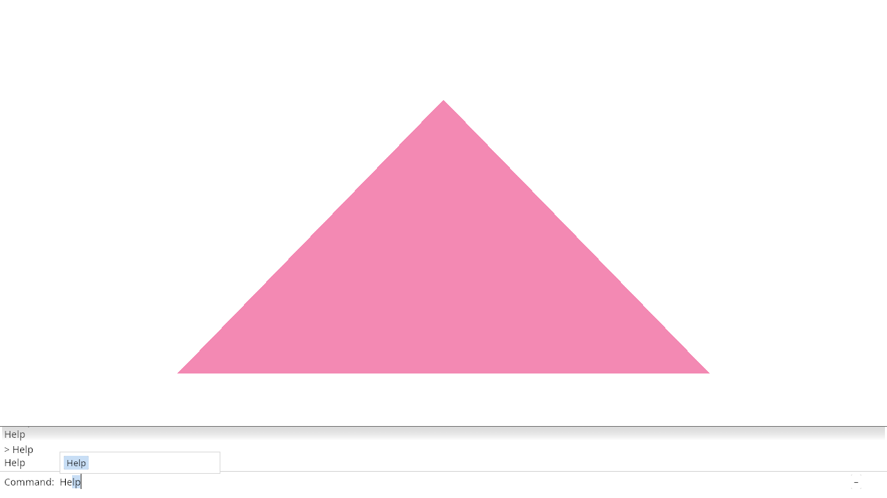

# The command dock

<a id="checkpoint-03d-input"></a>

Type, complete and submit Help in a GPU command dock while keeping the scene unchanged.

## Prerequisites and ownership

Complete [Shaders and first egui painting](03-triangle.md). This subject owns command text, retained history, completion, option buttons and keyboard/pointer ownership. It supplies `command_dock/{mod,theme,view}.rs`, `command_vocabulary.rs`, the panel adapter, browser event wiring and option-button tests.

The shared dock receives a `Commands` implementation instead of importing application commands. This checkpoint supplies Help; later subjects supply their own vocabulary. The focus adapter is completed here, before another editor needs keyboard focus. Adding layer controls must not rewrite the dock.

## Build

Copy the complete files below; type the model, vocabulary and event-routing sections as you study them.

### Retained state and application vocabulary

Use `src/command_dock/mod.rs`:

```rust
--8<-- "journey/code/03-dock-3.rs"
```

Start with `CommandLine`: drawing happens repeatedly, so text, history and the selected completion must survive between frames. Visibility is separate state. Collapsing history does not delete its entries. `take_command` transfers one submitted string to the caller; an empty Enter must not manufacture a command.

`Commands` defines the application's boundary: canonical names, whether an option is being chosen, acceptance, completion and browsing. The dock paints and edits; its caller decides what a command means.

Use `src/command_vocabulary.rs`:

```rust
--8<-- "journey/code/03-dock-7.rs"
```

Prefix matching is case-insensitive for this ASCII vocabulary. Rank an exact match first, then a complete word followed by a space, then longer prefixes. The visible selection stays predictable as the application grows its command list.

### Completion, selection and focus

Follow `refresh`, `browse`, `popup` and the cursor helpers in the dock source. A suggested suffix is selected text, not a second command string. Backspace rejects that selected suffix; Tab accepts a completion and leaves space for another word. Egui cursor positions count characters, so the cursor helpers must not confuse UTF-8 bytes with character positions.

`command_open` controls visibility. `focus_command` requests focus once. Thereafter completions and Escape follow the actual field response, including focus lost during the current frame. Continually requesting focus because a dock is open would prevent a layer-name field from retaining it.

The widget rectangles are interaction data. Record the input, completion and option rectangles after layout so later pointer events use the positions actually drawn. History and completion can both be visible without sharing one scrolling policy.

### Layout and option buttons

Use `src/command_dock/view.rs` and `src/command_dock/theme.rs`:

```rust
--8<-- "journey/code/03-dock-4.rs"
```

```rust
--8<-- "journey/code/03-dock-2.rs"
```

`view.rs` measures and places the field and retained history. The theme owns font registration and palette choices. Option buttons belong to the running command: their labels and submitted strings are separate values. Measure button widths before deciding how much space remains for the text field. The command itself still goes through the same submission boundary.

Copy the option-button checks into `src/command_dock/tool_buttons_tests.rs`:

```rust
--8<-- "journey/code/03-dock-9.rs"
```

### Browser events and pointer ownership

Use `src/panel.rs`:

```rust
--8<-- "journey/code/03-dock-1.rs"
```

Keyboard events produce egui key and text events. Skip an event while the browser reports composition; do not turn an unfinished composed character into a command. The adapter distinguishes key-down from key-up and preserves modifiers and repeat information.

Pointer coordinates are CSS points relative to the canvas. Do not multiply them by display density: egui layout uses the same logical points. A press over the dock owns the interaction until release, even after the pointer leaves its rectangle. Both cancellation and lost capture release all pressed buttons; otherwise a disappearing browser gesture can leave the interface dragging forever.

Wheel deltas carry pixel, line or page units. Preserve that unit when translating the event. Prevent the browser's default behavior only when the dock consumes the input; scene gestures need the remaining events.

### Draw after input, present after drawing

Use `src/browser.rs`, `src/lib.rs` and `Cargo.toml`:

```rust
--8<-- "journey/code/03-dock-5.rs"
```

```rust
--8<-- "journey/code/03d-input-cumulative-7-lib.rs"
```

```toml
--8<-- "journey/code/03d-input-cumulative-kernel-feature-8.toml"
```

The browser retains the panel with the renderer, routes input into it, and presents the resulting frame. It uses the existing scene and egui passes. A command may change retained UI state without changing a single scene pixel.

## Register startup

Register the command-dock constructor as the default viewer mode, retaining the mathematics constructor. The first-frame subject owns the fixed entry and explains its asynchronous constructor type. This registration changes which completed implementation starts; it does not replace the entry or the mathematics files.

### `examples/course/registration.rs`

Select the viewer for the input subject; mathematics remains registered.

```rust
--8<-- "journey/code/03d-input-cumulative-default.rs"
```

## Run and observe

From `session_viewer`:

```sh
npm --prefix ../session_tests run course -- reference 03d-input --output target/command-dock
cd target/command-dock
trunk serve --port 8780
```

Click the scene and type `He`: the dock opens and suggests Help. Backspace rejects the selected suffix; Tab accepts it. Enter submits once and adds one history entry. Clicking a completion submits it through the same path. Collapsing history retains its contents.

## Predict and try

Predict whether collapsing history deletes it. Submit Help twice, collapse the dock, then expand it. The same entries remain because layout visibility and retained history are different state.

## Question and answer

Why must pointer cancellation release ownership even when no normal pointer-up arrives?

The browser can interrupt a gesture or lose capture. Retaining the pressed state would let subsequent motion act like a drag, even though the user has already ended the gesture.

## Validation

The [original checkpoints and exact focus adapter](../archived/command-dock/checkpoints.json) are retained. Their 22 executable steps are consolidated into one subject; the complete course endpoint remains unchanged. The layer lesson now uses the completed focus behavior without rewriting it. The corrected checkpoint passes desktop and upright browser tests for typing, completion, history, pointer cancellation, lost capture and unchanged scene pixels. Four locked native tests cover option buttons and focus ownership; locked wasm compilation, optimized bundling and native scene-pixel verification also pass. See the [evidence](dock-evidence.json).



Later panel and browser ownership remains unfinished. The course does not yet satisfy the finished-subject rule globally.
