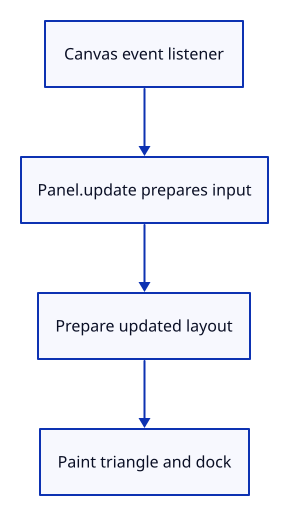

# 1.3.25 · Hand commands to the application

**Chapter 1 · Browser, Rust and the GPU · Section 1.3 · Shaders and the command dock** · [Contents](contents.md)

**Typing: 22–44 minutes.** [Estimate](typing-load.md).

Listen on the canvas and hand events to Panel.update. Prepare the dock again after input, then paint one frame. Typing after a scene click focuses the field immediately.

## Type

Continue from [Return accepted application commands](03cn-handoff.md). [Save or recover your work](recovery.md).

### 1. `src/browser.rs`

Import the retained Closure type. Keep canvas acquisition ready for canvas-owned input. Keep GPU setup with the final browser event owner. Remove the intermediate event callback setup. Keep surface configuration before the canvas input owner. Handle command update errors in the canvas callback. Stop the callback after a layout failure. Present after preparing the final command layout. Register drawing and keyboard events on the canvas. Retain the wheel callback for the page lifetime. Give surface presentation its complete function. Return a useful error when the surface is unavailable.

<details>
<summary>Locate the existing block</summary>

```rust
use crate::renderer::Renderer;
use wasm_bindgen::{JsCast, JsValue};

pub fn report(message: &str) {
    if let Some(document) = web_sys::window().and_then(|window| window.document()) {
        if let Some(status) = document.get_element_by_id("status") {
            status.set_text_content(Some(message));
            if message.starts_with("Cannot") { let _ = status.remove_attribute("hidden"); }
        }
    }
}

pub async fn run() -> Result<(), JsValue> {
    let window = web_sys::window().ok_or("No browser window")?;
    let document = window.document().ok_or("No document")?;
    let canvas: web_sys::HtmlCanvasElement = document
        .get_element_by_id("canvas").ok_or("Missing canvas")?.dyn_into()?;
    let instance = wgpu::Instance::new(wgpu::InstanceDescriptor {
        backends: wgpu::Backends::BROWSER_WEBGPU,
        flags: Default::default(),
        memory_budget_thresholds: Default::default(),
        backend_options: Default::default(),
        display: None,
    });
    let surface = instance.create_surface(wgpu::SurfaceTarget::Canvas(canvas.clone()))
        .map_err(|error| JsValue::from_str(&error.to_string()))?;
    let adapter = instance.request_adapter(&wgpu::RequestAdapterOptions {
        compatible_surface: Some(&surface),
        ..Default::default()
    }).await.map_err(|error| JsValue::from_str(&error.to_string()))?;
    let (device, queue) = adapter.request_device(&wgpu::DeviceDescriptor::default())
        .await.map_err(|error| JsValue::from_str(&error.to_string()))?;
    device.on_uncaptured_error(std::sync::Arc::new(|error| report(&error.to_string())));
    let limit = device.limits().max_texture_dimension_2d;
    let width = (window.inner_width()?.as_f64().ok_or("No window width")? as u32).clamp(1, limit);
    let height = (window.inner_height()?.as_f64().ok_or("No window height")? as u32).clamp(1, limit);
    canvas.set_width(width);
    canvas.set_height(height);
    let mut config = surface.get_default_config(&adapter, width, height)
        .ok_or("No compatible surface format")?;
    config.view_formats = vec![config.format.add_srgb_suffix()];
    surface.configure(&device, &config);
    let renderer = Renderer::new(device, queue, config.format.add_srgb_suffix());
    let mut panel = crate::panel::Panel::new(&renderer, config.format.add_srgb_suffix(), &["Help"]);
    panel.update(None, &canvas)?;
    present(&surface, &renderer, &mut panel)?;
    let input_canvas = canvas.clone();
    let redraw = wasm_bindgen::closure::Closure::<dyn FnMut(web_sys::Event)>::new(move |event: web_sys::Event| {
        if let Err(error) = panel.update(Some(&event), &input_canvas) {
            report(&format!("Cannot read command: {error:?}"));
        }
        if let Err(error) = panel.update(None, &input_canvas) {
            report(&format!("Cannot lay out commands: {error:?}"));
        }
        {
            if let Err(error) = present(&surface, &renderer, &mut panel) {
                report(&format!("Cannot redraw: {error:?}"));
            }
        }
    });
    for name in ["keydown", "keyup", "pointerdown", "pointermove", "pointerup", "pointercancel"] {
        window.add_event_listener_with_callback(name, redraw.as_ref().unchecked_ref())?;
    }
    let options = web_sys::AddEventListenerOptions::new();
    options.set_passive(false);
    canvas.add_event_listener_with_callback_and_add_event_listener_options("wheel", redraw.as_ref().unchecked_ref(), &options)?;
    redraw.forget();
    report("Panel returns accepted application commands.");
    Ok(())
}

fn present(surface: &wgpu::Surface<'_>, renderer: &Renderer, panel: &mut crate::panel::Panel) -> Result<(), JsValue> {
    let frame = match surface.get_current_texture() {
        wgpu::CurrentSurfaceTexture::Success(frame)
        | wgpu::CurrentSurfaceTexture::Suboptimal(frame) => frame,
        other => return Err(JsValue::from_str(&format!("Surface unavailable: {other:?}"))),
    };
    let view = frame.texture.create_view(&wgpu::TextureViewDescriptor {
        format: Some(frame.texture.format().add_srgb_suffix()),
        ..Default::default()
    });
    renderer.draw(&view);
    panel.draw(renderer, &view);
    frame.present();
    Ok(())
}
```

</details>

Edit the existing block to match this code; keep unchanged lines:

```rust
use crate::renderer::Renderer;
use wasm_bindgen::{JsCast, JsValue, closure::Closure};

pub fn report(message: &str) {
    if let Some(document) = web_sys::window().and_then(|window| window.document()) {
        if let Some(status) = document.get_element_by_id("status") {
            status.set_text_content(Some(message));
            if message.starts_with("Cannot") { let _ = status.remove_attribute("hidden"); }
        }
    }
}

pub async fn run() -> Result<(), JsValue> {
    let window = web_sys::window().ok_or("No browser window")?;
    let document = window.document().ok_or("No document")?;
    let canvas: web_sys::HtmlCanvasElement = document
        .get_element_by_id("canvas")
        .ok_or("Missing canvas")?
        .dyn_into()?;
    let instance = wgpu::Instance::new(wgpu::InstanceDescriptor {
        backends: wgpu::Backends::BROWSER_WEBGPU,
        flags: Default::default(),
        memory_budget_thresholds: Default::default(),
        backend_options: Default::default(),
        display: None,
    });
    let surface = instance
        .create_surface(wgpu::SurfaceTarget::Canvas(canvas.clone()))
        .map_err(|error| JsValue::from_str(&error.to_string()))?;
    let adapter = instance
        .request_adapter(&wgpu::RequestAdapterOptions {
            compatible_surface: Some(&surface),
            ..Default::default()
        })
        .await
        .map_err(|error| JsValue::from_str(&error.to_string()))?;
    let (device, queue) = adapter
        .request_device(&wgpu::DeviceDescriptor::default())
        .await
        .map_err(|error| JsValue::from_str(&error.to_string()))?;
    device.on_uncaptured_error(std::sync::Arc::new(|error| report(&error.to_string())));
    let limit = device.limits().max_texture_dimension_2d;
    let width = (window.inner_width()?.as_f64().ok_or("No window width")? as u32).clamp(1, limit);
    let height = (window.inner_height()?.as_f64().ok_or("No window height")? as u32).clamp(1, limit);
    canvas.set_width(width);
    canvas.set_height(height);
    let mut config = surface
        .get_default_config(&adapter, width, height)
        .ok_or("No compatible surface format")?;
    config.view_formats = vec![config.format.add_srgb_suffix()];
    surface.configure(&device, &config);
    let renderer = Renderer::new(device, queue, config.format.add_srgb_suffix());
    let mut panel = crate::panel::Panel::new(&renderer, config.format.add_srgb_suffix(), &["Help"]);
    panel.update(None, &canvas)?;
    present(&surface, &renderer, &mut panel)?;
    let input_canvas = canvas.clone();
    let click = Closure::<dyn FnMut(web_sys::Event)>::new(move |event: web_sys::Event| {
        let _line = match panel.update(Some(&event), &input_canvas) {
            Ok(line) => line,
            Err(error) => {
                report(&format!("Cannot read command: {error:?}"));
                return;
            }
        };
        if let Err(error) = panel.update(None, &input_canvas) {
            report(&format!("Cannot lay out commands: {error:?}"));
            return;
        }
        if let Err(error) = present(&surface, &renderer, &mut panel) {
            report(&format!("Cannot redraw: {error:?}"));
        }
    });
    for name in [
        "pointerdown",
        "pointermove",
        "pointerup",
        "pointercancel",
        "lostpointercapture",
        "contextmenu",
        "keydown",
        "keyup",
        "blur",
    ] {
        canvas.add_event_listener_with_callback(name, click.as_ref().unchecked_ref())?;
    }
    let options = web_sys::AddEventListenerOptions::new();
    options.set_passive(false);
    canvas.add_event_listener_with_callback_and_add_event_listener_options(
        "wheel",
        click.as_ref().unchecked_ref(),
        &options,
    )?;
    // The page has one listener for its lifetime; JavaScript must retain the Rust callback.
    click.forget();
    report("Type Help in the command field and press Enter.");
    Ok(())
}

fn present(
    surface: &wgpu::Surface<'_>,
    renderer: &Renderer,
    panel: &mut crate::panel::Panel,
) -> Result<(), JsValue> {
    let frame = match surface.get_current_texture() {
        wgpu::CurrentSurfaceTexture::Success(frame)
        | wgpu::CurrentSurfaceTexture::Suboptimal(frame) => frame,
        other => {
            return Err(JsValue::from_str(&format!(
                "Surface unavailable: {other:?}"
            )));
        }
    };
    let view = frame.texture.create_view(&wgpu::TextureViewDescriptor {
        format: Some(frame.texture.format().add_srgb_suffix()),
        ..Default::default()
    });
    renderer.draw(&view);
    panel.draw(renderer, &view);
    frame.present();
    Ok(())
}
```

<details>
<summary>Optional patch references</summary>

Use these original edit fragments when comparing a saved checkpoint. Apply the complete blocks above.

```text
--8<-- "journey/code/03d-input-direct-01.rs"
```

```text
--8<-- "journey/code/03d-input-direct-02.rs"
```

```text
--8<-- "journey/code/03d-input-direct-03.rs"
```

```text
--8<-- "journey/code/03d-input-direct-04.rs"
```

```text
--8<-- "journey/code/03d-input-direct-05.rs"
```

```text
--8<-- "journey/code/03d-input-direct-06.rs"
```

```text
--8<-- "journey/code/03d-input-direct-07.rs"
```

```text
--8<-- "journey/code/03d-input-direct-08.rs"
```

```text
--8<-- "journey/code/03d-input-direct-09.rs"
```

```text
--8<-- "journey/code/03d-input-direct-10.rs"
```

```text
--8<-- "journey/code/03d-input-direct-11.rs"
```

```text
--8<-- "journey/code/03d-input-direct-12.rs"
```

</details>

## Run and check

In your project:

```sh
cd workspace/journey
cargo build --lib --locked --target wasm32-unknown-unknown -j1
CARGO_BUILD_JOBS=1 trunk serve --port 8780
```

Open `http://127.0.0.1:8780/`. Keep an existing Trunk server running; saving rebuilds it.

Click the scene, type Help and press Enter. One answer appears in the real dock.

### Recorded visual result

**Previous native render — current verification pending.**


*This recorded image predates a source or checker change. Rebuild this checkpoint before using it as current evidence; browser controls require separate acceptance.*

This reference image is shared with [1.3.1 · Give the GPU three corners](03-triangle.md). It does not demonstrate a new feature by itself.

<details>
<summary>Code explanation and diagram</summary>


Return accepted commands while keeping editing inside Panel.



Why prepare again before painting?

Input can change layout or history; the final frame must show the updated model.

Study estimate, including typing and experiments: 0.5–1 hours.

</details>

<details>
<summary>Optional experiment</summary>

Click the scene between two Help submissions. Each submission should add one answer without requiring a field click.

</details>

<details>
<summary>Check and save your work</summary>

Restore experimental edits, then run from `session_viewer`:

```sh
npm --prefix ../session_tests run course -- check 1.3.25
npm --prefix ../session_tests run course -- save 1.3.25
```

Source comparison leaves your project untouched. [Save and recovery instructions](recovery.md).

</details>

<details>
<summary>Viewer coverage and verification</summary>

This step connects one responsibility of the production command dock. Scene commands are added in the following lessons.


[Full validation scope](release.md).

To reproduce the scripted acceptance of the reference checkpoint, run from `session_viewer` with the [course bundle server](release.md#reproduce) running on port 8781:

```sh
npm --prefix ../session_tests run course -- capture 1.3.25
```

This uses the verified reference bundle; it does not check or change your typed project.

</details>
