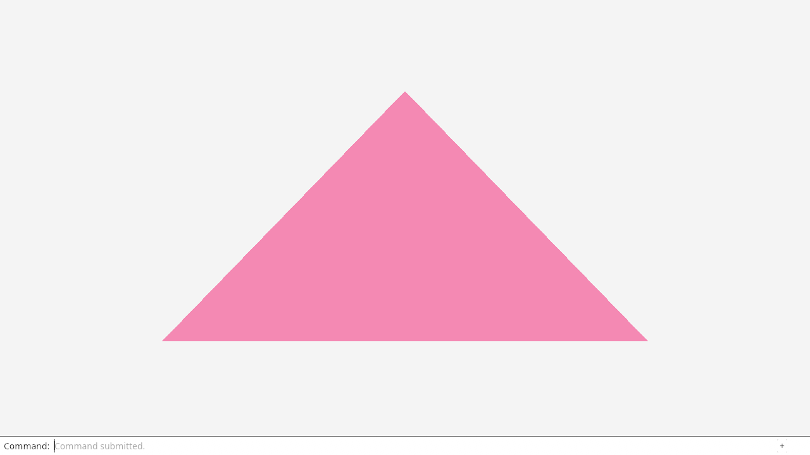

# Commands that change the view

<a id="checkpoint-04-input"></a>

Use `Background` to change the canvas clear colour while the triangle keeps its shape and position.

## Prerequisites and ownership

Complete [the command dock](03d-input.md). Keep mathematics available through the existing mode registry. This subject introduces `src/background.rs` and connects the practice command to the browser event handler and renderer. Those browser and renderer edits remain an outstanding course-wide ownership conflict; this lesson does not claim their implementations are finished.

The proposed registration boundary follows production's [command interface](../../src/app/command/mod.rs) and [verb registry](../../src/app/command/verbs/mod.rs): a command supplies its completion metadata and parser, and the shared dispatcher runs the resulting action. Later subjects should add a verb module and registry entry while retaining the input callback. Production actions borrow `State`, so this boundary requires the state-owning subject; adding a registry to this practice callback alone would not complete production integration. Rendering also needs its finished state-to-frame boundary before these files can be marked complete.

## Build

Type the state and apply the included browser and renderer blocks in your existing cumulative project.

### Background state

Create `src/background.rs`. A boolean stores the choice; `rgb` reads it without changing it. The default draws white.

```rust
--8<-- "journey/code/04-input-02.rs"
```

Register it beside the renderer in `src/lib.rs`:

```rust
--8<-- "journey/code/04-input-fullscreen-1.rs"
```

### Rendering the choice

In `src/renderer.rs`, update the end of `new` and beginning of `draw`. Borrowing the background lets rendering read application state without taking ownership.

```rust
--8<-- "journey/code/04-input-fullscreen-6.rs"
```

Use those components in the render pass's colour attachment. The clear operation changes the background; the existing pipeline still draws the triangle.

```rust
--8<-- "journey/code/04-input-fullscreen-7.rs"
```

### Submitting and presenting

In `src/browser.rs`, add the background import beside `Renderer`:

```rust
--8<-- "journey/code/04-input-window-1.rs"
```

Update initialization and the input callback. `Panel::update` returns an optional submitted line; caret movement alone does not toggle the background. The callback owns the state for its lifetime and redraws after a recognised command.

```rust
--8<-- "journey/code/04-input-window-2.rs"
```

Update the status text and `present` signature:

```rust
--8<-- "journey/code/04-input-window-3.rs"
```

Pass the borrowed background to the renderer before painting the dock and presenting the surface texture:

```rust
--8<-- "journey/code/04-input-window-4.rs"
```

## Run and observe

From `session_viewer`, check the typed files and install the checkpoint's recorded dependencies:

```sh
npm --prefix ../session_tests run course -- check 04-input
npm --prefix ../session_tests run course -- dependencies 04-input
```

From `workspace/journey`, run:

```sh
cargo build --lib --locked --target wasm32-unknown-unknown -j1
trunk serve --port 8780
```

Open `http://localhost:8780/?tutorial=viewer`. Type `Background` and press Enter: white changes to light grey. Submit it again: white returns. The triangle retains its shape, position and colour. Open `?tutorial=math` to select the retained mathematics checkpoint.

## Predict and try

Predict the final picture after two submissions, then run them. Trace `toggle` and find the `Renderer` constructor. Explain why neither submission constructs another GPU pipeline.

## Question and answer

**Does submitting Background create a new GPU pipeline?** No. The browser keeps the existing Renderer and changes one boolean in Background. The next draw reuses the device, queue and pipeline.

## Validation

The current 44-file cumulative checkpoint passes 29 native tests with none failed or ignored, plus optimized wasm and Trunk builds. Browser checks at 1280-by-720 and 390-by-844 verify that typing does not submit, two Background submissions restore the picture, Help leaves the background alone, and mathematics remains selectable and navigable. The triangle's colour, shape and position survive the background change. All 14 captured frames were reviewed.

[Source-bound validation receipt](release/cumulative-command04-windows-20261114.json). Upright viewport emulation does not establish physical-phone acceptance. Course-wide ownership, structural and production-parity checks remain unfinished.



[Upright result](../screenshots/cumulative-command04-windows/portrait-grey.png). The practice triangle uses clip coordinates, so its proportions follow the viewport. Camera aspect handling belongs to the later camera subject.

The [expanded historical page](../archived/journey-04-input-expanded.md) preserves earlier figures and explanations. See [validation scope](release.md).
