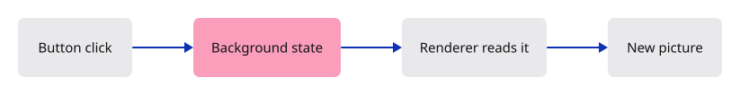

# 1.4.1 · Make a choice change the picture

**Chapter 1 · Browser, Rust and the GPU · Section 1.4 · Commands that change the view** · [Contents](contents.md)

**Typing: 12–24 minutes.** [Estimate](typing-load.md).

We can already type in the viewer’s own command line. Today one submitted word changes the picture. Type Background and press Enter: one boolean flips, and the existing renderer draws again.

## Type

Continue from [Hand commands to the application](03d-input.md). [Save or recover your work](recovery.md).

### 1. `src/background.rs`

Create the small piece of application state. It knows colours, but knows nothing about HTML or GPU resources.

Create the file and type:

```rust
--8<-- "journey/code/04-input-02.rs"
```

### 2. `src/lib.rs`

Register the state module so both the browser and the renderer can use it.

<details>
<summary>Locate the existing block</summary>

```rust
pub mod renderer;
#[cfg(target_arch = "wasm32")]
mod browser;
```

</details>

Edit the existing block to match this code; keep unchanged lines:

```rust
--8<-- "journey/code/04-input-fullscreen-1.rs"
```

### 3. `src/renderer.rs`

Borrow Background in draw and read its RGB value. Clear the render target with that RGB value.

Edit these blocks from bottom to top. Keep the surrounding lines unchanged.

<details>
<summary>Locate this block</summary>

```rust
                    resolve_target: None,
                    ops: wgpu::Operations {
                        load: wgpu::LoadOp::Clear(wgpu::Color {
                            r: 1.0, g: 1.0, b: 1.0, a: 1.0,
                        }),
                        store: wgpu::StoreOp::Store,
                    },
```

</details>

Replace it with:

```rust
                    resolve_target: None,
                    ops: wgpu::Operations {
                        load: wgpu::LoadOp::Clear(wgpu::Color {
                            r, g, b, a: 1.0,
                        }),
                        store: wgpu::StoreOp::Store,
                    },
```

<details>
<summary>Locate this block</summary>

```rust
        Self { device, queue, pipeline }
    }

    pub fn draw(&self, view: &wgpu::TextureView) {
        let mut encoder = self.device.create_command_encoder(&Default::default());
        {
            // The pass borrows the encoder. This scope ends that borrow before finish takes it.
```

</details>

Replace it with:

```rust
        Self { device, queue, pipeline }
    }

    pub fn draw(&self, view: &wgpu::TextureView, background: &crate::background::Background) {
        let [r, g, b] = background.rgb();
        let mut encoder = self.device.create_command_encoder(&Default::default());
        {
            // The pass borrows the encoder. This scope ends that borrow before finish takes it.
```

<details>
<summary>Complete updated block reference</summary>

```rust
pub struct Renderer {
    pub device: wgpu::Device,
    pub queue: wgpu::Queue,
    pipeline: wgpu::RenderPipeline,
}

impl Renderer {
    pub fn new(device: wgpu::Device, queue: wgpu::Queue, format: wgpu::TextureFormat) -> Self {
        let shader = device.create_shader_module(wgpu::ShaderModuleDescriptor {
            label: Some("triangle"),
            source: wgpu::ShaderSource::Wgsl(include_str!("triangle.wgsl").into()),
        });
        let pipeline = device.create_render_pipeline(&wgpu::RenderPipelineDescriptor {
            label: Some("triangle"),
            layout: None,
            vertex: wgpu::VertexState {
                module: &shader,
                entry_point: Some("vertex"),
                compilation_options: Default::default(),
                buffers: &[],
            },
            fragment: Some(wgpu::FragmentState {
                module: &shader,
                entry_point: Some("fragment"),
                compilation_options: Default::default(),
                targets: &[Some(format.into())],
            }),
            primitive: Default::default(),
            depth_stencil: None,
            multisample: Default::default(),
            multiview_mask: None,
            cache: None,
        });
        Self { device, queue, pipeline }
    }

    pub fn draw(&self, view: &wgpu::TextureView, background: &crate::background::Background) {
        let [r, g, b] = background.rgb();
        let mut encoder = self.device.create_command_encoder(&Default::default());
        {
            // The pass borrows the encoder. This scope ends that borrow before finish takes it.
            let mut pass = encoder.begin_render_pass(&wgpu::RenderPassDescriptor {
                label: Some("canvas"),
                color_attachments: &[Some(wgpu::RenderPassColorAttachment {
                    view,
                    depth_slice: None,
                    resolve_target: None,
                    ops: wgpu::Operations {
                        load: wgpu::LoadOp::Clear(wgpu::Color {
                            r, g, b, a: 1.0,
                        }),
                        store: wgpu::StoreOp::Store,
                    },
                })],
                ..Default::default()
            });
            pass.set_pipeline(&self.pipeline);
            pass.draw(0..3, 0..1);
        }
        self.queue.submit([encoder.finish()]);
    }
}
```

</details>

<details>
<summary>Optional patch references</summary>

Use these original edit fragments when comparing a saved checkpoint. Apply the complete blocks above.

```text
--8<-- "journey/code/04-input-fullscreen-6.rs"
```

```text
--8<-- "journey/code/04-input-fullscreen-7.rs"
```

</details>

### 4. `src/browser.rs`

Import the background state. Own the background and toggle it when the dock submits Background. Pass the background into presentation and update the status message. Draw the scene with the current background.

Edit these blocks from bottom to top. Keep the surrounding lines unchanged.

<details>
<summary>Locate this block</summary>

```rust
        format: Some(frame.texture.format().add_srgb_suffix()),
        ..Default::default()
    });
    renderer.draw(&view);
    panel.draw(renderer, &view);
    frame.present();
    Ok(())
```

</details>

Replace it with:

```rust
        format: Some(frame.texture.format().add_srgb_suffix()),
        ..Default::default()
    });
    renderer.draw(&view, background);
    panel.draw(renderer, &view);
    frame.present();
    Ok(())
```

<details>
<summary>Locate this block</summary>

```rust
    )?;
    // The page has one listener for its lifetime; JavaScript must retain the Rust callback.
    click.forget();
    report("Type Help in the command field and press Enter.");
    Ok(())
}

fn present(
    surface: &wgpu::Surface<'_>,
    renderer: &Renderer,
    panel: &mut crate::panel::Panel,
) -> Result<(), JsValue> {
    let frame = match surface.get_current_texture() {
```

</details>

Replace it with:

```rust
    )?;
    // The page has one listener for its lifetime; JavaScript must retain the Rust callback.
    click.forget();
    report("Change the background. The triangle keeps its shape and colour.");
    Ok(())
}

fn present(
    surface: &wgpu::Surface<'_>,
    renderer: &Renderer,
    background: &Background,
    panel: &mut crate::panel::Panel,
) -> Result<(), JsValue> {
    let frame = match surface.get_current_texture() {
```

<details>
<summary>Locate this block</summary>

```rust
    config.view_formats = vec![config.format.add_srgb_suffix()];
    surface.configure(&device, &config);
    let renderer = Renderer::new(device, queue, config.format.add_srgb_suffix());
    let mut panel = crate::panel::Panel::new(&renderer, config.format.add_srgb_suffix(), &["Help"]);
    panel.update(None, &canvas)?;
    present(&surface, &renderer, &mut panel)?;
    let input_canvas = canvas.clone();
    let click = Closure::<dyn FnMut(web_sys::Event)>::new(move |event: web_sys::Event| {
        let _line = match panel.update(Some(&event), &input_canvas) {
            Ok(line) => line,
            Err(error) => {
                report(&format!("Cannot read command: {error:?}"));
                return;
            }
        };
        if let Err(error) = panel.update(None, &input_canvas) {
            report(&format!("Cannot lay out commands: {error:?}"));
            return;
        }
        if let Err(error) = present(&surface, &renderer, &mut panel) {
            report(&format!("Cannot redraw: {error:?}"));
        }
    });
```

</details>

Replace it with:

```rust
    config.view_formats = vec![config.format.add_srgb_suffix()];
    surface.configure(&device, &config);
    let renderer = Renderer::new(device, queue, config.format.add_srgb_suffix());
    let mut panel = crate::panel::Panel::new(
        &renderer,
        config.format.add_srgb_suffix(),
        &["Help", "Background"],
    );
    panel.update(None, &canvas)?;
    let mut background = Background::default();
    present(&surface, &renderer, &background, &mut panel)?;
    let input_canvas = canvas.clone();
    let click = Closure::<dyn FnMut(web_sys::Event)>::new(move |event: web_sys::Event| {
        let line = match panel.update(Some(&event), &input_canvas) {
            Ok(line) => line,
            Err(error) => {
                report(&format!("Cannot read command: {error:?}"));
                return;
            }
        };
        if line.as_deref() == Some("background") {
            background.toggle();
        }
        if let Err(error) = panel.update(None, &input_canvas) {
            report(&format!("Cannot lay out commands: {error:?}"));
            return;
        }
        if let Err(error) = present(&surface, &renderer, &background, &mut panel) {
            report(&format!("Cannot redraw: {error:?}"));
        }
    });
```

<details>
<summary>Locate this block</summary>

```rust
use crate::renderer::Renderer;
use wasm_bindgen::{JsCast, JsValue, closure::Closure};
```

</details>

Replace it with:

```rust
use crate::background::Background;
use crate::renderer::Renderer;
use wasm_bindgen::{JsCast, JsValue, closure::Closure};
```

<details>
<summary>Complete updated block reference</summary>

```rust
use crate::background::Background;
use crate::renderer::Renderer;
use wasm_bindgen::{JsCast, JsValue, closure::Closure};

pub fn report(message: &str) {
    if let Some(document) = web_sys::window().and_then(|window| window.document()) {
        if let Some(status) = document.get_element_by_id("status") {
            status.set_text_content(Some(message));
            if message.starts_with("Cannot") { let _ = status.remove_attribute("hidden"); }
        }
    }
}

pub async fn run() -> Result<(), JsValue> {
    let window = web_sys::window().ok_or("No browser window")?;
    let document = window.document().ok_or("No document")?;
    let canvas: web_sys::HtmlCanvasElement = document
        .get_element_by_id("canvas")
        .ok_or("Missing canvas")?
        .dyn_into()?;
    let instance = wgpu::Instance::new(wgpu::InstanceDescriptor {
        backends: wgpu::Backends::BROWSER_WEBGPU,
        flags: Default::default(),
        memory_budget_thresholds: Default::default(),
        backend_options: Default::default(),
        display: None,
    });
    let surface = instance
        .create_surface(wgpu::SurfaceTarget::Canvas(canvas.clone()))
        .map_err(|error| JsValue::from_str(&error.to_string()))?;
    let adapter = instance
        .request_adapter(&wgpu::RequestAdapterOptions {
            compatible_surface: Some(&surface),
            ..Default::default()
        })
        .await
        .map_err(|error| JsValue::from_str(&error.to_string()))?;
    let (device, queue) = adapter
        .request_device(&wgpu::DeviceDescriptor::default())
        .await
        .map_err(|error| JsValue::from_str(&error.to_string()))?;
    device.on_uncaptured_error(std::sync::Arc::new(|error| report(&error.to_string())));
    let limit = device.limits().max_texture_dimension_2d;
    let width = (window.inner_width()?.as_f64().ok_or("No window width")? as u32).clamp(1, limit);
    let height = (window.inner_height()?.as_f64().ok_or("No window height")? as u32).clamp(1, limit);
    canvas.set_width(width);
    canvas.set_height(height);
    let mut config = surface
        .get_default_config(&adapter, width, height)
        .ok_or("No compatible surface format")?;
    config.view_formats = vec![config.format.add_srgb_suffix()];
    surface.configure(&device, &config);
    let renderer = Renderer::new(device, queue, config.format.add_srgb_suffix());
    let mut panel = crate::panel::Panel::new(
        &renderer,
        config.format.add_srgb_suffix(),
        &["Help", "Background"],
    );
    panel.update(None, &canvas)?;
    let mut background = Background::default();
    present(&surface, &renderer, &background, &mut panel)?;
    let input_canvas = canvas.clone();
    let click = Closure::<dyn FnMut(web_sys::Event)>::new(move |event: web_sys::Event| {
        let line = match panel.update(Some(&event), &input_canvas) {
            Ok(line) => line,
            Err(error) => {
                report(&format!("Cannot read command: {error:?}"));
                return;
            }
        };
        if line.as_deref() == Some("background") {
            background.toggle();
        }
        if let Err(error) = panel.update(None, &input_canvas) {
            report(&format!("Cannot lay out commands: {error:?}"));
            return;
        }
        if let Err(error) = present(&surface, &renderer, &background, &mut panel) {
            report(&format!("Cannot redraw: {error:?}"));
        }
    });
    for name in [
        "pointerdown",
        "pointermove",
        "pointerup",
        "pointercancel",
        "lostpointercapture",
        "contextmenu",
        "keydown",
        "keyup",
        "blur",
    ] {
        canvas.add_event_listener_with_callback(name, click.as_ref().unchecked_ref())?;
    }
    let options = web_sys::AddEventListenerOptions::new();
    options.set_passive(false);
    canvas.add_event_listener_with_callback_and_add_event_listener_options(
        "wheel",
        click.as_ref().unchecked_ref(),
        &options,
    )?;
    // The page has one listener for its lifetime; JavaScript must retain the Rust callback.
    click.forget();
    report("Change the background. The triangle keeps its shape and colour.");
    Ok(())
}

fn present(
    surface: &wgpu::Surface<'_>,
    renderer: &Renderer,
    background: &Background,
    panel: &mut crate::panel::Panel,
) -> Result<(), JsValue> {
    let frame = match surface.get_current_texture() {
        wgpu::CurrentSurfaceTexture::Success(frame)
        | wgpu::CurrentSurfaceTexture::Suboptimal(frame) => frame,
        other => {
            return Err(JsValue::from_str(&format!(
                "Surface unavailable: {other:?}"
            )));
        }
    };
    let view = frame.texture.create_view(&wgpu::TextureViewDescriptor {
        format: Some(frame.texture.format().add_srgb_suffix()),
        ..Default::default()
    });
    renderer.draw(&view, background);
    panel.draw(renderer, &view);
    frame.present();
    Ok(())
}
```

</details>

<details>
<summary>Optional patch references</summary>

Use these original edit fragments when comparing a saved checkpoint. Apply the complete blocks above.

```text
--8<-- "journey/code/04-input-window-1.rs"
```

```text
--8<-- "journey/code/04-input-window-2.rs"
```

```text
--8<-- "journey/code/04-input-window-3.rs"
```

```text
--8<-- "journey/code/04-input-window-4.rs"
```

</details>

## Run and check

In your project:

```sh
cd workspace/journey
cargo build --lib --locked --target wasm32-unknown-unknown -j1
CARGO_BUILD_JOBS=1 trunk serve --port 8780
```

Open `http://127.0.0.1:8780/`. Keep an existing Trunk server running; saving rebuilds it.

Type `Background` twice. The first command changes the background; the second restores white. The triangle keeps the same shape and position.

### Recorded visual result

**Previous native render — current verification pending.**


*This recorded image predates a source or checker change. Rebuild this checkpoint before using it as current evidence; browser controls require separate acceptance.*

<details>
<summary>Code explanation and diagram</summary>

The browser owns Background beside Panel and Renderer. Panel reads the line; Background owns the choice; Renderer turns that choice into pixels. No new device or pipeline is created when you run the command.

`Option<String>` means a submitted line may or may not be present. Most events only move a caret or update completion. Only the recognised Background line changes the background. The match reads that result without inventing a second input path.

Typed Background → Panel returns a line → Background toggles → Renderer redraws.



Does submitting Background create a new GPU pipeline?

No. The browser keeps the existing Renderer and changes one boolean in Background. The next draw reuses the device, queue and pipeline.

Study estimate, including typing and experiments: 1–2 hours.

</details>

<details>
<summary>Optional experiment</summary>

Before submitting Background twice, predict the final picture. Then trace the one boolean changed by toggle. Find the Renderer constructor and explain why neither command calls it again.

</details>

<details>
<summary>Check and save your work</summary>

Restore experimental edits, then run from `session_viewer`:

```sh
npm --prefix ../session_tests run course -- check 1.4.1
npm --prefix ../session_tests run course -- save 1.4.1
```

Source comparison leaves your project untouched. [Save and recovery instructions](recovery.md).

</details>

<details>
<summary>Viewer coverage and verification</summary>

In the full viewer, input similarly requests a change before a new frame reads the result. This background is view state, not geometry. Moving an object will instead change the document and refresh its display data.

This uses the production dock and styling. Background is a course practice command; later chapters build the production vocabulary. The command names below each checkpoint tell you exactly what it currently accepts.


[Full validation scope](release.md).

</details>
