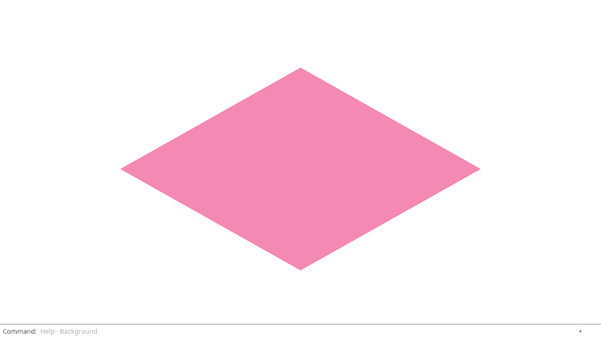

# Buffers that describe a shared mesh

<a id="checkpoint-05-vertices"></a>
<a id="checkpoint-06-indices"></a>

Draw a diamond from four shared vertices and six indices without duplicating its corners.

## Prerequisites and ownership

Complete [Commands that change the view](04-input.md). This subject owns the vertex/index byte contract and indexed draw: `src/triangle.wgsl`, the mesh buffers in `src/renderer.rs`, and the browser status text. Keep the existing command dock and background model.

The current course still rewrites the renderer in later subjects. Consolidating this mesh subject does not resolve those remaining ownership findings or establish production parity.

## Build

Type the three complete files below, keeping every other file from the previous checkpoint.

### The vertex contract

```wgsl
--8<-- "journey/code/05-mesh-1.wgsl"
```

Shader location zero receives one two-component position. The vertex stage extends that position to clip coordinates: z is zero and w is one. The fragment stage supplies the pink colour. Positions now come from a buffer instead of an array selected by the shader's vertex index.

### One vertex, several uses

```rust
--8<-- "journey/code/05-mesh-2.rs"
```

`POSITIONS` stores four corners in order: left, bottom, right and top. `INDICES` assembles the lower triangle from corners 0, 1 and 2, then the upper triangle from 0, 2 and 3. Corners 0 and 2 form the shared edge. An index chooses a vertex; it is not another position or an offset measured in bytes.

Each vertex contains two 32-bit floats, so `array_stride` is eight bytes and location zero uses `Float32x2`. The explicit byte conversion serializes the floats without relying on a Rust struct's layout. Keep the shader input, CPU element size and buffer layout in agreement: wgpu cannot infer that a wrong stride still reads the intended corner.

`DeviceExt::create_buffer_init` allocates each buffer and supplies its initial bytes. `VERTEX` and `INDEX` describe their GPU use. These immutable geometry buffers live with the renderer; drawing another frame does not recreate them.

The draw pass binds the pipeline, the vertex buffer and the index buffer in that order. `Uint16` matches the CPU index type. `draw_indexed` requests six indices and one instance. Its count is six even though only four vertices are stored. The pass ends before the encoder is finished and submitted.

### Keep input and presentation together

```rust
--8<-- "journey/code/05-mesh-3.rs"
```

The browser still owns the surface and input callbacks. It draws the scene, paints the command dock using the same target, and presents once. Changing the background changes the clear colour; it does not allocate another mesh or change an index.

## Run and observe

From `session_viewer`, assemble the checkpoint in a fresh directory:

```sh
npm --prefix ../session_tests run course -- reference 05-vertices --output target/shared-mesh
cd target/shared-mesh
trunk serve --port 8780
```

Run builds through the workspace storage guard and build slot. Open `http://127.0.0.1:8780/`.

A pink diamond fills the centre of the canvas. Its two triangles meet without a gap, and the existing command dock still changes the background.

## Predict and try

Predict what happens when position zero moves left while the index list stays unchanged. Both triangles stretch together and their shared edge remains joined. Restore the position.

Next predict the result of reducing the indexed draw count from six to three: only the lower triangle remains. Restore six before continuing.

## Question and answer

Why does moving the left vertex keep both triangles joined?

Both triangles reference the same vertex index. Updating that one position changes both uses; there is no second copy to forget.

## Validation

The subject replays to the exact former indexed-mesh endpoint; its original two checkpoints and page text are retained in the archive. The native pixel check measures both triangles, their shared edge and the diamond's area. Fresh wasm and optimized web builds pass, and the WARP native pixel check passes. Chrome interaction checks pass at 1280-by-720 and 390-by-844; the browser reports an Intel default WebGPU adapter. The upright case is viewport emulation, not a physical phone.

[Source-bound validation receipt](release/consolidated-windows-20261113.json) ? [Upright browser frame](../screenshots/consolidated-windows/05-vertices-upright.png). Native evidence uses software rendering; viewport emulation does not establish real-device acceptance.


