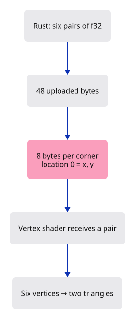

# 2.1.1 · Let Rust supply the corners

**Chapter 2 · Geometry, camera and selection · Section 2.1 · CPU geometry** · [Contents](contents.md)

**Typing: 12–23 minutes.** [Estimate](typing-load.md).

Move the corner positions out of WGSL and into a Rust vertex buffer. Six coordinate pairs draw two triangles forming a rectangle. Shared corners are duplicated here; the next lesson removes that duplication.

## Type

Continue from [Make a choice change the picture](04-input.md). [Save or recover your work](recovery.md).

### 1. `src/triangle.wgsl`

Replace the shader. It now receives one position per invocation instead of looking up a hard-coded corner.

<details>
<summary>Locate the existing block</summary>

```wgsl
@vertex
fn vertex(@builtin(vertex_index) index: u32) -> @builtin(position) vec4<f32> {
    let corners = array<vec2<f32>, 3>(
        vec2<f32>(-0.6, -0.5),
        vec2<f32>(0.6, -0.5),
        vec2<f32>(0.0, 0.6),
    );
    return vec4<f32>(corners[index], 0.0, 1.0);
}

@fragment
fn fragment() -> @location(0) vec4<f32> {
    return vec4<f32>(0.9, 0.25, 0.45, 1.0);
}
```

</details>

Edit the existing block to match this code; keep unchanged lines:

```wgsl
--8<-- "journey/code/05-vertices-01.wgsl"
```

### 2. `src/renderer.rs`

Define six positions and upload their vertex buffer. Describe two f32 coordinates at each eight-byte vertex. Retain the uploaded vertex buffer in Renderer. Bind the vertex buffer and draw all six positions.

<details>
<summary>Locate the existing block</summary>

```rust
pub struct Renderer {
    pub device: wgpu::Device,
    pub queue: wgpu::Queue,
    pipeline: wgpu::RenderPipeline,
}

impl Renderer {
    pub fn new(device: wgpu::Device, queue: wgpu::Queue, format: wgpu::TextureFormat) -> Self {
        let shader = device.create_shader_module(wgpu::ShaderModuleDescriptor {
            label: Some("triangle"),
            source: wgpu::ShaderSource::Wgsl(include_str!("triangle.wgsl").into()),
        });
        let pipeline = device.create_render_pipeline(&wgpu::RenderPipelineDescriptor {
            label: Some("triangle"),
            layout: None,
            vertex: wgpu::VertexState {
                module: &shader,
                entry_point: Some("vertex"),
                compilation_options: Default::default(),
                buffers: &[],
            },
            fragment: Some(wgpu::FragmentState {
                module: &shader,
                entry_point: Some("fragment"),
                compilation_options: Default::default(),
                targets: &[Some(format.into())],
            }),
            primitive: Default::default(),
            depth_stencil: None,
            multisample: Default::default(),
            multiview_mask: None,
            cache: None,
        });
        Self { device, queue, pipeline }
    }

    pub fn draw(&self, view: &wgpu::TextureView, background: &crate::background::Background) {
        let [r, g, b] = background.rgb();
        let mut encoder = self.device.create_command_encoder(&Default::default());
        {
            // The pass borrows the encoder. This scope ends that borrow before finish takes it.
            let mut pass = encoder.begin_render_pass(&wgpu::RenderPassDescriptor {
                label: Some("canvas"),
                color_attachments: &[Some(wgpu::RenderPassColorAttachment {
                    view,
                    depth_slice: None,
                    resolve_target: None,
                    ops: wgpu::Operations {
                        load: wgpu::LoadOp::Clear(wgpu::Color {
                            r, g, b, a: 1.0,
                        }),
                        store: wgpu::StoreOp::Store,
                    },
                })],
                ..Default::default()
            });
            pass.set_pipeline(&self.pipeline);
            pass.draw(0..3, 0..1);
        }
        self.queue.submit([encoder.finish()]);
    }
}
```

</details>

Edit the existing block to match this code; keep unchanged lines:

```rust
use wgpu::util::DeviceExt;

const POSITIONS: [[f32; 2]; 6] = [
    [-0.6, -0.5], [0.6, -0.5], [0.6, 0.6],
    [-0.6, -0.5], [0.6, 0.6], [-0.6, 0.6],
];

pub struct Renderer {
    pub device: wgpu::Device,
    pub queue: wgpu::Queue,
    pipeline: wgpu::RenderPipeline,
    vertices: wgpu::Buffer,
}

impl Renderer {
    pub fn new(device: wgpu::Device, queue: wgpu::Queue, format: wgpu::TextureFormat) -> Self {
        let bytes: Vec<u8> = POSITIONS.iter().flatten()
            .flat_map(|value| value.to_ne_bytes()).collect();
        let vertices = device.create_buffer_init(&wgpu::util::BufferInitDescriptor {
            label: Some("rectangle positions"),
            contents: &bytes,
            usage: wgpu::BufferUsages::VERTEX,
        });
        let shader = device.create_shader_module(wgpu::ShaderModuleDescriptor {
            label: Some("triangle"),
            source: wgpu::ShaderSource::Wgsl(include_str!("triangle.wgsl").into()),
        });
        let pipeline = device.create_render_pipeline(&wgpu::RenderPipelineDescriptor {
            label: Some("triangle"),
            layout: None,
            vertex: wgpu::VertexState {
                module: &shader,
                entry_point: Some("vertex"),
                compilation_options: Default::default(),
                buffers: &[wgpu::VertexBufferLayout {
                    array_stride: 8,
                    step_mode: wgpu::VertexStepMode::Vertex,
                    attributes: &wgpu::vertex_attr_array![0 => Float32x2],
                }],
            },
            fragment: Some(wgpu::FragmentState {
                module: &shader,
                entry_point: Some("fragment"),
                compilation_options: Default::default(),
                targets: &[Some(format.into())],
            }),
            primitive: Default::default(),
            depth_stencil: None,
            multisample: Default::default(),
            multiview_mask: None,
            cache: None,
        });
        Self { device, queue, pipeline, vertices }
    }

    pub fn draw(&self, view: &wgpu::TextureView, background: &crate::background::Background) {
        let [r, g, b] = background.rgb();
        let mut encoder = self.device.create_command_encoder(&Default::default());
        {
            // The pass borrows the encoder. This scope ends that borrow before finish takes it.
            let mut pass = encoder.begin_render_pass(&wgpu::RenderPassDescriptor {
                label: Some("canvas"),
                color_attachments: &[Some(wgpu::RenderPassColorAttachment {
                    view,
                    depth_slice: None,
                    resolve_target: None,
                    ops: wgpu::Operations {
                        load: wgpu::LoadOp::Clear(wgpu::Color {
                            r, g, b, a: 1.0,
                        }),
                        store: wgpu::StoreOp::Store,
                    },
                })],
                ..Default::default()
            });
            pass.set_pipeline(&self.pipeline);
            pass.set_vertex_buffer(0, self.vertices.slice(..));
            pass.draw(0..POSITIONS.len() as u32, 0..1);
        }
        self.queue.submit([encoder.finish()]);
    }
}
```

<details>
<summary>Optional patch references</summary>

Use these original edit fragments when comparing a saved checkpoint. Apply the complete blocks above.

```text
--8<-- "journey/code/05-vertices-fullscreen-2.rs"
```

```text
--8<-- "journey/code/05-vertices-fullscreen-3.rs"
```

```text
--8<-- "journey/code/05-vertices-fullscreen-4.rs"
```

```text
--8<-- "journey/code/05-vertices-fullscreen-5.rs"
```

</details>

### 3. `src/browser.rs`

Report that the uploaded corners form a rectangle.

<details>
<summary>Locate the existing block</summary>

```rust
    )?;
    // The page has one listener for its lifetime; JavaScript must retain the Rust callback.
    click.forget();
    report("Change the background. The triangle keeps its shape and colour.");
    Ok(())
}
```

</details>

Edit the existing block to match this code; keep unchanged lines:

```rust
--8<-- "journey/code/05-vertices-window-1.rs"
```

## Run and check

In your project:

```sh
cd workspace/journey
cargo build --lib --locked --target wasm32-unknown-unknown -j1
CARGO_BUILD_JOBS=1 trunk serve --port 8780
```

Open `http://127.0.0.1:8780/`. Keep an existing Trunk server running; saving rebuilds it.

The GPU draws a rectangle from six buffered positions. Change one corner in the Rust vertex array, save, and check the changed outline. Restore it.

### Recorded visual result

**Previous native render — current verification pending.**


*This recorded image predates a source or checker change. Rebuild this checkpoint before using it as current evidence; browser controls require separate acceptance.*

<details>
<summary>Code explanation and diagram</summary>

Describe the buffer layout explicitly: two `f32` values, eight bytes per vertex, matching shader `@location(0)`. Buffer slot and shader location are separate settings even though both are zero here.

`iter().flatten()` visits each coordinate, `flat_map` converts it to bytes, and `collect` owns the resulting byte vector. Importing the `DeviceExt` trait enables `create_buffer_init`. It creates and fills GPU storage; the temporary CPU byte vector can then be dropped.

Rust positions → bytes → vertex buffer → vertex layout → shader location 0 → two triangles.



Who owns the positions, and how does the shader know where each pair of numbers begins?

Rust supplies the positions and uploads their bytes. The renderer retains the GPU buffer. Its vertex layout says that a vertex occupies eight bytes and location 0 contains two f32 values starting at byte zero. The shader reads that location; it no longer chooses corners from its own array.

Study estimate, including typing and experiments: 1–2 hours.

</details>

<details>
<summary>Optional experiment</summary>

Predict which triangle changes if you move only the first position to [-0.9, -0.5]. Try it. The other occurrence of that corner stays put, opening a mismatch along the shared edge. Restore the value. This is the duplication that indices will remove.

</details>

<details>
<summary>Check and save your work</summary>

Restore experimental edits, then run from `session_viewer`:

```sh
npm --prefix ../session_tests run course -- check 2.1.1
npm --prefix ../session_tests run course -- save 2.1.1
```

Source comparison leaves your project untouched. [Save and recovery instructions](recovery.md).

</details>

<details>
<summary>Viewer coverage and verification</summary>

The maintained viewer uploads mesh vertices into shared GPU storage. This lesson establishes the CPU-to-GPU byte contract used by those uploads. Document identity and shared allocation are separate jobs introduced later.


[Full validation scope](release.md).

</details>
