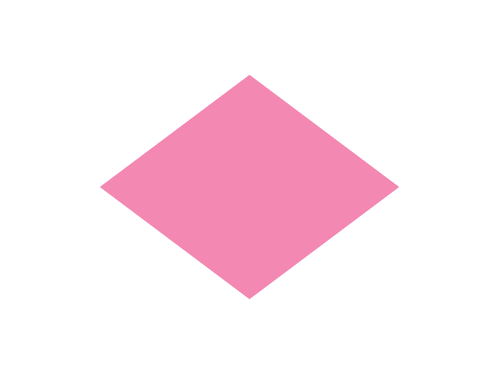
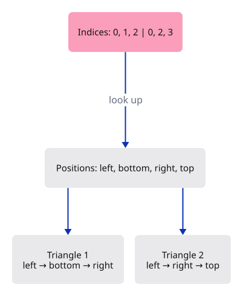

# 2.2.1 · Share a corner between triangles

**Chapter 2 · Geometry, camera and selection · Section 2.2 · Indexed triangles** · [Contents](contents.md)

**Typing: 8–15 minutes.** [Estimate](typing-load.md).

Store four corner positions and connect them with indices: `0, 1, 2` and `0, 2, 3`. The two triangles now share corners 0 and 2.

## Type

Continue from [Let Rust supply the corners](05-vertices.md). [Save or recover your work](recovery.md).

### 1. `src/renderer.rs`

Define four diamond corners and six indices; retain an index buffer. Upload the indices as native-endian u16 bytes. Retain the index buffer in Renderer. Bind the u16 index buffer and draw its six entries.

Edit these blocks from bottom to top. Keep the surrounding lines unchanged.

<details>
<summary>Locate this block</summary>

```rust
            });
            pass.set_pipeline(&self.pipeline);
            pass.set_vertex_buffer(0, self.vertices.slice(..));
            pass.draw(0..POSITIONS.len() as u32, 0..1);
        }
        self.queue.submit([encoder.finish()]);
    }
```

</details>

Replace it with:

```rust
            });
            pass.set_pipeline(&self.pipeline);
            pass.set_vertex_buffer(0, self.vertices.slice(..));
            pass.set_index_buffer(self.indices.slice(..), wgpu::IndexFormat::Uint16);
            pass.draw_indexed(0..INDICES.len() as u32, 0, 0..1);
        }
        self.queue.submit([encoder.finish()]);
    }
```

<details>
<summary>Locate this block</summary>

```rust
            multiview_mask: None,
            cache: None,
        });
        Self { device, queue, pipeline, vertices }
    }

    pub fn draw(&self, view: &wgpu::TextureView, background: &crate::background::Background) {
```

</details>

Replace it with:

```rust
            multiview_mask: None,
            cache: None,
        });
        Self { device, queue, pipeline, vertices, indices }
    }

    pub fn draw(&self, view: &wgpu::TextureView, background: &crate::background::Background) {
```

<details>
<summary>Locate this block</summary>

```rust
            contents: &bytes,
            usage: wgpu::BufferUsages::VERTEX,
        });
        let shader = device.create_shader_module(wgpu::ShaderModuleDescriptor {
            label: Some("triangle"),
            source: wgpu::ShaderSource::Wgsl(include_str!("triangle.wgsl").into()),
```

</details>

Replace it with:

```rust
            contents: &bytes,
            usage: wgpu::BufferUsages::VERTEX,
        });
        let bytes: Vec<u8> = INDICES.iter().flat_map(|index| index.to_ne_bytes()).collect();
        let indices = device.create_buffer_init(&wgpu::util::BufferInitDescriptor {
            label: Some("diamond indices"),
            contents: &bytes,
            usage: wgpu::BufferUsages::INDEX,
        });
        let shader = device.create_shader_module(wgpu::ShaderModuleDescriptor {
            label: Some("triangle"),
            source: wgpu::ShaderSource::Wgsl(include_str!("triangle.wgsl").into()),
```

<details>
<summary>Locate this block</summary>

```rust
use wgpu::util::DeviceExt;

const POSITIONS: [[f32; 2]; 6] = [
    [-0.6, -0.5], [0.6, -0.5], [0.6, 0.6],
    [-0.6, -0.5], [0.6, 0.6], [-0.6, 0.6],
];

pub struct Renderer {
    pub device: wgpu::Device,
    pub queue: wgpu::Queue,
    pipeline: wgpu::RenderPipeline,
    vertices: wgpu::Buffer,
}

impl Renderer {
```

</details>

Replace it with:

```rust
use wgpu::util::DeviceExt;

const POSITIONS: [[f32; 2]; 4] = [
    [-0.6, 0.0], [0.0, -0.6], [0.6, 0.0], [0.0, 0.6],
];
const INDICES: [u16; 6] = [0, 1, 2, 0, 2, 3];

pub struct Renderer {
    pub device: wgpu::Device,
    pub queue: wgpu::Queue,
    pipeline: wgpu::RenderPipeline,
    vertices: wgpu::Buffer,
    indices: wgpu::Buffer,
}

impl Renderer {
```

<details>
<summary>Complete updated block reference</summary>

```rust
use wgpu::util::DeviceExt;

const POSITIONS: [[f32; 2]; 4] = [
    [-0.6, 0.0], [0.0, -0.6], [0.6, 0.0], [0.0, 0.6],
];
const INDICES: [u16; 6] = [0, 1, 2, 0, 2, 3];

pub struct Renderer {
    pub device: wgpu::Device,
    pub queue: wgpu::Queue,
    pipeline: wgpu::RenderPipeline,
    vertices: wgpu::Buffer,
    indices: wgpu::Buffer,
}

impl Renderer {
    pub fn new(device: wgpu::Device, queue: wgpu::Queue, format: wgpu::TextureFormat) -> Self {
        let bytes: Vec<u8> = POSITIONS.iter().flatten()
            .flat_map(|value| value.to_ne_bytes()).collect();
        let vertices = device.create_buffer_init(&wgpu::util::BufferInitDescriptor {
            label: Some("rectangle positions"),
            contents: &bytes,
            usage: wgpu::BufferUsages::VERTEX,
        });
        let bytes: Vec<u8> = INDICES.iter().flat_map(|index| index.to_ne_bytes()).collect();
        let indices = device.create_buffer_init(&wgpu::util::BufferInitDescriptor {
            label: Some("diamond indices"),
            contents: &bytes,
            usage: wgpu::BufferUsages::INDEX,
        });
        let shader = device.create_shader_module(wgpu::ShaderModuleDescriptor {
            label: Some("triangle"),
            source: wgpu::ShaderSource::Wgsl(include_str!("triangle.wgsl").into()),
        });
        let pipeline = device.create_render_pipeline(&wgpu::RenderPipelineDescriptor {
            label: Some("triangle"),
            layout: None,
            vertex: wgpu::VertexState {
                module: &shader,
                entry_point: Some("vertex"),
                compilation_options: Default::default(),
                buffers: &[wgpu::VertexBufferLayout {
                    array_stride: 8,
                    step_mode: wgpu::VertexStepMode::Vertex,
                    attributes: &wgpu::vertex_attr_array![0 => Float32x2],
                }],
            },
            fragment: Some(wgpu::FragmentState {
                module: &shader,
                entry_point: Some("fragment"),
                compilation_options: Default::default(),
                targets: &[Some(format.into())],
            }),
            primitive: Default::default(),
            depth_stencil: None,
            multisample: Default::default(),
            multiview_mask: None,
            cache: None,
        });
        Self { device, queue, pipeline, vertices, indices }
    }

    pub fn draw(&self, view: &wgpu::TextureView, background: &crate::background::Background) {
        let [r, g, b] = background.rgb();
        let mut encoder = self.device.create_command_encoder(&Default::default());
        {
            // The pass borrows the encoder. This scope ends that borrow before finish takes it.
            let mut pass = encoder.begin_render_pass(&wgpu::RenderPassDescriptor {
                label: Some("canvas"),
                color_attachments: &[Some(wgpu::RenderPassColorAttachment {
                    view,
                    depth_slice: None,
                    resolve_target: None,
                    ops: wgpu::Operations {
                        load: wgpu::LoadOp::Clear(wgpu::Color {
                            r, g, b, a: 1.0,
                        }),
                        store: wgpu::StoreOp::Store,
                    },
                })],
                ..Default::default()
            });
            pass.set_pipeline(&self.pipeline);
            pass.set_vertex_buffer(0, self.vertices.slice(..));
            pass.set_index_buffer(self.indices.slice(..), wgpu::IndexFormat::Uint16);
            pass.draw_indexed(0..INDICES.len() as u32, 0, 0..1);
        }
        self.queue.submit([encoder.finish()]);
    }
}
```

</details>

<details>
<summary>Optional patch references</summary>

Use these original edit fragments when comparing a saved checkpoint. Apply the complete blocks above.

```text
--8<-- "journey/code/06-indices-fullscreen-2.rs"
```

```text
--8<-- "journey/code/06-indices-fullscreen-3.rs"
```

```text
--8<-- "journey/code/06-indices-fullscreen-4.rs"
```

```text
--8<-- "journey/code/06-indices-fullscreen-5.rs"
```

</details>

### 2. `src/browser.rs`

Report that four shared corners form two triangles.

<details>
<summary>Locate the existing block</summary>

```rust
    )?;
    // The page has one listener for its lifetime; JavaScript must retain the Rust callback.
    click.forget();
    report("Six uploaded corners make one rectangle.");
    Ok(())
}
```

</details>

Edit the existing block to match this code; keep unchanged lines:

```rust
--8<-- "journey/code/06-indices-window-1.rs"
```

## Run and check

In your project:

```sh
cd workspace/journey
cargo build --lib --locked --target wasm32-unknown-unknown -j1
CARGO_BUILD_JOBS=1 trunk serve --port 8780
```

Open `http://127.0.0.1:8780/`. Keep an existing Trunk server running; saving rebuilds it.

A diamond is drawn from four vertices. Follow the six indices into those vertices: they must describe two triangles that share the middle edge.

### Recorded visual result

**Previous native render — current verification pending.**



*This recorded image predates a source or checker change. Rebuild this checkpoint before using it as current evidence; browser controls require separate acceptance.*

<details>
<summary>Code explanation and diagram</summary>

The vertex buffer answers where a corner is; the index buffer answers which corners form a triangle. Changing a shared position changes both triangles.

These indices are `u16`, so bind the index buffer as `Uint16`. Each index occupies two bytes; each position still occupies eight. `draw_indexed` chooses index entries, adds its base-vertex value, then draws the requested instances. The shader keeps its previous input layout.

Six indices → four shared positions → vertex shader → two joined triangles.



Why do we draw six indices when there are only four positions?

Each triangle needs three corner references. The first triangle reads positions 0, 1 and 2; the second reads 0, 2 and 3. Positions 0 and 2 are shared. Six index entries describe two triangles while only four coordinate pairs are stored.

Study estimate, including typing and experiments: 1–2 hours.

</details>

<details>
<summary>Optional experiment</summary>

Move position 0 from [-0.6, 0.0] to [-0.9, 0.0]. Predict which triangles change. Both should move their left corner together, leaving no crack. Then restore the coordinate and temporarily draw only 0..3 indices: only the lower triangle should remain. Restore 0..6 before comparing.

</details>

<details>
<summary>Check and save your work</summary>

Restore experimental edits, then run from `session_viewer`:

```sh
npm --prefix ../session_tests run course -- check 2.2.1
npm --prefix ../session_tests run course -- save 2.2.1
```

Source comparison leaves your project untouched. [Save and recovery instructions](recovery.md).

</details>

<details>
<summary>Viewer coverage and verification</summary>

Mesh topology uses indices to share vertices. The production mesh lane uses the same distinction between a vertex range and an index range; its shared allocations add offsets without changing what an index means.


[Full validation scope](release.md).

</details>
