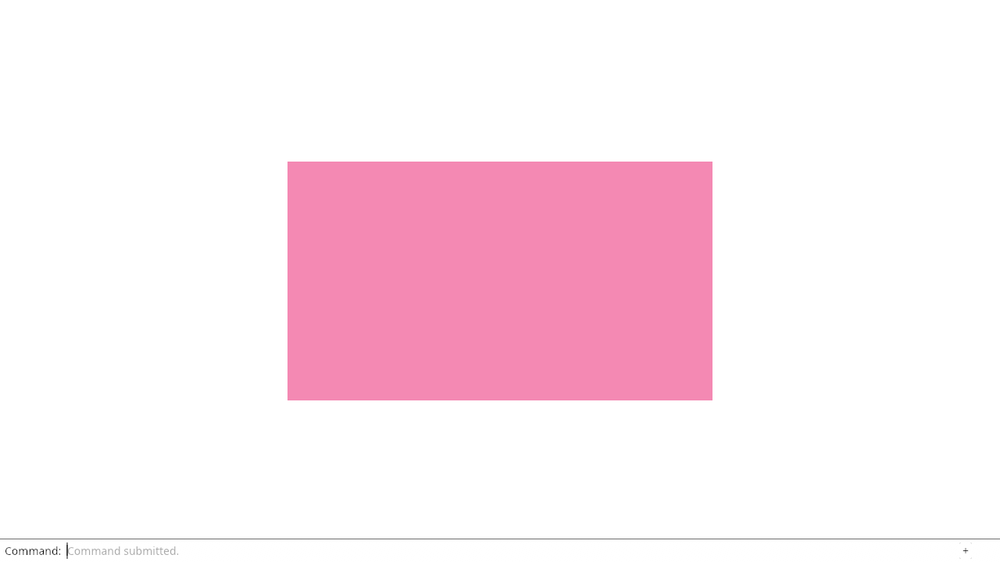

# Camera state and matrix uniforms

<a id="checkpoint-07-uniforms"></a>
<a id="checkpoint-08-camera"></a>
<a id="checkpoint-09-matrices"></a>

Pan, zoom, rotate and reset the diamond without changing its stored geometry.

## Prerequisites and ownership

Complete [Buffers that describe a shared mesh](05-vertices.md). This subject owns camera state, the matrix byte contract and its uniform binding. Keep the command dock, background and shared mesh.

Later course subjects still rewrite the renderer and camera; those ownership failures remain unresolved. The checkpoint below preserves the existing matrix endpoint and does not claim production parity.

## Build

Type these complete files while retaining every other file from the previous checkpoint.

### A camera is state

```rust
--8<-- "journey/code/07-view-4.rs"
```

The camera stores a centre, a positive scale and an angle in radians. A pan changes the point we look at; it does not translate the mesh. Zoom accepts only finite positive factors and clamps the resulting scale between 0.1 and 10. Reset constructs the default camera, leaving the independently owned background alone.

The view first subtracts the camera centre, then scales and rotates the result. With `a = scale * cos(angle)` and `b = scale * sin(angle)`, the screen coordinates of world position `(x, y)` are `a*x + b*y` and `-b*x + a*y`, plus translation. Translation is the negative transformed camera centre. Consequently that centre always maps to zero, including after rotation. The first test checks this invariant using a panned, scaled and rotated view.

Read the sixteen returned floats as four columns. The first three columns describe transformed coordinate axes; the fourth describes the transformed origin. This is column-major storage, matching WGSL. Uploading the same numbers in row order would put translation in the wrong places.

### The shader reads the matrix

```wgsl
--8<-- "journey/code/07-view-1.wgsl"
```

Group zero, binding zero identifies the uniform resource. A `mat4x4<f32>` occupies four 16-byte columns, for 64 bytes total. Multiplying it by `(x, y, 0, 1)` combines the columns with those weights. The final one includes translation. A direction would use zero there, because changing the origin must not move a direction.

### Retain and upload the uniform

```rust
--8<-- "journey/code/07-view-2.rs"
```

The renderer allocates one 64-byte buffer with `UNIFORM | COPY_DST`: the shader reads it, and the CPU can upload a new view. The pipeline derives its layout from the shader; `get_bind_group_layout(0)` supplies the matching layout when the bind group is created. `as_entire_binding` exposes all sixteen floats at binding zero.

Each draw serializes those floats in column order and calls `queue.write_buffer` before submitting the render pass. The pass binds the group before drawing the six mesh indices. Camera commands change these 64 bytes, while retaining the geometry buffers, bind group and pipeline. The application determines the view; the renderer only uploads and uses it.

### Connect commands and present

```rust
--8<-- "journey/code/07-view-3.rs"
```

The browser translates the dock's submitted text into camera operations. `Orbit Right` adds a quarter of pi radians; `View Reset` replaces only the camera. Presentation computes the current matrix, draws the scene, paints the existing dock onto the same target and presents once. An input event is processed by the dock before its submitted command is dispatched.

Register the camera alongside the existing modules:

```rust
--8<-- "journey/code/07-view-5.rs"
```

## Run and observe

From `session_viewer`, assemble the checkpoint in a fresh directory:

```sh
npm --prefix ../session_tests run course -- reference 07-uniforms --output target/camera-view
cd target/camera-view
trunk serve --port 8780
```

Use the workspace storage guard and build slot for builds. Open `http://127.0.0.1:8780/`. The initial pink diamond is centred. `Zoom Out` halves its size. `Orbit Right` rotates the view by 45 degrees clockwise, making the diamond axis-aligned. It is square in clip space; this checkpoint maps the two axes across the canvas independently, so a nonsquare viewport displays a rectangle. `View Reset` restores its original angle and size. `Background` still changes the clear colour. Production camera projection remains part of the unresolved endpoint-parity work.

## Predict and try

Reset, then submit `Pan Right` and `Orbit Right`. Predict where the world origin lands. The camera centre is `(0.25, 0)` and the angle is pi/4: translation becomes approximately `(-0.177, 0.177)`. The diamond's centre therefore moves left and up in clip space. Reset again. Change the background and reset once more: the background stays as selected.

## Question and answer

Which matrix column moves a point, and why does its input position end with a 1?

The fourth column contains translation. Multiplication adds that column multiplied by the input's last component. A position ends with 1, so translation affects it. A direction would end with 0, so translation would not move it. The first three columns describe how the coordinate axes are transformed.

## Validation

Source replay compares this checkpoint with the exact endpoint of the three archived uniform, camera and matrix checkpoints. Camera tests check the fixed centre under rotation and zoom, and bounded positive scale. Fresh wasm and optimized web builds, four native tests and the WARP pixel check pass. Chrome interaction checks execute `Orbit Right` at desktop and upright dimensions. Production projection and later-subject ownership remain unresolved.

[Source-bound validation receipt](release/consolidated-windows-20261113.json) ? [Upright browser frame](../screenshots/consolidated-windows/07-uniforms-upright.png). Native evidence uses software rendering; viewport emulation does not establish real-device acceptance.


