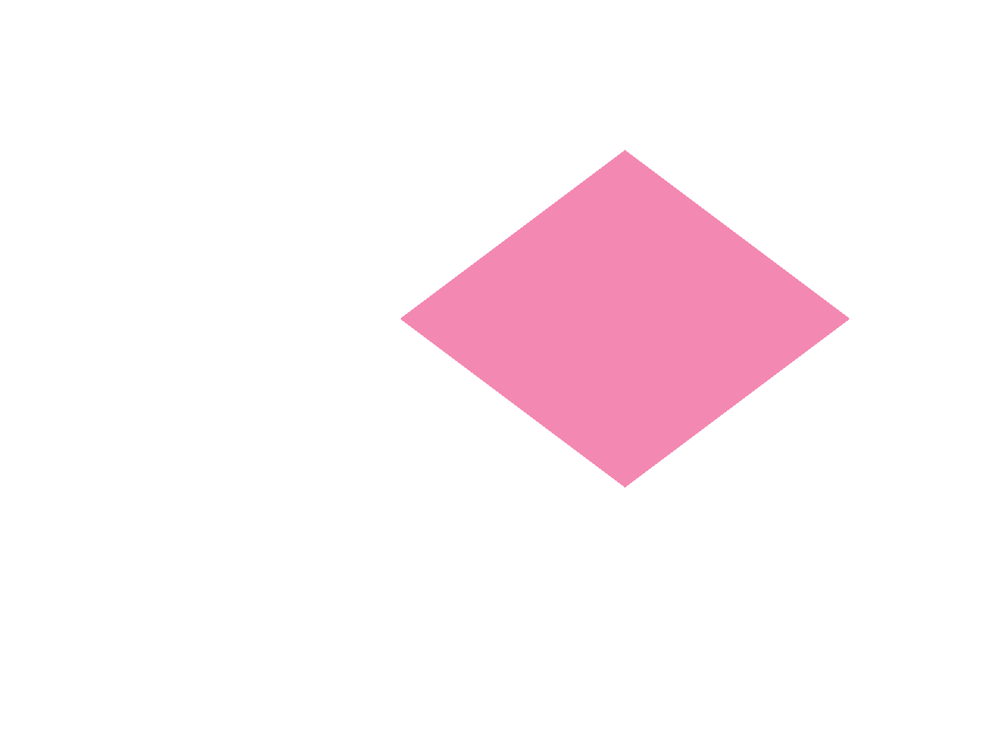
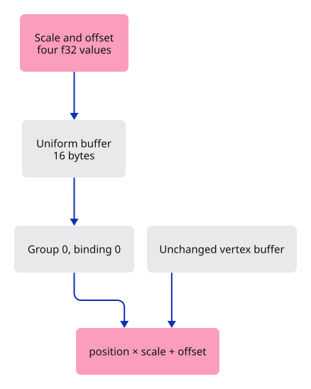

# 2.3.1 · Send one view setting to every corner

**Chapter 2 · Geometry, camera and selection · Section 2.3 · Shared view settings** · [Contents](contents.md)

**Typing: 16–32 minutes.** [Estimate](typing-load.md).

Move the diamond by uploading one setting shared by all its vertices. Four floats describe horizontal and vertical scale and offset. The shader applies `position * scale + offset`.

## Type

Continue from [Share a corner between triangles](06-indices.md). [Save or recover your work](recovery.md).

### 1. `src/triangle.wgsl`

Declare the uniform resource before the vertex function. Its group and binding identify a resource slot. Use the first pair as scale and the second pair as offset. The swizzles xy and zw select those pairs.

<details>
<summary>Locate the existing block</summary>

```wgsl
@vertex
fn vertex(@location(0) position: vec2<f32>) -> @builtin(position) vec4<f32> {
    return vec4<f32>(position, 0.0, 1.0);
}

@fragment
fn fragment() -> @location(0) vec4<f32> {
    return vec4<f32>(0.9, 0.25, 0.45, 1.0);
}
```

</details>

Edit the existing block to match this code; keep unchanged lines:

```wgsl
@group(0) @binding(0) var<uniform> transform: vec4<f32>;

@vertex
fn vertex(@location(0) position: vec2<f32>) -> @builtin(position) vec4<f32> {
    return vec4<f32>(position * transform.xy + transform.zw, 0.0, 1.0);
}

@fragment
fn fragment() -> @location(0) vec4<f32> {
    return vec4<f32>(0.9, 0.25, 0.45, 1.0);
}
```

<details>
<summary>Optional patch references</summary>

Use these original edit fragments when comparing a saved checkpoint. Apply the complete blocks above.

```text
--8<-- "journey/code/07-uniforms-01.wgsl"
```

```text
--8<-- "journey/code/07-uniforms-02.wgsl"
```

</details>

### 2. `src/renderer.rs`

Retain the uniform buffer and bind group. Allocate the uniform buffer and bind it at the shader’s resource slot. Bind the view settings before drawing.

Edit these blocks from bottom to top. Keep the surrounding lines unchanged.

<details>
<summary>Locate this block</summary>

```rust
                ..Default::default()
            });
            pass.set_pipeline(&self.pipeline);
            pass.set_vertex_buffer(0, self.vertices.slice(..));
            pass.set_index_buffer(self.indices.slice(..), wgpu::IndexFormat::Uint16);
            pass.draw_indexed(0..INDICES.len() as u32, 0, 0..1);
```

</details>

Replace it with:

```rust
                ..Default::default()
            });
            pass.set_pipeline(&self.pipeline);
            pass.set_bind_group(0, &self.view_group, &[]);
            pass.set_vertex_buffer(0, self.vertices.slice(..));
            pass.set_index_buffer(self.indices.slice(..), wgpu::IndexFormat::Uint16);
            pass.draw_indexed(0..INDICES.len() as u32, 0, 0..1);
```

<details>
<summary>Locate this block</summary>

```rust
            multiview_mask: None,
            cache: None,
        });
        Self { device, queue, pipeline, vertices, indices }
    }

    pub fn draw(&self, view: &wgpu::TextureView, background: &crate::background::Background) {
        let [r, g, b] = background.rgb();
        let mut encoder = self.device.create_command_encoder(&Default::default());
        {
```

</details>

Replace it with:

```rust
            multiview_mask: None,
            cache: None,
        });
        let uniform = device.create_buffer(&wgpu::BufferDescriptor {
            label: Some("view transform"),
            size: 16,
            usage: wgpu::BufferUsages::UNIFORM | wgpu::BufferUsages::COPY_DST,
            mapped_at_creation: false,
        });
        let view_group = device.create_bind_group(&wgpu::BindGroupDescriptor {
            label: Some("view settings"),
            layout: &pipeline.get_bind_group_layout(0),
            entries: &[wgpu::BindGroupEntry {
                binding: 0,
                resource: uniform.as_entire_binding(),
            }],
        });
        Self { device, queue, pipeline, vertices, indices, uniform, view_group }
    }

    pub fn draw(
        &self,
        view: &wgpu::TextureView,
        background: &crate::background::Background,
        transform: &[f32; 4],
    ) {
        let bytes: Vec<u8> = transform.iter().flat_map(|value| value.to_ne_bytes()).collect();
        self.queue.write_buffer(&self.uniform, 0, &bytes);
        let [r, g, b] = background.rgb();
        let mut encoder = self.device.create_command_encoder(&Default::default());
        {
```

<details>
<summary>Locate this block</summary>

```rust
    pipeline: wgpu::RenderPipeline,
    vertices: wgpu::Buffer,
    indices: wgpu::Buffer,
}

impl Renderer {
```

</details>

Replace it with:

```rust
    pipeline: wgpu::RenderPipeline,
    vertices: wgpu::Buffer,
    indices: wgpu::Buffer,
    uniform: wgpu::Buffer,
    view_group: wgpu::BindGroup,
}

impl Renderer {
```

<details>
<summary>Complete updated block reference</summary>

```rust
use wgpu::util::DeviceExt;

const POSITIONS: [[f32; 2]; 4] = [
    [-0.6, 0.0], [0.0, -0.6], [0.6, 0.0], [0.0, 0.6],
];
const INDICES: [u16; 6] = [0, 1, 2, 0, 2, 3];

pub struct Renderer {
    pub device: wgpu::Device,
    pub queue: wgpu::Queue,
    pipeline: wgpu::RenderPipeline,
    vertices: wgpu::Buffer,
    indices: wgpu::Buffer,
    uniform: wgpu::Buffer,
    view_group: wgpu::BindGroup,
}

impl Renderer {
    pub fn new(device: wgpu::Device, queue: wgpu::Queue, format: wgpu::TextureFormat) -> Self {
        let bytes: Vec<u8> = POSITIONS.iter().flatten()
            .flat_map(|value| value.to_ne_bytes()).collect();
        let vertices = device.create_buffer_init(&wgpu::util::BufferInitDescriptor {
            label: Some("rectangle positions"),
            contents: &bytes,
            usage: wgpu::BufferUsages::VERTEX,
        });
        let bytes: Vec<u8> = INDICES.iter().flat_map(|index| index.to_ne_bytes()).collect();
        let indices = device.create_buffer_init(&wgpu::util::BufferInitDescriptor {
            label: Some("diamond indices"),
            contents: &bytes,
            usage: wgpu::BufferUsages::INDEX,
        });
        let shader = device.create_shader_module(wgpu::ShaderModuleDescriptor {
            label: Some("triangle"),
            source: wgpu::ShaderSource::Wgsl(include_str!("triangle.wgsl").into()),
        });
        let pipeline = device.create_render_pipeline(&wgpu::RenderPipelineDescriptor {
            label: Some("triangle"),
            layout: None,
            vertex: wgpu::VertexState {
                module: &shader,
                entry_point: Some("vertex"),
                compilation_options: Default::default(),
                buffers: &[wgpu::VertexBufferLayout {
                    array_stride: 8,
                    step_mode: wgpu::VertexStepMode::Vertex,
                    attributes: &wgpu::vertex_attr_array![0 => Float32x2],
                }],
            },
            fragment: Some(wgpu::FragmentState {
                module: &shader,
                entry_point: Some("fragment"),
                compilation_options: Default::default(),
                targets: &[Some(format.into())],
            }),
            primitive: Default::default(),
            depth_stencil: None,
            multisample: Default::default(),
            multiview_mask: None,
            cache: None,
        });
        let uniform = device.create_buffer(&wgpu::BufferDescriptor {
            label: Some("view transform"),
            size: 16,
            usage: wgpu::BufferUsages::UNIFORM | wgpu::BufferUsages::COPY_DST,
            mapped_at_creation: false,
        });
        let view_group = device.create_bind_group(&wgpu::BindGroupDescriptor {
            label: Some("view settings"),
            layout: &pipeline.get_bind_group_layout(0),
            entries: &[wgpu::BindGroupEntry {
                binding: 0,
                resource: uniform.as_entire_binding(),
            }],
        });
        Self { device, queue, pipeline, vertices, indices, uniform, view_group }
    }

    pub fn draw(
        &self,
        view: &wgpu::TextureView,
        background: &crate::background::Background,
        transform: &[f32; 4],
    ) {
        let bytes: Vec<u8> = transform.iter().flat_map(|value| value.to_ne_bytes()).collect();
        self.queue.write_buffer(&self.uniform, 0, &bytes);
        let [r, g, b] = background.rgb();
        let mut encoder = self.device.create_command_encoder(&Default::default());
        {
            // The pass borrows the encoder. This scope ends that borrow before finish takes it.
            let mut pass = encoder.begin_render_pass(&wgpu::RenderPassDescriptor {
                label: Some("canvas"),
                color_attachments: &[Some(wgpu::RenderPassColorAttachment {
                    view,
                    depth_slice: None,
                    resolve_target: None,
                    ops: wgpu::Operations {
                        load: wgpu::LoadOp::Clear(wgpu::Color {
                            r, g, b, a: 1.0,
                        }),
                        store: wgpu::StoreOp::Store,
                    },
                })],
                ..Default::default()
            });
            pass.set_pipeline(&self.pipeline);
            pass.set_bind_group(0, &self.view_group, &[]);
            pass.set_vertex_buffer(0, self.vertices.slice(..));
            pass.set_index_buffer(self.indices.slice(..), wgpu::IndexFormat::Uint16);
            pass.draw_indexed(0..INDICES.len() as u32, 0, 0..1);
        }
        self.queue.submit([encoder.finish()]);
    }
}
```

</details>

<details>
<summary>Optional patch references</summary>

Use these original edit fragments when comparing a saved checkpoint. Apply the complete blocks above.

```text
--8<-- "journey/code/07-uniforms-fullscreen-6.rs"
```

```text
--8<-- "journey/code/07-uniforms-fullscreen-7.rs"
```

```text
--8<-- "journey/code/07-uniforms-fullscreen-8.rs"
```

</details>

### 3. `src/browser.rs`

Set the initial scale and translation for presentation. Redraw with the same transform after a command. Report the shared view setting. Accept the transform at the presentation boundary. Pass the transform to the renderer.

Edit these blocks from bottom to top. Keep the surrounding lines unchanged.

<details>
<summary>Locate this block</summary>

```rust
        format: Some(frame.texture.format().add_srgb_suffix()),
        ..Default::default()
    });
    renderer.draw(&view, background);
    panel.draw(renderer, &view);
    frame.present();
    Ok(())
```

</details>

Replace it with:

```rust
        format: Some(frame.texture.format().add_srgb_suffix()),
        ..Default::default()
    });
    renderer.draw(&view, background, transform);
    panel.draw(renderer, &view);
    frame.present();
    Ok(())
```

<details>
<summary>Locate this block</summary>

```rust
    surface: &wgpu::Surface<'_>,
    renderer: &Renderer,
    background: &Background,
    panel: &mut crate::panel::Panel,
) -> Result<(), JsValue> {
    let frame = match surface.get_current_texture() {
```

</details>

Replace it with:

```rust
    surface: &wgpu::Surface<'_>,
    renderer: &Renderer,
    background: &Background,
    transform: &[f32; 4],
    panel: &mut crate::panel::Panel,
) -> Result<(), JsValue> {
    let frame = match surface.get_current_texture() {
```

<details>
<summary>Locate this block</summary>

```rust
    )?;
    // The page has one listener for its lifetime; JavaScript must retain the Rust callback.
    click.forget();
    report("Four shared corners make two triangles.");
    Ok(())
}
```

</details>

Replace it with:

```rust
    )?;
    // The page has one listener for its lifetime; JavaScript must retain the Rust callback.
    click.forget();
    report("One view setting moves all four corners.");
    Ok(())
}
```

<details>
<summary>Locate this block</summary>

```rust
            report(&format!("Cannot lay out commands: {error:?}"));
            return;
        }
        if let Err(error) = present(&surface, &renderer, &background, &mut panel) {
            report(&format!("Cannot redraw: {error:?}"));
        }
    });
```

</details>

Replace it with:

```rust
            report(&format!("Cannot lay out commands: {error:?}"));
            return;
        }
        if let Err(error) = present(&surface, &renderer, &background, &transform, &mut panel) {
            report(&format!("Cannot redraw: {error:?}"));
        }
    });
```

<details>
<summary>Locate this block</summary>

```rust
    );
    panel.update(None, &canvas)?;
    let mut background = Background::default();
    present(&surface, &renderer, &background, &mut panel)?;
    let input_canvas = canvas.clone();
    let click = Closure::<dyn FnMut(web_sys::Event)>::new(move |event: web_sys::Event| {
        let line = match panel.update(Some(&event), &input_canvas) {
```

</details>

Replace it with:

```rust
    );
    panel.update(None, &canvas)?;
    let mut background = Background::default();
    let transform = [0.75, 0.75, 0.25, 0.15];
    present(&surface, &renderer, &background, &transform, &mut panel)?;
    let input_canvas = canvas.clone();
    let click = Closure::<dyn FnMut(web_sys::Event)>::new(move |event: web_sys::Event| {
        let line = match panel.update(Some(&event), &input_canvas) {
```

<details>
<summary>Complete updated block reference</summary>

```rust
use crate::background::Background;
use crate::renderer::Renderer;
use wasm_bindgen::{JsCast, JsValue, closure::Closure};

pub fn report(message: &str) {
    if let Some(document) = web_sys::window().and_then(|window| window.document()) {
        if let Some(status) = document.get_element_by_id("status") {
            status.set_text_content(Some(message));
            if message.starts_with("Cannot") { let _ = status.remove_attribute("hidden"); }
        }
    }
}

pub async fn run() -> Result<(), JsValue> {
    let window = web_sys::window().ok_or("No browser window")?;
    let document = window.document().ok_or("No document")?;
    let canvas: web_sys::HtmlCanvasElement = document
        .get_element_by_id("canvas")
        .ok_or("Missing canvas")?
        .dyn_into()?;
    let instance = wgpu::Instance::new(wgpu::InstanceDescriptor {
        backends: wgpu::Backends::BROWSER_WEBGPU,
        flags: Default::default(),
        memory_budget_thresholds: Default::default(),
        backend_options: Default::default(),
        display: None,
    });
    let surface = instance
        .create_surface(wgpu::SurfaceTarget::Canvas(canvas.clone()))
        .map_err(|error| JsValue::from_str(&error.to_string()))?;
    let adapter = instance
        .request_adapter(&wgpu::RequestAdapterOptions {
            compatible_surface: Some(&surface),
            ..Default::default()
        })
        .await
        .map_err(|error| JsValue::from_str(&error.to_string()))?;
    let (device, queue) = adapter
        .request_device(&wgpu::DeviceDescriptor::default())
        .await
        .map_err(|error| JsValue::from_str(&error.to_string()))?;
    device.on_uncaptured_error(std::sync::Arc::new(|error| report(&error.to_string())));
    let limit = device.limits().max_texture_dimension_2d;
    let width = (window.inner_width()?.as_f64().ok_or("No window width")? as u32).clamp(1, limit);
    let height = (window.inner_height()?.as_f64().ok_or("No window height")? as u32).clamp(1, limit);
    canvas.set_width(width);
    canvas.set_height(height);
    let mut config = surface
        .get_default_config(&adapter, width, height)
        .ok_or("No compatible surface format")?;
    config.view_formats = vec![config.format.add_srgb_suffix()];
    surface.configure(&device, &config);
    let renderer = Renderer::new(device, queue, config.format.add_srgb_suffix());
    let mut panel = crate::panel::Panel::new(
        &renderer,
        config.format.add_srgb_suffix(),
        &["Help", "Background"],
    );
    panel.update(None, &canvas)?;
    let mut background = Background::default();
    let transform = [0.75, 0.75, 0.25, 0.15];
    present(&surface, &renderer, &background, &transform, &mut panel)?;
    let input_canvas = canvas.clone();
    let click = Closure::<dyn FnMut(web_sys::Event)>::new(move |event: web_sys::Event| {
        let line = match panel.update(Some(&event), &input_canvas) {
            Ok(line) => line,
            Err(error) => {
                report(&format!("Cannot read command: {error:?}"));
                return;
            }
        };
        if line.as_deref() == Some("background") {
            background.toggle();
        }
        if let Err(error) = panel.update(None, &input_canvas) {
            report(&format!("Cannot lay out commands: {error:?}"));
            return;
        }
        if let Err(error) = present(&surface, &renderer, &background, &transform, &mut panel) {
            report(&format!("Cannot redraw: {error:?}"));
        }
    });
    for name in [
        "pointerdown",
        "pointermove",
        "pointerup",
        "pointercancel",
        "lostpointercapture",
        "contextmenu",
        "keydown",
        "keyup",
        "blur",
    ] {
        canvas.add_event_listener_with_callback(name, click.as_ref().unchecked_ref())?;
    }
    let options = web_sys::AddEventListenerOptions::new();
    options.set_passive(false);
    canvas.add_event_listener_with_callback_and_add_event_listener_options(
        "wheel",
        click.as_ref().unchecked_ref(),
        &options,
    )?;
    // The page has one listener for its lifetime; JavaScript must retain the Rust callback.
    click.forget();
    report("One view setting moves all four corners.");
    Ok(())
}

fn present(
    surface: &wgpu::Surface<'_>,
    renderer: &Renderer,
    background: &Background,
    transform: &[f32; 4],
    panel: &mut crate::panel::Panel,
) -> Result<(), JsValue> {
    let frame = match surface.get_current_texture() {
        wgpu::CurrentSurfaceTexture::Success(frame)
        | wgpu::CurrentSurfaceTexture::Suboptimal(frame) => frame,
        other => {
            return Err(JsValue::from_str(&format!(
                "Surface unavailable: {other:?}"
            )));
        }
    };
    let view = frame.texture.create_view(&wgpu::TextureViewDescriptor {
        format: Some(frame.texture.format().add_srgb_suffix()),
        ..Default::default()
    });
    renderer.draw(&view, background, transform);
    panel.draw(renderer, &view);
    frame.present();
    Ok(())
}
```

</details>

<details>
<summary>Optional patch references</summary>

Use these original edit fragments when comparing a saved checkpoint. Apply the complete blocks above.

```text
--8<-- "journey/code/07-uniforms-window-1.rs"
```

```text
--8<-- "journey/code/07-uniforms-window-2.rs"
```

```text
--8<-- "journey/code/07-uniforms-window-3.rs"
```

```text
--8<-- "journey/code/07-uniforms-window-4.rs"
```

```text
--8<-- "journey/code/07-uniforms-window-5.rs"
```

</details>

## Run and check

In your project:

```sh
cd workspace/journey
cargo build --lib --locked --target wasm32-unknown-unknown -j1
CARGO_BUILD_JOBS=1 trunk serve --port 8780
```

Open `http://127.0.0.1:8780/`. Keep an existing Trunk server running; saving rebuilds it.

Change the uniform’s scale or offset, save, and compare the diamond. Its stored vertex positions stay unchanged. Restore the original uniform.

### Recorded visual result

**Previous native render — current verification pending.**



*This recorded image predates a source or checker change. Rebuild this checkpoint before using it as current evidence; browser controls require separate acceptance.*

<details>
<summary>Code explanation and diagram</summary>

A uniform buffer stores the values. Its bind group connects that buffer to shader group 0, binding 0. Derive this small pipeline's layout from the shader, then use its group layout when creating the bind group.

A WGSL `vec4<f32>` requires 16 bytes with 16-byte alignment. Four Rust floats starting at byte zero match it. Larger structures will need explicit padding checks.

`UNIFORM` permits shader reads; `COPY_DST` permits uploads. `write_buffer` schedules new values before the next submission. Changing the view therefore keeps both the geometry buffer and pipeline.

View values → uniform buffer → bind group 0 → shader binding 0 → transformed position.



If the diamond moves, must its position buffer have changed?

No. The position buffer still contains the same four corners. A separate uniform supplies scale and offset. Every vertex invocation reads those shared values and transforms its corner before the GPU decides which pixels are covered.

Study estimate, including typing and experiments: 2–3 hours.

</details>

<details>
<summary>Optional experiment</summary>

Predict the result of changing only the first scale from 0.75 to 0.25. The diamond should become narrower without becoming shorter. Then restore it and set the horizontal offset to -0.25: the diamond moves left. Explain why neither experiment edits POSITIONS or INDICES.

</details>

<details>
<summary>Check and save your work</summary>

Restore experimental edits, then run from `session_viewer`:

```sh
npm --prefix ../session_tests run course -- check 2.3.1
npm --prefix ../session_tests run course -- save 2.3.1
```

Source comparison leaves your project untouched. [Save and recovery instructions](recovery.md).

</details>

<details>
<summary>Viewer coverage and verification</summary>

The full viewer sends camera and viewport information through frame uniforms. This is the same boundary: application state calculates values; the renderer uploads them; shaders use them while drawing unchanged geometry.


[Full validation scope](release.md).

</details>
