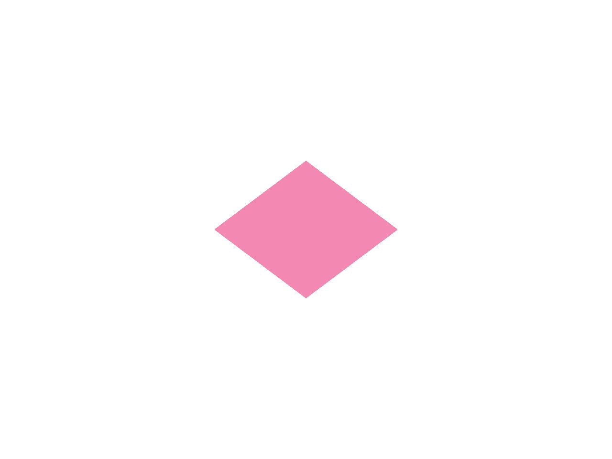
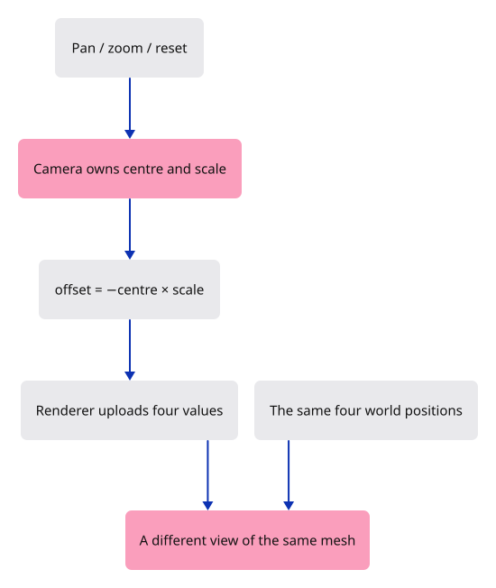

# 2.4.1 · Move the view, keep the geometry

**Chapter 2 · Geometry, camera and selection · Section 2.4 · Moving the camera** · [Contents](contents.md)

**Typing: 25–50 minutes.** [Estimate](typing-load.md).

Give view state its own `Camera`: a centre and scale. Typed pan and zoom commands update it, then redraw with the existing geometry.

## Type

Continue from [Send one view setting to every corner](07-uniforms.md). [Save or recover your work](recovery.md).

### 1. `src/camera.rs`

Create the camera state and its two tests. There are no browser or wgpu types in this file.

Create the file and type:

```rust
--8<-- "journey/code/08-camera-02.rs"
```

### 2. `src/lib.rs`

Register the camera module so the browser and native tests can use it.

<details>
<summary>Locate the existing block</summary>

```rust
pub mod background;
pub mod renderer;
#[cfg(target_arch = "wasm32")]
mod browser;
```

</details>

Edit the existing block to match this code; keep unchanged lines:

```rust
--8<-- "journey/code/08-camera-fullscreen-1.rs"
```

### 3. `src/browser.rs`

Import the camera owner. Add camera commands and present its initial uniform. Apply the submitted camera command, then redraw with its uniform. Report that navigation leaves the mesh unchanged.

Edit these blocks from bottom to top. Keep the surrounding lines unchanged.

<details>
<summary>Locate this block</summary>

```rust
    )?;
    // The page has one listener for its lifetime; JavaScript must retain the Rust callback.
    click.forget();
    report("One view setting moves all four corners.");
    Ok(())
}
```

</details>

Replace it with:

```rust
    )?;
    // The page has one listener for its lifetime; JavaScript must retain the Rust callback.
    click.forget();
    report("Pan and zoom change the view, not the mesh.");
    Ok(())
}
```

<details>
<summary>Locate this block</summary>

```rust
                return;
            }
        };
        if line.as_deref() == Some("background") {
            background.toggle();
        }
        if let Err(error) = panel.update(None, &input_canvas) {
            report(&format!("Cannot lay out commands: {error:?}"));
            return;
        }
        if let Err(error) = present(&surface, &renderer, &background, &transform, &mut panel) {
            report(&format!("Cannot redraw: {error:?}"));
        }
    });
```

</details>

Replace it with:

```rust
                return;
            }
        };

        if let Some(line) = line {
            match line.as_str() {
                "background" => background.toggle(),
                "zoom in" => camera.zoom(2.0),
                "zoom out" => camera.zoom(0.5),
                "pan left" => camera.pan(-0.25, 0.0),
                "pan right" => camera.pan(0.25, 0.0),
                "view reset" => camera = Camera::default(),
                _ => return,
            }
        }
        if let Err(error) = panel.update(None, &input_canvas) {
            report(&format!("Cannot lay out commands: {error:?}"));
            return;
        }
        if let Err(error) = present(
            &surface,
            &renderer,
            &background,
            &camera.uniform(),
            &mut panel,
        ) {
            report(&format!("Cannot redraw: {error:?}"));
        }
    });
```

<details>
<summary>Locate this block</summary>

```rust
    let mut panel = crate::panel::Panel::new(
        &renderer,
        config.format.add_srgb_suffix(),
        &["Help", "Background"],
    );
    panel.update(None, &canvas)?;
    let mut background = Background::default();
    let transform = [0.75, 0.75, 0.25, 0.15];
    present(&surface, &renderer, &background, &transform, &mut panel)?;
    let input_canvas = canvas.clone();
    let click = Closure::<dyn FnMut(web_sys::Event)>::new(move |event: web_sys::Event| {
        let line = match panel.update(Some(&event), &input_canvas) {
```

</details>

Replace it with:

```rust
    let mut panel = crate::panel::Panel::new(
        &renderer,
        config.format.add_srgb_suffix(),
        &[
            "Help",
            "Background",
            "Zoom In",
            "Zoom Out",
            "Pan Left",
            "Pan Right",
            "View Reset",
        ],
    );
    panel.update(None, &canvas)?;
    let mut background = Background::default();
    let mut camera = Camera::default();
    present(
        &surface,
        &renderer,
        &background,
        &camera.uniform(),
        &mut panel,
    )?;
    let input_canvas = canvas.clone();
    let click = Closure::<dyn FnMut(web_sys::Event)>::new(move |event: web_sys::Event| {
        let line = match panel.update(Some(&event), &input_canvas) {
```

<details>
<summary>Locate this block</summary>

```rust
use crate::background::Background;
use crate::renderer::Renderer;
use wasm_bindgen::{JsCast, JsValue, closure::Closure};
```

</details>

Replace it with:

```rust
use crate::background::Background;
use crate::camera::Camera;
use crate::renderer::Renderer;
use wasm_bindgen::{JsCast, JsValue, closure::Closure};
```

<details>
<summary>Complete updated block reference</summary>

```rust
use crate::background::Background;
use crate::camera::Camera;
use crate::renderer::Renderer;
use wasm_bindgen::{JsCast, JsValue, closure::Closure};

pub fn report(message: &str) {
    if let Some(document) = web_sys::window().and_then(|window| window.document()) {
        if let Some(status) = document.get_element_by_id("status") {
            status.set_text_content(Some(message));
            if message.starts_with("Cannot") { let _ = status.remove_attribute("hidden"); }
        }
    }
}

pub async fn run() -> Result<(), JsValue> {
    let window = web_sys::window().ok_or("No browser window")?;
    let document = window.document().ok_or("No document")?;
    let canvas: web_sys::HtmlCanvasElement = document
        .get_element_by_id("canvas")
        .ok_or("Missing canvas")?
        .dyn_into()?;
    let instance = wgpu::Instance::new(wgpu::InstanceDescriptor {
        backends: wgpu::Backends::BROWSER_WEBGPU,
        flags: Default::default(),
        memory_budget_thresholds: Default::default(),
        backend_options: Default::default(),
        display: None,
    });
    let surface = instance
        .create_surface(wgpu::SurfaceTarget::Canvas(canvas.clone()))
        .map_err(|error| JsValue::from_str(&error.to_string()))?;
    let adapter = instance
        .request_adapter(&wgpu::RequestAdapterOptions {
            compatible_surface: Some(&surface),
            ..Default::default()
        })
        .await
        .map_err(|error| JsValue::from_str(&error.to_string()))?;
    let (device, queue) = adapter
        .request_device(&wgpu::DeviceDescriptor::default())
        .await
        .map_err(|error| JsValue::from_str(&error.to_string()))?;
    device.on_uncaptured_error(std::sync::Arc::new(|error| report(&error.to_string())));
    let limit = device.limits().max_texture_dimension_2d;
    let width = (window.inner_width()?.as_f64().ok_or("No window width")? as u32).clamp(1, limit);
    let height = (window.inner_height()?.as_f64().ok_or("No window height")? as u32).clamp(1, limit);
    canvas.set_width(width);
    canvas.set_height(height);
    let mut config = surface
        .get_default_config(&adapter, width, height)
        .ok_or("No compatible surface format")?;
    config.view_formats = vec![config.format.add_srgb_suffix()];
    surface.configure(&device, &config);
    let renderer = Renderer::new(device, queue, config.format.add_srgb_suffix());
    let mut panel = crate::panel::Panel::new(
        &renderer,
        config.format.add_srgb_suffix(),
        &[
            "Help",
            "Background",
            "Zoom In",
            "Zoom Out",
            "Pan Left",
            "Pan Right",
            "View Reset",
        ],
    );
    panel.update(None, &canvas)?;
    let mut background = Background::default();
    let mut camera = Camera::default();
    present(
        &surface,
        &renderer,
        &background,
        &camera.uniform(),
        &mut panel,
    )?;
    let input_canvas = canvas.clone();
    let click = Closure::<dyn FnMut(web_sys::Event)>::new(move |event: web_sys::Event| {
        let line = match panel.update(Some(&event), &input_canvas) {
            Ok(line) => line,
            Err(error) => {
                report(&format!("Cannot read command: {error:?}"));
                return;
            }
        };

        if let Some(line) = line {
            match line.as_str() {
                "background" => background.toggle(),
                "zoom in" => camera.zoom(2.0),
                "zoom out" => camera.zoom(0.5),
                "pan left" => camera.pan(-0.25, 0.0),
                "pan right" => camera.pan(0.25, 0.0),
                "view reset" => camera = Camera::default(),
                _ => return,
            }
        }
        if let Err(error) = panel.update(None, &input_canvas) {
            report(&format!("Cannot lay out commands: {error:?}"));
            return;
        }
        if let Err(error) = present(
            &surface,
            &renderer,
            &background,
            &camera.uniform(),
            &mut panel,
        ) {
            report(&format!("Cannot redraw: {error:?}"));
        }
    });
    for name in [
        "pointerdown",
        "pointermove",
        "pointerup",
        "pointercancel",
        "lostpointercapture",
        "contextmenu",
        "keydown",
        "keyup",
        "blur",
    ] {
        canvas.add_event_listener_with_callback(name, click.as_ref().unchecked_ref())?;
    }
    let options = web_sys::AddEventListenerOptions::new();
    options.set_passive(false);
    canvas.add_event_listener_with_callback_and_add_event_listener_options(
        "wheel",
        click.as_ref().unchecked_ref(),
        &options,
    )?;
    // The page has one listener for its lifetime; JavaScript must retain the Rust callback.
    click.forget();
    report("Pan and zoom change the view, not the mesh.");
    Ok(())
}

fn present(
    surface: &wgpu::Surface<'_>,
    renderer: &Renderer,
    background: &Background,
    transform: &[f32; 4],
    panel: &mut crate::panel::Panel,
) -> Result<(), JsValue> {
    let frame = match surface.get_current_texture() {
        wgpu::CurrentSurfaceTexture::Success(frame)
        | wgpu::CurrentSurfaceTexture::Suboptimal(frame) => frame,
        other => {
            return Err(JsValue::from_str(&format!(
                "Surface unavailable: {other:?}"
            )));
        }
    };
    let view = frame.texture.create_view(&wgpu::TextureViewDescriptor {
        format: Some(frame.texture.format().add_srgb_suffix()),
        ..Default::default()
    });
    renderer.draw(&view, background, transform);
    panel.draw(renderer, &view);
    frame.present();
    Ok(())
}
```

</details>

<details>
<summary>Optional patch references</summary>

Use these original edit fragments when comparing a saved checkpoint. Apply the complete blocks above.

```text
--8<-- "journey/code/08-camera-window-1.rs"
```

```text
--8<-- "journey/code/08-camera-window-2.rs"
```

```text
--8<-- "journey/code/08-camera-window-3.rs"
```

```text
--8<-- "journey/code/08-camera-window-4.rs"
```

</details>

## Run and check

In your project:

```sh
cd workspace/journey
cargo build --lib --locked --target wasm32-unknown-unknown -j1
CARGO_BUILD_JOBS=1 trunk serve --port 8780
```

Open `http://127.0.0.1:8780/`. Keep an existing Trunk server running; saving rebuilds it.

Type `Zoom Out`, then `View Reset`. The diamond shrinks, then returns to its initial size. The camera changed; the geometry did not.

### Recorded visual result

**Previous native render — current verification pending.**

This is the result after one Zoom Out action.



*This recorded image predates a source or checker change. Rebuild this checkpoint before using it as current evidence; browser controls require separate acceptance.*

<details>
<summary>Code explanation and diagram</summary>

The camera formula is `(position - center) * scale`. Our shader already accepts scale and offset, so supply `offset = -center * scale`. With centre 0.25 and scale 2, offset −0.5 puts world x = 0.25 at screen x = 0.

The browser translates a submitted command into camera changes. The renderer receives four numbers and does not know how the user chose them. Camera tests verify the centre stays fixed during zoom and reject invalid or out-of-range scale.

command → camera centre or scale → four uniform values → existing renderer → unchanged mesh in a different view.



When the camera centre moves right, why does the diamond move left on the screen?

The shader receives an offset equal to minus the camera centre times the scale. It therefore draws each world position relative to the camera centre. Looking farther right places the stationary diamond farther left in our view; its stored positions have not moved.

Study estimate, including typing and experiments: 2–3 hours.

</details>

<details>
<summary>Optional experiment</summary>

Zoom Out once, Pan Right once, then Pan Left once. Predict what View Reset will change. Now change the background and reset again: the background should stay as you chose it. This checks that camera state and background state have separate responsibilities.

</details>

<details>
<summary>Check and save your work</summary>

Restore experimental edits, then run from `session_viewer`:

```sh
npm --prefix ../session_tests run course -- check 2.4.1
npm --prefix ../session_tests run course -- save 2.4.1
```

Source comparison leaves your project untouched. [Save and recovery instructions](recovery.md).

</details>

<details>
<summary>Viewer coverage and verification</summary>

A full 3D camera also owns a target and a viewing scale or distance. Its orientation and projection add the third dimension. We will extend this view model before connecting orbit gestures, while preserving the separation between camera state, document geometry and GPU resources.


[Full validation scope](release.md).

</details>
