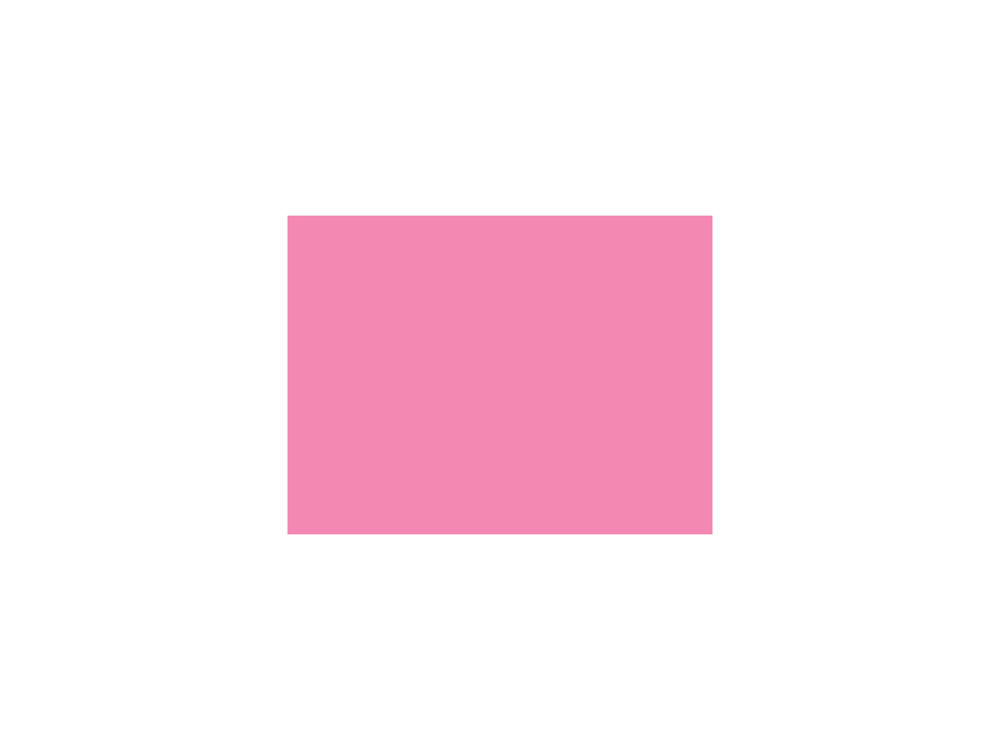
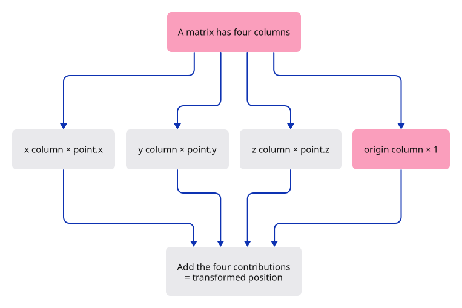

# 2.5.1 · Let one matrix describe the view

**Chapter 2 · Geometry, camera and selection · Section 2.5 · View matrices** · [Contents](contents.md)

**Typing: 12–23 minutes.** [Estimate](typing-load.md).

Replace separate scale and offset uniforms with one matrix so the view can also rotate. The geometry and draw pipeline remain the same.

## Type

Continue from [Move the view, keep the geometry](08-camera.md). [Save or recover your work](recovery.md).

### 1. `src/camera.rs`

Keep the viewing angle in radians beside the centre and scale. Start without rotation and make Reset view restore that angle. Replace the four-number uniform with a column-major matrix and add rotation. Strengthen the camera test: its target must stay centred after both zooming and rotation.

<details>
<summary>Locate the existing block</summary>

```rust
pub struct Camera {
    pub center: [f32; 2],
    pub scale: f32,
}

impl Default for Camera {
    fn default() -> Self {
        Self { center: [0.0, 0.0], scale: 1.0 }
    }
}

impl Camera {
    pub fn pan(&mut self, dx: f32, dy: f32) {
        self.center[0] += dx;
        self.center[1] += dy;
    }

    pub fn zoom(&mut self, factor: f32) {
        if factor.is_finite() && factor > 0.0 {
            self.scale = (self.scale * factor).clamp(0.1, 10.0);
        }
    }

    pub fn uniform(&self) -> [f32; 4] {
        // Subtract the camera centre before scaling the world position.
        [self.scale, self.scale, -self.center[0] * self.scale, -self.center[1] * self.scale]
    }
}

#[cfg(test)]
mod tests {
    use super::*;

    #[test]
    fn panned_target_stays_at_the_screen_centre_when_zooming() {
        let mut camera = Camera::default();
        camera.pan(0.25, -0.5);
        camera.zoom(2.0);
        let [sx, sy, ox, oy] = camera.uniform();
        assert_eq!(camera.center[0] * sx + ox, 0.0);
        assert_eq!(camera.center[1] * sy + oy, 0.0);
    }

    #[test]
    fn zoom_stays_positive_and_bounded() {
        let mut camera = Camera::default();
        camera.zoom(0.0001);
        assert_eq!(camera.scale, 0.1);
        camera.zoom(1_000.0);
        assert_eq!(camera.scale, 10.0);
        camera.zoom(f32::NAN);
        camera.zoom(-1.0);
        assert_eq!(camera.scale, 10.0);
    }
}
```

</details>

Edit the existing block to match this code; keep unchanged lines:

```rust
pub struct Camera {
    pub center: [f32; 2],
    pub scale: f32,
    pub angle: f32,
}

impl Default for Camera {
    fn default() -> Self {
        Self { center: [0.0, 0.0], scale: 1.0, angle: 0.0 }
    }
}

impl Camera {
    pub fn pan(&mut self, dx: f32, dy: f32) {
        self.center[0] += dx;
        self.center[1] += dy;
    }

    pub fn zoom(&mut self, factor: f32) {
        if factor.is_finite() && factor > 0.0 {
            self.scale = (self.scale * factor).clamp(0.1, 10.0);
        }
    }

    pub fn rotate(&mut self, radians: f32) {
        self.angle += radians;
    }

    pub fn uniform(&self) -> [f32; 16] {
        let a = self.scale * self.angle.cos();
        let b = self.scale * self.angle.sin();
        let [x, y] = self.center;
        // WGSL matrices are uploaded column by column.
        [
            a, -b, 0.0, 0.0,
            b,  a, 0.0, 0.0,
            0.0, 0.0, 1.0, 0.0,
            -a * x - b * y, b * x - a * y, 0.0, 1.0,
        ]
    }
}

#[cfg(test)]
mod tests {
    use super::*;

    #[test]
    fn panned_target_stays_at_the_screen_centre_when_zooming() {
        let mut camera = Camera::default();
        camera.pan(0.25, -0.5);
        camera.zoom(2.0);
        camera.rotate(std::f32::consts::FRAC_PI_4);
        let m = camera.uniform();
        let [x, y] = camera.center;
        assert!((m[0] * x + m[4] * y + m[12]).abs() < 1.0e-6);
        assert!((m[1] * x + m[5] * y + m[13]).abs() < 1.0e-6);
    }

    #[test]
    fn zoom_stays_positive_and_bounded() {
        let mut camera = Camera::default();
        camera.zoom(0.0001);
        assert_eq!(camera.scale, 0.1);
        camera.zoom(1_000.0);
        assert_eq!(camera.scale, 10.0);
        camera.zoom(f32::NAN);
        camera.zoom(-1.0);
        assert_eq!(camera.scale, 10.0);
    }
}
```

<details>
<summary>Optional patch references</summary>

Use these original edit fragments when comparing a saved checkpoint. Apply the complete blocks above.

```text
--8<-- "journey/code/09-matrices-01.rs"
```

```text
--8<-- "journey/code/09-matrices-02.rs"
```

```text
--8<-- "journey/code/09-matrices-03.rs"
```

```text
--8<-- "journey/code/09-matrices-04.rs"
```

</details>

### 2. `src/triangle.wgsl`

Change the resource type to four columns of four floats. Multiply a world position by the matrix. Its final component 1 lets the translation column contribute.

<details>
<summary>Locate the existing block</summary>

```wgsl
@group(0) @binding(0) var<uniform> transform: vec4<f32>;

@vertex
fn vertex(@location(0) position: vec2<f32>) -> @builtin(position) vec4<f32> {
    return vec4<f32>(position * transform.xy + transform.zw, 0.0, 1.0);
}

@fragment
fn fragment() -> @location(0) vec4<f32> {
    return vec4<f32>(0.9, 0.25, 0.45, 1.0);
}
```

</details>

Edit the existing block to match this code; keep unchanged lines:

```wgsl
@group(0) @binding(0) var<uniform> transform: mat4x4<f32>;

@vertex
fn vertex(@location(0) position: vec2<f32>) -> @builtin(position) vec4<f32> {
    return transform * vec4<f32>(position, 0.0, 1.0);
}

@fragment
fn fragment() -> @location(0) vec4<f32> {
    return vec4<f32>(0.9, 0.25, 0.45, 1.0);
}
```

<details>
<summary>Optional patch references</summary>

Use these original edit fragments when comparing a saved checkpoint. Apply the complete blocks above.

```text
--8<-- "journey/code/09-matrices-05.wgsl"
```

```text
--8<-- "journey/code/09-matrices-06.wgsl"
```

</details>

### 3. `src/renderer.rs`

Allocate 64 bytes for sixteen f32 matrix entries. Upload all sixteen matrix entries before drawing.

Edit these blocks from bottom to top. Keep the surrounding lines unchanged.

<details>
<summary>Locate this block</summary>

```rust
        &self,
        view: &wgpu::TextureView,
        background: &crate::background::Background,
        transform: &[f32; 4],
    ) {
        let bytes: Vec<u8> = transform.iter().flat_map(|value| value.to_ne_bytes()).collect();
        self.queue.write_buffer(&self.uniform, 0, &bytes);
```

</details>

Replace it with:

```rust
        &self,
        view: &wgpu::TextureView,
        background: &crate::background::Background,
        transform: &[f32; 16],
    ) {
        let bytes: Vec<u8> = transform.iter().flat_map(|value| value.to_ne_bytes()).collect();
        self.queue.write_buffer(&self.uniform, 0, &bytes);
```

<details>
<summary>Locate this block</summary>

```rust
        });
        let uniform = device.create_buffer(&wgpu::BufferDescriptor {
            label: Some("view transform"),
            size: 16,
            usage: wgpu::BufferUsages::UNIFORM | wgpu::BufferUsages::COPY_DST,
            mapped_at_creation: false,
        });
```

</details>

Replace it with:

```rust
        });
        let uniform = device.create_buffer(&wgpu::BufferDescriptor {
            label: Some("view transform"),
            size: 64,
            usage: wgpu::BufferUsages::UNIFORM | wgpu::BufferUsages::COPY_DST,
            mapped_at_creation: false,
        });
```

<details>
<summary>Complete updated block reference</summary>

```rust
use wgpu::util::DeviceExt;

const POSITIONS: [[f32; 2]; 4] = [
    [-0.6, 0.0], [0.0, -0.6], [0.6, 0.0], [0.0, 0.6],
];
const INDICES: [u16; 6] = [0, 1, 2, 0, 2, 3];

pub struct Renderer {
    pub device: wgpu::Device,
    pub queue: wgpu::Queue,
    pipeline: wgpu::RenderPipeline,
    vertices: wgpu::Buffer,
    indices: wgpu::Buffer,
    uniform: wgpu::Buffer,
    view_group: wgpu::BindGroup,
}

impl Renderer {
    pub fn new(device: wgpu::Device, queue: wgpu::Queue, format: wgpu::TextureFormat) -> Self {
        let bytes: Vec<u8> = POSITIONS.iter().flatten()
            .flat_map(|value| value.to_ne_bytes()).collect();
        let vertices = device.create_buffer_init(&wgpu::util::BufferInitDescriptor {
            label: Some("rectangle positions"),
            contents: &bytes,
            usage: wgpu::BufferUsages::VERTEX,
        });
        let bytes: Vec<u8> = INDICES.iter().flat_map(|index| index.to_ne_bytes()).collect();
        let indices = device.create_buffer_init(&wgpu::util::BufferInitDescriptor {
            label: Some("diamond indices"),
            contents: &bytes,
            usage: wgpu::BufferUsages::INDEX,
        });
        let shader = device.create_shader_module(wgpu::ShaderModuleDescriptor {
            label: Some("triangle"),
            source: wgpu::ShaderSource::Wgsl(include_str!("triangle.wgsl").into()),
        });
        let pipeline = device.create_render_pipeline(&wgpu::RenderPipelineDescriptor {
            label: Some("triangle"),
            layout: None,
            vertex: wgpu::VertexState {
                module: &shader,
                entry_point: Some("vertex"),
                compilation_options: Default::default(),
                buffers: &[wgpu::VertexBufferLayout {
                    array_stride: 8,
                    step_mode: wgpu::VertexStepMode::Vertex,
                    attributes: &wgpu::vertex_attr_array![0 => Float32x2],
                }],
            },
            fragment: Some(wgpu::FragmentState {
                module: &shader,
                entry_point: Some("fragment"),
                compilation_options: Default::default(),
                targets: &[Some(format.into())],
            }),
            primitive: Default::default(),
            depth_stencil: None,
            multisample: Default::default(),
            multiview_mask: None,
            cache: None,
        });
        let uniform = device.create_buffer(&wgpu::BufferDescriptor {
            label: Some("view transform"),
            size: 64,
            usage: wgpu::BufferUsages::UNIFORM | wgpu::BufferUsages::COPY_DST,
            mapped_at_creation: false,
        });
        let view_group = device.create_bind_group(&wgpu::BindGroupDescriptor {
            label: Some("view settings"),
            layout: &pipeline.get_bind_group_layout(0),
            entries: &[wgpu::BindGroupEntry {
                binding: 0,
                resource: uniform.as_entire_binding(),
            }],
        });
        Self { device, queue, pipeline, vertices, indices, uniform, view_group }
    }

    pub fn draw(
        &self,
        view: &wgpu::TextureView,
        background: &crate::background::Background,
        transform: &[f32; 16],
    ) {
        let bytes: Vec<u8> = transform.iter().flat_map(|value| value.to_ne_bytes()).collect();
        self.queue.write_buffer(&self.uniform, 0, &bytes);
        let [r, g, b] = background.rgb();
        let mut encoder = self.device.create_command_encoder(&Default::default());
        {
            // The pass borrows the encoder. This scope ends that borrow before finish takes it.
            let mut pass = encoder.begin_render_pass(&wgpu::RenderPassDescriptor {
                label: Some("canvas"),
                color_attachments: &[Some(wgpu::RenderPassColorAttachment {
                    view,
                    depth_slice: None,
                    resolve_target: None,
                    ops: wgpu::Operations {
                        load: wgpu::LoadOp::Clear(wgpu::Color {
                            r, g, b, a: 1.0,
                        }),
                        store: wgpu::StoreOp::Store,
                    },
                })],
                ..Default::default()
            });
            pass.set_pipeline(&self.pipeline);
            pass.set_bind_group(0, &self.view_group, &[]);
            pass.set_vertex_buffer(0, self.vertices.slice(..));
            pass.set_index_buffer(self.indices.slice(..), wgpu::IndexFormat::Uint16);
            pass.draw_indexed(0..INDICES.len() as u32, 0, 0..1);
        }
        self.queue.submit([encoder.finish()]);
    }
}
```

</details>

<details>
<summary>Optional patch references</summary>

Use these original edit fragments when comparing a saved checkpoint. Apply the complete blocks above.

```text
--8<-- "journey/code/09-matrices-fullscreen-5.rs"
```

```text
--8<-- "journey/code/09-matrices-fullscreen-6.rs"
```

</details>

### 4. `src/browser.rs`

Add Orbit Right to the vocabulary. Rotate the camera when Orbit Right is submitted. Report the matrix transform. Pass the full matrix into presentation.

Edit these blocks from bottom to top. Keep the surrounding lines unchanged.

<details>
<summary>Locate this block</summary>

```rust
    surface: &wgpu::Surface<'_>,
    renderer: &Renderer,
    background: &Background,
    transform: &[f32; 4],
    panel: &mut crate::panel::Panel,
) -> Result<(), JsValue> {
    let frame = match surface.get_current_texture() {
```

</details>

Replace it with:

```rust
    surface: &wgpu::Surface<'_>,
    renderer: &Renderer,
    background: &Background,
    transform: &[f32; 16],
    panel: &mut crate::panel::Panel,
) -> Result<(), JsValue> {
    let frame = match surface.get_current_texture() {
```

<details>
<summary>Locate this block</summary>

```rust
    )?;
    // The page has one listener for its lifetime; JavaScript must retain the Rust callback.
    click.forget();
    report("Pan and zoom change the view, not the mesh.");
    Ok(())
}
```

</details>

Replace it with:

```rust
    )?;
    // The page has one listener for its lifetime; JavaScript must retain the Rust callback.
    click.forget();
    report("A matrix carries pan, scale and rotation.");
    Ok(())
}
```

<details>
<summary>Locate this block</summary>

```rust
                "zoom out" => camera.zoom(0.5),
                "pan left" => camera.pan(-0.25, 0.0),
                "pan right" => camera.pan(0.25, 0.0),
                "view reset" => camera = Camera::default(),
                _ => return,
            }
```

</details>

Replace it with:

```rust
                "zoom out" => camera.zoom(0.5),
                "pan left" => camera.pan(-0.25, 0.0),
                "pan right" => camera.pan(0.25, 0.0),
                "orbit right" => camera.rotate(std::f32::consts::FRAC_PI_4),
                "view reset" => camera = Camera::default(),
                _ => return,
            }
```

<details>
<summary>Locate this block</summary>

```rust
            "Zoom Out",
            "Pan Left",
            "Pan Right",
            "View Reset",
        ],
    );
```

</details>

Replace it with:

```rust
            "Zoom Out",
            "Pan Left",
            "Pan Right",
            "Orbit Right",
            "View Reset",
        ],
    );
```

<details>
<summary>Complete updated block reference</summary>

```rust
use crate::background::Background;
use crate::camera::Camera;
use crate::renderer::Renderer;
use wasm_bindgen::{JsCast, JsValue, closure::Closure};

pub fn report(message: &str) {
    if let Some(document) = web_sys::window().and_then(|window| window.document()) {
        if let Some(status) = document.get_element_by_id("status") {
            status.set_text_content(Some(message));
            if message.starts_with("Cannot") { let _ = status.remove_attribute("hidden"); }
        }
    }
}

pub async fn run() -> Result<(), JsValue> {
    let window = web_sys::window().ok_or("No browser window")?;
    let document = window.document().ok_or("No document")?;
    let canvas: web_sys::HtmlCanvasElement = document
        .get_element_by_id("canvas")
        .ok_or("Missing canvas")?
        .dyn_into()?;
    let instance = wgpu::Instance::new(wgpu::InstanceDescriptor {
        backends: wgpu::Backends::BROWSER_WEBGPU,
        flags: Default::default(),
        memory_budget_thresholds: Default::default(),
        backend_options: Default::default(),
        display: None,
    });
    let surface = instance
        .create_surface(wgpu::SurfaceTarget::Canvas(canvas.clone()))
        .map_err(|error| JsValue::from_str(&error.to_string()))?;
    let adapter = instance
        .request_adapter(&wgpu::RequestAdapterOptions {
            compatible_surface: Some(&surface),
            ..Default::default()
        })
        .await
        .map_err(|error| JsValue::from_str(&error.to_string()))?;
    let (device, queue) = adapter
        .request_device(&wgpu::DeviceDescriptor::default())
        .await
        .map_err(|error| JsValue::from_str(&error.to_string()))?;
    device.on_uncaptured_error(std::sync::Arc::new(|error| report(&error.to_string())));
    let limit = device.limits().max_texture_dimension_2d;
    let width = (window.inner_width()?.as_f64().ok_or("No window width")? as u32).clamp(1, limit);
    let height = (window.inner_height()?.as_f64().ok_or("No window height")? as u32).clamp(1, limit);
    canvas.set_width(width);
    canvas.set_height(height);
    let mut config = surface
        .get_default_config(&adapter, width, height)
        .ok_or("No compatible surface format")?;
    config.view_formats = vec![config.format.add_srgb_suffix()];
    surface.configure(&device, &config);
    let renderer = Renderer::new(device, queue, config.format.add_srgb_suffix());
    let mut panel = crate::panel::Panel::new(
        &renderer,
        config.format.add_srgb_suffix(),
        &[
            "Help",
            "Background",
            "Zoom In",
            "Zoom Out",
            "Pan Left",
            "Pan Right",
            "Orbit Right",
            "View Reset",
        ],
    );
    panel.update(None, &canvas)?;
    let mut background = Background::default();
    let mut camera = Camera::default();
    present(
        &surface,
        &renderer,
        &background,
        &camera.uniform(),
        &mut panel,
    )?;
    let input_canvas = canvas.clone();
    let click = Closure::<dyn FnMut(web_sys::Event)>::new(move |event: web_sys::Event| {
        let line = match panel.update(Some(&event), &input_canvas) {
            Ok(line) => line,
            Err(error) => {
                report(&format!("Cannot read command: {error:?}"));
                return;
            }
        };

        if let Some(line) = line {
            match line.as_str() {
                "background" => background.toggle(),
                "zoom in" => camera.zoom(2.0),
                "zoom out" => camera.zoom(0.5),
                "pan left" => camera.pan(-0.25, 0.0),
                "pan right" => camera.pan(0.25, 0.0),
                "orbit right" => camera.rotate(std::f32::consts::FRAC_PI_4),
                "view reset" => camera = Camera::default(),
                _ => return,
            }
        }
        if let Err(error) = panel.update(None, &input_canvas) {
            report(&format!("Cannot lay out commands: {error:?}"));
            return;
        }
        if let Err(error) = present(
            &surface,
            &renderer,
            &background,
            &camera.uniform(),
            &mut panel,
        ) {
            report(&format!("Cannot redraw: {error:?}"));
        }
    });
    for name in [
        "pointerdown",
        "pointermove",
        "pointerup",
        "pointercancel",
        "lostpointercapture",
        "contextmenu",
        "keydown",
        "keyup",
        "blur",
    ] {
        canvas.add_event_listener_with_callback(name, click.as_ref().unchecked_ref())?;
    }
    let options = web_sys::AddEventListenerOptions::new();
    options.set_passive(false);
    canvas.add_event_listener_with_callback_and_add_event_listener_options(
        "wheel",
        click.as_ref().unchecked_ref(),
        &options,
    )?;
    // The page has one listener for its lifetime; JavaScript must retain the Rust callback.
    click.forget();
    report("A matrix carries pan, scale and rotation.");
    Ok(())
}

fn present(
    surface: &wgpu::Surface<'_>,
    renderer: &Renderer,
    background: &Background,
    transform: &[f32; 16],
    panel: &mut crate::panel::Panel,
) -> Result<(), JsValue> {
    let frame = match surface.get_current_texture() {
        wgpu::CurrentSurfaceTexture::Success(frame)
        | wgpu::CurrentSurfaceTexture::Suboptimal(frame) => frame,
        other => {
            return Err(JsValue::from_str(&format!(
                "Surface unavailable: {other:?}"
            )));
        }
    };
    let view = frame.texture.create_view(&wgpu::TextureViewDescriptor {
        format: Some(frame.texture.format().add_srgb_suffix()),
        ..Default::default()
    });
    renderer.draw(&view, background, transform);
    panel.draw(renderer, &view);
    frame.present();
    Ok(())
}
```

</details>

<details>
<summary>Optional patch references</summary>

Use these original edit fragments when comparing a saved checkpoint. Apply the complete blocks above.

```text
--8<-- "journey/code/09-matrices-window-1.rs"
```

```text
--8<-- "journey/code/09-matrices-window-2.rs"
```

```text
--8<-- "journey/code/09-matrices-window-3.rs"
```

```text
--8<-- "journey/code/09-matrices-window-4.rs"
```

</details>

## Run and check

In your project:

```sh
cd workspace/journey
cargo build --lib --locked --target wasm32-unknown-unknown -j1
CARGO_BUILD_JOBS=1 trunk serve --port 8780
```

Open `http://127.0.0.1:8780/`. Keep an existing Trunk server running; saving rebuilds it.

Type `Orbit Right`. The diamond rotates by 45 degrees. Type `View Reset` to restore its angle. The vertex buffer stays unchanged.

### Recorded visual result

**Previous native render — current verification pending.**

This is the result after one 45-degree Orbit Right action.



*This recorded image predates a source or checker change. Rebuild this checkpoint before using it as current evidence; browser controls require separate acceptance.*

<details>
<summary>Code explanation and diagram</summary>

Read the four columns as transformed x, y and z steps, followed by the transformed origin. A position combines them using x, y, z and a final 1.

For camera angle θ, use `a = scale × cos(θ)` and `b = scale × sin(θ)`. Screen coordinates become `(a×x + b×y, −b×x + a×y)` plus translation. Subtract the rotated, scaled camera centre so that centre still lands at zero.

WGSL reads four consecutive `vec4<f32>` columns: 64 bytes. Rust supplies floats in that column order. The rotation test catches an incorrect translation column.

Camera centre, angle and scale → four matrix columns → uniform buffer → matrix × world position.



Which matrix column moves a point, and why does its input position end with a 1?

The fourth column contains translation. Multiplication adds that column multiplied by the input’s last component. A position ends with 1, so translation affects it. A direction would end with 0, so translation would not move it. The first three columns describe how the coordinate axes are transformed.

Study estimate, including typing and experiments: 2–4 hours.

</details>

<details>
<summary>Optional experiment</summary>

Pan Right, then turn the view. Predict where the origin will appear before you run it. Reset, turn twice, and locate the original right-hand corner: a 90-degree camera turn places it below the centre. The position buffer must remain unchanged throughout.

</details>

<details>
<summary>Check and save your work</summary>

Restore experimental edits, then run from `session_viewer`:

```sh
npm --prefix ../session_tests run course -- check 2.5.1
npm --prefix ../session_tests run course -- save 2.5.1
```

Source comparison leaves your project untouched. [Save and recovery instructions](recovery.md).

</details>

<details>
<summary>Viewer coverage and verification</summary>

Frame uniforms in the complete renderer carry view and projection matrices. Reading a matrix as transformed axes plus an origin helps diagnose a transposed upload, a wrong multiplication order or geometry that drifts while orbiting.


[Full validation scope](release.md).

</details>
