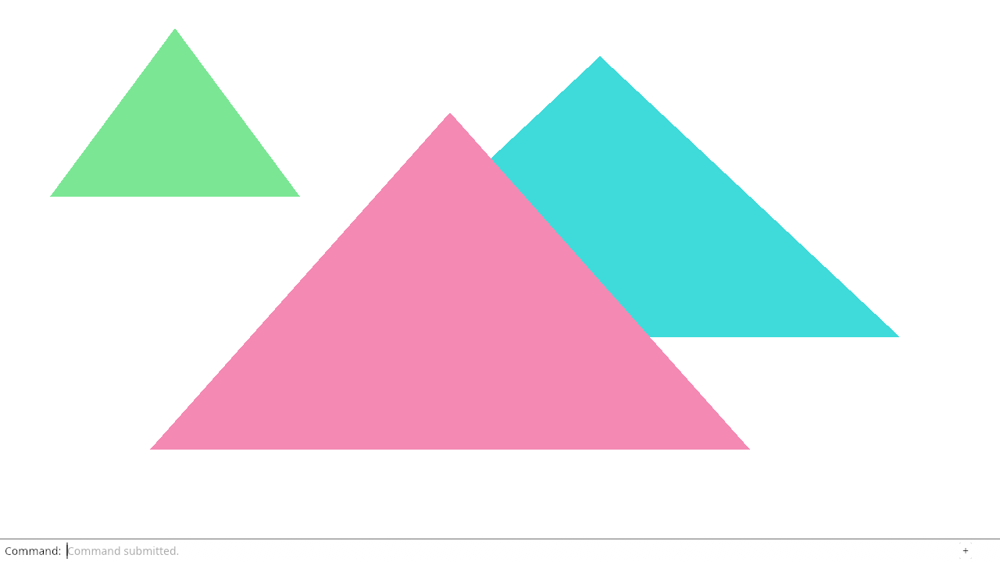

# A depth-tested scene with stable objects

<a id="checkpoint-10-depth"></a>
<a id="checkpoint-10a-mesh"></a>
<a id="checkpoint-11-scene"></a>
<a id="checkpoint-11a-identity"></a>

Draw overlapping meshes with correct depth and toggle an object without losing its identity.

## Prerequisites and ownership

Complete [Camera state and matrix uniforms](07-uniforms.md). This subject owns validated CPU meshes, object IDs, GPU mesh buffers and opaque depth testing. It connects those owners to the existing renderer and command dock. Later ownership findings in these modules remain unresolved; this checkpoint is not yet the production endpoint.

## Build

Type the seven files below, retaining the previous camera, background and dock modules.

### Validate geometry before upload

```rust
--8<-- "journey/code/10-scene-1.rs"
```

`Mesh` owns its vertex and index vectors. Each vertex has six floats: three position coordinates followed by three colour channels. Construction rejects an index outside the vertex list, an incomplete triangle, too many indices for the draw count, or any nonfinite vertex value. An empty mesh is allowed; an index referring to a missing vertex is not.

The vectors remain private. Callers receive borrowed slices, so they can read and upload data without inserting invalid indices after construction. `Result` returns either the validated owner or a reason it cannot be created. The tests exercise both outcomes.

### An object name survives row movement

```rust
--8<-- "journey/code/10-scene-2.rs"
```

`Scene` retains the CPU meshes in named objects. `ObjectId` wraps a counter; it is not a vector index. Removing the first object moves the next object to row zero without changing its ID. The `extra` field therefore remembers an ID, so toggling the example triangle can still find it after unrelated removals.

`checked_add` detects counter exhaustion before insertion. The scene never wraps around to reuse an old name. `remove` searches by identity and reports whether an object existed; `next` cycles through the remaining objects without fabricating an ID. The two scene tests verify row movement and removal of the remembered extra object.

### GPU buffers are derived resources

```rust
--8<-- "journey/code/10-scene-3.rs"
```

`GpuMesh::upload` borrows `&Mesh`, serializes its slices and creates vertex/index buffers. It does not consume the CPU mesh. The scene can retain data for later queries while the renderer owns the buffers used for drawing. The stored index count describes the draw, including shared vertices.

### Carry colour through the vertex stage

```wgsl
--8<-- "journey/code/10-scene-4.wgsl"
```

Location zero contains a three-component position and location one a three-component colour. The view matrix transforms the position; the rasterizer interpolates the colour for the fragment stage. The CPU's 24-byte stride and two `Float32x3` attributes must match this contract.

### Visibility is decided per pixel

```rust
--8<-- "journey/code/10-scene-5.rs"
```

The renderer borrows the scene to build its GPU list and owns a `Depth32Float` attachment. Clear depth to one, enable writes and compare with `Less`. The near pink triangle has depth 0.25; the farther turquoise one has depth 0.75. Even when turquoise is submitted later, its overlapping fragments fail against the nearer stored value. This rule is for opaque surfaces; it does not solve transparency ordering.

Depth and colour attachments must have matching dimensions and sample counts. `resize` recreates the depth view at the chosen surface size. The browser calls it before the first frame. A depth texture view keeps its backing texture alive after the local texture variable leaves scope.

`set_scene` replaces the derived GPU mesh list by uploading the current CPU objects. This checkpoint rebuilds that list on an object change; camera commands only upload the existing view matrix. Keep those two responsibilities separate when measuring allocations.

### Dispatch the object command

```rust
--8<-- "journey/code/10-scene-6.rs"
```

`Example Triangle` changes the scene, refreshes its GPU list and redraws. The browser continues to own the scene and camera. It paints the dock after the depth-tested scene and presents the surface once.

Register the three new owners:

```rust
--8<-- "journey/code/10-depth-cumulative-6-lib.rs"
```

## Run and observe

From `session_viewer`, assemble a fresh checkpoint directory:

```sh
npm --prefix ../session_tests run course -- reference 10-depth --output target/depth-scene
cd target/depth-scene
trunk serve --port 8780
```

Use the shared Cargo cache, storage guard and build slot. Open `http://127.0.0.1:8780/`. Pink covers turquoise where the triangles overlap. `Example Triangle` adds a green triangle; submitting it again removes that same object. The camera and background commands remain available.

## Predict and try

Pan right, then submit `Example Triangle` twice. Predict which state returns: the object collection returns to two triangles while the camera remains panned.

Reset the view. Change the near triangle's three depth values from 0.25 to 0.9. Predict the overlapping colour: turquoise now wins. Restore 0.25. Reversing the insertion order of these two opaque objects should preserve the image because depth, rather than submission order, determines visibility.

## Question and answer

Does moving to row zero create a new object?

No. The vector position changes; the ObjectId assigned at insertion stays the same.

## Validation

The cumulative checkpoint passes 34 native library tests and its optimized WASM build. Browser checks exercise the scene and retained mathematics at desktop and emulated upright dimensions. The near pink triangle covers the later-drawn turquoise triangle. The extra green triangle appears and disappears through its command. [Source-bound runtime receipt](release/cumulative-six-runtime-windows-20261114.json).



[Upright browser result](../screenshots/journey/cumulative-six-20261114/10-depth/portrait-extra.png). Clip-space coordinates stretch with the canvas aspect. These checks use viewport emulation and do not establish physical-device or selected hardware-adapter acceptance. Full-course structure, finished-subject ownership and production parity remain unresolved.

The [native-only receipt](release/cumulative-native-six-windows-20261114.json) preserves the earlier test milestone. Historical references: [Historical GPU and browser receipt](release/consolidated-windows-20261113.json), [Upright browser frame](../screenshots/consolidated-windows/10-depth-upright.png).
