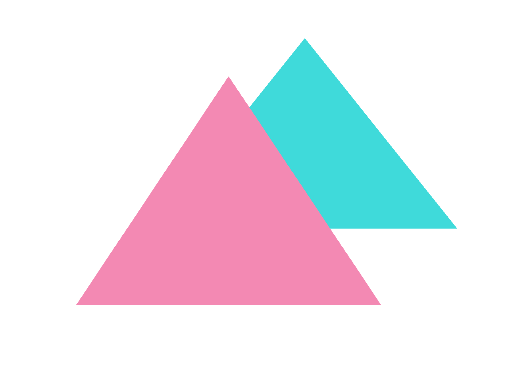
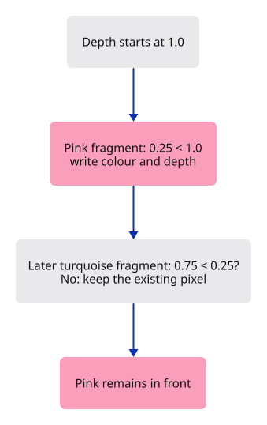

# 2.6.1 · Keep the nearest surface

**Chapter 2 · Geometry, camera and selection · Section 2.6 · Depth and validated meshes** · [Contents](contents.md)

**Typing: 28–56 minutes.** [Estimate](typing-load.md).

Keep the nearer triangle even when the farther triangle is drawn last. Give pink depth 0.25 and turquoise depth 0.75; draw pink first.

## Type

Continue from [Let one matrix describe the view](09-matrices.md). [Save or recover your work](recovery.md).

### 1. `src/triangle.wgsl`

Pass transformed 3D positions and vertex colours to the rasterizer. The fragment function uses the interpolated colour.

<details>
<summary>Locate the existing block</summary>

```wgsl
@group(0) @binding(0) var<uniform> transform: mat4x4<f32>;

@vertex
fn vertex(@location(0) position: vec2<f32>) -> @builtin(position) vec4<f32> {
    return transform * vec4<f32>(position, 0.0, 1.0);
}

@fragment
fn fragment() -> @location(0) vec4<f32> {
    return vec4<f32>(0.9, 0.25, 0.45, 1.0);
}
```

</details>

Edit the existing block to match this code; keep unchanged lines:

```wgsl
--8<-- "journey/code/10-depth-09.wgsl"
```

### 2. `src/renderer.rs`

Define two coloured triangles with different Z coordinates. Retain a depth view and upload position/color vertex records. Describe the two Float32x3 attributes in each 24-byte vertex. Enable depth writes and the Less comparison. Create and retain the Depth32Float texture view. Attach the depth view and clear it to 1.0 for each frame.

Edit these blocks from bottom to top. Keep the surrounding lines unchanged.

<details>
<summary>Locate this block</summary>

```rust
            // The pass borrows the encoder. This scope ends that borrow before finish takes it.
            let mut pass = encoder.begin_render_pass(&wgpu::RenderPassDescriptor {
                label: Some("canvas"),
                color_attachments: &[Some(wgpu::RenderPassColorAttachment {
                    view,
                    depth_slice: None,
```

</details>

Replace it with:

```rust
            // The pass borrows the encoder. This scope ends that borrow before finish takes it.
            let mut pass = encoder.begin_render_pass(&wgpu::RenderPassDescriptor {
                label: Some("canvas"),
                depth_stencil_attachment: Some(wgpu::RenderPassDepthStencilAttachment {
                    view: &self.depth,
                    depth_ops: Some(wgpu::Operations {
                        load: wgpu::LoadOp::Clear(1.0),
                        store: wgpu::StoreOp::Store,
                    }),
                    stencil_ops: None,
                }),
                color_attachments: &[Some(wgpu::RenderPassColorAttachment {
                    view,
                    depth_slice: None,
```

<details>
<summary>Locate this block</summary>

```rust
                resource: uniform.as_entire_binding(),
            }],
        });
        Self { device, queue, pipeline, vertices, indices, uniform, view_group }
    }

    pub fn draw(
```

</details>

Replace it with:

```rust
                resource: uniform.as_entire_binding(),
            }],
        });
        let depth = Self::depth(&device, 640, 480);
        Self { device, queue, pipeline, vertices, indices, uniform, view_group, depth }
    }

    fn depth(device: &wgpu::Device, width: u32, height: u32) -> wgpu::TextureView {
        let depth_texture = device.create_texture(&wgpu::TextureDescriptor {
            label: Some("opaque depth"),
            size: wgpu::Extent3d { width, height, depth_or_array_layers: 1 },
            mip_level_count: 1,
            sample_count: 1,
            dimension: wgpu::TextureDimension::D2,
            format: wgpu::TextureFormat::Depth32Float,
            usage: wgpu::TextureUsages::RENDER_ATTACHMENT,
            view_formats: &[],
        });
        depth_texture.create_view(&Default::default())
    }

    pub fn resize(&mut self, width: u32, height: u32) {
        self.depth = Self::depth(&self.device, width, height);
    }

    pub fn draw(
```

<details>
<summary>Locate this block</summary>

```rust
                targets: &[Some(format.into())],
            }),
            primitive: Default::default(),
            depth_stencil: None,
            multisample: Default::default(),
            multiview_mask: None,
            cache: None,
```

</details>

Replace it with:

```rust
                targets: &[Some(format.into())],
            }),
            primitive: Default::default(),
            depth_stencil: Some(wgpu::DepthStencilState {
                format: wgpu::TextureFormat::Depth32Float,
                depth_write_enabled: Some(true),
                depth_compare: Some(wgpu::CompareFunction::Less),
                stencil: Default::default(),
                bias: Default::default(),
            }),
            multisample: Default::default(),
            multiview_mask: None,
            cache: None,
```

<details>
<summary>Locate this block</summary>

```rust
                entry_point: Some("vertex"),
                compilation_options: Default::default(),
                buffers: &[wgpu::VertexBufferLayout {
                    array_stride: 8,
                    step_mode: wgpu::VertexStepMode::Vertex,
                    attributes: &wgpu::vertex_attr_array![0 => Float32x2],
                }],
            },
            fragment: Some(wgpu::FragmentState {
```

</details>

Replace it with:

```rust
                entry_point: Some("vertex"),
                compilation_options: Default::default(),
                buffers: &[wgpu::VertexBufferLayout {
                    array_stride: 24,
                    step_mode: wgpu::VertexStepMode::Vertex,
                    attributes: &wgpu::vertex_attr_array![0 => Float32x3, 1 => Float32x3],
                }],
            },
            fragment: Some(wgpu::FragmentState {
```

<details>
<summary>Locate this block</summary>

```rust
    indices: wgpu::Buffer,
    uniform: wgpu::Buffer,
    view_group: wgpu::BindGroup,
}

impl Renderer {
    pub fn new(device: wgpu::Device, queue: wgpu::Queue, format: wgpu::TextureFormat) -> Self {
        let bytes: Vec<u8> = POSITIONS.iter().flatten()
            .flat_map(|value| value.to_ne_bytes()).collect();
        let vertices = device.create_buffer_init(&wgpu::util::BufferInitDescriptor {
            label: Some("rectangle positions"),
```

</details>

Replace it with:

```rust
    indices: wgpu::Buffer,
    uniform: wgpu::Buffer,
    view_group: wgpu::BindGroup,
    depth: wgpu::TextureView,
}

impl Renderer {
    pub fn new(device: wgpu::Device, queue: wgpu::Queue, format: wgpu::TextureFormat) -> Self {
        let bytes: Vec<u8> = VERTICES.iter().flatten()
            .flat_map(|value| value.to_ne_bytes()).collect();
        let vertices = device.create_buffer_init(&wgpu::util::BufferInitDescriptor {
            label: Some("rectangle positions"),
```

<details>
<summary>Locate this block</summary>

```rust
use wgpu::util::DeviceExt;

const POSITIONS: [[f32; 2]; 4] = [
    [-0.6, 0.0], [0.0, -0.6], [0.6, 0.0], [0.0, 0.6],
];
const INDICES: [u16; 6] = [0, 1, 2, 0, 2, 3];

pub struct Renderer {
    pub device: wgpu::Device,
```

</details>

Replace it with:

```rust
use wgpu::util::DeviceExt;

// Each vertex stores x, y, z, then red, green and blue.
const VERTICES: [[f32; 6]; 6] = [
    [-0.7, -0.6, 0.25, 0.9, 0.25, 0.45],
    [ 0.5, -0.6, 0.25, 0.9, 0.25, 0.45],
    [-0.1,  0.6, 0.25, 0.9, 0.25, 0.45],
    [-0.4, -0.2, 0.75, 0.05, 0.7, 0.7],
    [ 0.8, -0.2, 0.75, 0.05, 0.7, 0.7],
    [ 0.2,  0.8, 0.75, 0.05, 0.7, 0.7],
];
const INDICES: [u16; 6] = [0, 1, 2, 3, 4, 5];

pub struct Renderer {
    pub device: wgpu::Device,
```

<details>
<summary>Complete updated block reference</summary>

```rust
use wgpu::util::DeviceExt;

// Each vertex stores x, y, z, then red, green and blue.
const VERTICES: [[f32; 6]; 6] = [
    [-0.7, -0.6, 0.25, 0.9, 0.25, 0.45],
    [ 0.5, -0.6, 0.25, 0.9, 0.25, 0.45],
    [-0.1,  0.6, 0.25, 0.9, 0.25, 0.45],
    [-0.4, -0.2, 0.75, 0.05, 0.7, 0.7],
    [ 0.8, -0.2, 0.75, 0.05, 0.7, 0.7],
    [ 0.2,  0.8, 0.75, 0.05, 0.7, 0.7],
];
const INDICES: [u16; 6] = [0, 1, 2, 3, 4, 5];

pub struct Renderer {
    pub device: wgpu::Device,
    pub queue: wgpu::Queue,
    pipeline: wgpu::RenderPipeline,
    vertices: wgpu::Buffer,
    indices: wgpu::Buffer,
    uniform: wgpu::Buffer,
    view_group: wgpu::BindGroup,
    depth: wgpu::TextureView,
}

impl Renderer {
    pub fn new(device: wgpu::Device, queue: wgpu::Queue, format: wgpu::TextureFormat) -> Self {
        let bytes: Vec<u8> = VERTICES.iter().flatten()
            .flat_map(|value| value.to_ne_bytes()).collect();
        let vertices = device.create_buffer_init(&wgpu::util::BufferInitDescriptor {
            label: Some("rectangle positions"),
            contents: &bytes,
            usage: wgpu::BufferUsages::VERTEX,
        });
        let bytes: Vec<u8> = INDICES.iter().flat_map(|index| index.to_ne_bytes()).collect();
        let indices = device.create_buffer_init(&wgpu::util::BufferInitDescriptor {
            label: Some("diamond indices"),
            contents: &bytes,
            usage: wgpu::BufferUsages::INDEX,
        });
        let shader = device.create_shader_module(wgpu::ShaderModuleDescriptor {
            label: Some("triangle"),
            source: wgpu::ShaderSource::Wgsl(include_str!("triangle.wgsl").into()),
        });
        let pipeline = device.create_render_pipeline(&wgpu::RenderPipelineDescriptor {
            label: Some("triangle"),
            layout: None,
            vertex: wgpu::VertexState {
                module: &shader,
                entry_point: Some("vertex"),
                compilation_options: Default::default(),
                buffers: &[wgpu::VertexBufferLayout {
                    array_stride: 24,
                    step_mode: wgpu::VertexStepMode::Vertex,
                    attributes: &wgpu::vertex_attr_array![0 => Float32x3, 1 => Float32x3],
                }],
            },
            fragment: Some(wgpu::FragmentState {
                module: &shader,
                entry_point: Some("fragment"),
                compilation_options: Default::default(),
                targets: &[Some(format.into())],
            }),
            primitive: Default::default(),
            depth_stencil: Some(wgpu::DepthStencilState {
                format: wgpu::TextureFormat::Depth32Float,
                depth_write_enabled: Some(true),
                depth_compare: Some(wgpu::CompareFunction::Less),
                stencil: Default::default(),
                bias: Default::default(),
            }),
            multisample: Default::default(),
            multiview_mask: None,
            cache: None,
        });
        let uniform = device.create_buffer(&wgpu::BufferDescriptor {
            label: Some("view transform"),
            size: 64,
            usage: wgpu::BufferUsages::UNIFORM | wgpu::BufferUsages::COPY_DST,
            mapped_at_creation: false,
        });
        let view_group = device.create_bind_group(&wgpu::BindGroupDescriptor {
            label: Some("view settings"),
            layout: &pipeline.get_bind_group_layout(0),
            entries: &[wgpu::BindGroupEntry {
                binding: 0,
                resource: uniform.as_entire_binding(),
            }],
        });
        let depth = Self::depth(&device, 640, 480);
        Self { device, queue, pipeline, vertices, indices, uniform, view_group, depth }
    }

    fn depth(device: &wgpu::Device, width: u32, height: u32) -> wgpu::TextureView {
        let depth_texture = device.create_texture(&wgpu::TextureDescriptor {
            label: Some("opaque depth"),
            size: wgpu::Extent3d { width, height, depth_or_array_layers: 1 },
            mip_level_count: 1,
            sample_count: 1,
            dimension: wgpu::TextureDimension::D2,
            format: wgpu::TextureFormat::Depth32Float,
            usage: wgpu::TextureUsages::RENDER_ATTACHMENT,
            view_formats: &[],
        });
        depth_texture.create_view(&Default::default())
    }

    pub fn resize(&mut self, width: u32, height: u32) {
        self.depth = Self::depth(&self.device, width, height);
    }

    pub fn draw(
        &self,
        view: &wgpu::TextureView,
        background: &crate::background::Background,
        transform: &[f32; 16],
    ) {
        let bytes: Vec<u8> = transform.iter().flat_map(|value| value.to_ne_bytes()).collect();
        self.queue.write_buffer(&self.uniform, 0, &bytes);
        let [r, g, b] = background.rgb();
        let mut encoder = self.device.create_command_encoder(&Default::default());
        {
            // The pass borrows the encoder. This scope ends that borrow before finish takes it.
            let mut pass = encoder.begin_render_pass(&wgpu::RenderPassDescriptor {
                label: Some("canvas"),
                depth_stencil_attachment: Some(wgpu::RenderPassDepthStencilAttachment {
                    view: &self.depth,
                    depth_ops: Some(wgpu::Operations {
                        load: wgpu::LoadOp::Clear(1.0),
                        store: wgpu::StoreOp::Store,
                    }),
                    stencil_ops: None,
                }),
                color_attachments: &[Some(wgpu::RenderPassColorAttachment {
                    view,
                    depth_slice: None,
                    resolve_target: None,
                    ops: wgpu::Operations {
                        load: wgpu::LoadOp::Clear(wgpu::Color {
                            r, g, b, a: 1.0,
                        }),
                        store: wgpu::StoreOp::Store,
                    },
                })],
                ..Default::default()
            });
            pass.set_pipeline(&self.pipeline);
            pass.set_bind_group(0, &self.view_group, &[]);
            pass.set_vertex_buffer(0, self.vertices.slice(..));
            pass.set_index_buffer(self.indices.slice(..), wgpu::IndexFormat::Uint16);
            pass.draw_indexed(0..INDICES.len() as u32, 0, 0..1);
        }
        self.queue.submit([encoder.finish()]);
    }
}
```

</details>

<details>
<summary>Optional patch references</summary>

Use these original edit fragments when comparing a saved checkpoint. Apply the complete blocks above.

```text
--8<-- "journey/code/10-depth-fullscreen-3.rs"
```

```text
--8<-- "journey/code/10-depth-fullscreen-4.rs"
```

```text
--8<-- "journey/code/10-depth-fullscreen-5.rs"
```

```text
--8<-- "journey/code/10-depth-fullscreen-6.rs"
```

```text
--8<-- "journey/code/10-depth-fullscreen-7.rs"
```

```text
--8<-- "journey/code/10-depth-fullscreen-8.rs"
```

</details>

### 3. `src/browser.rs`

Allocate depth storage at the canvas size. Report which triangle wins the overlap.

Edit these blocks from bottom to top. Keep the surrounding lines unchanged.

<details>
<summary>Locate this block</summary>

```rust
    )?;
    // The page has one listener for its lifetime; JavaScript must retain the Rust callback.
    click.forget();
    report("A matrix carries pan, scale and rotation.");
    Ok(())
}
```

</details>

Replace it with:

```rust
    )?;
    // The page has one listener for its lifetime; JavaScript must retain the Rust callback.
    click.forget();
    report("The nearer pink triangle wins the overlap.");
    Ok(())
}
```

<details>
<summary>Locate this block</summary>

```rust
        .ok_or("No compatible surface format")?;
    config.view_formats = vec![config.format.add_srgb_suffix()];
    surface.configure(&device, &config);
    let renderer = Renderer::new(device, queue, config.format.add_srgb_suffix());
    let mut panel = crate::panel::Panel::new(
        &renderer,
        config.format.add_srgb_suffix(),
```

</details>

Replace it with:

```rust
        .ok_or("No compatible surface format")?;
    config.view_formats = vec![config.format.add_srgb_suffix()];
    surface.configure(&device, &config);
    let mut renderer = Renderer::new(device, queue, config.format.add_srgb_suffix());
    renderer.resize(width, height);
    let mut panel = crate::panel::Panel::new(
        &renderer,
        config.format.add_srgb_suffix(),
```

<details>
<summary>Complete updated block reference</summary>

```rust
use crate::background::Background;
use crate::camera::Camera;
use crate::renderer::Renderer;
use wasm_bindgen::{JsCast, JsValue, closure::Closure};

pub fn report(message: &str) {
    if let Some(document) = web_sys::window().and_then(|window| window.document()) {
        if let Some(status) = document.get_element_by_id("status") {
            status.set_text_content(Some(message));
            if message.starts_with("Cannot") { let _ = status.remove_attribute("hidden"); }
        }
    }
}

pub async fn run() -> Result<(), JsValue> {
    let window = web_sys::window().ok_or("No browser window")?;
    let document = window.document().ok_or("No document")?;
    let canvas: web_sys::HtmlCanvasElement = document
        .get_element_by_id("canvas")
        .ok_or("Missing canvas")?
        .dyn_into()?;
    let instance = wgpu::Instance::new(wgpu::InstanceDescriptor {
        backends: wgpu::Backends::BROWSER_WEBGPU,
        flags: Default::default(),
        memory_budget_thresholds: Default::default(),
        backend_options: Default::default(),
        display: None,
    });
    let surface = instance
        .create_surface(wgpu::SurfaceTarget::Canvas(canvas.clone()))
        .map_err(|error| JsValue::from_str(&error.to_string()))?;
    let adapter = instance
        .request_adapter(&wgpu::RequestAdapterOptions {
            compatible_surface: Some(&surface),
            ..Default::default()
        })
        .await
        .map_err(|error| JsValue::from_str(&error.to_string()))?;
    let (device, queue) = adapter
        .request_device(&wgpu::DeviceDescriptor::default())
        .await
        .map_err(|error| JsValue::from_str(&error.to_string()))?;
    device.on_uncaptured_error(std::sync::Arc::new(|error| report(&error.to_string())));
    let limit = device.limits().max_texture_dimension_2d;
    let width = (window.inner_width()?.as_f64().ok_or("No window width")? as u32).clamp(1, limit);
    let height = (window.inner_height()?.as_f64().ok_or("No window height")? as u32).clamp(1, limit);
    canvas.set_width(width);
    canvas.set_height(height);
    let mut config = surface
        .get_default_config(&adapter, width, height)
        .ok_or("No compatible surface format")?;
    config.view_formats = vec![config.format.add_srgb_suffix()];
    surface.configure(&device, &config);
    let mut renderer = Renderer::new(device, queue, config.format.add_srgb_suffix());
    renderer.resize(width, height);
    let mut panel = crate::panel::Panel::new(
        &renderer,
        config.format.add_srgb_suffix(),
        &[
            "Help",
            "Background",
            "Zoom In",
            "Zoom Out",
            "Pan Left",
            "Pan Right",
            "Orbit Right",
            "View Reset",
        ],
    );
    panel.update(None, &canvas)?;
    let mut background = Background::default();
    let mut camera = Camera::default();
    present(
        &surface,
        &renderer,
        &background,
        &camera.uniform(),
        &mut panel,
    )?;
    let input_canvas = canvas.clone();
    let click = Closure::<dyn FnMut(web_sys::Event)>::new(move |event: web_sys::Event| {
        let line = match panel.update(Some(&event), &input_canvas) {
            Ok(line) => line,
            Err(error) => {
                report(&format!("Cannot read command: {error:?}"));
                return;
            }
        };

        if let Some(line) = line {
            match line.as_str() {
                "background" => background.toggle(),
                "zoom in" => camera.zoom(2.0),
                "zoom out" => camera.zoom(0.5),
                "pan left" => camera.pan(-0.25, 0.0),
                "pan right" => camera.pan(0.25, 0.0),
                "orbit right" => camera.rotate(std::f32::consts::FRAC_PI_4),
                "view reset" => camera = Camera::default(),
                _ => return,
            }
        }
        if let Err(error) = panel.update(None, &input_canvas) {
            report(&format!("Cannot lay out commands: {error:?}"));
            return;
        }
        if let Err(error) = present(
            &surface,
            &renderer,
            &background,
            &camera.uniform(),
            &mut panel,
        ) {
            report(&format!("Cannot redraw: {error:?}"));
        }
    });
    for name in [
        "pointerdown",
        "pointermove",
        "pointerup",
        "pointercancel",
        "lostpointercapture",
        "contextmenu",
        "keydown",
        "keyup",
        "blur",
    ] {
        canvas.add_event_listener_with_callback(name, click.as_ref().unchecked_ref())?;
    }
    let options = web_sys::AddEventListenerOptions::new();
    options.set_passive(false);
    canvas.add_event_listener_with_callback_and_add_event_listener_options(
        "wheel",
        click.as_ref().unchecked_ref(),
        &options,
    )?;
    // The page has one listener for its lifetime; JavaScript must retain the Rust callback.
    click.forget();
    report("The nearer pink triangle wins the overlap.");
    Ok(())
}

fn present(
    surface: &wgpu::Surface<'_>,
    renderer: &Renderer,
    background: &Background,
    transform: &[f32; 16],
    panel: &mut crate::panel::Panel,
) -> Result<(), JsValue> {
    let frame = match surface.get_current_texture() {
        wgpu::CurrentSurfaceTexture::Success(frame)
        | wgpu::CurrentSurfaceTexture::Suboptimal(frame) => frame,
        other => {
            return Err(JsValue::from_str(&format!(
                "Surface unavailable: {other:?}"
            )));
        }
    };
    let view = frame.texture.create_view(&wgpu::TextureViewDescriptor {
        format: Some(frame.texture.format().add_srgb_suffix()),
        ..Default::default()
    });
    renderer.draw(&view, background, transform);
    panel.draw(renderer, &view);
    frame.present();
    Ok(())
}
```

</details>

<details>
<summary>Optional patch references</summary>

Use these original edit fragments when comparing a saved checkpoint. Apply the complete blocks above.

```text
--8<-- "journey/code/10-depth-window-1.rs"
```

```text
--8<-- "journey/code/10-depth-window-2.rs"
```

</details>

## Run and check

In your project:

```sh
cd workspace/journey
cargo build --lib --locked --target wasm32-unknown-unknown -j1
CARGO_BUILD_JOBS=1 trunk serve --port 8780
```

Open `http://127.0.0.1:8780/`. Keep an existing Trunk server running; saving rebuilds it.

Look at the overlapping triangles. The nearer triangle must cover the farther one even though it is drawn first. Reverse their draw order: the overlap should stay the same. Restore the order.

### Recorded visual result

**Previous native render — current verification pending.**



*This recorded image predates a source or checker change. Rebuild this checkpoint before using it as current evidence; browser controls require separate acceptance.*

<details>
<summary>Code explanation and diagram</summary>

Attach a depth texture alongside colour. Clear depth to 1 and use `Less` with depth writes: a fragment passes only when it is nearer than the stored depth. Its dimensions and sample count must match the colour image.

A vertex now contains position and colour: six `f32` values, 24 bytes. Shader locations 0 and 1 read those two groups. The vertex shader passes colour to the fragment shader.

The browser supplies the startup dimensions to `renderer.resize`. Later resize handling updates both attachments. This depth rule handles opaque visibility; transparency comes later.

Vertex z → transformed depth → depth comparison → colour written only for the nearer fragment.



Why is it not enough to draw the far triangle first?

A particular draw order might work for these two flat triangles, but a real scene can overlap differently from each viewpoint. A depth attachment remembers the nearest depth at each pixel. The comparison chooses visibility there, so drawing an opaque farther surface later does not cover a nearer one.

Study estimate, including typing and experiments: 2–4 hours.

</details>

<details>
<summary>Optional experiment</summary>

Temporarily change the near triangle’s three z values from 0.25 to 0.9. Predict which colour will appear at the shared centre. Turquoise should now win. Restore the values, then reverse the two groups of indices: the picture should stay the same. Restore the original order before comparing.

</details>

<details>
<summary>Check and save your work</summary>

Restore experimental edits, then run from `session_viewer`:

```sh
npm --prefix ../session_tests run course -- check 2.6.1
npm --prefix ../session_tests run course -- save 2.6.1
```

Source comparison leaves your project untouched. [Save and recovery instructions](recovery.md).

</details>

<details>
<summary>Viewer coverage and verification</summary>

The finished viewer uses depth attachments for opaque visibility, then adds the rules needed for strokes, CAD boundaries and transparency. This lesson establishes why those rules must refer to visible surfaces rather than draw order.


[Full validation scope](release.md).

</details>
