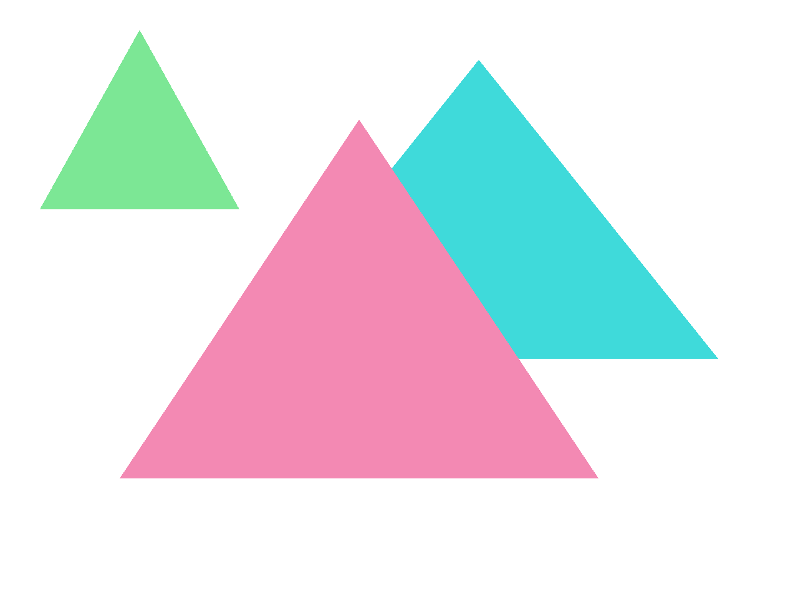
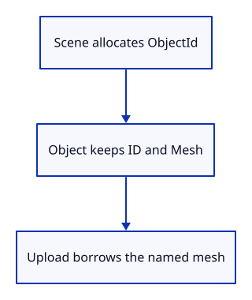

# 2.7.2 · Name objects independently of their rows

**Chapter 2 · Geometry, camera and selection · Section 2.7 · GPU meshes and object identity** · [Contents](contents.md)

**Typing: 29–57 minutes.** [Estimate](typing-load.md).

ObjectId names an object independently of its vector row. Scene allocates IDs, looks up objects by those names, and remembers the extra triangle by ID.

## Type

Continue from [Draw the scene through GPU mesh owners](11-scene.md). [Save or recover your work](recovery.md).

### 1. `src/scene.rs`

Replace the scene with stable object IDs and named insertion, removal and lookup operations. Keep the two existing demonstration meshes unchanged.

<details>
<summary>Locate the existing block</summary>

```rust
use crate::mesh::Mesh;

pub struct Scene {
    pub meshes: Vec<Mesh>,
}

impl Scene {
    pub fn demo() -> Self {
        let near = Mesh::new(vec![
            [-0.7, -0.6, 0.25, 0.9, 0.25, 0.45],
            [ 0.5, -0.6, 0.25, 0.9, 0.25, 0.45],
            [-0.1,  0.6, 0.25, 0.9, 0.25, 0.45],
        ], vec![0, 1, 2]).expect("Valid near triangle");
        let far = Mesh::new(vec![
            [-0.4, -0.2, 0.75, 0.05, 0.7, 0.7],
            [ 0.8, -0.2, 0.75, 0.05, 0.7, 0.7],
            [ 0.2,  0.8, 0.75, 0.05, 0.7, 0.7],
        ], vec![0, 1, 2]).expect("Valid far triangle");
        Self { meshes: vec![near, far] }
    }

    pub fn toggle_extra(&mut self) {
        if self.meshes.len() == 3 {
            self.meshes.pop();
        } else {
            let extra = Mesh::new(vec![
                [-0.9, 0.3, 0.5, 0.2, 0.8, 0.3],
                [-0.4, 0.3, 0.5, 0.2, 0.8, 0.3],
                [-0.65, 0.9, 0.5, 0.2, 0.8, 0.3],
            ], vec![0, 1, 2]).expect("Valid extra triangle");
            self.meshes.push(extra);
        }
    }
}
```

</details>

Edit the existing block to match this code; keep unchanged lines:

```rust
--8<-- "journey/code/12-identity-01.rs"
```

### 2. `src/renderer.rs`

Upload the mesh borrowed from each named object.

Edit these blocks from bottom to top. Keep the surrounding lines unchanged.

<details>
<summary>Locate this block</summary>

```rust
    }

    pub fn set_scene(&mut self, scene: &Scene) {
        self.meshes = scene.meshes.iter().map(|mesh| GpuMesh::upload(&self.device, mesh)).collect();
    }

    fn depth(device: &wgpu::Device, width: u32, height: u32) -> wgpu::TextureView {
```

</details>

Replace it with:

```rust
    }

    pub fn set_scene(&mut self, scene: &Scene) {
        self.meshes = scene.objects().iter().map(|object| GpuMesh::upload(&self.device, &object.mesh)).collect();
    }

    fn depth(device: &wgpu::Device, width: u32, height: u32) -> wgpu::TextureView {
```

<details>
<summary>Locate this block</summary>

```rust
        format: wgpu::TextureFormat,
        scene: &Scene,
    ) -> Self {
        let meshes = scene.meshes.iter().map(|mesh| GpuMesh::upload(&device, mesh)).collect();
        let shader = device.create_shader_module(wgpu::ShaderModuleDescriptor {
            label: Some("triangle"),
            source: wgpu::ShaderSource::Wgsl(include_str!("triangle.wgsl").into()),
```

</details>

Replace it with:

```rust
        format: wgpu::TextureFormat,
        scene: &Scene,
    ) -> Self {
        let meshes = scene.objects().iter().map(|object| GpuMesh::upload(&device, &object.mesh)).collect();
        let shader = device.create_shader_module(wgpu::ShaderModuleDescriptor {
            label: Some("triangle"),
            source: wgpu::ShaderSource::Wgsl(include_str!("triangle.wgsl").into()),
```

<details>
<summary>Complete updated block reference</summary>

```rust
use crate::{gpu_mesh::GpuMesh, scene::Scene};

pub struct Renderer {
    pub device: wgpu::Device,
    pub queue: wgpu::Queue,
    pipeline: wgpu::RenderPipeline,
    meshes: Vec<GpuMesh>,
    uniform: wgpu::Buffer,
    view_group: wgpu::BindGroup,
    depth: wgpu::TextureView,
}

impl Renderer {
    pub fn new(
        device: wgpu::Device,
        queue: wgpu::Queue,
        format: wgpu::TextureFormat,
        scene: &Scene,
    ) -> Self {
        let meshes = scene.objects().iter().map(|object| GpuMesh::upload(&device, &object.mesh)).collect();
        let shader = device.create_shader_module(wgpu::ShaderModuleDescriptor {
            label: Some("triangle"),
            source: wgpu::ShaderSource::Wgsl(include_str!("triangle.wgsl").into()),
        });
        let pipeline = device.create_render_pipeline(&wgpu::RenderPipelineDescriptor {
            label: Some("triangle"),
            layout: None,
            vertex: wgpu::VertexState {
                module: &shader,
                entry_point: Some("vertex"),
                compilation_options: Default::default(),
                buffers: &[wgpu::VertexBufferLayout {
                    array_stride: 24,
                    step_mode: wgpu::VertexStepMode::Vertex,
                    attributes: &wgpu::vertex_attr_array![0 => Float32x3, 1 => Float32x3],
                }],
            },
            fragment: Some(wgpu::FragmentState {
                module: &shader,
                entry_point: Some("fragment"),
                compilation_options: Default::default(),
                targets: &[Some(format.into())],
            }),
            primitive: Default::default(),
            depth_stencil: Some(wgpu::DepthStencilState {
                format: wgpu::TextureFormat::Depth32Float,
                depth_write_enabled: Some(true),
                depth_compare: Some(wgpu::CompareFunction::Less),
                stencil: Default::default(),
                bias: Default::default(),
            }),
            multisample: Default::default(),
            multiview_mask: None,
            cache: None,
        });
        let uniform = device.create_buffer(&wgpu::BufferDescriptor {
            label: Some("view transform"),
            size: 64,
            usage: wgpu::BufferUsages::UNIFORM | wgpu::BufferUsages::COPY_DST,
            mapped_at_creation: false,
        });
        let view_group = device.create_bind_group(&wgpu::BindGroupDescriptor {
            label: Some("view settings"),
            layout: &pipeline.get_bind_group_layout(0),
            entries: &[wgpu::BindGroupEntry {
                binding: 0,
                resource: uniform.as_entire_binding(),
            }],
        });
        let depth = Self::depth(&device, 640, 480);
        Self { device, queue, pipeline, meshes, uniform, view_group, depth }
    }

    pub fn set_scene(&mut self, scene: &Scene) {
        self.meshes = scene.objects().iter().map(|object| GpuMesh::upload(&self.device, &object.mesh)).collect();
    }

    fn depth(device: &wgpu::Device, width: u32, height: u32) -> wgpu::TextureView {
        let depth_texture = device.create_texture(&wgpu::TextureDescriptor {
            label: Some("opaque depth"),
            size: wgpu::Extent3d { width, height, depth_or_array_layers: 1 },
            mip_level_count: 1,
            sample_count: 1,
            dimension: wgpu::TextureDimension::D2,
            format: wgpu::TextureFormat::Depth32Float,
            usage: wgpu::TextureUsages::RENDER_ATTACHMENT,
            view_formats: &[],
        });
        depth_texture.create_view(&Default::default())
    }

    pub fn resize(&mut self, width: u32, height: u32) {
        self.depth = Self::depth(&self.device, width, height);
    }

    pub fn draw(
        &self,
        view: &wgpu::TextureView,
        background: &crate::background::Background,
        transform: &[f32; 16],
    ) {
        let bytes: Vec<u8> = transform.iter().flat_map(|value| value.to_ne_bytes()).collect();
        self.queue.write_buffer(&self.uniform, 0, &bytes);
        let [r, g, b] = background.rgb();
        let mut encoder = self.device.create_command_encoder(&Default::default());
        {
            // The pass borrows the encoder. This scope ends that borrow before finish takes it.
            let mut pass = encoder.begin_render_pass(&wgpu::RenderPassDescriptor {
                label: Some("canvas"),
                depth_stencil_attachment: Some(wgpu::RenderPassDepthStencilAttachment {
                    view: &self.depth,
                    depth_ops: Some(wgpu::Operations {
                        load: wgpu::LoadOp::Clear(1.0),
                        store: wgpu::StoreOp::Store,
                    }),
                    stencil_ops: None,
                }),
                color_attachments: &[Some(wgpu::RenderPassColorAttachment {
                    view,
                    depth_slice: None,
                    resolve_target: None,
                    ops: wgpu::Operations {
                        load: wgpu::LoadOp::Clear(wgpu::Color {
                            r, g, b, a: 1.0,
                        }),
                        store: wgpu::StoreOp::Store,
                    },
                })],
                ..Default::default()
            });
            pass.set_pipeline(&self.pipeline);
            pass.set_bind_group(0, &self.view_group, &[]);
            for mesh in &self.meshes {
                mesh.draw(&mut pass);
            }
        }
        self.queue.submit([encoder.finish()]);
    }
}
```

</details>

<details>
<summary>Optional patch references</summary>

Use these original edit fragments when comparing a saved checkpoint. Apply the complete blocks above.

```text
--8<-- "journey/code/11a-identity-upload-1.rs"
```

```text
--8<-- "journey/code/11a-identity-upload-2.rs"
```

</details>

## Run and check

In your project:

```sh
cd workspace/journey
cargo build --lib --locked --target wasm32-unknown-unknown -j1
CARGO_BUILD_JOBS=1 trunk serve --port 8780
```

Open `http://127.0.0.1:8780/`. Keep an existing Trunk server running; saving rebuilds it.

Inspect the supplied state fixtures. Removing the first object moves the next row without changing its ID; toggling the extra object still removes that object.

### Recorded visual result

**Previous native render — current verification pending.**



*This recorded image predates a source or checker change. Rebuild this checkpoint before using it as current evidence; browser controls require separate acceptance.*

This reference image is shared with [2.7.1 · Draw the scene through GPU mesh owners](11-scene.md). It does not demonstrate a new feature by itself.

<details>
<summary>Code explanation and diagram</summary>

The wrapper type prevents confusing an ID with an index. checked_add returns an error before the counter can wrap and reuse a name.

Scene allocates ObjectId → Object retains Mesh → GPU upload borrows that mesh.



Does moving to row zero create a new object?

No. The vector position changes; the ObjectId assigned at insertion stays the same.

Study estimate, including typing and experiments: 0.75–1.5 hours.

</details>

<details>
<summary>Optional experiment</summary>

In the removal test, compare the second object’s ID before and after deleting the first. The ID should match even though its row changes.

</details>

<details>
<summary>Check and save your work</summary>

Restore experimental edits, then run from `session_viewer`:

```sh
npm --prefix ../session_tests run course -- check 2.7.2
npm --prefix ../session_tests run course -- save 2.7.2
```

Source comparison leaves your project untouched. [Save and recovery instructions](recovery.md).

</details>

<details>
<summary>Viewer coverage and verification</summary>

Source identities and GPU row positions have different lifetimes. This checkpoint keeps the source name stable while the existing upload borrows each object’s mesh.

The browser independently verifies the retained add/remove drawing and command dock. Native tests establish stable IDs and removal after row changes; selection display is connected next.

[Full validation scope](release.md).

</details>
