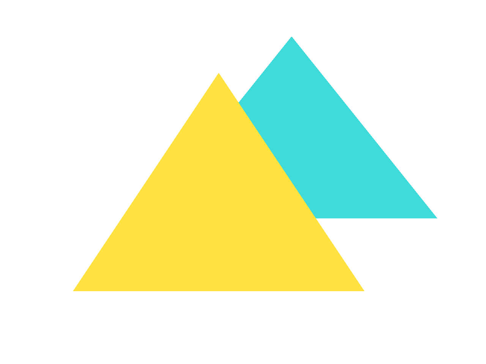
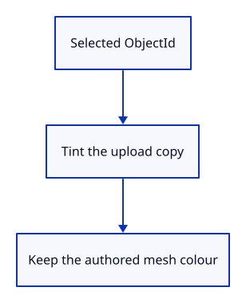

# 2.8.1 · Display selection by object identity

**Chapter 2 · Geometry, camera and selection · Section 2.8 · Selection and CPU queries** · [Contents](contents.md)

**Typing: 16–32 minutes.** [Estimate](typing-load.md).

Selection stores Option<ObjectId>, so it follows the object through row changes. GpuMesh uploads a yellow copy for the selected ID while Scene retains its original colours.

## Type

Continue from [Name objects independently of their rows](11a-identity.md). [Save or recover your work](recovery.md).

### 1. `src/gpu_mesh.rs`

Let the uploaded representation know whether to show selection. Apply the yellow tint to an upload copy. Never overwrite the CPU mesh’s original colour.

<details>
<summary>Locate the existing block</summary>

```rust
use crate::mesh::Mesh;
use wgpu::util::DeviceExt;

pub struct GpuMesh {
    vertices: wgpu::Buffer,
    indices: wgpu::Buffer,
    index_count: u32,
}

impl GpuMesh {
    pub fn upload(device: &wgpu::Device, mesh: &Mesh) -> Self {
        let bytes: Vec<u8> = mesh.vertices().iter().flatten()
            .flat_map(|value| value.to_ne_bytes()).collect();
        let vertices = device.create_buffer_init(&wgpu::util::BufferInitDescriptor {
            label: Some("mesh vertices"),
            contents: &bytes,
            usage: wgpu::BufferUsages::VERTEX,
        });
        let bytes: Vec<u8> = mesh.indices().iter().flat_map(|index| index.to_ne_bytes()).collect();
        let indices = device.create_buffer_init(&wgpu::util::BufferInitDescriptor {
            label: Some("mesh indices"),
            contents: &bytes,
            usage: wgpu::BufferUsages::INDEX,
        });
        Self { vertices, indices, index_count: mesh.indices().len() as u32 }
    }

    pub fn draw(&self, pass: &mut wgpu::RenderPass<'_>) {
        pass.set_vertex_buffer(0, self.vertices.slice(..));
        pass.set_index_buffer(self.indices.slice(..), wgpu::IndexFormat::Uint16);
        pass.draw_indexed(0..self.index_count, 0, 0..1);
    }
}
```

</details>

Edit the existing block to match this code; keep unchanged lines:

```rust
use crate::mesh::Mesh;
use wgpu::util::DeviceExt;

pub struct GpuMesh {
    vertices: wgpu::Buffer,
    indices: wgpu::Buffer,
    index_count: u32,
}

impl GpuMesh {
    pub fn upload(device: &wgpu::Device, mesh: &Mesh, selected: bool) -> Self {
        let mut bytes = Vec::with_capacity(mesh.vertices().len() * 24);
        for vertex in mesh.vertices() {
            let mut display = *vertex;
            if selected {
                display[3..].copy_from_slice(&[1.0, 0.75, 0.05]);
            }
            for value in display {
                bytes.extend_from_slice(&value.to_ne_bytes());
            }
        }
        let vertices = device.create_buffer_init(&wgpu::util::BufferInitDescriptor {
            label: Some("mesh vertices"),
            contents: &bytes,
            usage: wgpu::BufferUsages::VERTEX,
        });
        let bytes: Vec<u8> = mesh.indices().iter().flat_map(|index| index.to_ne_bytes()).collect();
        let indices = device.create_buffer_init(&wgpu::util::BufferInitDescriptor {
            label: Some("mesh indices"),
            contents: &bytes,
            usage: wgpu::BufferUsages::INDEX,
        });
        Self { vertices, indices, index_count: mesh.indices().len() as u32 }
    }

    pub fn draw(&self, pass: &mut wgpu::RenderPass<'_>) {
        pass.set_vertex_buffer(0, self.vertices.slice(..));
        pass.set_index_buffer(self.indices.slice(..), wgpu::IndexFormat::Uint16);
        pass.draw_indexed(0..self.index_count, 0, 0..1);
    }
}
```

<details>
<summary>Optional patch references</summary>

Use these original edit fragments when comparing a saved checkpoint. Apply the complete blocks above.

```text
--8<-- "journey/code/12-identity-02.rs"
```

```text
--8<-- "journey/code/12-identity-03.rs"
```

</details>

### 2. `src/renderer.rs`

Import ObjectId at the renderer boundary. Upload each scene object without selection highlighting initially. Highlight the uploaded object whose stable ID matches the selection.

Edit these blocks from bottom to top. Keep the surrounding lines unchanged.

<details>
<summary>Locate this block</summary>

```rust
        Self { device, queue, pipeline, meshes, uniform, view_group, depth }
    }

    pub fn set_scene(&mut self, scene: &Scene) {
        self.meshes = scene.objects().iter().map(|object| GpuMesh::upload(&self.device, &object.mesh)).collect();
    }

    fn depth(device: &wgpu::Device, width: u32, height: u32) -> wgpu::TextureView {
```

</details>

Replace it with:

```rust
        Self { device, queue, pipeline, meshes, uniform, view_group, depth }
    }

    pub fn set_scene(&mut self, scene: &Scene, selected: Option<ObjectId>) {
        self.meshes = scene.objects().iter().map(|object| {
            GpuMesh::upload(&self.device, &object.mesh, selected == Some(object.id))
        }).collect();
    }

    fn depth(device: &wgpu::Device, width: u32, height: u32) -> wgpu::TextureView {
```

<details>
<summary>Locate this block</summary>

```rust
        format: wgpu::TextureFormat,
        scene: &Scene,
    ) -> Self {
        let meshes = scene.objects().iter().map(|object| GpuMesh::upload(&device, &object.mesh)).collect();
        let shader = device.create_shader_module(wgpu::ShaderModuleDescriptor {
            label: Some("triangle"),
            source: wgpu::ShaderSource::Wgsl(include_str!("triangle.wgsl").into()),
```

</details>

Replace it with:

```rust
        format: wgpu::TextureFormat,
        scene: &Scene,
    ) -> Self {
        let meshes = scene.objects().iter().map(|object| GpuMesh::upload(&device, &object.mesh, false)).collect();
        let shader = device.create_shader_module(wgpu::ShaderModuleDescriptor {
            label: Some("triangle"),
            source: wgpu::ShaderSource::Wgsl(include_str!("triangle.wgsl").into()),
```

<details>
<summary>Locate this block</summary>

```rust
use crate::{gpu_mesh::GpuMesh, scene::Scene};

pub struct Renderer {
    pub device: wgpu::Device,
```

</details>

Replace it with:

```rust
use crate::{gpu_mesh::GpuMesh, scene::{ObjectId, Scene}};

pub struct Renderer {
    pub device: wgpu::Device,
```

<details>
<summary>Complete updated block reference</summary>

```rust
use crate::{gpu_mesh::GpuMesh, scene::{ObjectId, Scene}};

pub struct Renderer {
    pub device: wgpu::Device,
    pub queue: wgpu::Queue,
    pipeline: wgpu::RenderPipeline,
    meshes: Vec<GpuMesh>,
    uniform: wgpu::Buffer,
    view_group: wgpu::BindGroup,
    depth: wgpu::TextureView,
}

impl Renderer {
    pub fn new(
        device: wgpu::Device,
        queue: wgpu::Queue,
        format: wgpu::TextureFormat,
        scene: &Scene,
    ) -> Self {
        let meshes = scene.objects().iter().map(|object| GpuMesh::upload(&device, &object.mesh, false)).collect();
        let shader = device.create_shader_module(wgpu::ShaderModuleDescriptor {
            label: Some("triangle"),
            source: wgpu::ShaderSource::Wgsl(include_str!("triangle.wgsl").into()),
        });
        let pipeline = device.create_render_pipeline(&wgpu::RenderPipelineDescriptor {
            label: Some("triangle"),
            layout: None,
            vertex: wgpu::VertexState {
                module: &shader,
                entry_point: Some("vertex"),
                compilation_options: Default::default(),
                buffers: &[wgpu::VertexBufferLayout {
                    array_stride: 24,
                    step_mode: wgpu::VertexStepMode::Vertex,
                    attributes: &wgpu::vertex_attr_array![0 => Float32x3, 1 => Float32x3],
                }],
            },
            fragment: Some(wgpu::FragmentState {
                module: &shader,
                entry_point: Some("fragment"),
                compilation_options: Default::default(),
                targets: &[Some(format.into())],
            }),
            primitive: Default::default(),
            depth_stencil: Some(wgpu::DepthStencilState {
                format: wgpu::TextureFormat::Depth32Float,
                depth_write_enabled: Some(true),
                depth_compare: Some(wgpu::CompareFunction::Less),
                stencil: Default::default(),
                bias: Default::default(),
            }),
            multisample: Default::default(),
            multiview_mask: None,
            cache: None,
        });
        let uniform = device.create_buffer(&wgpu::BufferDescriptor {
            label: Some("view transform"),
            size: 64,
            usage: wgpu::BufferUsages::UNIFORM | wgpu::BufferUsages::COPY_DST,
            mapped_at_creation: false,
        });
        let view_group = device.create_bind_group(&wgpu::BindGroupDescriptor {
            label: Some("view settings"),
            layout: &pipeline.get_bind_group_layout(0),
            entries: &[wgpu::BindGroupEntry {
                binding: 0,
                resource: uniform.as_entire_binding(),
            }],
        });
        let depth = Self::depth(&device, 640, 480);
        Self { device, queue, pipeline, meshes, uniform, view_group, depth }
    }

    pub fn set_scene(&mut self, scene: &Scene, selected: Option<ObjectId>) {
        self.meshes = scene.objects().iter().map(|object| {
            GpuMesh::upload(&self.device, &object.mesh, selected == Some(object.id))
        }).collect();
    }

    fn depth(device: &wgpu::Device, width: u32, height: u32) -> wgpu::TextureView {
        let depth_texture = device.create_texture(&wgpu::TextureDescriptor {
            label: Some("opaque depth"),
            size: wgpu::Extent3d { width, height, depth_or_array_layers: 1 },
            mip_level_count: 1,
            sample_count: 1,
            dimension: wgpu::TextureDimension::D2,
            format: wgpu::TextureFormat::Depth32Float,
            usage: wgpu::TextureUsages::RENDER_ATTACHMENT,
            view_formats: &[],
        });
        depth_texture.create_view(&Default::default())
    }

    pub fn resize(&mut self, width: u32, height: u32) {
        self.depth = Self::depth(&self.device, width, height);
    }

    pub fn draw(
        &self,
        view: &wgpu::TextureView,
        background: &crate::background::Background,
        transform: &[f32; 16],
    ) {
        let bytes: Vec<u8> = transform.iter().flat_map(|value| value.to_ne_bytes()).collect();
        self.queue.write_buffer(&self.uniform, 0, &bytes);
        let [r, g, b] = background.rgb();
        let mut encoder = self.device.create_command_encoder(&Default::default());
        {
            // The pass borrows the encoder. This scope ends that borrow before finish takes it.
            let mut pass = encoder.begin_render_pass(&wgpu::RenderPassDescriptor {
                label: Some("canvas"),
                depth_stencil_attachment: Some(wgpu::RenderPassDepthStencilAttachment {
                    view: &self.depth,
                    depth_ops: Some(wgpu::Operations {
                        load: wgpu::LoadOp::Clear(1.0),
                        store: wgpu::StoreOp::Store,
                    }),
                    stencil_ops: None,
                }),
                color_attachments: &[Some(wgpu::RenderPassColorAttachment {
                    view,
                    depth_slice: None,
                    resolve_target: None,
                    ops: wgpu::Operations {
                        load: wgpu::LoadOp::Clear(wgpu::Color {
                            r, g, b, a: 1.0,
                        }),
                        store: wgpu::StoreOp::Store,
                    },
                })],
                ..Default::default()
            });
            pass.set_pipeline(&self.pipeline);
            pass.set_bind_group(0, &self.view_group, &[]);
            for mesh in &self.meshes {
                mesh.draw(&mut pass);
            }
        }
        self.queue.submit([encoder.finish()]);
    }
}
```

</details>

<details>
<summary>Optional patch references</summary>

Use these original edit fragments when comparing a saved checkpoint. Apply the complete blocks above.

```text
--8<-- "journey/code/12-identity-fullscreen-5.rs"
```

```text
--8<-- "journey/code/12-identity-fullscreen-6.rs"
```

```text
--8<-- "journey/code/12-identity-fullscreen-7.rs"
```

</details>

### 3. `src/browser.rs`

Add Select Next and Delete to the vocabulary. Start without a selected object. Preserve valid selection, cycle by identity, and delete the selected object. Report that selection follows object identity.

Edit these blocks from bottom to top. Keep the surrounding lines unchanged.

<details>
<summary>Locate this block</summary>

```rust
    )?;
    // The page has one listener for its lifetime; JavaScript must retain the Rust callback.
    click.forget();
    report("Scene data owns the meshes; the renderer displays them.");
    Ok(())
}
```

</details>

Replace it with:

```rust
    )?;
    // The page has one listener for its lifetime; JavaScript must retain the Rust callback.
    click.forget();
    report("Selection follows object identity, even when rows move.");
    Ok(())
}
```

<details>
<summary>Locate this block</summary>

```rust
            match line.as_str() {
                "example triangle" => {
                    scene.toggle_extra();
                    renderer.set_scene(&scene);
                }
                "background" => background.toggle(),
                "zoom in" => camera.zoom(2.0),
```

</details>

Replace it with:

```rust
            match line.as_str() {
                "example triangle" => {
                    scene.toggle_extra();
                    selected = selected.filter(|id| scene.contains(*id));
                    renderer.set_scene(&scene, selected);
                }
                "select next" => {
                    selected = scene.next(selected);
                    renderer.set_scene(&scene, selected);
                }
                "delete" => {
                    if let Some(id) = selected.take() {
                        scene.remove(id);
                        renderer.set_scene(&scene, selected);
                    }
                }
                "background" => background.toggle(),
                "zoom in" => camera.zoom(2.0),
```

<details>
<summary>Locate this block</summary>

```rust
        ],
    );
    panel.update(None, &canvas)?;
    let mut background = Background::default();
    let mut camera = Camera::default();
    present(
```

</details>

Replace it with:

```rust
        ],
    );
    panel.update(None, &canvas)?;
    let mut selected = None;
    let mut background = Background::default();
    let mut camera = Camera::default();
    present(
```

<details>
<summary>Locate this block</summary>

```rust
        &[
            "Help",
            "Example Triangle",
            "Background",
            "Zoom In",
            "Zoom Out",
```

</details>

Replace it with:

```rust
        &[
            "Help",
            "Example Triangle",
            "Select Next",
            "Delete",
            "Background",
            "Zoom In",
            "Zoom Out",
```

<details>
<summary>Complete updated block reference</summary>

```rust
use crate::background::Background;
use crate::camera::Camera;
use crate::renderer::Renderer;
use crate::scene::Scene;
use wasm_bindgen::{JsCast, JsValue, closure::Closure};

pub fn report(message: &str) {
    if let Some(document) = web_sys::window().and_then(|window| window.document()) {
        if let Some(status) = document.get_element_by_id("status") {
            status.set_text_content(Some(message));
            if message.starts_with("Cannot") { let _ = status.remove_attribute("hidden"); }
        }
    }
}

pub async fn run() -> Result<(), JsValue> {
    let window = web_sys::window().ok_or("No browser window")?;
    let document = window.document().ok_or("No document")?;
    let canvas: web_sys::HtmlCanvasElement = document
        .get_element_by_id("canvas")
        .ok_or("Missing canvas")?
        .dyn_into()?;
    let instance = wgpu::Instance::new(wgpu::InstanceDescriptor {
        backends: wgpu::Backends::BROWSER_WEBGPU,
        flags: Default::default(),
        memory_budget_thresholds: Default::default(),
        backend_options: Default::default(),
        display: None,
    });
    let surface = instance
        .create_surface(wgpu::SurfaceTarget::Canvas(canvas.clone()))
        .map_err(|error| JsValue::from_str(&error.to_string()))?;
    let adapter = instance
        .request_adapter(&wgpu::RequestAdapterOptions {
            compatible_surface: Some(&surface),
            ..Default::default()
        })
        .await
        .map_err(|error| JsValue::from_str(&error.to_string()))?;
    let (device, queue) = adapter
        .request_device(&wgpu::DeviceDescriptor::default())
        .await
        .map_err(|error| JsValue::from_str(&error.to_string()))?;
    device.on_uncaptured_error(std::sync::Arc::new(|error| report(&error.to_string())));
    let limit = device.limits().max_texture_dimension_2d;
    let width = (window.inner_width()?.as_f64().ok_or("No window width")? as u32).clamp(1, limit);
    let height = (window.inner_height()?.as_f64().ok_or("No window height")? as u32).clamp(1, limit);
    canvas.set_width(width);
    canvas.set_height(height);
    let mut config = surface
        .get_default_config(&adapter, width, height)
        .ok_or("No compatible surface format")?;
    config.view_formats = vec![config.format.add_srgb_suffix()];
    surface.configure(&device, &config);
    let mut scene = Scene::demo();
    let mut renderer = Renderer::new(device, queue, config.format.add_srgb_suffix(), &scene);
    renderer.resize(width, height);
    let mut panel = crate::panel::Panel::new(
        &renderer,
        config.format.add_srgb_suffix(),
        &[
            "Help",
            "Example Triangle",
            "Select Next",
            "Delete",
            "Background",
            "Zoom In",
            "Zoom Out",
            "Pan Left",
            "Pan Right",
            "Orbit Right",
            "View Reset",
        ],
    );
    panel.update(None, &canvas)?;
    let mut selected = None;
    let mut background = Background::default();
    let mut camera = Camera::default();
    present(
        &surface,
        &renderer,
        &background,
        &camera.uniform(),
        &mut panel,
    )?;
    let input_canvas = canvas.clone();
    let click = Closure::<dyn FnMut(web_sys::Event)>::new(move |event: web_sys::Event| {
        let line = match panel.update(Some(&event), &input_canvas) {
            Ok(line) => line,
            Err(error) => {
                report(&format!("Cannot read command: {error:?}"));
                return;
            }
        };

        if let Some(line) = line {
            match line.as_str() {
                "example triangle" => {
                    scene.toggle_extra();
                    selected = selected.filter(|id| scene.contains(*id));
                    renderer.set_scene(&scene, selected);
                }
                "select next" => {
                    selected = scene.next(selected);
                    renderer.set_scene(&scene, selected);
                }
                "delete" => {
                    if let Some(id) = selected.take() {
                        scene.remove(id);
                        renderer.set_scene(&scene, selected);
                    }
                }
                "background" => background.toggle(),
                "zoom in" => camera.zoom(2.0),
                "zoom out" => camera.zoom(0.5),
                "pan left" => camera.pan(-0.25, 0.0),
                "pan right" => camera.pan(0.25, 0.0),
                "orbit right" => camera.rotate(std::f32::consts::FRAC_PI_4),
                "view reset" => camera = Camera::default(),
                _ => return,
            }
        }
        if let Err(error) = panel.update(None, &input_canvas) {
            report(&format!("Cannot lay out commands: {error:?}"));
            return;
        }
        if let Err(error) = present(
            &surface,
            &renderer,
            &background,
            &camera.uniform(),
            &mut panel,
        ) {
            report(&format!("Cannot redraw: {error:?}"));
        }
    });
    for name in [
        "pointerdown",
        "pointermove",
        "pointerup",
        "pointercancel",
        "lostpointercapture",
        "contextmenu",
        "keydown",
        "keyup",
        "blur",
    ] {
        canvas.add_event_listener_with_callback(name, click.as_ref().unchecked_ref())?;
    }
    let options = web_sys::AddEventListenerOptions::new();
    options.set_passive(false);
    canvas.add_event_listener_with_callback_and_add_event_listener_options(
        "wheel",
        click.as_ref().unchecked_ref(),
        &options,
    )?;
    // The page has one listener for its lifetime; JavaScript must retain the Rust callback.
    click.forget();
    report("Selection follows object identity, even when rows move.");
    Ok(())
}

fn present(
    surface: &wgpu::Surface<'_>,
    renderer: &Renderer,
    background: &Background,
    transform: &[f32; 16],
    panel: &mut crate::panel::Panel,
) -> Result<(), JsValue> {
    let frame = match surface.get_current_texture() {
        wgpu::CurrentSurfaceTexture::Success(frame)
        | wgpu::CurrentSurfaceTexture::Suboptimal(frame) => frame,
        other => {
            return Err(JsValue::from_str(&format!(
                "Surface unavailable: {other:?}"
            )));
        }
    };
    let view = frame.texture.create_view(&wgpu::TextureViewDescriptor {
        format: Some(frame.texture.format().add_srgb_suffix()),
        ..Default::default()
    });
    renderer.draw(&view, background, transform);
    panel.draw(renderer, &view);
    frame.present();
    Ok(())
}
```

</details>

<details>
<summary>Optional patch references</summary>

Use these original edit fragments when comparing a saved checkpoint. Apply the complete blocks above.

```text
--8<-- "journey/code/12-identity-window-1.rs"
```

```text
--8<-- "journey/code/12-identity-window-2.rs"
```

```text
--8<-- "journey/code/12-identity-window-3.rs"
```

```text
--8<-- "journey/code/12-identity-window-4.rs"
```

</details>

## Run and check

In your project:

```sh
cd workspace/journey
cargo build --lib --locked --target wasm32-unknown-unknown -j1
CARGO_BUILD_JOBS=1 trunk serve --port 8780
```

Open `http://127.0.0.1:8780/`. Keep an existing Trunk server running; saving rebuilds it.

Type Select Next. The first object turns yellow; its stored mesh colour remains pink.

### Recorded visual result

**Previous native render — current verification pending.**

This is the first object selected in yellow; its stored mesh colour remains pink.



*This recorded image predates a source or checker change. Rebuild this checkpoint before using it as current evidence; browser controls require separate acceptance.*

<details>
<summary>Code explanation and diagram</summary>

Delete removes the selected ID and clears selection. The CPU mesh is borrowed during upload; only the copied display colours change.

selected ObjectId → upload copy → yellow display vertices.



Why tint a copy rather than the retained mesh?

The scene keeps the authored colour. Clearing selection must recover that colour instead of replacing source data.

Study estimate, including typing and experiments: 0.5–1 hours.

</details>

<details>
<summary>Optional experiment</summary>

Select the first object, then Delete. Add the extra triangle and toggle it off. Only the original far triangle should remain.

</details>

<details>
<summary>Check and save your work</summary>

Restore experimental edits, then run from `session_viewer`:

```sh
npm --prefix ../session_tests run course -- check 2.8.1
npm --prefix ../session_tests run course -- save 2.8.1
```

Source comparison leaves your project untouched. [Save and recovery instructions](recovery.md).

</details>

<details>
<summary>Viewer coverage and verification</summary>

The complete viewer distinguishes document identity, displayed object rows and source sub-elements. Picking and undo must cross those mappings explicitly. This lesson establishes the first rule: a storage index cannot serve as a permanent object name.


[Full validation scope](release.md).

</details>
