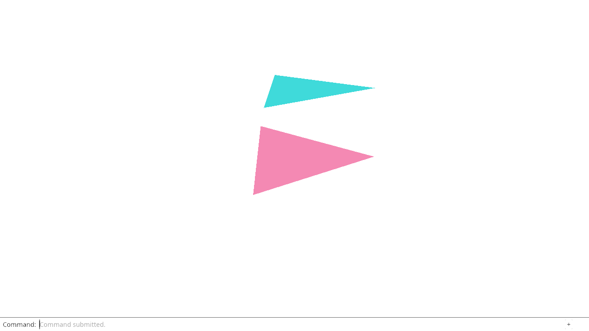

# Select, navigate and undo

<a id="checkpoint-12-identity"></a>
<a id="checkpoint-12a-coordinates"></a>
<a id="checkpoint-12b-picking"></a>
<a id="checkpoint-13-picking"></a>
<a id="checkpoint-13a-history"></a>
<a id="checkpoint-14-history"></a>
<a id="checkpoint-14a-perspective"></a>
<a id="checkpoint-14b-ray"></a>
<a id="checkpoint-15-perspective"></a>
<a id="checkpoint-16-orbit"></a>

Orbit a perspective scene, select its nearest visible triangle, and undo or redo a document edit without losing object identity.

## Prerequisites and ownership

Complete [A depth-tested scene with stable objects](10-depth.md). You need indexed meshes, a depth attachment, camera uniforms, the command dock and stable object IDs. This subject owns the complete perspective picking and snapshot-history implementations in this checkpoint. Camera navigation and ray construction are taught together because drawing and picking must use the same projection.

The active course still contains later replacements of camera, scene and renderer implementations. This consolidation replaces ten checkpoints with one; it does not establish finished ownership across the whole course or parity with the production viewer. The [original source sequence](../archived/selection-navigation/checkpoints.json) and [original illustrated page](../archived/journey-consolidation-12-identity.md) remain available for historical reconstruction.

## Build

Keep the preceding project's files except for the nine files below. Type each complete implementation once. The kernel is a path dependency: use its points, vectors, quaternions and transforms rather than implementing a second matrix library.

### Dependencies and module declarations

```toml
--8<-- "journey/code/12-selection-9.toml"
```

```rust
--8<-- "journey/code/12-selection-6.rs"
```

The module declarations make `history` and `picking` part of the same crate as the existing scene and camera. They do not create separate programs or separate GPU devices.

### One camera for drawing and picking

```rust
--8<-- "journey/code/12-selection-4.rs"
```

`Camera` stores a target, distance, quaternion orientation and aspect ratio. The quaternion rotates the right, forward and up basis vectors. Panning moves the target along the current right and up directions; zoom changes distance within finite bounds. Orbit composes a world-axis yaw with a pitch about the current right axis, then normalizes the quaternion so repeated gestures do not gradually distort the basis.

`view_projection` places the eye behind the target along the forward direction and multiplies perspective projection by the view transform. The uniform uses that same matrix. `ray` inverts it and unprojects two points at the pointer's normalized x/y coordinates: depth zero and depth one. Their difference supplies a normalized direction and the length of the visible interval. Reject non-finite coordinates, points outside the canvas and a failed inverse before intersecting anything.

Browser coordinates grow downward in y; normalized device coordinates grow upward. The browser adapter uses `1 - 2*y/height`. Use the canvas's client rectangle for both axes, so CSS dimensions and pointer coordinates share units. The matrix's perspective division belongs in the kernel transform; dividing a screen coordinate by a camera scale is insufficient for perspective picking.

### Nearest visible triangle

```rust
--8<-- "journey/code/12-selection-5.rs"
```

For each indexed triangle, form two edge vectors. Cross and dot products solve for the ray distance and barycentric coordinates. A near-zero determinant rejects a ray parallel to the triangle. The inequalities `u >= 0`, `v >= 0` and `u + v <= 1` keep the hit inside it. The outer search accepts only nonnegative distances smaller than the ray's current nearest distance, initially its far-plane interval.

Return the object's stable ID, not its current vector index. Removing a different object can move a row without changing the identity of the selected object. The tests cover the nearer surface, deletion revealing the farther surface, camera changes, a shortened ray and triangles behind the ray origin.

### Document snapshots and branches

```rust
--8<-- "journey/code/12-selection-7.rs"
```

```rust
--8<-- "journey/code/12-history-final.rs"
```

A scene clone copies object records and shares immutable meshes through `Rc`. History therefore retains document snapshots without copying vertex arrays or GPU buffers. `try_edit` saves the previous scene before calling a fallible action. Success retains that snapshot and clears the redo branch. An error restores the scene and leaves undo and redo unchanged, even if the action modified the scene before failing. `edit` delegates infallible actions through this same transaction. Undo and redo move snapshots between stacks and restore the document. The undo stack retains at most 64 edits; this is a count limit, not a byte limit.

`Scene::restore` keeps the greater of the saved and current `next_id` counters. Undo can bring back an existing ID, but a new edit after undo must not reuse an ID already issued on the discarded branch. History does not compare snapshots to reject no-op edits: callers must decide whether a command represents a document edit. Camera navigation is outside document history.

### Display and input ownership

```rust
--8<-- "journey/code/12-selection-1.rs"
```

```rust
--8<-- "journey/code/12-selection-2.rs"
```

```rust
--8<-- "journey/code/12-selection-3.rs"
```

Selection changes uploaded display colour to yellow while retaining the original mesh. `set_scene` rebuilds the displayed mesh list when scene contents or selection change. GPU resources remain owned by the renderer; snapshots contain document data.

The browser lets the dock consume input first. Canvas clicks become viewing rays; orbit commands update the camera. Document commands use history, while navigation updates only the camera. After deletion or history travel, filter selection through the restored scene's IDs before uploading it. The scene and dock draw into one acquired texture, followed by one presentation.

## Run and observe

From `session_viewer`, assemble a fresh checkpoint:

```sh
npm --prefix ../session_tests run course -- reference 12-identity --output target/select-navigate
cd target/select-navigate
trunk serve --port 8780
```

Run builds through the workspace storage guard and build slot. Open `http://127.0.0.1:8780/`. Two coloured triangles overlap in perspective. Click their shared area: the nearer turquoise triangle becomes yellow. Delete it to expose the pink triangle, then use `undo` and `redo` in the command dock. Enter `orbit right` or `orbit up` and select again; selection must follow the displayed projection. Entering a dock command must not also select through the panel.

## Predict and try

Delete the nearer triangle and undo. Predict what happens after `example triangle` creates a different edit and you enter `redo`: the old redo branch is gone. The newly inserted triangle also receives a fresh ID, even if undo restored an earlier scene snapshot.

Predict the result of shortening a viewing ray below its first hit distance: no object is selected. Restore the original interval before continuing. This distinguishes clipping from choosing whichever triangle happens to be visited first.

Create a redo branch, then try an action that removes an object and returns an error. Predict whether the object and redo branch survive. The rollback test checks both; a failure must not consume history.

## Question and answer

Why must undo preserve both an object's ID and the highest identity already issued?

Restored objects keep references meaningful. Preserving the highest issued identity prevents a new branch from assigning an old identity to a different object. A row position provides neither guarantee.

## Validation

The checkpoint passes 14 native library tests and the unchanged 640-by-480 WARP pixel test, optimized WebAssembly/Trunk builds, and actual Chrome interaction checks at 1280 by 720 and 390 by 844. The tests exercise rollback, selection, deletion, undo/redo, branching history and camera navigation. Native rendering uses Microsoft WARP software; Chrome reports an Intel gen-12lp adapter. [Source-bound commands, images and scope](release/history-editor-viewport-windows-20261114.json) retain the exact tested inputs.

The upright viewport is emulated. Its fixed camera crops geometry at the right edge; passing input checks does not establish full phone composition or physical-device acceptance. The ten original checkpoint sources and earlier [browser evidence](release/selection-navigation-windows-20261114.json) remain archived.



[Upright input check and its cropped view](../screenshots/journey/runtime-20261114/12-identity-upright.png) ? [Native WARP frame](../screenshots/journey/runtime-20261114/12-identity-native.png)

Browser adapter fields come from a separate query and do not independently prove renderer adapter selection. Full-course ownership and parity still fail.
