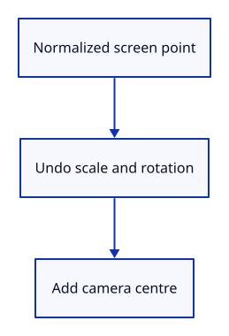

# 2.8.2 · Convert screen positions back to the scene

**Chapter 2 · Geometry, camera and selection · Section 2.8 · Selection and CPU queries** · [Contents](contents.md)

**Typing: 10–19 minutes.** [Estimate](typing-load.md).

Divide a screen point by camera scale, reverse rotation, then add the camera centre. world_from_screen returns the corresponding scene point.

## Type

Continue from [Display selection by object identity](12-identity.md). [Save or recover your work](recovery.md).

### 1. `src/camera.rs`

Add the inverse conversion for our flat camera. Rust’s sin_cos returns the sine and cosine as a pair. Check that pan, zoom and rotation preserve the coordinate round trip.

Edit these blocks from bottom to top. Keep the surrounding lines unchanged.

<details>
<summary>Locate this block</summary>

```rust
}

#[cfg(test)]
mod tests {
    use super::*;
```

</details>

Replace it with:

```rust
}

#[cfg(test)]
mod coordinate_tests {
    use super::Camera;

    #[test]
    fn moving_the_view_preserves_the_coordinate_round_trip() {
        let mut camera = Camera::default();
        camera.pan(0.1, -0.2);
        camera.zoom(0.5);
        camera.rotate(0.7);
        let world = [0.4, 0.0];
        let matrix = camera.uniform();
        let screen = [matrix[0] * world[0] + matrix[4] * world[1] + matrix[12],
            matrix[1] * world[0] + matrix[5] * world[1] + matrix[13]];
        let restored = camera.world_from_screen(screen);
        assert!((restored[0] - world[0]).abs() < 1.0e-6);
        assert!((restored[1] - world[1]).abs() < 1.0e-6);
    }
}

#[cfg(test)]
mod tests {
    use super::*;
```

<details>
<summary>Locate this block</summary>

```rust
        self.angle += radians;
    }

    pub fn uniform(&self) -> [f32; 16] {
        let a = self.scale * self.angle.cos();
        let b = self.scale * self.angle.sin();
```

</details>

Replace it with:

```rust
        self.angle += radians;
    }

    pub fn world_from_screen(&self, point: [f32; 2]) -> [f32; 2] {
        let x = point[0] / self.scale;
        let y = point[1] / self.scale;
        let (sin, cos) = self.angle.sin_cos();
        [self.center[0] + x * cos - y * sin, self.center[1] + x * sin + y * cos]
    }

    pub fn uniform(&self) -> [f32; 16] {
        let a = self.scale * self.angle.cos();
        let b = self.scale * self.angle.sin();
```

<details>
<summary>Complete updated block reference</summary>

```rust
pub struct Camera {
    pub center: [f32; 2],
    pub scale: f32,
    pub angle: f32,
}

impl Default for Camera {
    fn default() -> Self {
        Self { center: [0.0, 0.0], scale: 1.0, angle: 0.0 }
    }
}

impl Camera {
    pub fn pan(&mut self, dx: f32, dy: f32) {
        self.center[0] += dx;
        self.center[1] += dy;
    }

    pub fn zoom(&mut self, factor: f32) {
        if factor.is_finite() && factor > 0.0 {
            self.scale = (self.scale * factor).clamp(0.1, 10.0);
        }
    }

    pub fn rotate(&mut self, radians: f32) {
        self.angle += radians;
    }

    pub fn world_from_screen(&self, point: [f32; 2]) -> [f32; 2] {
        let x = point[0] / self.scale;
        let y = point[1] / self.scale;
        let (sin, cos) = self.angle.sin_cos();
        [self.center[0] + x * cos - y * sin, self.center[1] + x * sin + y * cos]
    }

    pub fn uniform(&self) -> [f32; 16] {
        let a = self.scale * self.angle.cos();
        let b = self.scale * self.angle.sin();
        let [x, y] = self.center;
        // WGSL matrices are uploaded column by column.
        [
            a, -b, 0.0, 0.0,
            b,  a, 0.0, 0.0,
            0.0, 0.0, 1.0, 0.0,
            -a * x - b * y, b * x - a * y, 0.0, 1.0,
        ]
    }
}

#[cfg(test)]
mod coordinate_tests {
    use super::Camera;

    #[test]
    fn moving_the_view_preserves_the_coordinate_round_trip() {
        let mut camera = Camera::default();
        camera.pan(0.1, -0.2);
        camera.zoom(0.5);
        camera.rotate(0.7);
        let world = [0.4, 0.0];
        let matrix = camera.uniform();
        let screen = [matrix[0] * world[0] + matrix[4] * world[1] + matrix[12],
            matrix[1] * world[0] + matrix[5] * world[1] + matrix[13]];
        let restored = camera.world_from_screen(screen);
        assert!((restored[0] - world[0]).abs() < 1.0e-6);
        assert!((restored[1] - world[1]).abs() < 1.0e-6);
    }
}

#[cfg(test)]
mod tests {
    use super::*;

    #[test]
    fn panned_target_stays_at_the_screen_centre_when_zooming() {
        let mut camera = Camera::default();
        camera.pan(0.25, -0.5);
        camera.zoom(2.0);
        camera.rotate(std::f32::consts::FRAC_PI_4);
        let m = camera.uniform();
        let [x, y] = camera.center;
        assert!((m[0] * x + m[4] * y + m[12]).abs() < 1.0e-6);
        assert!((m[1] * x + m[5] * y + m[13]).abs() < 1.0e-6);
    }

    #[test]
    fn zoom_stays_positive_and_bounded() {
        let mut camera = Camera::default();
        camera.zoom(0.0001);
        assert_eq!(camera.scale, 0.1);
        camera.zoom(1_000.0);
        assert_eq!(camera.scale, 10.0);
        camera.zoom(f32::NAN);
        camera.zoom(-1.0);
        assert_eq!(camera.scale, 10.0);
    }
}
```

</details>

<details>
<summary>Optional patch references</summary>

Use these original edit fragments when comparing a saved checkpoint. Apply the complete blocks above.

```text
--8<-- "journey/code/13-picking-03.rs"
```

```text
--8<-- "journey/code/12a-coordinates-test.rs"
```

</details>

## Run and check

In your project:

```sh
cd workspace/journey
cargo build --lib --locked --target wasm32-unknown-unknown -j1
CARGO_BUILD_JOBS=1 trunk serve --port 8780
```

Open `http://127.0.0.1:8780/`. Keep an existing Trunk server running; saving rebuilds it.

Inspect the supplied state fixtures. The new round-trip test restores a known scene point after pan, zoom and rotation.

### Recorded visual result

**Previous native render — current verification pending.**


*This recorded image predates a source or checker change. Rebuild this checkpoint before using it as current evidence; browser controls require separate acceptance.*

This reference image is shared with [2.8.1 · Display selection by object identity](12-identity.md). It does not demonstrate a new feature by itself.

<details>
<summary>Code explanation and diagram</summary>

A round-trip check transforms a known scene point into the view and restores it after pan, zoom and rotation.

Screen point → divide scale → reverse rotation → add scene centre.



Why reverse the camera before testing geometry?

The click is in the displayed view; mesh positions are in scene coordinates. The conversion puts both in the same coordinates.

Study estimate, including typing and experiments: 0.5–0.75 hours.

</details>

<details>
<summary>Optional experiment</summary>

Trace [0.4, 0.0] through the forward and inverse coordinate conversions. Undoing scale and rotation must recover both coordinates within 0.000001; inspect the supplied round-trip fixture.

</details>

<details>
<summary>Check and save your work</summary>

Restore experimental edits, then run from `session_viewer`:

```sh
npm --prefix ../session_tests run course -- check 2.8.2
npm --prefix ../session_tests run course -- save 2.8.2
```

Source comparison leaves your project untouched. [Save and recovery instructions](recovery.md).

</details>

<details>
<summary>Viewer coverage and verification</summary>

Picking must compare view input with geometry in a common coordinate system. The later perspective lesson replaces this flat conversion with a ray.

Chrome independently verifies the existing command and selection drawing. The new inverse conversion is checked natively; mouse selection is connected in 13.

[Full validation scope](release.md).

</details>
