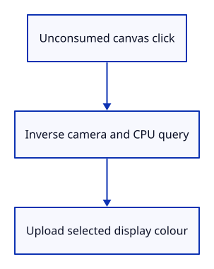

# 2.9.1 · Select the visible object with a mouse click

**Chapter 2 · Geometry, camera and selection · Section 2.9 · Mouse selection and history** · [Contents](contents.md)

**Typing: 14–27 minutes.** [Estimate](typing-load.md).

Convert an unconsumed canvas click from CSS pixels to normalized screen coordinates. Reverse y, undo the camera, then ask the query for the visible ObjectId.

## Type

Continue from [Find the nearest triangle at a scene point](12b-picking.md). [Save or recover your work](recovery.md).

### 1. `src/browser.rs`

Convert an unconsumed canvas click into a picking request. Listen for canvas clicks. Report the visible selection result.

Edit these blocks from bottom to top. Keep the surrounding lines unchanged.

<details>
<summary>Locate this block</summary>

```rust
    )?;
    // The page has one listener for its lifetime; JavaScript must retain the Rust callback.
    click.forget();
    report("Selection follows object identity, even when rows move.");
    Ok(())
}
```

</details>

Replace it with:

```rust
    )?;
    // The page has one listener for its lifetime; JavaScript must retain the Rust callback.
    click.forget();
    report("Click a triangle; the visible object is selected.");
    Ok(())
}
```

<details>
<summary>Locate this block</summary>

```rust
        "keydown",
        "keyup",
        "blur",
    ] {
        canvas.add_event_listener_with_callback(name, click.as_ref().unchecked_ref())?;
    }
```

</details>

Replace it with:

```rust
        "keydown",
        "keyup",
        "blur",
        "click",
    ] {
        canvas.add_event_listener_with_callback(name, click.as_ref().unchecked_ref())?;
    }
```

<details>
<summary>Locate this block</summary>

```rust
            }
        };

        if let Some(line) = line {
            match line.as_str() {
                "example triangle" => {
                    scene.toggle_extra();
                    selected = selected.filter(|id| scene.contains(*id));
```

</details>

Replace it with:

```rust
            }
        };

        let line = line.or_else(|| {
            let mouse = event.dyn_ref::<web_sys::MouseEvent>()?;
            (event.type_() == "click"
                && !panel.consumed
                && mouse
                    .target()
                    .and_then(|target| target.dyn_into::<web_sys::Element>().ok())
                    .is_some_and(|target| target.id() == "canvas"))
            .then(|| "canvas".into())
        });
        if let Some(line) = line {
            match line.as_str() {
                "canvas" => {
                    let Some(event) = event.dyn_ref::<web_sys::MouseEvent>() else {
                        return;
                    };
                    let rect = input_canvas.get_bounding_client_rect();
                    if rect.width() <= 0.0 || rect.height() <= 0.0 {
                        return;
                    }
                    let screen = [
                        (2.0 * (event.client_x() as f64 - rect.left()) / rect.width() - 1.0) as f32,
                        (1.0 - 2.0 * (event.client_y() as f64 - rect.top()) / rect.height()) as f32,
                    ];
                    selected = crate::picking::pick(&scene, camera.world_from_screen(screen));
                    renderer.set_scene(&scene, selected);
                }
                "example triangle" => {
                    scene.toggle_extra();
                    selected = selected.filter(|id| scene.contains(*id));
```

<details>
<summary>Complete updated block reference</summary>

```rust
use crate::background::Background;
use crate::camera::Camera;
use crate::renderer::Renderer;
use crate::scene::Scene;
use wasm_bindgen::{JsCast, JsValue, closure::Closure};

pub fn report(message: &str) {
    if let Some(document) = web_sys::window().and_then(|window| window.document()) {
        if let Some(status) = document.get_element_by_id("status") {
            status.set_text_content(Some(message));
            if message.starts_with("Cannot") { let _ = status.remove_attribute("hidden"); }
        }
    }
}

pub async fn run() -> Result<(), JsValue> {
    let window = web_sys::window().ok_or("No browser window")?;
    let document = window.document().ok_or("No document")?;
    let canvas: web_sys::HtmlCanvasElement = document
        .get_element_by_id("canvas")
        .ok_or("Missing canvas")?
        .dyn_into()?;
    let instance = wgpu::Instance::new(wgpu::InstanceDescriptor {
        backends: wgpu::Backends::BROWSER_WEBGPU,
        flags: Default::default(),
        memory_budget_thresholds: Default::default(),
        backend_options: Default::default(),
        display: None,
    });
    let surface = instance
        .create_surface(wgpu::SurfaceTarget::Canvas(canvas.clone()))
        .map_err(|error| JsValue::from_str(&error.to_string()))?;
    let adapter = instance
        .request_adapter(&wgpu::RequestAdapterOptions {
            compatible_surface: Some(&surface),
            ..Default::default()
        })
        .await
        .map_err(|error| JsValue::from_str(&error.to_string()))?;
    let (device, queue) = adapter
        .request_device(&wgpu::DeviceDescriptor::default())
        .await
        .map_err(|error| JsValue::from_str(&error.to_string()))?;
    device.on_uncaptured_error(std::sync::Arc::new(|error| report(&error.to_string())));
    let limit = device.limits().max_texture_dimension_2d;
    let width = (window.inner_width()?.as_f64().ok_or("No window width")? as u32).clamp(1, limit);
    let height = (window.inner_height()?.as_f64().ok_or("No window height")? as u32).clamp(1, limit);
    canvas.set_width(width);
    canvas.set_height(height);
    let mut config = surface
        .get_default_config(&adapter, width, height)
        .ok_or("No compatible surface format")?;
    config.view_formats = vec![config.format.add_srgb_suffix()];
    surface.configure(&device, &config);
    let mut scene = Scene::demo();
    let mut renderer = Renderer::new(device, queue, config.format.add_srgb_suffix(), &scene);
    renderer.resize(width, height);
    let mut panel = crate::panel::Panel::new(
        &renderer,
        config.format.add_srgb_suffix(),
        &[
            "Help",
            "Example Triangle",
            "Select Next",
            "Delete",
            "Background",
            "Zoom In",
            "Zoom Out",
            "Pan Left",
            "Pan Right",
            "Orbit Right",
            "View Reset",
        ],
    );
    panel.update(None, &canvas)?;
    let mut selected = None;
    let mut background = Background::default();
    let mut camera = Camera::default();
    present(
        &surface,
        &renderer,
        &background,
        &camera.uniform(),
        &mut panel,
    )?;
    let input_canvas = canvas.clone();
    let click = Closure::<dyn FnMut(web_sys::Event)>::new(move |event: web_sys::Event| {
        let line = match panel.update(Some(&event), &input_canvas) {
            Ok(line) => line,
            Err(error) => {
                report(&format!("Cannot read command: {error:?}"));
                return;
            }
        };

        let line = line.or_else(|| {
            let mouse = event.dyn_ref::<web_sys::MouseEvent>()?;
            (event.type_() == "click"
                && !panel.consumed
                && mouse
                    .target()
                    .and_then(|target| target.dyn_into::<web_sys::Element>().ok())
                    .is_some_and(|target| target.id() == "canvas"))
            .then(|| "canvas".into())
        });
        if let Some(line) = line {
            match line.as_str() {
                "canvas" => {
                    let Some(event) = event.dyn_ref::<web_sys::MouseEvent>() else {
                        return;
                    };
                    let rect = input_canvas.get_bounding_client_rect();
                    if rect.width() <= 0.0 || rect.height() <= 0.0 {
                        return;
                    }
                    let screen = [
                        (2.0 * (event.client_x() as f64 - rect.left()) / rect.width() - 1.0) as f32,
                        (1.0 - 2.0 * (event.client_y() as f64 - rect.top()) / rect.height()) as f32,
                    ];
                    selected = crate::picking::pick(&scene, camera.world_from_screen(screen));
                    renderer.set_scene(&scene, selected);
                }
                "example triangle" => {
                    scene.toggle_extra();
                    selected = selected.filter(|id| scene.contains(*id));
                    renderer.set_scene(&scene, selected);
                }
                "select next" => {
                    selected = scene.next(selected);
                    renderer.set_scene(&scene, selected);
                }
                "delete" => {
                    if let Some(id) = selected.take() {
                        scene.remove(id);
                        renderer.set_scene(&scene, selected);
                    }
                }
                "background" => background.toggle(),
                "zoom in" => camera.zoom(2.0),
                "zoom out" => camera.zoom(0.5),
                "pan left" => camera.pan(-0.25, 0.0),
                "pan right" => camera.pan(0.25, 0.0),
                "orbit right" => camera.rotate(std::f32::consts::FRAC_PI_4),
                "view reset" => camera = Camera::default(),
                _ => return,
            }
        }
        if let Err(error) = panel.update(None, &input_canvas) {
            report(&format!("Cannot lay out commands: {error:?}"));
            return;
        }
        if let Err(error) = present(
            &surface,
            &renderer,
            &background,
            &camera.uniform(),
            &mut panel,
        ) {
            report(&format!("Cannot redraw: {error:?}"));
        }
    });
    for name in [
        "pointerdown",
        "pointermove",
        "pointerup",
        "pointercancel",
        "lostpointercapture",
        "contextmenu",
        "keydown",
        "keyup",
        "blur",
        "click",
    ] {
        canvas.add_event_listener_with_callback(name, click.as_ref().unchecked_ref())?;
    }
    let options = web_sys::AddEventListenerOptions::new();
    options.set_passive(false);
    canvas.add_event_listener_with_callback_and_add_event_listener_options(
        "wheel",
        click.as_ref().unchecked_ref(),
        &options,
    )?;
    // The page has one listener for its lifetime; JavaScript must retain the Rust callback.
    click.forget();
    report("Click a triangle; the visible object is selected.");
    Ok(())
}

fn present(
    surface: &wgpu::Surface<'_>,
    renderer: &Renderer,
    background: &Background,
    transform: &[f32; 16],
    panel: &mut crate::panel::Panel,
) -> Result<(), JsValue> {
    let frame = match surface.get_current_texture() {
        wgpu::CurrentSurfaceTexture::Success(frame)
        | wgpu::CurrentSurfaceTexture::Suboptimal(frame) => frame,
        other => {
            return Err(JsValue::from_str(&format!(
                "Surface unavailable: {other:?}"
            )));
        }
    };
    let view = frame.texture.create_view(&wgpu::TextureViewDescriptor {
        format: Some(frame.texture.format().add_srgb_suffix()),
        ..Default::default()
    });
    renderer.draw(&view, background, transform);
    panel.draw(renderer, &view);
    frame.present();
    Ok(())
}
```

</details>

<details>
<summary>Optional patch references</summary>

Use these original edit fragments when comparing a saved checkpoint. Apply the complete blocks above.

```text
--8<-- "journey/code/13-picking-window-1.rs"
```

```text
--8<-- "journey/code/13-picking-window-2.rs"
```

```text
--8<-- "journey/code/13-picking-window-3.rs"
```

</details>

## Run and check

In your project:

```sh
cd workspace/journey
cargo build --lib --locked --target wasm32-unknown-unknown -j1
CARGO_BUILD_JOBS=1 trunk serve --port 8780
```

Open `http://127.0.0.1:8780/`. Keep an existing Trunk server running; saving rebuilds it.

Click the visible far triangle. It turns yellow.

### Recorded visual result

**Previous native render — current verification pending.**

This is the far triangle selected by a click outside the overlap.

This checkpoint was rendered independently and has the same native comparison frame as [Find the nearest triangle at a scene point](12b-picking.md). Use its state checks and browser exercise to assess the changed behavior.


*This recorded image predates a source or checker change. Rebuild this checkpoint before using it as current evidence; browser controls require separate acceptance.*

This reference image is shared with [2.8.3 · Find the nearest triangle at a scene point](12b-picking.md). It does not demonstrate a new feature by itself.

<details>
<summary>Code explanation and diagram</summary>

The command dock handles its own input first. A scene click updates selection and uploads its display colour.

Canvas click → normalized point → inverse camera → pick → selected display.



Why test whether the command dock consumed the click?

Clicking or editing the dock must not also select scene geometry.

Study estimate, including typing and experiments: 0.5–1 hours.

</details>

<details>
<summary>Optional experiment</summary>

Select the front triangle at the overlap and delete it. Click that same place again. The far triangle should now be selected with its original ID. Then move the camera and repeat: explain the coordinate conversions rather than memorising a pixel position.

</details>

<details>
<summary>Check and save your work</summary>

Restore experimental edits, then run from `session_viewer`:

```sh
npm --prefix ../session_tests run course -- check 2.9.1
npm --prefix ../session_tests run course -- save 2.9.1
```

Source comparison leaves your project untouched. [Save and recovery instructions](recovery.md).

</details>

<details>
<summary>Viewer coverage and verification</summary>

Production picking renders integer identifiers, reads a small result asynchronously, rejects stale results and resolves the displayed row back to source identity. The conversion and ownership questions introduced here remain the same when the implementation becomes more capable.


[Full validation scope](release.md).

</details>
