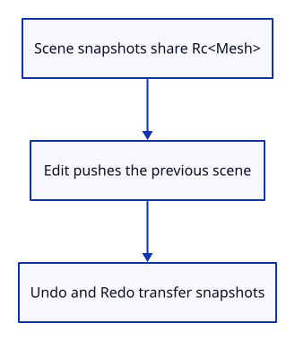

# 2.9.2 · Retain reversible scene snapshots

**Chapter 2 · Geometry, camera and selection · Section 2.9 · Mouse selection and history** · [Contents](contents.md)

**Typing: 28–55 minutes.** [Estimate](typing-load.md).

History retains scene snapshots before an edit. Undo and Redo transfer snapshots between two stacks; a new edit clears Redo. Keep the latest 64 edits.

## Type

Continue from [Select the visible object with a mouse click](13-picking.md). [Save or recover your work](recovery.md).

### 1. `src/scene.rs`

Use shared ownership for immutable mesh data. Allow scene snapshots to clone the object record. Share the mesh allocation between object snapshots. Clone the small scene records for a snapshot. Rc prevents a deep copy of each mesh. Give a newly inserted mesh its first shared owner. Restore document contents while preserving the highest ID counter reached.

Edit these blocks from bottom to top. Keep the surrounding lines unchanged.

<details>
<summary>Locate this block</summary>

```rust
        let next = self.next_id.checked_add(1).ok_or("Object IDs exhausted")?;
        let id = ObjectId(self.next_id);
        self.next_id = next;
        self.objects.push(Object { id, mesh });
        Ok(id)
    }
```

</details>

Replace it with:

```rust
        let next = self.next_id.checked_add(1).ok_or("Object IDs exhausted")?;
        let id = ObjectId(self.next_id);
        self.next_id = next;
        self.objects.push(Object { id, mesh: Rc::new(mesh) });
        Ok(id)
    }
```

<details>
<summary>Locate this block</summary>

```rust
        scene
    }

    pub fn objects(&self) -> &[Object] {
        &self.objects
    }
```

</details>

Replace it with:

```rust
        scene
    }

    pub fn restore(&mut self, mut saved: Self) {
        saved.next_id = saved.next_id.max(self.next_id);
        *self = saved;
    }

    pub fn objects(&self) -> &[Object] {
        &self.objects
    }
```

<details>
<summary>Locate this block</summary>

```rust
use crate::mesh::Mesh;

#[derive(Clone, Copy, Debug, PartialEq, Eq)]
pub struct ObjectId(u32);

pub struct Object {
    pub id: ObjectId,
    pub mesh: Mesh,
}

pub struct Scene {
    objects: Vec<Object>,
    next_id: u32,
```

</details>

Replace it with:

```rust
use crate::mesh::Mesh;
use std::rc::Rc;

#[derive(Clone, Copy, Debug, PartialEq, Eq)]
pub struct ObjectId(u32);

#[derive(Clone)]
pub struct Object {
    pub id: ObjectId,
    pub mesh: Rc<Mesh>,
}

#[derive(Clone)]
pub struct Scene {
    objects: Vec<Object>,
    next_id: u32,
```

<details>
<summary>Complete updated block reference</summary>

```rust
use crate::mesh::Mesh;
use std::rc::Rc;

#[derive(Clone, Copy, Debug, PartialEq, Eq)]
pub struct ObjectId(u32);

#[derive(Clone)]
pub struct Object {
    pub id: ObjectId,
    pub mesh: Rc<Mesh>,
}

#[derive(Clone)]
pub struct Scene {
    objects: Vec<Object>,
    next_id: u32,
    extra: Option<ObjectId>,
}

impl Scene {
    pub fn demo() -> Self {
        let near = Mesh::new(vec![
            [-0.7, -0.6, 0.25, 0.9, 0.25, 0.45],
            [ 0.5, -0.6, 0.25, 0.9, 0.25, 0.45],
            [-0.1,  0.6, 0.25, 0.9, 0.25, 0.45],
        ], vec![0, 1, 2]).expect("Valid near triangle");
        let far = Mesh::new(vec![
            [-0.4, -0.2, 0.75, 0.05, 0.7, 0.7],
            [ 0.8, -0.2, 0.75, 0.05, 0.7, 0.7],
            [ 0.2,  0.8, 0.75, 0.05, 0.7, 0.7],
        ], vec![0, 1, 2]).expect("Valid far triangle");
        let mut scene = Self { objects: Vec::new(), next_id: 1, extra: None };
        scene.insert(near).expect("ID available");
        scene.insert(far).expect("ID available");
        scene
    }

    pub fn restore(&mut self, mut saved: Self) {
        saved.next_id = saved.next_id.max(self.next_id);
        *self = saved;
    }

    pub fn objects(&self) -> &[Object] {
        &self.objects
    }

    pub fn insert(&mut self, mesh: Mesh) -> Result<ObjectId, &'static str> {
        let next = self.next_id.checked_add(1).ok_or("Object IDs exhausted")?;
        let id = ObjectId(self.next_id);
        self.next_id = next;
        self.objects.push(Object { id, mesh: Rc::new(mesh) });
        Ok(id)
    }

    pub fn remove(&mut self, id: ObjectId) -> bool {
        let Some(index) = self.objects.iter().position(|object| object.id == id) else { return false; };
        self.objects.remove(index);
        if self.extra == Some(id) {
            self.extra = None;
        }
        true
    }

    pub fn contains(&self, id: ObjectId) -> bool {
        self.objects.iter().any(|object| object.id == id)
    }

    pub fn next(&self, current: Option<ObjectId>) -> Option<ObjectId> {
        if self.objects.is_empty() {
            return None;
        }
        let index = self.objects.iter().position(|object| Some(object.id) == current)
            .map_or(0, |index| index + 1);
        Some(self.objects[index % self.objects.len()].id)
    }

    pub fn toggle_extra(&mut self) {
        if let Some(id) = self.extra.take() {
            self.remove(id);
        } else {
            let extra = Mesh::new(vec![
                [-0.9, 0.3, 0.5, 0.2, 0.8, 0.3],
                [-0.4, 0.3, 0.5, 0.2, 0.8, 0.3],
                [-0.65, 0.9, 0.5, 0.2, 0.8, 0.3],
            ], vec![0, 1, 2]).expect("Valid extra triangle");
            self.extra = Some(self.insert(extra).expect("ID available"));
        }
    }
}

#[cfg(test)]
mod tests {
    use super::*;

    #[test]
    fn removal_moves_a_row_without_changing_its_identity() {
        let mut scene = Scene::demo();
        let first = scene.objects()[0].id;
        let second = scene.objects()[1].id;
        assert!(scene.remove(first));
        assert_eq!(scene.objects()[0].id, second);
        assert_eq!(scene.next(None), Some(second));
        assert!(!scene.contains(first));
        scene.toggle_extra();
        assert_ne!(scene.objects()[1].id, first);
        assert_ne!(scene.objects()[1].id, second);
    }

    #[test]
    fn toggling_the_extra_object_uses_its_id_after_other_removals() {
        let mut scene = Scene::demo();
        scene.toggle_extra();
        let extra = scene.objects()[2].id;
        scene.remove(scene.objects()[0].id);
        scene.toggle_extra();
        assert!(!scene.contains(extra));
        assert_eq!(scene.objects().len(), 1);
    }
}
```

</details>

<details>
<summary>Optional patch references</summary>

Use these original edit fragments when comparing a saved checkpoint. Apply the complete blocks above.

```text
--8<-- "journey/code/14-history-01.rs"
```

```text
--8<-- "journey/code/14-history-02.rs"
```

```text
--8<-- "journey/code/14-history-03.rs"
```

```text
--8<-- "journey/code/14-history-04.rs"
```

```text
--8<-- "journey/code/14-history-05.rs"
```

```text
--8<-- "journey/code/14-history-06.rs"
```

</details>

### 2. `src/history.rs`

Create bounded undo and redo stacks, plus tests for identity, shared data and a new editing branch.

Create the file and type:

```rust
--8<-- "journey/code/14-history-07.rs"
```

### 3. `src/lib.rs`

Register history as a document operation, independent of the browser and GPU.

<details>
<summary>Locate the existing block</summary>

```rust
pub mod mesh;
pub mod scene;
pub mod picking;
pub mod gpu_mesh;
pub mod renderer;
#[cfg(target_arch = "wasm32")]
```

</details>

Edit the existing block to match this code; keep unchanged lines:

```rust
--8<-- "journey/code/14-history-fullscreen-1.rs"
```

## Run and check

In your project:

```sh
cd workspace/journey
cargo build --lib --locked --target wasm32-unknown-unknown -j1
CARGO_BUILD_JOBS=1 trunk serve --port 8780
```

Open `http://127.0.0.1:8780/`. Keep an existing Trunk server running; saving rebuilds it.

Inspect the supplied state fixtures. Undo restores the same ID and mesh allocation; a new branch clears Redo without reusing IDs; history keeps 64 edits.

### Recorded visual result

**Previous native render — current verification pending.**


*This recorded image predates a source or checker change. Rebuild this checkpoint before using it as current evidence; browser controls require separate acceptance.*

<details>
<summary>Code explanation and diagram</summary>

Rc shares immutable Mesh values across snapshots. FnOnce accepts an action called once with the scene. Restoring contents preserves the highest ID counter reached.

Edit saves Scene → undo/redo transfer snapshots → restore keeps the highest ID counter.



Does cloning a scene copy every vertex array?

No. Object records clone Rc<Mesh> handles. The snapshots share the same immutable mesh allocation.

Study estimate, including typing and experiments: 0.75–1.5 hours.

</details>

<details>
<summary>Optional experiment</summary>

Read the pointer-equality assertion before running the history checks. Undo should restore the original Rc allocation rather than a copied mesh.

</details>

<details>
<summary>Check and save your work</summary>

Restore experimental edits, then run from `session_viewer`:

```sh
npm --prefix ../session_tests run course -- check 2.9.2
npm --prefix ../session_tests run course -- save 2.9.2
```

Source comparison leaves your project untouched. [Save and recovery instructions](recovery.md).

</details>

<details>
<summary>Viewer coverage and verification</summary>

Document snapshots preserve source identity and immutable geometry owners. Camera and background remain outside document history.

Native tests establish the snapshot, sharing and branching behavior. Chrome retains picking and typed selection until Undo/Redo commands are connected next.

[Full validation scope](release.md).

</details>
