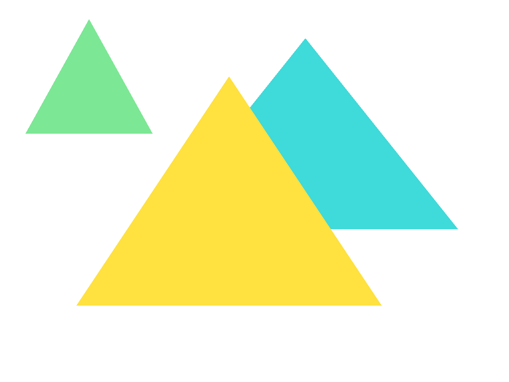
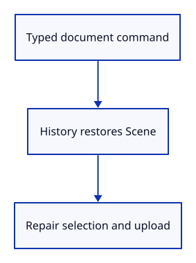

# 2.10.1 · Run Undo and Redo from the command line

**Chapter 2 · Geometry, camera and selection · Section 2.10 · Undo, Redo and viewing rays** · [Contents](contents.md)

**Typing: 8–16 minutes.** [Estimate](typing-load.md).

Route Example Triangle and Delete through History::edit. Undo and Redo restore the scene, retain only valid selection, then upload the restored display.

## Type

Continue from [Retain reversible scene snapshots](13a-history.md). [Save or recover your work](recovery.md).

### 1. `src/browser.rs`

Import the history owner. Add Undo and Redo to the vocabulary. Create document history beside the scene. Record the example toggle as a history edit. Record deletion and route Undo/Redo through history; retain only valid selection. Report the undo result.

Edit these blocks from bottom to top. Keep the surrounding lines unchanged.

<details>
<summary>Locate this block</summary>

```rust
    )?;
    // The page has one listener for its lifetime; JavaScript must retain the Rust callback.
    click.forget();
    report("Click a triangle; the visible object is selected.");
    Ok(())
}
```

</details>

Replace it with:

```rust
    )?;
    // The page has one listener for its lifetime; JavaScript must retain the Rust callback.
    click.forget();
    report("Undo restores the document while the view stays put.");
    Ok(())
}
```

<details>
<summary>Locate this block</summary>

```rust
                }
                "delete" => {
                    if let Some(id) = selected.take() {
                        scene.remove(id);
                        renderer.set_scene(&scene, selected);
                    }
                }
                "background" => background.toggle(),
                "zoom in" => camera.zoom(2.0),
                "zoom out" => camera.zoom(0.5),
```

</details>

Replace it with:

```rust
                }
                "delete" => {
                    if let Some(id) = selected.take() {
                        history.edit(&mut scene, |scene| {
                            scene.remove(id);
                        });
                        renderer.set_scene(&scene, selected);
                    }
                }
                "undo" | "redo" => {
                    if line == "undo" {
                        history.undo(&mut scene);
                    } else {
                        history.redo(&mut scene);
                    }
                    selected = selected.filter(|id| scene.contains(*id));
                    renderer.set_scene(&scene, selected);
                }
                "background" => background.toggle(),
                "zoom in" => camera.zoom(2.0),
                "zoom out" => camera.zoom(0.5),
```

<details>
<summary>Locate this block</summary>

```rust
                    renderer.set_scene(&scene, selected);
                }
                "example triangle" => {
                    scene.toggle_extra();
                    selected = selected.filter(|id| scene.contains(*id));
                    renderer.set_scene(&scene, selected);
                }
```

</details>

Replace it with:

```rust
                    renderer.set_scene(&scene, selected);
                }
                "example triangle" => {
                    history.edit(&mut scene, Scene::toggle_extra);
                    selected = selected.filter(|id| scene.contains(*id));
                    renderer.set_scene(&scene, selected);
                }
```

<details>
<summary>Locate this block</summary>

```rust
        ],
    );
    panel.update(None, &canvas)?;
    let mut selected = None;
    let mut background = Background::default();
    let mut camera = Camera::default();
```

</details>

Replace it with:

```rust
        ],
    );
    panel.update(None, &canvas)?;
    let mut history = History::default();
    let mut selected = None;
    let mut background = Background::default();
    let mut camera = Camera::default();
```

<details>
<summary>Locate this block</summary>

```rust
            "Example Triangle",
            "Select Next",
            "Delete",
            "Background",
            "Zoom In",
            "Zoom Out",
```

</details>

Replace it with:

```rust
            "Example Triangle",
            "Select Next",
            "Delete",
            "Undo",
            "Redo",
            "Background",
            "Zoom In",
            "Zoom Out",
```

<details>
<summary>Locate this block</summary>

```rust
use crate::background::Background;
use crate::camera::Camera;
use crate::renderer::Renderer;
use crate::scene::Scene;
use wasm_bindgen::{JsCast, JsValue, closure::Closure};
```

</details>

Replace it with:

```rust
use crate::background::Background;
use crate::camera::Camera;
use crate::history::History;
use crate::renderer::Renderer;
use crate::scene::Scene;
use wasm_bindgen::{JsCast, JsValue, closure::Closure};
```

<details>
<summary>Complete updated block reference</summary>

```rust
use crate::background::Background;
use crate::camera::Camera;
use crate::history::History;
use crate::renderer::Renderer;
use crate::scene::Scene;
use wasm_bindgen::{JsCast, JsValue, closure::Closure};

pub fn report(message: &str) {
    if let Some(document) = web_sys::window().and_then(|window| window.document()) {
        if let Some(status) = document.get_element_by_id("status") {
            status.set_text_content(Some(message));
            if message.starts_with("Cannot") { let _ = status.remove_attribute("hidden"); }
        }
    }
}

pub async fn run() -> Result<(), JsValue> {
    let window = web_sys::window().ok_or("No browser window")?;
    let document = window.document().ok_or("No document")?;
    let canvas: web_sys::HtmlCanvasElement = document
        .get_element_by_id("canvas")
        .ok_or("Missing canvas")?
        .dyn_into()?;
    let instance = wgpu::Instance::new(wgpu::InstanceDescriptor {
        backends: wgpu::Backends::BROWSER_WEBGPU,
        flags: Default::default(),
        memory_budget_thresholds: Default::default(),
        backend_options: Default::default(),
        display: None,
    });
    let surface = instance
        .create_surface(wgpu::SurfaceTarget::Canvas(canvas.clone()))
        .map_err(|error| JsValue::from_str(&error.to_string()))?;
    let adapter = instance
        .request_adapter(&wgpu::RequestAdapterOptions {
            compatible_surface: Some(&surface),
            ..Default::default()
        })
        .await
        .map_err(|error| JsValue::from_str(&error.to_string()))?;
    let (device, queue) = adapter
        .request_device(&wgpu::DeviceDescriptor::default())
        .await
        .map_err(|error| JsValue::from_str(&error.to_string()))?;
    device.on_uncaptured_error(std::sync::Arc::new(|error| report(&error.to_string())));
    let limit = device.limits().max_texture_dimension_2d;
    let width = (window.inner_width()?.as_f64().ok_or("No window width")? as u32).clamp(1, limit);
    let height = (window.inner_height()?.as_f64().ok_or("No window height")? as u32).clamp(1, limit);
    canvas.set_width(width);
    canvas.set_height(height);
    let mut config = surface
        .get_default_config(&adapter, width, height)
        .ok_or("No compatible surface format")?;
    config.view_formats = vec![config.format.add_srgb_suffix()];
    surface.configure(&device, &config);
    let mut scene = Scene::demo();
    let mut renderer = Renderer::new(device, queue, config.format.add_srgb_suffix(), &scene);
    renderer.resize(width, height);
    let mut panel = crate::panel::Panel::new(
        &renderer,
        config.format.add_srgb_suffix(),
        &[
            "Help",
            "Example Triangle",
            "Select Next",
            "Delete",
            "Undo",
            "Redo",
            "Background",
            "Zoom In",
            "Zoom Out",
            "Pan Left",
            "Pan Right",
            "Orbit Right",
            "View Reset",
        ],
    );
    panel.update(None, &canvas)?;
    let mut history = History::default();
    let mut selected = None;
    let mut background = Background::default();
    let mut camera = Camera::default();
    present(
        &surface,
        &renderer,
        &background,
        &camera.uniform(),
        &mut panel,
    )?;
    let input_canvas = canvas.clone();
    let click = Closure::<dyn FnMut(web_sys::Event)>::new(move |event: web_sys::Event| {
        let line = match panel.update(Some(&event), &input_canvas) {
            Ok(line) => line,
            Err(error) => {
                report(&format!("Cannot read command: {error:?}"));
                return;
            }
        };

        let line = line.or_else(|| {
            let mouse = event.dyn_ref::<web_sys::MouseEvent>()?;
            (event.type_() == "click"
                && !panel.consumed
                && mouse
                    .target()
                    .and_then(|target| target.dyn_into::<web_sys::Element>().ok())
                    .is_some_and(|target| target.id() == "canvas"))
            .then(|| "canvas".into())
        });
        if let Some(line) = line {
            match line.as_str() {
                "canvas" => {
                    let Some(event) = event.dyn_ref::<web_sys::MouseEvent>() else {
                        return;
                    };
                    let rect = input_canvas.get_bounding_client_rect();
                    if rect.width() <= 0.0 || rect.height() <= 0.0 {
                        return;
                    }
                    let screen = [
                        (2.0 * (event.client_x() as f64 - rect.left()) / rect.width() - 1.0) as f32,
                        (1.0 - 2.0 * (event.client_y() as f64 - rect.top()) / rect.height()) as f32,
                    ];
                    selected = crate::picking::pick(&scene, camera.world_from_screen(screen));
                    renderer.set_scene(&scene, selected);
                }
                "example triangle" => {
                    history.edit(&mut scene, Scene::toggle_extra);
                    selected = selected.filter(|id| scene.contains(*id));
                    renderer.set_scene(&scene, selected);
                }
                "select next" => {
                    selected = scene.next(selected);
                    renderer.set_scene(&scene, selected);
                }
                "delete" => {
                    if let Some(id) = selected.take() {
                        history.edit(&mut scene, |scene| {
                            scene.remove(id);
                        });
                        renderer.set_scene(&scene, selected);
                    }
                }
                "undo" | "redo" => {
                    if line == "undo" {
                        history.undo(&mut scene);
                    } else {
                        history.redo(&mut scene);
                    }
                    selected = selected.filter(|id| scene.contains(*id));
                    renderer.set_scene(&scene, selected);
                }
                "background" => background.toggle(),
                "zoom in" => camera.zoom(2.0),
                "zoom out" => camera.zoom(0.5),
                "pan left" => camera.pan(-0.25, 0.0),
                "pan right" => camera.pan(0.25, 0.0),
                "orbit right" => camera.rotate(std::f32::consts::FRAC_PI_4),
                "view reset" => camera = Camera::default(),
                _ => return,
            }
        }
        if let Err(error) = panel.update(None, &input_canvas) {
            report(&format!("Cannot lay out commands: {error:?}"));
            return;
        }
        if let Err(error) = present(
            &surface,
            &renderer,
            &background,
            &camera.uniform(),
            &mut panel,
        ) {
            report(&format!("Cannot redraw: {error:?}"));
        }
    });
    for name in [
        "pointerdown",
        "pointermove",
        "pointerup",
        "pointercancel",
        "lostpointercapture",
        "contextmenu",
        "keydown",
        "keyup",
        "blur",
        "click",
    ] {
        canvas.add_event_listener_with_callback(name, click.as_ref().unchecked_ref())?;
    }
    let options = web_sys::AddEventListenerOptions::new();
    options.set_passive(false);
    canvas.add_event_listener_with_callback_and_add_event_listener_options(
        "wheel",
        click.as_ref().unchecked_ref(),
        &options,
    )?;
    // The page has one listener for its lifetime; JavaScript must retain the Rust callback.
    click.forget();
    report("Undo restores the document while the view stays put.");
    Ok(())
}

fn present(
    surface: &wgpu::Surface<'_>,
    renderer: &Renderer,
    background: &Background,
    transform: &[f32; 16],
    panel: &mut crate::panel::Panel,
) -> Result<(), JsValue> {
    let frame = match surface.get_current_texture() {
        wgpu::CurrentSurfaceTexture::Success(frame)
        | wgpu::CurrentSurfaceTexture::Suboptimal(frame) => frame,
        other => {
            return Err(JsValue::from_str(&format!(
                "Surface unavailable: {other:?}"
            )));
        }
    };
    let view = frame.texture.create_view(&wgpu::TextureViewDescriptor {
        format: Some(frame.texture.format().add_srgb_suffix()),
        ..Default::default()
    });
    renderer.draw(&view, background, transform);
    panel.draw(renderer, &view);
    frame.present();
    Ok(())
}
```

</details>

<details>
<summary>Optional patch references</summary>

Use these original edit fragments when comparing a saved checkpoint. Apply the complete blocks above.

```text
--8<-- "journey/code/14-history-window-1.rs"
```

```text
--8<-- "journey/code/14-history-window-2.rs"
```

```text
--8<-- "journey/code/14-history-window-3.rs"
```

```text
--8<-- "journey/code/14-history-window-4.rs"
```

```text
--8<-- "journey/code/14-history-window-5.rs"
```

```text
--8<-- "journey/code/14-history-window-6.rs"
```

</details>

## Run and check

In your project:

```sh
cd workspace/journey
cargo build --lib --locked --target wasm32-unknown-unknown -j1
CARGO_BUILD_JOBS=1 trunk serve --port 8780
```

Open `http://127.0.0.1:8780/`. Keep an existing Trunk server running; saving rebuilds it.

Type Example Triangle, then Undo and Redo. The third triangle disappears and returns.

### Recorded visual result

**Previous native render — current verification pending.**

The deleted third triangle has been restored, and the first object is selected.

This checkpoint was rendered independently and has the same native comparison frame as [Retain reversible scene snapshots](13a-history.md). Use its state checks and browser exercise to assess the changed behavior.



*This recorded image predates a source or checker change. Rebuild this checkpoint before using it as current evidence; browser controls require separate acceptance.*

This reference image is shared with [2.9.2 · Retain reversible scene snapshots](13a-history.md). It does not demonstrate a new feature by itself.

<details>
<summary>Code explanation and diagram</summary>

The callback keeps camera and background outside history. A document restoration redraws with the current view.

Typed edit → History → restored Scene → selection repair → set_scene.



Why repair selection after restoration?

Selection stores an ID. The restored scene may not contain that ID, so retain it only when it still exists.

Study estimate, including typing and experiments: 0.25–0.5 hours.

</details>

<details>
<summary>Optional experiment</summary>

Add the third triangle, undo that addition, then add it again. It looks similar, but the new addition must receive a new ID. Read the branching-history test and explain why. Next pan the camera, delete an object and undo: the camera should stay where you put it.

</details>

<details>
<summary>Check and save your work</summary>

Restore experimental edits, then run from `session_viewer`:

```sh
npm --prefix ../session_tests run course -- check 2.10.1
npm --prefix ../session_tests run course -- save 2.10.1
```

Source comparison leaves your project untouched. [Save and recovery instructions](recovery.md).

</details>

<details>
<summary>Viewer coverage and verification</summary>

The full viewer groups document operations into transactions and coordinates restoration with displayed rows and tool state. This lesson establishes reversible document changes, shared immutable data, preserved identity and the boundary between an edit and a view change.


[Full validation scope](release.md).

</details>
