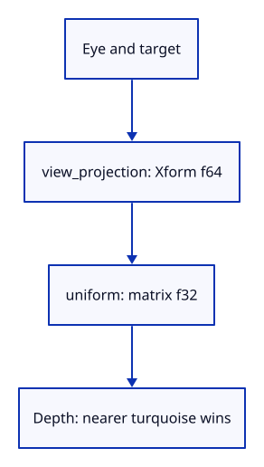

# 2.10.2 · Draw through a perspective camera

**Chapter 2 · Geometry, camera and selection · Section 2.10 · Undo, Redo and viewing rays** · [Contents](contents.md)

**Typing: 20–40 minutes.** [Estimate](typing-load.md).

Look from z = 3 toward z = 0 with a 60-degree vertical field of view. The nearer turquoise triangle covers pink at their overlap.

## Type

Continue from [Run Undo and Redo from the command line](14-history.md). [Save or recover your work](recovery.md).

### 1. `Cargo.toml`

Add the geometry kernel and browser-compatible random number support.

<details>
<summary>Locate the existing block</summary>

```toml
console_error_panic_hook = "=0.1.7"
wasm-bindgen-futures = "=0.4.78"
wgpu = "=29.0.4"

egui = { version = "=0.34.3", default-features = false }
egui-wgpu = { version = "=0.34.3", default-features = false }
```

</details>

Edit the existing block to match this code; keep unchanged lines:

```toml
--8<-- "journey/code/15-perspective-dock-01.toml"
```

### 2. `src/camera.rs`

Give the camera an eye distance, view-projection matrix and GPU uniform. Check the transformed target stays centred.

<details>
<summary>Locate the existing block</summary>

```rust
pub struct Camera {
    pub center: [f32; 2],
    pub scale: f32,
    pub angle: f32,
}

impl Default for Camera {
    fn default() -> Self {
        Self { center: [0.0, 0.0], scale: 1.0, angle: 0.0 }
    }
}

impl Camera {
    pub fn pan(&mut self, dx: f32, dy: f32) {
        self.center[0] += dx;
        self.center[1] += dy;
    }

    pub fn zoom(&mut self, factor: f32) {
        if factor.is_finite() && factor > 0.0 {
            self.scale = (self.scale * factor).clamp(0.1, 10.0);
        }
    }

    pub fn rotate(&mut self, radians: f32) {
        self.angle += radians;
    }

    pub fn world_from_screen(&self, point: [f32; 2]) -> [f32; 2] {
        let x = point[0] / self.scale;
        let y = point[1] / self.scale;
        let (sin, cos) = self.angle.sin_cos();
        [self.center[0] + x * cos - y * sin, self.center[1] + x * sin + y * cos]
    }

    pub fn uniform(&self) -> [f32; 16] {
        let a = self.scale * self.angle.cos();
        let b = self.scale * self.angle.sin();
        let [x, y] = self.center;
        // WGSL matrices are uploaded column by column.
        [
            a, -b, 0.0, 0.0,
            b,  a, 0.0, 0.0,
            0.0, 0.0, 1.0, 0.0,
            -a * x - b * y, b * x - a * y, 0.0, 1.0,
        ]
    }
}

#[cfg(test)]
mod coordinate_tests {
    use super::Camera;

    #[test]
    fn moving_the_view_preserves_the_coordinate_round_trip() {
        let mut camera = Camera::default();
        camera.pan(0.1, -0.2);
        camera.zoom(0.5);
        camera.rotate(0.7);
        let world = [0.4, 0.0];
        let matrix = camera.uniform();
        let screen = [matrix[0] * world[0] + matrix[4] * world[1] + matrix[12],
            matrix[1] * world[0] + matrix[5] * world[1] + matrix[13]];
        let restored = camera.world_from_screen(screen);
        assert!((restored[0] - world[0]).abs() < 1.0e-6);
        assert!((restored[1] - world[1]).abs() < 1.0e-6);
    }
}

#[cfg(test)]
mod tests {
    use super::*;

    #[test]
    fn panned_target_stays_at_the_screen_centre_when_zooming() {
        let mut camera = Camera::default();
        camera.pan(0.25, -0.5);
        camera.zoom(2.0);
        camera.rotate(std::f32::consts::FRAC_PI_4);
        let m = camera.uniform();
        let [x, y] = camera.center;
        assert!((m[0] * x + m[4] * y + m[12]).abs() < 1.0e-6);
        assert!((m[1] * x + m[5] * y + m[13]).abs() < 1.0e-6);
    }

    #[test]
    fn zoom_stays_positive_and_bounded() {
        let mut camera = Camera::default();
        camera.zoom(0.0001);
        assert_eq!(camera.scale, 0.1);
        camera.zoom(1_000.0);
        assert_eq!(camera.scale, 10.0);
        camera.zoom(f32::NAN);
        camera.zoom(-1.0);
        assert_eq!(camera.scale, 10.0);
    }
}
```

</details>

Edit the existing block to match this code; keep unchanged lines:

```rust
--8<-- "journey/code/14a-perspective-camera.rs"
```

### 3. `src/scene.rs`

Name the mesh by colour; which surface is nearer now depends on the camera. Give the other mesh a camera-independent name. Name the pink triangle in its validation error. Name the turquoise triangle in its validation error. Insert the same two mesh data sets in the same order. Their identities are unchanged.

Edit these blocks from bottom to top. Keep the surrounding lines unchanged.

<details>
<summary>Locate this block</summary>

```rust

impl Scene {
    pub fn demo() -> Self {
        let near = Mesh::new(vec![
            [-0.7, -0.6, 0.25, 0.9, 0.25, 0.45],
            [ 0.5, -0.6, 0.25, 0.9, 0.25, 0.45],
            [-0.1,  0.6, 0.25, 0.9, 0.25, 0.45],
        ], vec![0, 1, 2]).expect("Valid near triangle");
        let far = Mesh::new(vec![
            [-0.4, -0.2, 0.75, 0.05, 0.7, 0.7],
            [ 0.8, -0.2, 0.75, 0.05, 0.7, 0.7],
            [ 0.2,  0.8, 0.75, 0.05, 0.7, 0.7],
        ], vec![0, 1, 2]).expect("Valid far triangle");
        let mut scene = Self { objects: Vec::new(), next_id: 1, extra: None };
        scene.insert(near).expect("ID available");
        scene.insert(far).expect("ID available");
        scene
    }
```

</details>

Replace it with:

```rust

impl Scene {
    pub fn demo() -> Self {
        let pink = Mesh::new(vec![
            [-0.7, -0.6, 0.25, 0.9, 0.25, 0.45],
            [ 0.5, -0.6, 0.25, 0.9, 0.25, 0.45],
            [-0.1,  0.6, 0.25, 0.9, 0.25, 0.45],
        ], vec![0, 1, 2]).expect("Valid pink triangle");
        let turquoise = Mesh::new(vec![
            [-0.4, -0.2, 0.75, 0.05, 0.7, 0.7],
            [ 0.8, -0.2, 0.75, 0.05, 0.7, 0.7],
            [ 0.2,  0.8, 0.75, 0.05, 0.7, 0.7],
        ], vec![0, 1, 2]).expect("Valid turquoise triangle");
        let mut scene = Self { objects: Vec::new(), next_id: 1, extra: None };
        scene.insert(pink).expect("ID available");
        scene.insert(turquoise).expect("ID available");
        scene
    }
```

<details>
<summary>Complete updated block reference</summary>

```rust
use crate::mesh::Mesh;
use std::rc::Rc;

#[derive(Clone, Copy, Debug, PartialEq, Eq)]
pub struct ObjectId(u32);

#[derive(Clone)]
pub struct Object {
    pub id: ObjectId,
    pub mesh: Rc<Mesh>,
}

#[derive(Clone)]
pub struct Scene {
    objects: Vec<Object>,
    next_id: u32,
    extra: Option<ObjectId>,
}

impl Scene {
    pub fn demo() -> Self {
        let pink = Mesh::new(vec![
            [-0.7, -0.6, 0.25, 0.9, 0.25, 0.45],
            [ 0.5, -0.6, 0.25, 0.9, 0.25, 0.45],
            [-0.1,  0.6, 0.25, 0.9, 0.25, 0.45],
        ], vec![0, 1, 2]).expect("Valid pink triangle");
        let turquoise = Mesh::new(vec![
            [-0.4, -0.2, 0.75, 0.05, 0.7, 0.7],
            [ 0.8, -0.2, 0.75, 0.05, 0.7, 0.7],
            [ 0.2,  0.8, 0.75, 0.05, 0.7, 0.7],
        ], vec![0, 1, 2]).expect("Valid turquoise triangle");
        let mut scene = Self { objects: Vec::new(), next_id: 1, extra: None };
        scene.insert(pink).expect("ID available");
        scene.insert(turquoise).expect("ID available");
        scene
    }

    pub fn restore(&mut self, mut saved: Self) {
        saved.next_id = saved.next_id.max(self.next_id);
        *self = saved;
    }

    pub fn objects(&self) -> &[Object] {
        &self.objects
    }

    pub fn insert(&mut self, mesh: Mesh) -> Result<ObjectId, &'static str> {
        let next = self.next_id.checked_add(1).ok_or("Object IDs exhausted")?;
        let id = ObjectId(self.next_id);
        self.next_id = next;
        self.objects.push(Object { id, mesh: Rc::new(mesh) });
        Ok(id)
    }

    pub fn remove(&mut self, id: ObjectId) -> bool {
        let Some(index) = self.objects.iter().position(|object| object.id == id) else { return false; };
        self.objects.remove(index);
        if self.extra == Some(id) {
            self.extra = None;
        }
        true
    }

    pub fn contains(&self, id: ObjectId) -> bool {
        self.objects.iter().any(|object| object.id == id)
    }

    pub fn next(&self, current: Option<ObjectId>) -> Option<ObjectId> {
        if self.objects.is_empty() {
            return None;
        }
        let index = self.objects.iter().position(|object| Some(object.id) == current)
            .map_or(0, |index| index + 1);
        Some(self.objects[index % self.objects.len()].id)
    }

    pub fn toggle_extra(&mut self) {
        if let Some(id) = self.extra.take() {
            self.remove(id);
        } else {
            let extra = Mesh::new(vec![
                [-0.9, 0.3, 0.5, 0.2, 0.8, 0.3],
                [-0.4, 0.3, 0.5, 0.2, 0.8, 0.3],
                [-0.65, 0.9, 0.5, 0.2, 0.8, 0.3],
            ], vec![0, 1, 2]).expect("Valid extra triangle");
            self.extra = Some(self.insert(extra).expect("ID available"));
        }
    }
}

#[cfg(test)]
mod tests {
    use super::*;

    #[test]
    fn removal_moves_a_row_without_changing_its_identity() {
        let mut scene = Scene::demo();
        let first = scene.objects()[0].id;
        let second = scene.objects()[1].id;
        assert!(scene.remove(first));
        assert_eq!(scene.objects()[0].id, second);
        assert_eq!(scene.next(None), Some(second));
        assert!(!scene.contains(first));
        scene.toggle_extra();
        assert_ne!(scene.objects()[1].id, first);
        assert_ne!(scene.objects()[1].id, second);
    }

    #[test]
    fn toggling_the_extra_object_uses_its_id_after_other_removals() {
        let mut scene = Scene::demo();
        scene.toggle_extra();
        let extra = scene.objects()[2].id;
        scene.remove(scene.objects()[0].id);
        scene.toggle_extra();
        assert!(!scene.contains(extra));
        assert_eq!(scene.objects().len(), 1);
    }
}
```

</details>

<details>
<summary>Optional patch references</summary>

Use these original edit fragments when comparing a saved checkpoint. Apply the complete blocks above.

```text
--8<-- "journey/code/15-perspective-05.rs"
```

```text
--8<-- "journey/code/15-perspective-06.rs"
```

```text
--8<-- "journey/code/15-perspective-07.rs"
```

```text
--8<-- "journey/code/15-perspective-08.rs"
```

```text
--8<-- "journey/code/15-perspective-09.rs"
```

</details>

### 4. `src/browser.rs`

Initialize camera aspect from the canvas size. Preserve aspect when resetting the camera.

Edit these blocks from bottom to top. Keep the surrounding lines unchanged.

<details>
<summary>Locate this block</summary>

```rust
                "pan left" => camera.pan(-0.25, 0.0),
                "pan right" => camera.pan(0.25, 0.0),
                "orbit right" => camera.rotate(std::f32::consts::FRAC_PI_4),
                "view reset" => camera = Camera::default(),
                _ => return,
            }
        }
```

</details>

Replace it with:

```rust
                "pan left" => camera.pan(-0.25, 0.0),
                "pan right" => camera.pan(0.25, 0.0),
                "orbit right" => camera.rotate(std::f32::consts::FRAC_PI_4),
                "view reset" => camera = Camera { aspect: camera.aspect, ..Camera::default() },
                _ => return,
            }
        }
```

<details>
<summary>Locate this block</summary>

```rust
    let mut history = History::default();
    let mut selected = None;
    let mut background = Background::default();
    let mut camera = Camera::default();
    present(
        &surface,
        &renderer,
```

</details>

Replace it with:

```rust
    let mut history = History::default();
    let mut selected = None;
    let mut background = Background::default();
    let mut camera = Camera { aspect: width as f64 / height as f64, ..Camera::default() };
    present(
        &surface,
        &renderer,
```

<details>
<summary>Complete updated block reference</summary>

```rust
use crate::background::Background;
use crate::camera::Camera;
use crate::history::History;
use crate::renderer::Renderer;
use crate::scene::Scene;
use wasm_bindgen::{JsCast, JsValue, closure::Closure};

pub fn report(message: &str) {
    if let Some(document) = web_sys::window().and_then(|window| window.document()) {
        if let Some(status) = document.get_element_by_id("status") {
            status.set_text_content(Some(message));
            if message.starts_with("Cannot") { let _ = status.remove_attribute("hidden"); }
        }
    }
}

pub async fn run() -> Result<(), JsValue> {
    let window = web_sys::window().ok_or("No browser window")?;
    let document = window.document().ok_or("No document")?;
    let canvas: web_sys::HtmlCanvasElement = document
        .get_element_by_id("canvas")
        .ok_or("Missing canvas")?
        .dyn_into()?;
    let instance = wgpu::Instance::new(wgpu::InstanceDescriptor {
        backends: wgpu::Backends::BROWSER_WEBGPU,
        flags: Default::default(),
        memory_budget_thresholds: Default::default(),
        backend_options: Default::default(),
        display: None,
    });
    let surface = instance
        .create_surface(wgpu::SurfaceTarget::Canvas(canvas.clone()))
        .map_err(|error| JsValue::from_str(&error.to_string()))?;
    let adapter = instance
        .request_adapter(&wgpu::RequestAdapterOptions {
            compatible_surface: Some(&surface),
            ..Default::default()
        })
        .await
        .map_err(|error| JsValue::from_str(&error.to_string()))?;
    let (device, queue) = adapter
        .request_device(&wgpu::DeviceDescriptor::default())
        .await
        .map_err(|error| JsValue::from_str(&error.to_string()))?;
    device.on_uncaptured_error(std::sync::Arc::new(|error| report(&error.to_string())));
    let limit = device.limits().max_texture_dimension_2d;
    let width = (window.inner_width()?.as_f64().ok_or("No window width")? as u32).clamp(1, limit);
    let height = (window.inner_height()?.as_f64().ok_or("No window height")? as u32).clamp(1, limit);
    canvas.set_width(width);
    canvas.set_height(height);
    let mut config = surface
        .get_default_config(&adapter, width, height)
        .ok_or("No compatible surface format")?;
    config.view_formats = vec![config.format.add_srgb_suffix()];
    surface.configure(&device, &config);
    let mut scene = Scene::demo();
    let mut renderer = Renderer::new(device, queue, config.format.add_srgb_suffix(), &scene);
    renderer.resize(width, height);
    let mut panel = crate::panel::Panel::new(
        &renderer,
        config.format.add_srgb_suffix(),
        &[
            "Help",
            "Example Triangle",
            "Select Next",
            "Delete",
            "Undo",
            "Redo",
            "Background",
            "Zoom In",
            "Zoom Out",
            "Pan Left",
            "Pan Right",
            "Orbit Right",
            "View Reset",
        ],
    );
    panel.update(None, &canvas)?;
    let mut history = History::default();
    let mut selected = None;
    let mut background = Background::default();
    let mut camera = Camera { aspect: width as f64 / height as f64, ..Camera::default() };
    present(
        &surface,
        &renderer,
        &background,
        &camera.uniform(),
        &mut panel,
    )?;
    let input_canvas = canvas.clone();
    let click = Closure::<dyn FnMut(web_sys::Event)>::new(move |event: web_sys::Event| {
        let line = match panel.update(Some(&event), &input_canvas) {
            Ok(line) => line,
            Err(error) => {
                report(&format!("Cannot read command: {error:?}"));
                return;
            }
        };

        let line = line.or_else(|| {
            let mouse = event.dyn_ref::<web_sys::MouseEvent>()?;
            (event.type_() == "click"
                && !panel.consumed
                && mouse
                    .target()
                    .and_then(|target| target.dyn_into::<web_sys::Element>().ok())
                    .is_some_and(|target| target.id() == "canvas"))
            .then(|| "canvas".into())
        });
        if let Some(line) = line {
            match line.as_str() {
                "canvas" => {
                    let Some(event) = event.dyn_ref::<web_sys::MouseEvent>() else {
                        return;
                    };
                    let rect = input_canvas.get_bounding_client_rect();
                    if rect.width() <= 0.0 || rect.height() <= 0.0 {
                        return;
                    }
                    let screen = [
                        (2.0 * (event.client_x() as f64 - rect.left()) / rect.width() - 1.0) as f32,
                        (1.0 - 2.0 * (event.client_y() as f64 - rect.top()) / rect.height()) as f32,
                    ];
                    selected = crate::picking::pick(&scene, camera.world_from_screen(screen));
                    renderer.set_scene(&scene, selected);
                }
                "example triangle" => {
                    history.edit(&mut scene, Scene::toggle_extra);
                    selected = selected.filter(|id| scene.contains(*id));
                    renderer.set_scene(&scene, selected);
                }
                "select next" => {
                    selected = scene.next(selected);
                    renderer.set_scene(&scene, selected);
                }
                "delete" => {
                    if let Some(id) = selected.take() {
                        history.edit(&mut scene, |scene| {
                            scene.remove(id);
                        });
                        renderer.set_scene(&scene, selected);
                    }
                }
                "undo" | "redo" => {
                    if line == "undo" {
                        history.undo(&mut scene);
                    } else {
                        history.redo(&mut scene);
                    }
                    selected = selected.filter(|id| scene.contains(*id));
                    renderer.set_scene(&scene, selected);
                }
                "background" => background.toggle(),
                "zoom in" => camera.zoom(2.0),
                "zoom out" => camera.zoom(0.5),
                "pan left" => camera.pan(-0.25, 0.0),
                "pan right" => camera.pan(0.25, 0.0),
                "orbit right" => camera.rotate(std::f32::consts::FRAC_PI_4),
                "view reset" => camera = Camera { aspect: camera.aspect, ..Camera::default() },
                _ => return,
            }
        }
        if let Err(error) = panel.update(None, &input_canvas) {
            report(&format!("Cannot lay out commands: {error:?}"));
            return;
        }
        if let Err(error) = present(
            &surface,
            &renderer,
            &background,
            &camera.uniform(),
            &mut panel,
        ) {
            report(&format!("Cannot redraw: {error:?}"));
        }
    });
    for name in [
        "pointerdown",
        "pointermove",
        "pointerup",
        "pointercancel",
        "lostpointercapture",
        "contextmenu",
        "keydown",
        "keyup",
        "blur",
        "click",
    ] {
        canvas.add_event_listener_with_callback(name, click.as_ref().unchecked_ref())?;
    }
    let options = web_sys::AddEventListenerOptions::new();
    options.set_passive(false);
    canvas.add_event_listener_with_callback_and_add_event_listener_options(
        "wheel",
        click.as_ref().unchecked_ref(),
        &options,
    )?;
    // The page has one listener for its lifetime; JavaScript must retain the Rust callback.
    click.forget();
    report("Undo restores the document while the view stays put.");
    Ok(())
}

fn present(
    surface: &wgpu::Surface<'_>,
    renderer: &Renderer,
    background: &Background,
    transform: &[f32; 16],
    panel: &mut crate::panel::Panel,
) -> Result<(), JsValue> {
    let frame = match surface.get_current_texture() {
        wgpu::CurrentSurfaceTexture::Success(frame)
        | wgpu::CurrentSurfaceTexture::Suboptimal(frame) => frame,
        other => {
            return Err(JsValue::from_str(&format!(
                "Surface unavailable: {other:?}"
            )));
        }
    };
    let view = frame.texture.create_view(&wgpu::TextureViewDescriptor {
        format: Some(frame.texture.format().add_srgb_suffix()),
        ..Default::default()
    });
    renderer.draw(&view, background, transform);
    panel.draw(renderer, &view);
    frame.present();
    Ok(())
}
```

</details>

<details>
<summary>Optional patch references</summary>

Use these original edit fragments when comparing a saved checkpoint. Apply the complete blocks above.

```text
--8<-- "journey/code/15-perspective-window-1.rs"
```

```text
--8<-- "journey/code/15-perspective-window-3.rs"
```

</details>

### 5. `src/lib.rs`

Pause the flat picking module until the camera-ray query is introduced.

<details>
<summary>Locate the existing block</summary>

```rust
pub mod picking;
pub mod history;
```

</details>

Edit the existing block to match this code; keep unchanged lines:

```rust
pub mod history;
```

<details>
<summary>Optional patch references</summary>

Use these original edit fragments when comparing a saved checkpoint. Apply the complete blocks above.

</details>

### 6. `src/browser.rs`

Pause canvas selection while the camera changes; typed selection still works. Report that perspective drawing is ready.

Edit these blocks from bottom to top. Keep the surrounding lines unchanged.

<details>
<summary>Locate this block</summary>

```rust
    )?;
    // The page has one listener for its lifetime; JavaScript must retain the Rust callback.
    click.forget();
    report("Undo restores the document while the view stays put.");
    Ok(())
}
```

</details>

Replace it with:

```rust
    )?;
    // The page has one listener for its lifetime; JavaScript must retain the Rust callback.
    click.forget();
    report("Perspective drawing uses the current camera.");
    Ok(())
}
```

<details>
<summary>Locate this block</summary>

```rust
        });
        if let Some(line) = line {
            match line.as_str() {
                "canvas" => {
                    let Some(event) = event.dyn_ref::<web_sys::MouseEvent>() else {
                        return;
                    };
                    let rect = input_canvas.get_bounding_client_rect();
                    if rect.width() <= 0.0 || rect.height() <= 0.0 {
                        return;
                    }
                    let screen = [
                        (2.0 * (event.client_x() as f64 - rect.left()) / rect.width() - 1.0) as f32,
                        (1.0 - 2.0 * (event.client_y() as f64 - rect.top()) / rect.height()) as f32,
                    ];
                    selected = crate::picking::pick(&scene, camera.world_from_screen(screen));
                    renderer.set_scene(&scene, selected);
                }
                "example triangle" => {
                    history.edit(&mut scene, Scene::toggle_extra);
                    selected = selected.filter(|id| scene.contains(*id));
```

</details>

Replace it with:

```rust
        });
        if let Some(line) = line {
            match line.as_str() {
                "canvas" => return,
                "example triangle" => {
                    history.edit(&mut scene, Scene::toggle_extra);
                    selected = selected.filter(|id| scene.contains(*id));
```

<details>
<summary>Complete updated block reference</summary>

```rust
use crate::background::Background;
use crate::camera::Camera;
use crate::history::History;
use crate::renderer::Renderer;
use crate::scene::Scene;
use wasm_bindgen::{JsCast, JsValue, closure::Closure};

pub fn report(message: &str) {
    if let Some(document) = web_sys::window().and_then(|window| window.document()) {
        if let Some(status) = document.get_element_by_id("status") {
            status.set_text_content(Some(message));
            if message.starts_with("Cannot") { let _ = status.remove_attribute("hidden"); }
        }
    }
}

pub async fn run() -> Result<(), JsValue> {
    let window = web_sys::window().ok_or("No browser window")?;
    let document = window.document().ok_or("No document")?;
    let canvas: web_sys::HtmlCanvasElement = document
        .get_element_by_id("canvas")
        .ok_or("Missing canvas")?
        .dyn_into()?;
    let instance = wgpu::Instance::new(wgpu::InstanceDescriptor {
        backends: wgpu::Backends::BROWSER_WEBGPU,
        flags: Default::default(),
        memory_budget_thresholds: Default::default(),
        backend_options: Default::default(),
        display: None,
    });
    let surface = instance
        .create_surface(wgpu::SurfaceTarget::Canvas(canvas.clone()))
        .map_err(|error| JsValue::from_str(&error.to_string()))?;
    let adapter = instance
        .request_adapter(&wgpu::RequestAdapterOptions {
            compatible_surface: Some(&surface),
            ..Default::default()
        })
        .await
        .map_err(|error| JsValue::from_str(&error.to_string()))?;
    let (device, queue) = adapter
        .request_device(&wgpu::DeviceDescriptor::default())
        .await
        .map_err(|error| JsValue::from_str(&error.to_string()))?;
    device.on_uncaptured_error(std::sync::Arc::new(|error| report(&error.to_string())));
    let limit = device.limits().max_texture_dimension_2d;
    let width = (window.inner_width()?.as_f64().ok_or("No window width")? as u32).clamp(1, limit);
    let height = (window.inner_height()?.as_f64().ok_or("No window height")? as u32).clamp(1, limit);
    canvas.set_width(width);
    canvas.set_height(height);
    let mut config = surface
        .get_default_config(&adapter, width, height)
        .ok_or("No compatible surface format")?;
    config.view_formats = vec![config.format.add_srgb_suffix()];
    surface.configure(&device, &config);
    let mut scene = Scene::demo();
    let mut renderer = Renderer::new(device, queue, config.format.add_srgb_suffix(), &scene);
    renderer.resize(width, height);
    let mut panel = crate::panel::Panel::new(
        &renderer,
        config.format.add_srgb_suffix(),
        &[
            "Help",
            "Example Triangle",
            "Select Next",
            "Delete",
            "Undo",
            "Redo",
            "Background",
            "Zoom In",
            "Zoom Out",
            "Pan Left",
            "Pan Right",
            "Orbit Right",
            "View Reset",
        ],
    );
    panel.update(None, &canvas)?;
    let mut history = History::default();
    let mut selected = None;
    let mut background = Background::default();
    let mut camera = Camera { aspect: width as f64 / height as f64, ..Camera::default() };
    present(
        &surface,
        &renderer,
        &background,
        &camera.uniform(),
        &mut panel,
    )?;
    let input_canvas = canvas.clone();
    let click = Closure::<dyn FnMut(web_sys::Event)>::new(move |event: web_sys::Event| {
        let line = match panel.update(Some(&event), &input_canvas) {
            Ok(line) => line,
            Err(error) => {
                report(&format!("Cannot read command: {error:?}"));
                return;
            }
        };

        let line = line.or_else(|| {
            let mouse = event.dyn_ref::<web_sys::MouseEvent>()?;
            (event.type_() == "click"
                && !panel.consumed
                && mouse
                    .target()
                    .and_then(|target| target.dyn_into::<web_sys::Element>().ok())
                    .is_some_and(|target| target.id() == "canvas"))
            .then(|| "canvas".into())
        });
        if let Some(line) = line {
            match line.as_str() {
                "canvas" => return,
                "example triangle" => {
                    history.edit(&mut scene, Scene::toggle_extra);
                    selected = selected.filter(|id| scene.contains(*id));
                    renderer.set_scene(&scene, selected);
                }
                "select next" => {
                    selected = scene.next(selected);
                    renderer.set_scene(&scene, selected);
                }
                "delete" => {
                    if let Some(id) = selected.take() {
                        history.edit(&mut scene, |scene| {
                            scene.remove(id);
                        });
                        renderer.set_scene(&scene, selected);
                    }
                }
                "undo" | "redo" => {
                    if line == "undo" {
                        history.undo(&mut scene);
                    } else {
                        history.redo(&mut scene);
                    }
                    selected = selected.filter(|id| scene.contains(*id));
                    renderer.set_scene(&scene, selected);
                }
                "background" => background.toggle(),
                "zoom in" => camera.zoom(2.0),
                "zoom out" => camera.zoom(0.5),
                "pan left" => camera.pan(-0.25, 0.0),
                "pan right" => camera.pan(0.25, 0.0),
                "orbit right" => camera.rotate(std::f32::consts::FRAC_PI_4),
                "view reset" => camera = Camera { aspect: camera.aspect, ..Camera::default() },
                _ => return,
            }
        }
        if let Err(error) = panel.update(None, &input_canvas) {
            report(&format!("Cannot lay out commands: {error:?}"));
            return;
        }
        if let Err(error) = present(
            &surface,
            &renderer,
            &background,
            &camera.uniform(),
            &mut panel,
        ) {
            report(&format!("Cannot redraw: {error:?}"));
        }
    });
    for name in [
        "pointerdown",
        "pointermove",
        "pointerup",
        "pointercancel",
        "lostpointercapture",
        "contextmenu",
        "keydown",
        "keyup",
        "blur",
        "click",
    ] {
        canvas.add_event_listener_with_callback(name, click.as_ref().unchecked_ref())?;
    }
    let options = web_sys::AddEventListenerOptions::new();
    options.set_passive(false);
    canvas.add_event_listener_with_callback_and_add_event_listener_options(
        "wheel",
        click.as_ref().unchecked_ref(),
        &options,
    )?;
    // The page has one listener for its lifetime; JavaScript must retain the Rust callback.
    click.forget();
    report("Perspective drawing uses the current camera.");
    Ok(())
}

fn present(
    surface: &wgpu::Surface<'_>,
    renderer: &Renderer,
    background: &Background,
    transform: &[f32; 16],
    panel: &mut crate::panel::Panel,
) -> Result<(), JsValue> {
    let frame = match surface.get_current_texture() {
        wgpu::CurrentSurfaceTexture::Success(frame)
        | wgpu::CurrentSurfaceTexture::Suboptimal(frame) => frame,
        other => {
            return Err(JsValue::from_str(&format!(
                "Surface unavailable: {other:?}"
            )));
        }
    };
    let view = frame.texture.create_view(&wgpu::TextureViewDescriptor {
        format: Some(frame.texture.format().add_srgb_suffix()),
        ..Default::default()
    });
    renderer.draw(&view, background, transform);
    panel.draw(renderer, &view);
    frame.present();
    Ok(())
}
```

</details>

<details>
<summary>Optional patch references</summary>

Use these original edit fragments when comparing a saved checkpoint. Apply the complete blocks above.

```text
--8<-- "journey/code/14a-perspective-canvas.rs"
```

```text
--8<-- "journey/code/14a-perspective-status.rs"
```

</details>

## Run and check

Run this from `session_viewer` to select the fixed dependency versions and install supplied binary assets. It updates Cargo.lock and preserves the previous lock. It does not write implementation code:

```sh
npm --prefix ../session_tests run course -- dependencies 2.10.2
```

In your project:

```sh
cd workspace/journey
REGEN_PROTO=0 cargo build --lib --locked --target wasm32-unknown-unknown -j1
REGEN_PROTO=0 CARGO_BUILD_JOBS=1 trunk serve --port 8780
```

Open `http://127.0.0.1:8780/`. Keep an existing Trunk server running; saving rebuilds it.

Refresh the viewer. Turquoise covers pink at the centre of the view.

### Recorded visual result

**Previous native render — current verification pending.**


*This recorded image predates a source or checker change. Rebuild this checkpoint before using it as current evidence; browser controls require separate acceptance.*

<details>
<summary>Code explanation and diagram</summary>

Xform calculates the view and projection in double precision. to_f32 supplies the existing GPU uniform; the shader divides clip coordinates by w. Keep aspect equal to window width divided by height.

Eye and target → view_projection → f32 uniform → GPU depth test.



Why is turquoise nearer even though its world z is larger?

The eye is at positive z and looks toward zero. The turquoise triangle at z = 0.75 is closer to that eye than pink at z = 0.25.

Study estimate, including typing and experiments: 0.75–1.25 hours.

</details>

<details>
<summary>Optional experiment</summary>

Type Zoom In, then View Reset. The eye moves closer and resets; geometry positions stay unchanged.

</details>

<details>
<summary>Check and save your work</summary>

Restore experimental edits, then run from `session_viewer`:

```sh
npm --prefix ../session_tests run course -- check 2.10.2
npm --prefix ../session_tests run course -- save 2.10.2
```

Source comparison leaves your project untouched. [Save and recovery instructions](recovery.md).

</details>

<details>
<summary>Viewer coverage and verification</summary>

The viewer calculates camera geometry in double precision and supplies float matrices to the GPU. This step establishes perspective drawing; the next two steps restore canvas picking with a matching ray.

This checkpoint verifies perspective drawing and typed commands. Canvas selection is paused while the old flat-coordinate query is replaced; it returns in the ray-picking step.

[Full validation scope](release.md).

To reproduce the scripted acceptance of the reference checkpoint, run from `session_viewer` with the [course bundle server](release.md#reproduce) running on port 8781:

```sh
npm --prefix ../session_tests run course -- capture 2.10.2
```

This uses the verified reference bundle; it does not check or change your typed project.

</details>
