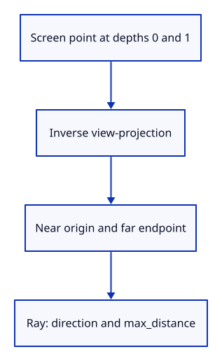

# 2.10.3 · Turn a screen point into a bounded ray

**Chapter 2 · Geometry, camera and selection · Section 2.10 · Undo, Redo and viewing rays** · [Contents](contents.md)

**Typing: 14–28 minutes.** [Estimate](typing-load.md).

Invert the view-projection matrix. A screen point at depths zero and one gives the near and far ends of a ray through the view.

## Type

Continue from [Draw through a perspective camera](14a-perspective.md). [Save or recover your work](recovery.md).

### 1. `src/camera.rs`

Keep the near origin, normalized direction and segment length together. Inverse-transform the screen point at both depth boundaries; reject invalid coordinates and invalid segment length. Check that a projected point lies on its recovered ray and invalid screen coordinates are rejected.

Edit these blocks from bottom to top. Keep the surrounding lines unchanged.

<details>
<summary>Locate this block</summary>

```rust
        assert!((0.0..1.0).contains(&screen[2]));
    }

}
```

</details>

Replace it with:

```rust
        assert!((0.0..1.0).contains(&screen[2]));
    }

    #[test]
    fn a_projected_point_lies_on_its_unprojected_ray() {
        let camera = Camera::default();
        let world = Point::new(0.4, 0.2, 0.75);
        let screen = camera.view_projection().transform_point(&world);
        let ray = camera.ray([screen[0] as f32, screen[1] as f32]).unwrap();
        let offset = &world - &ray.origin;
        assert!(offset.cross(&ray.direction).magnitude() < 1.0e-6);
        assert!(offset.dot(&ray.direction) > 0.0);
        assert!(offset.magnitude() < ray.max_distance);
        assert!(camera.ray([f32::NAN, 0.0]).is_none());
    }
}
```

<details>
<summary>Locate this block</summary>

```rust
        self.view_projection().to_f32()
    }

}

#[cfg(test)]
```

</details>

Replace it with:

```rust
        self.view_projection().to_f32()
    }

    pub fn ray(&self, screen: [f32; 2]) -> Option<Ray> {
        if screen.iter().any(|value| !value.is_finite() || value.abs() > 1.0) {
            return None;
        }
        let inverse = self.view_projection().inverse()?;
        let origin = inverse.transform_point(&Point::new(screen[0] as f64, screen[1] as f64, 0.0));
        let end = inverse.transform_point(&Point::new(screen[0] as f64, screen[1] as f64, 1.0));
        let delta = &end - &origin;
        let max_distance = delta.magnitude();
        if !max_distance.is_finite() || max_distance <= 0.0 {
            return None;
        }
        Some(Ray { origin, direction: delta.normalized(), max_distance })
    }
}

#[cfg(test)]
```

<details>
<summary>Locate this block</summary>

```rust
use session_rust::{Point, Vector, Xform};

pub struct Camera {
    pub center: [f64; 2],
    pub distance: f64,
```

</details>

Replace it with:

```rust
use session_rust::{Point, Vector, Xform};

pub struct Ray {
    pub origin: Point,
    pub direction: Vector,
    pub max_distance: f64,
}

pub struct Camera {
    pub center: [f64; 2],
    pub distance: f64,
```

<details>
<summary>Complete updated block reference</summary>

```rust
use session_rust::{Point, Vector, Xform};

pub struct Ray {
    pub origin: Point,
    pub direction: Vector,
    pub max_distance: f64,
}

pub struct Camera {
    pub center: [f64; 2],
    pub distance: f64,
    pub angle: f64,
    pub aspect: f64,
}

impl Default for Camera {
    fn default() -> Self {
        Self { center: [0.0, 0.0], distance: 3.0, angle: 0.0, aspect: 640.0 / 480.0 }
    }
}

impl Camera {
    pub fn pan(&mut self, dx: f32, dy: f32) {
        let (sin, cos) = self.angle.sin_cos();
        self.center[0] += dx as f64 * cos - dy as f64 * sin;
        self.center[1] += dx as f64 * sin + dy as f64 * cos;
    }

    pub fn zoom(&mut self, factor: f32) {
        if factor.is_finite() && factor > 0.0 {
            self.distance = (self.distance / factor as f64).clamp(0.2, 50.0);
        }
    }

    pub fn rotate(&mut self, radians: f32) {
        self.angle += radians as f64;
    }

    pub fn view_projection(&self) -> Xform {
        let eye = Point::new(self.center[0], self.center[1], self.distance);
        let target = Point::new(self.center[0], self.center[1], 0.0);
        let (sin, cos) = self.angle.sin_cos();
        let up = Vector::new(-sin, cos, 0.0);
        let view = Xform::look_at_right_handed(&eye, &target, &up);
        let projection = Xform::perspective(60.0_f64.to_radians(), self.aspect, 0.01, 100.0);
        projection * view
    }

    pub fn uniform(&self) -> [f32; 16] {
        self.view_projection().to_f32()
    }

    pub fn ray(&self, screen: [f32; 2]) -> Option<Ray> {
        if screen.iter().any(|value| !value.is_finite() || value.abs() > 1.0) {
            return None;
        }
        let inverse = self.view_projection().inverse()?;
        let origin = inverse.transform_point(&Point::new(screen[0] as f64, screen[1] as f64, 0.0));
        let end = inverse.transform_point(&Point::new(screen[0] as f64, screen[1] as f64, 1.0));
        let delta = &end - &origin;
        let max_distance = delta.magnitude();
        if !max_distance.is_finite() || max_distance <= 0.0 {
            return None;
        }
        Some(Ray { origin, direction: delta.normalized(), max_distance })
    }
}

#[cfg(test)]
mod tests {
    use super::*;

    #[test]
    fn the_target_stays_centred_after_pan_zoom_and_turn() {
        let mut camera = Camera::default();
        camera.pan(0.25, -0.5);
        camera.zoom(2.0);
        camera.rotate(0.7);
        let target = Point::new(camera.center[0], camera.center[1], 0.0);
        let screen = camera.view_projection().transform_point(&target);
        assert!(screen[0].abs() < 1.0e-9 && screen[1].abs() < 1.0e-9);
        assert!((0.0..1.0).contains(&screen[2]));
    }

    #[test]
    fn a_projected_point_lies_on_its_unprojected_ray() {
        let camera = Camera::default();
        let world = Point::new(0.4, 0.2, 0.75);
        let screen = camera.view_projection().transform_point(&world);
        let ray = camera.ray([screen[0] as f32, screen[1] as f32]).unwrap();
        let offset = &world - &ray.origin;
        assert!(offset.cross(&ray.direction).magnitude() < 1.0e-6);
        assert!(offset.dot(&ray.direction) > 0.0);
        assert!(offset.magnitude() < ray.max_distance);
        assert!(camera.ray([f32::NAN, 0.0]).is_none());
    }
}
```

</details>

<details>
<summary>Optional patch references</summary>

Use these original edit fragments when comparing a saved checkpoint. Apply the complete blocks above.

```text
--8<-- "journey/code/14b-ray-type.rs"
```

```text
--8<-- "journey/code/14b-ray-method.rs"
```

```text
--8<-- "journey/code/14b-ray-test.rs"
```

</details>

## Run and check

In your project:

```sh
cd workspace/journey
REGEN_PROTO=0 cargo build --lib --locked --target wasm32-unknown-unknown -j1
REGEN_PROTO=0 CARGO_BUILD_JOBS=1 trunk serve --port 8780
```

Open `http://127.0.0.1:8780/`. Keep an existing Trunk server running; saving rebuilds it.

Inspect the supplied state fixtures. A projected point lies on its recovered ray; invalid screen coordinates are rejected.

### Recorded visual result

**Previous native render — current verification pending.**


*This recorded image predates a source or checker change. Rebuild this checkpoint before using it as current evidence; browser controls require separate acceptance.*

This reference image is shared with [2.10.2 · Draw through a perspective camera](14a-perspective.md). It does not demonstrate a new feature by itself.

<details>
<summary>Code explanation and diagram</summary>

Option returns None for invalid coordinates or an inverse that cannot be computed. Normalize the direction and retain the segment length.

Screen depth 0 and 1 → inverse view-projection → origin, direction and max_distance.



Why retain max_distance beside a normalized direction?

Normalization removes length. max_distance keeps the far-plane boundary so picking can reject objects outside the visible segment.

Study estimate, including typing and experiments: 0.5–0.75 hours.

</details>

<details>
<summary>Optional experiment</summary>

Change the round-trip test screen x to NaN. ray should return None; restore the valid point.

</details>

<details>
<summary>Check and save your work</summary>

Restore experimental edits, then run from `session_viewer`:

```sh
npm --prefix ../session_tests run course -- check 2.10.3
npm --prefix ../session_tests run course -- save 2.10.3
```

Source comparison leaves your project untouched. [Save and recovery instructions](recovery.md).

</details>

<details>
<summary>Viewer coverage and verification</summary>

Drawing and picking use the same view-projection transform. This step verifies the bounded ray before the next query chooses an object.

The browser retains the independently captured perspective drawing. Native tests establish the new ray conversion; canvas picking is connected next.

[Full validation scope](release.md).

To reproduce the scripted acceptance of the reference checkpoint, run from `session_viewer` with the [course bundle server](release.md#reproduce) running on port 8781:

```sh
npm --prefix ../session_tests run course -- capture 2.10.3
```

This uses the verified reference bundle; it does not check or change your typed project.

</details>
