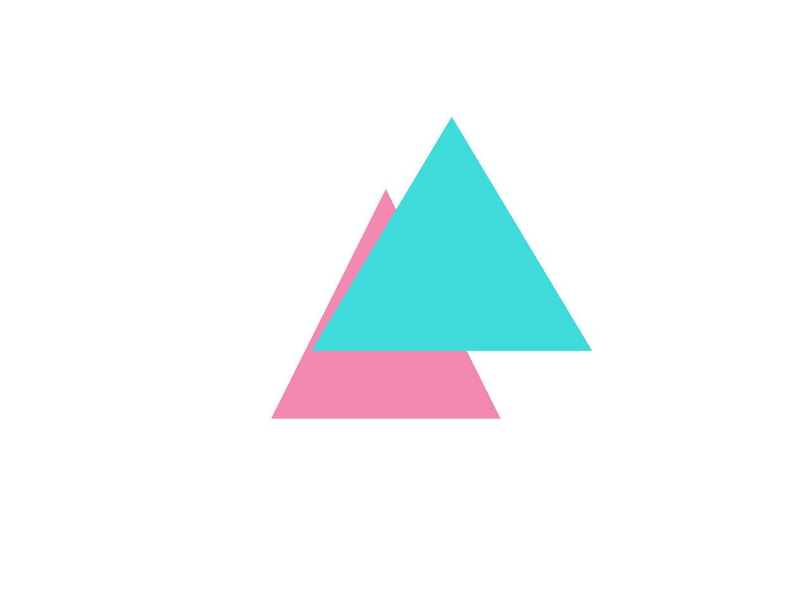
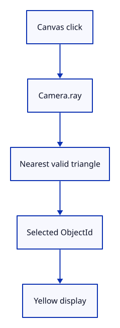

# 2.11.1 · Pick the nearest surface through the view

**Chapter 2 · Geometry, camera and selection · Section 2.11 · Nearest-surface picking** · [Contents](contents.md)

**Typing: 30–59 minutes.** [Estimate](typing-load.md).

Intersect the camera ray with each triangle. Keep the nearest hit inside the near-to-far segment and return its ObjectId.

## Type

Continue from [Turn a screen point into a bounded ray](14b-ray.md). [Save or recover your work](recovery.md).

### 1. `src/picking.rs`

Replace the flat coverage query with ray–triangle intersections and update the visibility tests for the new camera.

<details>
<summary>Locate the existing block</summary>

```rust
use crate::scene::{ObjectId, Scene};

pub fn pick(scene: &Scene, point: [f32; 2]) -> Option<ObjectId> {
    let mut nearest = 1.0;
    let mut hit = None;
    for object in scene.objects() {
        let vertices = object.mesh.vertices();
        for triangle in object.mesh.indices().chunks_exact(3) {
            let a = vertices[triangle[0] as usize];
            let b = vertices[triangle[1] as usize];
            let c = vertices[triangle[2] as usize];
            if let Some(depth) = triangle_depth(point, a, b, c) {
                if depth >= 0.0 && depth < nearest {
                    nearest = depth;
                    hit = Some(object.id);
                }
            }
        }
    }
    hit
}

fn triangle_depth(p: [f32; 2], a: [f32; 6], b: [f32; 6], c: [f32; 6]) -> Option<f32> {
    let cross = |u: [f32; 2], v: [f32; 2]| u[0] * v[1] - u[1] * v[0];
    let ab = [b[0] - a[0], b[1] - a[1]];
    let ac = [c[0] - a[0], c[1] - a[1]];
    let ap = [p[0] - a[0], p[1] - a[1]];
    let area = cross(ab, ac);
    if area.abs() < 1.0e-8 {
        return None;
    }
    let u = cross(ap, ac) / area;
    let v = cross(ab, ap) / area;
    if u >= 0.0 && v >= 0.0 && u + v <= 1.0 {
        Some((1.0 - u - v) * a[2] + u * b[2] + v * c[2])
    } else {
        None
    }
}

#[cfg(test)]
mod tests {
    use super::*;
    use crate::camera::Camera;

    #[test]
    fn overlap_chooses_the_visible_object_and_deletion_reveals_the_next() {
        let mut scene = Scene::demo();
        let near = scene.objects()[0].id;
        let far = scene.objects()[1].id;
        assert_eq!(pick(&scene, [0.0, 0.0]), Some(near));
        assert_eq!(pick(&scene, [0.4, 0.0]), Some(far));
        scene.remove(near);
        assert_eq!(pick(&scene, [0.0, 0.0]), Some(far));
        assert_eq!(pick(&scene, [-0.9, -0.9]), None);
    }

    #[test]
    fn picking_follows_a_panned_zoomed_and_rotated_camera() {
        let scene = Scene::demo();
        let mut camera = Camera::default();
        camera.pan(0.1, -0.2);
        camera.zoom(0.5);
        camera.rotate(0.7);
        let world = [0.4, 0.0];
        let m = camera.uniform();
        let screen = [m[0] * world[0] + m[4] * world[1] + m[12],
            m[1] * world[0] + m[5] * world[1] + m[13]];
        let restored = camera.world_from_screen(screen);
        assert!((restored[0] - world[0]).abs() < 1.0e-6);
        assert!((restored[1] - world[1]).abs() < 1.0e-6);
        assert_eq!(pick(&scene, restored), Some(scene.objects()[1].id));
    }

    #[test]
    fn an_edge_on_or_invalid_triangle_cannot_be_picked() {
        assert_eq!(triangle_depth([0.0, 0.0], [0.0; 6], [0.0; 6], [0.0; 6]), None);
        assert_eq!(pick(&Scene::demo(), [f32::NAN, 0.0]), None);
    }
}
```

</details>

Edit the existing block to match this code; keep unchanged lines:

```rust
--8<-- "journey/code/15-perspective-03.rs"
```

### 2. `src/lib.rs`

Register the camera-ray query now that its input is available.

<details>
<summary>Locate the existing block</summary>

```rust
pub mod scene;
```

</details>

After that block, type:

```rust
--8<-- "journey/code/15-perspective-picking-module.rs" skip=15
```

### 3. `src/browser.rs`

Convert a canvas click to a camera ray and highlight its nearest valid object. Report that perspective picking is ready.

Edit these blocks from bottom to top. Keep the surrounding lines unchanged.

<details>
<summary>Locate this block</summary>

```rust
    )?;
    // The page has one listener for its lifetime; JavaScript must retain the Rust callback.
    click.forget();
    report("Perspective drawing uses the current camera.");
    Ok(())
}
```

</details>

Replace it with:

```rust
    )?;
    // The page has one listener for its lifetime; JavaScript must retain the Rust callback.
    click.forget();
    report("Perspective and picking use the same camera.");
    Ok(())
}
```

<details>
<summary>Locate this block</summary>

```rust
        });
        if let Some(line) = line {
            match line.as_str() {
                "canvas" => return,
                "example triangle" => {
                    history.edit(&mut scene, Scene::toggle_extra);
                    selected = selected.filter(|id| scene.contains(*id));
```

</details>

Replace it with:

```rust
        });
        if let Some(line) = line {
            match line.as_str() {
                "canvas" => {
                    let Some(event) = event.dyn_ref::<web_sys::MouseEvent>() else {
                        return;
                    };
                    let rect = input_canvas.get_bounding_client_rect();
                    if rect.width() <= 0.0 || rect.height() <= 0.0 {
                        return;
                    }
                    let screen = [
                        (2.0 * (event.client_x() as f64 - rect.left()) / rect.width() - 1.0) as f32,
                        (1.0 - 2.0 * (event.client_y() as f64 - rect.top()) / rect.height()) as f32,
                    ];
                    selected = camera
                        .ray(screen)
                        .and_then(|ray| crate::picking::pick(&scene, &ray));
                    renderer.set_scene(&scene, selected);
                }
                "example triangle" => {
                    history.edit(&mut scene, Scene::toggle_extra);
                    selected = selected.filter(|id| scene.contains(*id));
```

<details>
<summary>Complete updated block reference</summary>

```rust
use crate::background::Background;
use crate::camera::Camera;
use crate::history::History;
use crate::renderer::Renderer;
use crate::scene::Scene;
use wasm_bindgen::{JsCast, JsValue, closure::Closure};

pub fn report(message: &str) {
    if let Some(document) = web_sys::window().and_then(|window| window.document()) {
        if let Some(status) = document.get_element_by_id("status") {
            status.set_text_content(Some(message));
            if message.starts_with("Cannot") { let _ = status.remove_attribute("hidden"); }
        }
    }
}

pub async fn run() -> Result<(), JsValue> {
    let window = web_sys::window().ok_or("No browser window")?;
    let document = window.document().ok_or("No document")?;
    let canvas: web_sys::HtmlCanvasElement = document
        .get_element_by_id("canvas")
        .ok_or("Missing canvas")?
        .dyn_into()?;
    let instance = wgpu::Instance::new(wgpu::InstanceDescriptor {
        backends: wgpu::Backends::BROWSER_WEBGPU,
        flags: Default::default(),
        memory_budget_thresholds: Default::default(),
        backend_options: Default::default(),
        display: None,
    });
    let surface = instance
        .create_surface(wgpu::SurfaceTarget::Canvas(canvas.clone()))
        .map_err(|error| JsValue::from_str(&error.to_string()))?;
    let adapter = instance
        .request_adapter(&wgpu::RequestAdapterOptions {
            compatible_surface: Some(&surface),
            ..Default::default()
        })
        .await
        .map_err(|error| JsValue::from_str(&error.to_string()))?;
    let (device, queue) = adapter
        .request_device(&wgpu::DeviceDescriptor::default())
        .await
        .map_err(|error| JsValue::from_str(&error.to_string()))?;
    device.on_uncaptured_error(std::sync::Arc::new(|error| report(&error.to_string())));
    let limit = device.limits().max_texture_dimension_2d;
    let width = (window.inner_width()?.as_f64().ok_or("No window width")? as u32).clamp(1, limit);
    let height = (window.inner_height()?.as_f64().ok_or("No window height")? as u32).clamp(1, limit);
    canvas.set_width(width);
    canvas.set_height(height);
    let mut config = surface
        .get_default_config(&adapter, width, height)
        .ok_or("No compatible surface format")?;
    config.view_formats = vec![config.format.add_srgb_suffix()];
    surface.configure(&device, &config);
    let mut scene = Scene::demo();
    let mut renderer = Renderer::new(device, queue, config.format.add_srgb_suffix(), &scene);
    renderer.resize(width, height);
    let mut panel = crate::panel::Panel::new(
        &renderer,
        config.format.add_srgb_suffix(),
        &[
            "Help",
            "Example Triangle",
            "Select Next",
            "Delete",
            "Undo",
            "Redo",
            "Background",
            "Zoom In",
            "Zoom Out",
            "Pan Left",
            "Pan Right",
            "Orbit Right",
            "View Reset",
        ],
    );
    panel.update(None, &canvas)?;
    let mut history = History::default();
    let mut selected = None;
    let mut background = Background::default();
    let mut camera = Camera { aspect: width as f64 / height as f64, ..Camera::default() };
    present(
        &surface,
        &renderer,
        &background,
        &camera.uniform(),
        &mut panel,
    )?;
    let input_canvas = canvas.clone();
    let click = Closure::<dyn FnMut(web_sys::Event)>::new(move |event: web_sys::Event| {
        let line = match panel.update(Some(&event), &input_canvas) {
            Ok(line) => line,
            Err(error) => {
                report(&format!("Cannot read command: {error:?}"));
                return;
            }
        };

        let line = line.or_else(|| {
            let mouse = event.dyn_ref::<web_sys::MouseEvent>()?;
            (event.type_() == "click"
                && !panel.consumed
                && mouse
                    .target()
                    .and_then(|target| target.dyn_into::<web_sys::Element>().ok())
                    .is_some_and(|target| target.id() == "canvas"))
            .then(|| "canvas".into())
        });
        if let Some(line) = line {
            match line.as_str() {
                "canvas" => {
                    let Some(event) = event.dyn_ref::<web_sys::MouseEvent>() else {
                        return;
                    };
                    let rect = input_canvas.get_bounding_client_rect();
                    if rect.width() <= 0.0 || rect.height() <= 0.0 {
                        return;
                    }
                    let screen = [
                        (2.0 * (event.client_x() as f64 - rect.left()) / rect.width() - 1.0) as f32,
                        (1.0 - 2.0 * (event.client_y() as f64 - rect.top()) / rect.height()) as f32,
                    ];
                    selected = camera
                        .ray(screen)
                        .and_then(|ray| crate::picking::pick(&scene, &ray));
                    renderer.set_scene(&scene, selected);
                }
                "example triangle" => {
                    history.edit(&mut scene, Scene::toggle_extra);
                    selected = selected.filter(|id| scene.contains(*id));
                    renderer.set_scene(&scene, selected);
                }
                "select next" => {
                    selected = scene.next(selected);
                    renderer.set_scene(&scene, selected);
                }
                "delete" => {
                    if let Some(id) = selected.take() {
                        history.edit(&mut scene, |scene| {
                            scene.remove(id);
                        });
                        renderer.set_scene(&scene, selected);
                    }
                }
                "undo" | "redo" => {
                    if line == "undo" {
                        history.undo(&mut scene);
                    } else {
                        history.redo(&mut scene);
                    }
                    selected = selected.filter(|id| scene.contains(*id));
                    renderer.set_scene(&scene, selected);
                }
                "background" => background.toggle(),
                "zoom in" => camera.zoom(2.0),
                "zoom out" => camera.zoom(0.5),
                "pan left" => camera.pan(-0.25, 0.0),
                "pan right" => camera.pan(0.25, 0.0),
                "orbit right" => camera.rotate(std::f32::consts::FRAC_PI_4),
                "view reset" => camera = Camera { aspect: camera.aspect, ..Camera::default() },
                _ => return,
            }
        }
        if let Err(error) = panel.update(None, &input_canvas) {
            report(&format!("Cannot lay out commands: {error:?}"));
            return;
        }
        if let Err(error) = present(
            &surface,
            &renderer,
            &background,
            &camera.uniform(),
            &mut panel,
        ) {
            report(&format!("Cannot redraw: {error:?}"));
        }
    });
    for name in [
        "pointerdown",
        "pointermove",
        "pointerup",
        "pointercancel",
        "lostpointercapture",
        "contextmenu",
        "keydown",
        "keyup",
        "blur",
        "click",
    ] {
        canvas.add_event_listener_with_callback(name, click.as_ref().unchecked_ref())?;
    }
    let options = web_sys::AddEventListenerOptions::new();
    options.set_passive(false);
    canvas.add_event_listener_with_callback_and_add_event_listener_options(
        "wheel",
        click.as_ref().unchecked_ref(),
        &options,
    )?;
    // The page has one listener for its lifetime; JavaScript must retain the Rust callback.
    click.forget();
    report("Perspective and picking use the same camera.");
    Ok(())
}

fn present(
    surface: &wgpu::Surface<'_>,
    renderer: &Renderer,
    background: &Background,
    transform: &[f32; 16],
    panel: &mut crate::panel::Panel,
) -> Result<(), JsValue> {
    let frame = match surface.get_current_texture() {
        wgpu::CurrentSurfaceTexture::Success(frame)
        | wgpu::CurrentSurfaceTexture::Suboptimal(frame) => frame,
        other => {
            return Err(JsValue::from_str(&format!(
                "Surface unavailable: {other:?}"
            )));
        }
    };
    let view = frame.texture.create_view(&wgpu::TextureViewDescriptor {
        format: Some(frame.texture.format().add_srgb_suffix()),
        ..Default::default()
    });
    renderer.draw(&view, background, transform);
    panel.draw(renderer, &view);
    frame.present();
    Ok(())
}
```

</details>

<details>
<summary>Optional patch references</summary>

Use these original edit fragments when comparing a saved checkpoint. Apply the complete blocks above.

```text
--8<-- "journey/code/15-perspective-canvas-ray.rs"
```

```text
--8<-- "journey/code/15-perspective-status.rs"
```

</details>

## Run and check

In your project:

```sh
cd workspace/journey
REGEN_PROTO=0 cargo build --lib --locked --target wasm32-unknown-unknown -j1
REGEN_PROTO=0 CARGO_BUILD_JOBS=1 trunk serve --port 8780
```

Open `http://127.0.0.1:8780/`. Keep an existing Trunk server running; saving rebuilds it.

Click the overlap. The turquoise triangle becomes yellow.

### Recorded visual result

**Previous native render — current verification pending.**

This checkpoint was rendered independently and has the same native comparison frame as [Turn a screen point into a bounded ray](14b-ray.md). Use its state checks and browser exercise to assess the changed behavior.



*This recorded image predates a source or checker change. Rebuild this checkpoint before using it as current evidence; browser controls require separate acceptance.*

This reference image is shared with [2.10.2 · Draw through a perspective camera](14a-perspective.md). It does not demonstrate a new feature by itself.

<details>
<summary>Code explanation and diagram</summary>

The barycentric values u and v test triangle coverage. The browser converts a canvas click to a ray, stores the selected ID, then uploads its yellow display colour.

Canvas click → Camera::ray → nearest valid triangle → ObjectId → yellow display.



Why compare ray distances rather than world z?

The camera can pan, rotate and zoom. Distance along its ray describes which valid surface the viewer sees first. World z alone does not.

Study estimate, including typing and experiments: 1–1.5 hours.

</details>

<details>
<summary>Optional experiment</summary>

Type Zoom In, select the overlap, then Delete and Undo. Picking should follow the camera and history should restore the same object.

</details>

<details>
<summary>Check and save your work</summary>

Restore experimental edits, then run from `session_viewer`:

```sh
npm --prefix ../session_tests run course -- check 2.11.1
npm --prefix ../session_tests run course -- save 2.11.1
```

Source comparison leaves your project untouched. [Save and recovery instructions](recovery.md).

</details>

<details>
<summary>Viewer coverage and verification</summary>

The full viewer uses this same geometry kernel, view-projection boundary and identity resolution. Its later camera adds world-up orbit, units, fit, floating origins and reversed depth for large scenes; those are extensions of the responsibilities introduced here.


[Full validation scope](release.md).

To reproduce the scripted acceptance of the reference checkpoint, run from `session_viewer` with the [course bundle server](release.md#reproduce) running on port 8781:

```sh
npm --prefix ../session_tests run course -- capture 2.11.1
```

This uses the verified reference bundle; it does not check or change your typed project.

</details>
