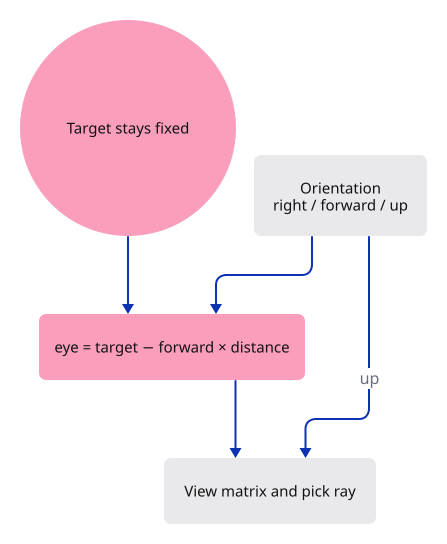

# 2.12.1 · Walk around the model

**Chapter 2 · Geometry, camera and selection · Section 2.12 · Orbit navigation** · [Contents](contents.md)

**Typing: 28–56 minutes.** [Estimate](typing-load.md).

Orbit around a fixed target. Camera orientation determines its right, up and forward directions; viewing distance places the eye behind the target.

## Type

Continue from [Pick the nearest surface through the view](15-perspective.md). [Save or recover your work](recovery.md).

### 1. `src/camera.rs`

Use the kernel’s rotation representation alongside its points, vectors and matrices. Store a 3D target and orientation instead of a flat centre and one angle. Keep the same initial eye and up directions as the perspective lesson. Move the target in the camera’s current right/up plane, including its world-z component. Add world-up orbit and a named pose. Keep rotate as the existing Turn view action. Calculate eye and up from the orientation, then reuse the existing view and projection construction. Extend the target-centering test to include a 3D orbit. Check the rotation invariant after many small updates, not just one convenient angle.

<details>
<summary>Locate the existing block</summary>

```rust
use session_rust::{Point, Vector, Xform};

pub struct Ray {
    pub origin: Point,
    pub direction: Vector,
    pub max_distance: f64,
}

pub struct Camera {
    pub center: [f64; 2],
    pub distance: f64,
    pub angle: f64,
    pub aspect: f64,
}

impl Default for Camera {
    fn default() -> Self {
        Self { center: [0.0, 0.0], distance: 3.0, angle: 0.0, aspect: 640.0 / 480.0 }
    }
}

impl Camera {
    pub fn pan(&mut self, dx: f32, dy: f32) {
        let (sin, cos) = self.angle.sin_cos();
        self.center[0] += dx as f64 * cos - dy as f64 * sin;
        self.center[1] += dx as f64 * sin + dy as f64 * cos;
    }

    pub fn zoom(&mut self, factor: f32) {
        if factor.is_finite() && factor > 0.0 {
            self.distance = (self.distance / factor as f64).clamp(0.2, 50.0);
        }
    }

    pub fn rotate(&mut self, radians: f32) {
        self.angle += radians as f64;
    }

    pub fn view_projection(&self) -> Xform {
        let eye = Point::new(self.center[0], self.center[1], self.distance);
        let target = Point::new(self.center[0], self.center[1], 0.0);
        let (sin, cos) = self.angle.sin_cos();
        let up = Vector::new(-sin, cos, 0.0);
        let view = Xform::look_at_right_handed(&eye, &target, &up);
        let projection = Xform::perspective(60.0_f64.to_radians(), self.aspect, 0.01, 100.0);
        projection * view
    }

    pub fn uniform(&self) -> [f32; 16] {
        self.view_projection().to_f32()
    }

    pub fn ray(&self, screen: [f32; 2]) -> Option<Ray> {
        if screen.iter().any(|value| !value.is_finite() || value.abs() > 1.0) {
            return None;
        }
        let inverse = self.view_projection().inverse()?;
        let origin = inverse.transform_point(&Point::new(screen[0] as f64, screen[1] as f64, 0.0));
        let end = inverse.transform_point(&Point::new(screen[0] as f64, screen[1] as f64, 1.0));
        let delta = &end - &origin;
        let max_distance = delta.magnitude();
        if !max_distance.is_finite() || max_distance <= 0.0 {
            return None;
        }
        Some(Ray { origin, direction: delta.normalized(), max_distance })
    }
}

#[cfg(test)]
mod tests {
    use super::*;

    #[test]
    fn the_target_stays_centred_after_pan_zoom_and_turn() {
        let mut camera = Camera::default();
        camera.pan(0.25, -0.5);
        camera.zoom(2.0);
        camera.rotate(0.7);
        let target = Point::new(camera.center[0], camera.center[1], 0.0);
        let screen = camera.view_projection().transform_point(&target);
        assert!(screen[0].abs() < 1.0e-9 && screen[1].abs() < 1.0e-9);
        assert!((0.0..1.0).contains(&screen[2]));
    }

    #[test]
    fn a_projected_point_lies_on_its_unprojected_ray() {
        let camera = Camera::default();
        let world = Point::new(0.4, 0.2, 0.75);
        let screen = camera.view_projection().transform_point(&world);
        let ray = camera.ray([screen[0] as f32, screen[1] as f32]).unwrap();
        let offset = &world - &ray.origin;
        assert!(offset.cross(&ray.direction).magnitude() < 1.0e-6);
        assert!(offset.dot(&ray.direction) > 0.0);
        assert!(offset.magnitude() < ray.max_distance);
        assert!(camera.ray([f32::NAN, 0.0]).is_none());
    }
}
```

</details>

Edit the existing block to match this code; keep unchanged lines:

```rust
use session_rust::{Point, Quaternion, Vector, Xform};

pub struct Ray {
    pub origin: Point,
    pub direction: Vector,
    pub max_distance: f64,
}

pub struct Camera {
    pub target: [f64; 3],
    pub distance: f64,
    pub orientation: Quaternion,
    pub aspect: f64,
}

impl Default for Camera {
    fn default() -> Self {
        Self {
            target: [0.0; 3],
            distance: 3.0,
            orientation: Quaternion::from_axis_angle(Vector::x_axis(), -std::f64::consts::FRAC_PI_2),
            aspect: 640.0 / 480.0,
        }
    }
}

impl Camera {
    pub fn pan(&mut self, dx: f32, dy: f32) {
        let right = self.orientation.rotate_vector(Vector::x_axis());
        let up = self.orientation.rotate_vector(Vector::z_axis());
        for i in 0..3 {
            self.target[i] += dx as f64 * right[i] + dy as f64 * up[i];
        }
    }

    pub fn zoom(&mut self, factor: f32) {
        if factor.is_finite() && factor > 0.0 {
            self.distance = (self.distance / factor as f64).clamp(0.2, 50.0);
        }
    }

    pub fn rotate(&mut self, radians: f32) {
        self.orbit(radians as f64, 0.0);
    }

    pub fn orbit(&mut self, yaw: f64, pitch: f64) {
        let right = self.orientation.rotate_vector(Vector::x_axis());
        let turn = Quaternion::from_axis_angle(Vector::z_axis(), yaw);
        let tilt = Quaternion::from_axis_angle(right, pitch);
        self.orientation = (turn * (tilt * self.orientation.duplicate())).normalized();
    }

    pub fn isometric(&mut self) {
        let turn = Quaternion::from_axis_angle(Vector::z_axis(), -std::f64::consts::FRAC_PI_6);
        let right = turn.rotate_vector(Vector::x_axis());
        let tilt = Quaternion::from_axis_angle(right, -std::f64::consts::FRAC_PI_6);
        self.orientation = (tilt * turn).normalized();
    }

    pub fn view_projection(&self) -> Xform {
        let forward = self.orientation.rotate_vector(Vector::y_axis());
        let up = self.orientation.rotate_vector(Vector::z_axis());
        let target = Point::new(self.target[0], self.target[1], self.target[2]);
        let eye = Point::new(
            self.target[0] - forward[0] * self.distance,
            self.target[1] - forward[1] * self.distance,
            self.target[2] - forward[2] * self.distance,
        );
        let view = Xform::look_at_right_handed(&eye, &target, &up);
        let projection = Xform::perspective(60.0_f64.to_radians(), self.aspect, 0.01, 100.0);
        projection * view
    }

    pub fn uniform(&self) -> [f32; 16] {
        self.view_projection().to_f32()
    }

    pub fn ray(&self, screen: [f32; 2]) -> Option<Ray> {
        if screen.iter().any(|value| !value.is_finite() || value.abs() > 1.0) {
            return None;
        }
        let inverse = self.view_projection().inverse()?;
        let origin = inverse.transform_point(&Point::new(screen[0] as f64, screen[1] as f64, 0.0));
        let end = inverse.transform_point(&Point::new(screen[0] as f64, screen[1] as f64, 1.0));
        let delta = &end - &origin;
        let max_distance = delta.magnitude();
        if !max_distance.is_finite() || max_distance <= 0.0 {
            return None;
        }
        Some(Ray { origin, direction: delta.normalized(), max_distance })
    }
}

#[cfg(test)]
mod tests {
    use super::*;

    #[test]
    fn the_target_stays_centred_after_pan_zoom_and_turn() {
        let mut camera = Camera::default();
        camera.pan(0.25, -0.5);
        camera.zoom(2.0);
        camera.rotate(0.7);
        camera.orbit(0.3, 0.2);
        let target = Point::new(camera.target[0], camera.target[1], camera.target[2]);
        let screen = camera.view_projection().transform_point(&target);
        assert!(screen[0].abs() < 1.0e-9 && screen[1].abs() < 1.0e-9);
        assert!((0.0..1.0).contains(&screen[2]));
    }

    #[test]
    fn repeated_orbit_keeps_the_camera_axes_orthonormal() {
        let mut camera = Camera::default();
        for _ in 0..1_000 {
            camera.orbit(0.01, 0.02);
        }
        let right = camera.orientation.rotate_vector(Vector::x_axis());
        let forward = camera.orientation.rotate_vector(Vector::y_axis());
        let up = camera.orientation.rotate_vector(Vector::z_axis());
        for axis in [&right, &forward, &up] {
            assert!((axis.magnitude() - 1.0).abs() < 1.0e-10);
        }
        assert!(right.dot(&forward).abs() < 1.0e-10);
        assert!(right.dot(&up).abs() < 1.0e-10);
        assert!(forward.dot(&up).abs() < 1.0e-10);
    }

    #[test]
    fn a_projected_point_lies_on_its_unprojected_ray() {
        let camera = Camera::default();
        let world = Point::new(0.4, 0.2, 0.75);
        let screen = camera.view_projection().transform_point(&world);
        let ray = camera.ray([screen[0] as f32, screen[1] as f32]).unwrap();
        let offset = &world - &ray.origin;
        assert!(offset.cross(&ray.direction).magnitude() < 1.0e-6);
        assert!(offset.dot(&ray.direction) > 0.0);
        assert!(offset.magnitude() < ray.max_distance);
        assert!(camera.ray([f32::NAN, 0.0]).is_none());
    }
}
```

<details>
<summary>Optional patch references</summary>

Use these original edit fragments when comparing a saved checkpoint. Apply the complete blocks above.

```text
--8<-- "journey/code/16-orbit-01.rs"
```

```text
--8<-- "journey/code/16-orbit-02.rs"
```

```text
--8<-- "journey/code/16-orbit-03.rs"
```

```text
--8<-- "journey/code/16-orbit-04.rs"
```

```text
--8<-- "journey/code/16-orbit-05.rs"
```

```text
--8<-- "journey/code/16-orbit-06.rs"
```

```text
--8<-- "journey/code/16-orbit-07.rs"
```

```text
--8<-- "journey/code/16-orbit-08.rs"
```

</details>

### 2. `src/browser.rs`

Add vertical orbit and isometric commands. Apply vertical orbit or the isometric orientation. Report that orbit preserves the target.

Edit these blocks from bottom to top. Keep the surrounding lines unchanged.

<details>
<summary>Locate this block</summary>

```rust
    )?;
    // The page has one listener for its lifetime; JavaScript must retain the Rust callback.
    click.forget();
    report("Perspective and picking use the same camera.");
    Ok(())
}
```

</details>

Replace it with:

```rust
    )?;
    // The page has one listener for its lifetime; JavaScript must retain the Rust callback.
    click.forget();
    report("Orbit moves the eye around a fixed target.");
    Ok(())
}
```

<details>
<summary>Locate this block</summary>

```rust
                "pan left" => camera.pan(-0.25, 0.0),
                "pan right" => camera.pan(0.25, 0.0),
                "orbit right" => camera.rotate(std::f32::consts::FRAC_PI_4),
                "view reset" => camera = Camera { aspect: camera.aspect, ..Camera::default() },
                _ => return,
            }
```

</details>

Replace it with:

```rust
                "pan left" => camera.pan(-0.25, 0.0),
                "pan right" => camera.pan(0.25, 0.0),
                "orbit right" => camera.rotate(std::f32::consts::FRAC_PI_4),
                "orbit up" => camera.orbit(0.0, std::f64::consts::FRAC_PI_6),
                "view isometric" => camera.isometric(),
                "view reset" => camera = Camera { aspect: camera.aspect, ..Camera::default() },
                _ => return,
            }
```

<details>
<summary>Locate this block</summary>

```rust
            "Pan Left",
            "Pan Right",
            "Orbit Right",
            "View Reset",
        ],
    );
```

</details>

Replace it with:

```rust
            "Pan Left",
            "Pan Right",
            "Orbit Right",
            "Orbit Up",
            "View Isometric",
            "View Reset",
        ],
    );
```

<details>
<summary>Complete updated block reference</summary>

```rust
use crate::background::Background;
use crate::camera::Camera;
use crate::history::History;
use crate::renderer::Renderer;
use crate::scene::Scene;
use wasm_bindgen::{JsCast, JsValue, closure::Closure};

pub fn report(message: &str) {
    if let Some(document) = web_sys::window().and_then(|window| window.document()) {
        if let Some(status) = document.get_element_by_id("status") {
            status.set_text_content(Some(message));
            if message.starts_with("Cannot") { let _ = status.remove_attribute("hidden"); }
        }
    }
}

pub async fn run() -> Result<(), JsValue> {
    let window = web_sys::window().ok_or("No browser window")?;
    let document = window.document().ok_or("No document")?;
    let canvas: web_sys::HtmlCanvasElement = document
        .get_element_by_id("canvas")
        .ok_or("Missing canvas")?
        .dyn_into()?;
    let instance = wgpu::Instance::new(wgpu::InstanceDescriptor {
        backends: wgpu::Backends::BROWSER_WEBGPU,
        flags: Default::default(),
        memory_budget_thresholds: Default::default(),
        backend_options: Default::default(),
        display: None,
    });
    let surface = instance
        .create_surface(wgpu::SurfaceTarget::Canvas(canvas.clone()))
        .map_err(|error| JsValue::from_str(&error.to_string()))?;
    let adapter = instance
        .request_adapter(&wgpu::RequestAdapterOptions {
            compatible_surface: Some(&surface),
            ..Default::default()
        })
        .await
        .map_err(|error| JsValue::from_str(&error.to_string()))?;
    let (device, queue) = adapter
        .request_device(&wgpu::DeviceDescriptor::default())
        .await
        .map_err(|error| JsValue::from_str(&error.to_string()))?;
    device.on_uncaptured_error(std::sync::Arc::new(|error| report(&error.to_string())));
    let limit = device.limits().max_texture_dimension_2d;
    let width = (window.inner_width()?.as_f64().ok_or("No window width")? as u32).clamp(1, limit);
    let height = (window.inner_height()?.as_f64().ok_or("No window height")? as u32).clamp(1, limit);
    canvas.set_width(width);
    canvas.set_height(height);
    let mut config = surface
        .get_default_config(&adapter, width, height)
        .ok_or("No compatible surface format")?;
    config.view_formats = vec![config.format.add_srgb_suffix()];
    surface.configure(&device, &config);
    let mut scene = Scene::demo();
    let mut renderer = Renderer::new(device, queue, config.format.add_srgb_suffix(), &scene);
    renderer.resize(width, height);
    let mut panel = crate::panel::Panel::new(
        &renderer,
        config.format.add_srgb_suffix(),
        &[
            "Help",
            "Example Triangle",
            "Select Next",
            "Delete",
            "Undo",
            "Redo",
            "Background",
            "Zoom In",
            "Zoom Out",
            "Pan Left",
            "Pan Right",
            "Orbit Right",
            "Orbit Up",
            "View Isometric",
            "View Reset",
        ],
    );
    panel.update(None, &canvas)?;
    let mut history = History::default();
    let mut selected = None;
    let mut background = Background::default();
    let mut camera = Camera { aspect: width as f64 / height as f64, ..Camera::default() };
    present(
        &surface,
        &renderer,
        &background,
        &camera.uniform(),
        &mut panel,
    )?;
    let input_canvas = canvas.clone();
    let click = Closure::<dyn FnMut(web_sys::Event)>::new(move |event: web_sys::Event| {
        let line = match panel.update(Some(&event), &input_canvas) {
            Ok(line) => line,
            Err(error) => {
                report(&format!("Cannot read command: {error:?}"));
                return;
            }
        };

        let line = line.or_else(|| {
            let mouse = event.dyn_ref::<web_sys::MouseEvent>()?;
            (event.type_() == "click"
                && !panel.consumed
                && mouse
                    .target()
                    .and_then(|target| target.dyn_into::<web_sys::Element>().ok())
                    .is_some_and(|target| target.id() == "canvas"))
            .then(|| "canvas".into())
        });
        if let Some(line) = line {
            match line.as_str() {
                "canvas" => {
                    let Some(event) = event.dyn_ref::<web_sys::MouseEvent>() else {
                        return;
                    };
                    let rect = input_canvas.get_bounding_client_rect();
                    if rect.width() <= 0.0 || rect.height() <= 0.0 {
                        return;
                    }
                    let screen = [
                        (2.0 * (event.client_x() as f64 - rect.left()) / rect.width() - 1.0) as f32,
                        (1.0 - 2.0 * (event.client_y() as f64 - rect.top()) / rect.height()) as f32,
                    ];
                    selected = camera
                        .ray(screen)
                        .and_then(|ray| crate::picking::pick(&scene, &ray));
                    renderer.set_scene(&scene, selected);
                }
                "example triangle" => {
                    history.edit(&mut scene, Scene::toggle_extra);
                    selected = selected.filter(|id| scene.contains(*id));
                    renderer.set_scene(&scene, selected);
                }
                "select next" => {
                    selected = scene.next(selected);
                    renderer.set_scene(&scene, selected);
                }
                "delete" => {
                    if let Some(id) = selected.take() {
                        history.edit(&mut scene, |scene| {
                            scene.remove(id);
                        });
                        renderer.set_scene(&scene, selected);
                    }
                }
                "undo" | "redo" => {
                    if line == "undo" {
                        history.undo(&mut scene);
                    } else {
                        history.redo(&mut scene);
                    }
                    selected = selected.filter(|id| scene.contains(*id));
                    renderer.set_scene(&scene, selected);
                }
                "background" => background.toggle(),
                "zoom in" => camera.zoom(2.0),
                "zoom out" => camera.zoom(0.5),
                "pan left" => camera.pan(-0.25, 0.0),
                "pan right" => camera.pan(0.25, 0.0),
                "orbit right" => camera.rotate(std::f32::consts::FRAC_PI_4),
                "orbit up" => camera.orbit(0.0, std::f64::consts::FRAC_PI_6),
                "view isometric" => camera.isometric(),
                "view reset" => camera = Camera { aspect: camera.aspect, ..Camera::default() },
                _ => return,
            }
        }
        if let Err(error) = panel.update(None, &input_canvas) {
            report(&format!("Cannot lay out commands: {error:?}"));
            return;
        }
        if let Err(error) = present(
            &surface,
            &renderer,
            &background,
            &camera.uniform(),
            &mut panel,
        ) {
            report(&format!("Cannot redraw: {error:?}"));
        }
    });
    for name in [
        "pointerdown",
        "pointermove",
        "pointerup",
        "pointercancel",
        "lostpointercapture",
        "contextmenu",
        "keydown",
        "keyup",
        "blur",
        "click",
    ] {
        canvas.add_event_listener_with_callback(name, click.as_ref().unchecked_ref())?;
    }
    let options = web_sys::AddEventListenerOptions::new();
    options.set_passive(false);
    canvas.add_event_listener_with_callback_and_add_event_listener_options(
        "wheel",
        click.as_ref().unchecked_ref(),
        &options,
    )?;
    // The page has one listener for its lifetime; JavaScript must retain the Rust callback.
    click.forget();
    report("Orbit moves the eye around a fixed target.");
    Ok(())
}

fn present(
    surface: &wgpu::Surface<'_>,
    renderer: &Renderer,
    background: &Background,
    transform: &[f32; 16],
    panel: &mut crate::panel::Panel,
) -> Result<(), JsValue> {
    let frame = match surface.get_current_texture() {
        wgpu::CurrentSurfaceTexture::Success(frame)
        | wgpu::CurrentSurfaceTexture::Suboptimal(frame) => frame,
        other => {
            return Err(JsValue::from_str(&format!(
                "Surface unavailable: {other:?}"
            )));
        }
    };
    let view = frame.texture.create_view(&wgpu::TextureViewDescriptor {
        format: Some(frame.texture.format().add_srgb_suffix()),
        ..Default::default()
    });
    renderer.draw(&view, background, transform);
    panel.draw(renderer, &view);
    frame.present();
    Ok(())
}
```

</details>

<details>
<summary>Optional patch references</summary>

Use these original edit fragments when comparing a saved checkpoint. Apply the complete blocks above.

```text
--8<-- "journey/code/16-orbit-window-1.rs"
```

```text
--8<-- "journey/code/16-orbit-window-2.rs"
```

```text
--8<-- "journey/code/16-orbit-window-3.rs"
```

</details>

## Run and check

In your project:

```sh
cd workspace/journey
REGEN_PROTO=0 cargo build --lib --locked --target wasm32-unknown-unknown -j1
REGEN_PROTO=0 CARGO_BUILD_JOBS=1 trunk serve --port 8780
```

Open `http://127.0.0.1:8780/`. Keep an existing Trunk server running; saving rebuilds it.

Type `View Isometric`, then `Orbit Right`. The eye moves around the same target. Click a visible face to confirm picking still agrees with the new view.

### Recorded visual result

**Previous native render — current verification pending.**

Look at the overlap: the pink triangle now covers the centre while the cyan triangle sits above it. The helper sets the camera to Isometric and checks the centre pixel against picking. This image shows the camera pose, not a mouse gesture.


*This recorded image predates a source or checker change. Rebuild this checkpoint before using it as current evidence; browser controls require separate acceptance.*

<details>
<summary>Code explanation and diagram</summary>

Use the kernel's quaternion to represent orientation. Rotate sideways around world z and tilt around the camera's current right axis. In `yaw × (pitch × orientation)`, the existing orientation is followed by tilt, then yaw. Order matters.

Normalise after updates to keep a pure rotation. The repeated-turn test checks that the resulting axes remain unit length and perpendicular.

Isometric changes orientation while retaining target and distance. Drawing and picking consume the same updated camera matrix. The scene, history and selection keep their existing owners.

View action → orientation quaternion → eye and up vectors → view-projection matrix → drawing and pick ray.



Which camera value should stay fixed while you orbit around the model?

The target stays fixed. Orientation changes the direction from the eye toward that target, and distance controls how far the eye is from it. Recomputing eye = target − forward × distance moves the eye around the target without editing any mesh positions.

Study estimate, including typing and experiments: 2–4 hours.

</details>

<details>
<summary>Optional experiment</summary>

Type `View Isometric` and press Enter, pan, then tilt. Predict whether the point at the screen centre will stay centred during the tilt. It should: pan chose a new target, and orbit keeps that target fixed. Delete a selected surface and undo; the camera should keep its current orientation.

</details>

<details>
<summary>Check and save your work</summary>

Restore experimental edits, then run from `session_viewer`:

```sh
npm --prefix ../session_tests run course -- check 2.12.1
npm --prefix ../session_tests run course -- save 2.12.1
```

Source comparison leaves your project untouched. [Save and recovery instructions](recovery.md).

</details>

<details>
<summary>Viewer coverage and verification</summary>

The maintained camera uses target, distance, orientation and world-up in the same way. Later gesture lessons turn pointer deltas into these operations; unit conversion, fit-to-scene and large-coordinate precision extend the camera without moving source geometry.

Look at the two triangles from Isometric: the changed overlap comes from the camera, not edited vertex positions.

[Full validation scope](release.md).

</details>
