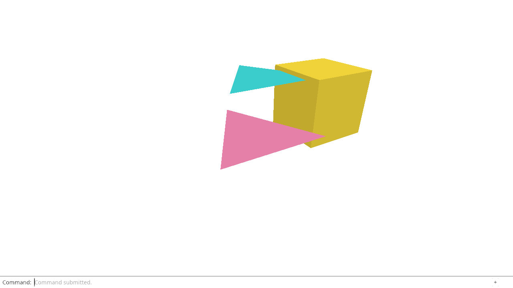

# Kernel geometry and one editor

<a id="checkpoint-17-solid"></a>
<a id="checkpoint-18-light"></a>
<a id="checkpoint-18a-editor"></a>
<a id="checkpoint-18b-actions"></a>
<a id="checkpoint-19-actions"></a>

Create a kernel box, shade its faces and route commands through one editor that keeps document history separate from camera navigation.

## Prerequisites and ownership

Complete [Select, navigate and undo](12-identity.md). You need stable object IDs, shared meshes, camera projection, picking, the command dock and reversible scene snapshots. This checkpoint combines kernel conversion, flat lighting and the editor's action boundary because the browser must publish the result of each completed action consistently.

This subject owns `src/mesh.rs`, `src/scene.rs`, `src/browser.rs`, `src/triangle.wgsl` and `src/editor.rs`, and registers the editor in `src/lib.rs`.

## Build

Keep the previous project's dependencies, GPU resource owner, camera and picking code. Type the seven complete files below in the same project.

### Validate the kernel's display data

```rust
--8<-- "journey/code/17-editor-1.rs"
```

`Mesh::from_kernel` asks the kernel for its render representation. Each display vertex carries a position and colour. The adapter checks every converted index fits this checkpoint's 16-bit index format, then `Mesh::new` checks complete triangles, valid references and finite vertex values. Failure returns before any object enters the scene or any GPU buffer is uploaded.

The kernel box in this checkpoint yields eight shared corners and twelve triangles. It does not supply one independent normal per corner face. The fragment shader below derives flat face directions from the interpolated world position.

### Insert one placed object

```rust
--8<-- "journey/code/17-editor-2.rs"
```

`Scene::add_box` creates a box with side lengths `0.8`, translates its kernel coordinates by `(0.9, 0, 0.4)`, assigns grey object colour and converts it before calling `insert`. The scene gives it one stable identity and stores the immutable display mesh behind `Rc`. Selection continues to use identities rather than vector offsets.

### Keep failed edits out of history

Use the completed [snapshot transaction](12-identity.md) when an editor action can fail. `try_edit` rolls back partial scene mutations without consuming redo; the editor supplies the action. GPU allocation stays outside the transaction: the browser uploads only after a successful action.

### Shade in world coordinates

```wgsl
--8<-- "journey/code/17-editor-5.wgsl"
```

The vertex stage sends world position to the fragment stage as well as projecting it. `dpdx` and `dpdy` describe the change in that position across neighbouring fragments. Their cross product gives a surface direction; normalization gives a unit normal.

The fixed light direction and normal both use world coordinates. Their dot product determines brightness. `abs` lights both sides of an open face, and the `0.3` base term keeps faces readable. Orbiting changes the view without rotating this light. This checkpoint teaches flat diffuse shading; the production viewer's other surface and ink lanes still require their owning subjects.

### Apply actions through one owner

```rust
--8<-- "journey/code/17-editor-6.rs"
```

`Editor` owns scene, selected identity, camera, background and history. `Action` describes intent without a browser event or GPU handle. Document actions use history, selection actions change the selected identity, and view actions update the camera or background. After deletion or undo, one shared repair step drops a selected ID that no longer exists.

`Change::View` requests a redraw with existing display geometry. `Change::Scene` requests a display upload. That second result does not necessarily mean the document changed: picking changes selected colours, so it also needs the scene display refreshed. The action decides whether to create a history transaction; the return value tells the renderer what to synchronize.

Resetting the view retains its current aspect ratio. Undo and redo restore document snapshots without rewinding camera navigation or background settings.

### Connect browser input and rendering

```rust
--8<-- "journey/code/17-editor-4.rs"
```

The browser adapter translates dock commands and canvas input into actions, calls `Editor::apply`, and reports an error before attempting a display upload. On `Change::Scene` it synchronizes the renderer from the editor's scene and selection. Both change kinds then draw through the same current camera and background. The editor itself never submits GPU commands.

```rust
--8<-- "journey/code/17-editor-7.rs"
```

The module declaration registers the editor in this crate. It does not create a second application or a second document owner.

## Run and observe

From `session_viewer`, check your handwritten project with `npm --prefix ../session_tests run course -- check 17-solid`. Use the [guarded build instructions](../maintaining.md) to build and serve it with the shared Cargo cache. The automated checkpoint command is `npm --prefix ../session_tests run course -- verify 17-solid`; it also requires the repository's storage and build guards.

Type `Example Box`, then `View Isometric`. A shaded grey solid appears behind the two triangles. Run `Select Next` three times: the box becomes yellow. `Undo` removes that box, and `Redo` restores it. Pan the view between those commands; history must leave that view in place.



[Upright input check and its cropped view](../screenshots/journey/runtime-20261114/17-solid-upright.png) ? [Native WARP frame](../screenshots/journey/runtime-20261114/17-solid-native.png)

This retained image illustrates the historical endpoint. It is not fresh acceptance of the consolidated checkpoint.

## Predict and try

Add a box, pan the camera, then undo and redo. Predict the object count, selected identity and camera position after each action. A deleted selection is cleared; the camera remains where you moved it.

In the rollback test, first create an available redo branch, then run an action that removes an object before returning an error. Predict whether redo remains available. The failed edit restores the scene and retains that branch.

Change the shader's light direction to the positive world z axis. Predict the top face becoming brighter and the vertical faces sharing the base brightness. Restore the original direction after checking; no vertex position needs to change.

## Question and answer

Why can picking return `Change::Scene` without creating an undo transaction?

Selection changes display colour, so it needs a GPU display update. It does not change the retained document geometry. The editor keeps those two decisions separate.

## Validation

The checkpoint passes 19 native library tests and the unchanged 640-by-480 WARP pixel test, optimized WebAssembly/Trunk builds, and actual Chrome interaction checks at 1280 by 720 and 390 by 844. Browser checks cover editor actions, empty Delete preserving redo, restoration of selection and picking through a moved camera. [Source-bound commands, images and scope](release/history-editor-viewport-windows-20261114.json) distinguish native WARP software rendering from Chrome?s reported Intel gen-12lp adapter.

The upright viewport is emulated and its fixed camera crops the right side of the scene. This is functional input evidence, not full phone composition or physical-device acceptance. The [original checkpoints](../archived/kernel-editor/checkpoints.json) and [illustrated sequence](../archived/journey-consolidation-17-solid.md) remain available.

Finished-subject ownership is incomplete: later subjects still change scene, editor and browser code. This subject reuses history without modifying it. Preserving the cumulative endpoint does not establish production parity or resolve those ownership conflicts.

Continue with [One drawing size and one captured gesture](consolidation/19a-viewport.md).
