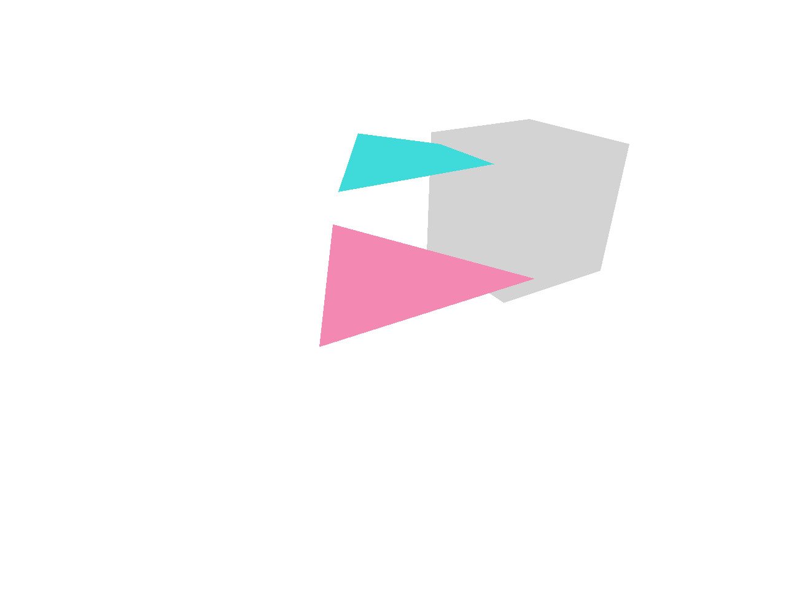
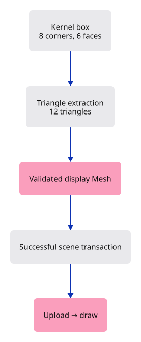

# 3.1.1 · Bring a solid into the scene

**Chapter 3 · Documents, editing and ownership · Section 3.1 · Kernel solids** · [Contents](contents.md)

**Typing: 27–54 minutes.** [Estimate](typing-load.md).

Create a grey box with the geometry kernel and adapt it to our validated display mesh. `to_render` supplies float vertices and triangle indices; the adapter selects position and colour for our six-float vertex layout.

## Type

Continue from [Walk around the model](16-orbit.md). [Save or recover your work](recovery.md).

### 1. `src/mesh.rs`

Adapt kernel triangle data to the current vertex and index layout with a checked narrowing conversion. Check the adapter using a solid with known topology.

<details>
<summary>Locate the existing block</summary>

```rust
pub struct Mesh {
    vertices: Vec<[f32; 6]>,
    indices: Vec<u16>,
}

impl Mesh {
    pub fn new(vertices: Vec<[f32; 6]>, indices: Vec<u16>) -> Result<Self, &'static str> {
        if indices.len() % 3 != 0 || indices.len() > u32::MAX as usize {
            return Err("Indices must describe complete triangles within the draw limit");
        }
        if indices.iter().any(|&index| index as usize >= vertices.len()) {
            return Err("A triangle refers to a missing vertex");
        }
        if vertices.iter().flatten().any(|value| !value.is_finite()) {
            return Err("Vertex values must be finite");
        }
        Ok(Self { vertices, indices })
    }

    pub fn vertices(&self) -> &[[f32; 6]] {
        &self.vertices
    }

    pub fn indices(&self) -> &[u16] {
        &self.indices
    }
}

#[cfg(test)]
mod tests {
    use super::*;

    #[test]
    fn invalid_connections_and_nonfinite_vertices_are_rejected() {
        assert!(Mesh::new(vec![[0.0; 6]; 3], vec![0, 1, 3]).is_err());
        assert!(Mesh::new(vec![[0.0; 6]; 3], vec![0, 1]).is_err());
        assert!(Mesh::new(vec![[f32::NAN; 6]; 3], vec![0, 1, 2]).is_err());
        assert!(Mesh::new(vec![[0.0; 6]; 3], vec![0, 1, 2]).is_ok());
    }
}
```

</details>

Edit the existing block to match this code; keep unchanged lines:

```rust
pub struct Mesh {
    vertices: Vec<[f32; 6]>,
    indices: Vec<u16>,
}

impl Mesh {
    pub fn new(vertices: Vec<[f32; 6]>, indices: Vec<u16>) -> Result<Self, &'static str> {
        if indices.len() % 3 != 0 || indices.len() > u32::MAX as usize {
            return Err("Indices must describe complete triangles within the draw limit");
        }
        if indices.iter().any(|&index| index as usize >= vertices.len()) {
            return Err("A triangle refers to a missing vertex");
        }
        if vertices.iter().flatten().any(|value| !value.is_finite()) {
            return Err("Vertex values must be finite");
        }
        Ok(Self { vertices, indices })
    }

    pub fn from_kernel(mesh: &session_rust::Mesh) -> Result<Self, &'static str> {
        let render = mesh.to_render();
        let vertices = render.vertices.iter().map(|vertex| {
            let [x, y, z] = vertex.position;
            let [r, g, b, _] = vertex.color;
            [x, y, z, r, g, b]
        }).collect();
        let indices: Result<Vec<u16>, _> = render.indices.into_iter().map(u16::try_from).collect();
        Self::new(vertices, indices.map_err(|_| "Mesh exceeds this lesson's 16-bit index capacity")?)
    }

    pub fn vertices(&self) -> &[[f32; 6]] {
        &self.vertices
    }

    pub fn indices(&self) -> &[u16] {
        &self.indices
    }
}

#[cfg(test)]
mod tests {
    use super::*;

    #[test]
    fn a_kernel_box_becomes_eight_vertices_and_twelve_triangles() {
        let source = session_rust::Mesh::create_box(0.8, 0.8, 0.8);
        let mesh = Mesh::from_kernel(&source).unwrap();
        assert_eq!(mesh.vertices().len(), 8);
        assert_eq!(mesh.indices().len(), 36);
    }

    #[test]
    fn invalid_connections_and_nonfinite_vertices_are_rejected() {
        assert!(Mesh::new(vec![[0.0; 6]; 3], vec![0, 1, 3]).is_err());
        assert!(Mesh::new(vec![[0.0; 6]; 3], vec![0, 1]).is_err());
        assert!(Mesh::new(vec![[f32::NAN; 6]; 3], vec![0, 1, 2]).is_err());
        assert!(Mesh::new(vec![[0.0; 6]; 3], vec![0, 1, 2]).is_ok());
    }
}
```

<details>
<summary>Optional patch references</summary>

Use these original edit fragments when comparing a saved checkpoint. Apply the complete blocks above.

```text
--8<-- "journey/code/17-solid-01.rs"
```

```text
--8<-- "journey/code/17-solid-02.rs"
```

</details>

### 2. `src/scene.rs`

Construct and place a box, then insert it only after its display mesh is valid.

<details>
<summary>Locate the existing block</summary>

```rust
    pub fn toggle_extra(&mut self) {
```

</details>

Edit the existing block to match this code; keep unchanged lines:

```rust
--8<-- "journey/code/17-solid-03.rs"
```

### 3. `src/history.rs`

Make transaction recording depend on success. The existing edit wrapper remains convenient for actions that cannot return an error. Prove that a partial failed change cannot destroy either document contents or the redo branch.

Edit these blocks from bottom to top. Keep the surrounding lines unchanged.

<details>
<summary>Locate this block</summary>

```rust
    }

    #[test]
    fn retained_history_has_a_fixed_count_limit() {
        let mut scene = Scene::demo();
        let mut history = History::default();
```

</details>

Replace it with:

```rust
    }

    #[test]
    fn a_failed_action_restores_the_scene_and_preserves_redo() {
        let mut scene = Scene::demo();
        let mut history = History::default();
        let id = scene.objects()[0].id;
        history.edit(&mut scene, |scene| { scene.remove(id); });
        history.undo(&mut scene);
        let result = history.try_edit(&mut scene, |scene| {
            scene.remove(id);
            Err("Creation failed after a partial change")
        });
        assert!(result.is_err());
        assert!(scene.contains(id));
        assert!(history.redo(&mut scene));
        assert!(!scene.contains(id));
    }

    #[test]
    fn retained_history_has_a_fixed_count_limit() {
        let mut scene = Scene::demo();
        let mut history = History::default();
```

<details>
<summary>Locate this block</summary>

```rust

impl History {
    pub fn edit(&mut self, scene: &mut Scene, action: impl FnOnce(&mut Scene)) {
        let before = scene.clone();
        action(scene);
        if self.undo.len() == LIMIT {
            self.undo.remove(0);
        }
        self.undo.push(before);
        self.redo.clear();
    }

    pub fn undo(&mut self, scene: &mut Scene) -> bool {
```

</details>

Replace it with:

```rust

impl History {
    pub fn edit(&mut self, scene: &mut Scene, action: impl FnOnce(&mut Scene)) {
        self.try_edit(scene, |scene| { action(scene); Ok(()) }).expect("Infallible scene edit");
    }

    pub fn try_edit(
        &mut self,
        scene: &mut Scene,
        action: impl FnOnce(&mut Scene) -> Result<(), &'static str>,
    ) -> Result<(), &'static str> {
        let before = scene.clone();
        if let Err(error) = action(scene) {
            scene.restore(before);
            return Err(error);
        }
        if self.undo.len() == LIMIT {
            self.undo.remove(0);
        }
        self.undo.push(before);
        self.redo.clear();
        Ok(())
    }

    pub fn undo(&mut self, scene: &mut Scene) -> bool {
```

<details>
<summary>Complete updated block reference</summary>

```rust
use crate::scene::Scene;

const LIMIT: usize = 64;

#[derive(Default)]
pub struct History {
    undo: Vec<Scene>,
    redo: Vec<Scene>,
}

impl History {
    pub fn edit(&mut self, scene: &mut Scene, action: impl FnOnce(&mut Scene)) {
        self.try_edit(scene, |scene| { action(scene); Ok(()) }).expect("Infallible scene edit");
    }

    pub fn try_edit(
        &mut self,
        scene: &mut Scene,
        action: impl FnOnce(&mut Scene) -> Result<(), &'static str>,
    ) -> Result<(), &'static str> {
        let before = scene.clone();
        if let Err(error) = action(scene) {
            scene.restore(before);
            return Err(error);
        }
        if self.undo.len() == LIMIT {
            self.undo.remove(0);
        }
        self.undo.push(before);
        self.redo.clear();
        Ok(())
    }

    pub fn undo(&mut self, scene: &mut Scene) -> bool {
        Self::travel(&mut self.undo, &mut self.redo, scene)
    }

    pub fn redo(&mut self, scene: &mut Scene) -> bool {
        Self::travel(&mut self.redo, &mut self.undo, scene)
    }

    fn travel(from: &mut Vec<Scene>, to: &mut Vec<Scene>, scene: &mut Scene) -> bool {
        let Some(saved) = from.pop() else { return false; };
        to.push(scene.clone());
        scene.restore(saved);
        true
    }
}

#[cfg(test)]
mod tests {
    use super::*;
    use std::rc::Rc;

    #[test]
    fn undo_restores_identity_and_shares_the_original_mesh() {
        let mut scene = Scene::demo();
        let mut history = History::default();
        let id = scene.objects()[0].id;
        let mesh = Rc::clone(&scene.objects()[0].mesh);
        history.edit(&mut scene, |scene| { scene.remove(id); });
        assert!(!scene.contains(id));
        assert!(history.undo(&mut scene));
        assert_eq!(scene.objects()[0].id, id);
        assert!(Rc::ptr_eq(&mesh, &scene.objects()[0].mesh));
        assert!(history.redo(&mut scene));
        assert!(!scene.contains(id));
    }

    #[test]
    fn a_new_branch_discards_redo_without_reusing_an_old_id() {
        let mut scene = Scene::demo();
        let mut history = History::default();
        history.edit(&mut scene, Scene::toggle_extra);
        let old_id = scene.objects()[2].id;
        history.undo(&mut scene);
        history.edit(&mut scene, Scene::toggle_extra);
        assert_ne!(scene.objects()[2].id, old_id);
        assert!(!history.redo(&mut scene));
    }

    #[test]
    fn a_failed_action_restores_the_scene_and_preserves_redo() {
        let mut scene = Scene::demo();
        let mut history = History::default();
        let id = scene.objects()[0].id;
        history.edit(&mut scene, |scene| { scene.remove(id); });
        history.undo(&mut scene);
        let result = history.try_edit(&mut scene, |scene| {
            scene.remove(id);
            Err("Creation failed after a partial change")
        });
        assert!(result.is_err());
        assert!(scene.contains(id));
        assert!(history.redo(&mut scene));
        assert!(!scene.contains(id));
    }

    #[test]
    fn retained_history_has_a_fixed_count_limit() {
        let mut scene = Scene::demo();
        let mut history = History::default();
        for _ in 0..LIMIT + 1 {
            history.edit(&mut scene, Scene::toggle_extra);
        }
        let mut count = 0;
        while history.undo(&mut scene) {
            count += 1;
        }
        assert_eq!(count, LIMIT);
    }
}
```

</details>

<details>
<summary>Optional patch references</summary>

Use these original edit fragments when comparing a saved checkpoint. Apply the complete blocks above.

```text
--8<-- "journey/code/17-solid-04.rs"
```

```text
--8<-- "journey/code/17-solid-05.rs"
```

</details>

### 4. `src/browser.rs`

Add Example Box to the vocabulary. Insert the box as one fallible history edit and report construction errors. Report the undoable kernel object.

Edit these blocks from bottom to top. Keep the surrounding lines unchanged.

<details>
<summary>Locate this block</summary>

```rust
    )?;
    // The page has one listener for its lifetime; JavaScript must retain the Rust callback.
    click.forget();
    report("Orbit moves the eye around a fixed target.");
    Ok(())
}
```

</details>

Replace it with:

```rust
    )?;
    // The page has one listener for its lifetime; JavaScript must retain the Rust callback.
    click.forget();
    report("Kernel geometry becomes an undoable scene object.");
    Ok(())
}
```

<details>
<summary>Locate this block</summary>

```rust
                        .and_then(|ray| crate::picking::pick(&scene, &ray));
                    renderer.set_scene(&scene, selected);
                }
                "example triangle" => {
                    history.edit(&mut scene, Scene::toggle_extra);
                    selected = selected.filter(|id| scene.contains(*id));
```

</details>

Replace it with:

```rust
                        .and_then(|ray| crate::picking::pick(&scene, &ray));
                    renderer.set_scene(&scene, selected);
                }
                "example box" => {
                    if let Err(error) =
                        history.try_edit(&mut scene, |scene| scene.add_box().map(|_| ()))
                    {
                        report(error);
                        return;
                    }
                    renderer.set_scene(&scene, selected);
                }
                "example triangle" => {
                    history.edit(&mut scene, Scene::toggle_extra);
                    selected = selected.filter(|id| scene.contains(*id));
```

<details>
<summary>Locate this block</summary>

```rust
        config.format.add_srgb_suffix(),
        &[
            "Help",
            "Example Triangle",
            "Select Next",
            "Delete",
```

</details>

Replace it with:

```rust
        config.format.add_srgb_suffix(),
        &[
            "Help",
            "Example Box",
            "Example Triangle",
            "Select Next",
            "Delete",
```

<details>
<summary>Complete updated block reference</summary>

```rust
use crate::background::Background;
use crate::camera::Camera;
use crate::history::History;
use crate::renderer::Renderer;
use crate::scene::Scene;
use wasm_bindgen::{JsCast, JsValue, closure::Closure};

pub fn report(message: &str) {
    if let Some(document) = web_sys::window().and_then(|window| window.document()) {
        if let Some(status) = document.get_element_by_id("status") {
            status.set_text_content(Some(message));
            if message.starts_with("Cannot") { let _ = status.remove_attribute("hidden"); }
        }
    }
}

pub async fn run() -> Result<(), JsValue> {
    let window = web_sys::window().ok_or("No browser window")?;
    let document = window.document().ok_or("No document")?;
    let canvas: web_sys::HtmlCanvasElement = document
        .get_element_by_id("canvas")
        .ok_or("Missing canvas")?
        .dyn_into()?;
    let instance = wgpu::Instance::new(wgpu::InstanceDescriptor {
        backends: wgpu::Backends::BROWSER_WEBGPU,
        flags: Default::default(),
        memory_budget_thresholds: Default::default(),
        backend_options: Default::default(),
        display: None,
    });
    let surface = instance
        .create_surface(wgpu::SurfaceTarget::Canvas(canvas.clone()))
        .map_err(|error| JsValue::from_str(&error.to_string()))?;
    let adapter = instance
        .request_adapter(&wgpu::RequestAdapterOptions {
            compatible_surface: Some(&surface),
            ..Default::default()
        })
        .await
        .map_err(|error| JsValue::from_str(&error.to_string()))?;
    let (device, queue) = adapter
        .request_device(&wgpu::DeviceDescriptor::default())
        .await
        .map_err(|error| JsValue::from_str(&error.to_string()))?;
    device.on_uncaptured_error(std::sync::Arc::new(|error| report(&error.to_string())));
    let limit = device.limits().max_texture_dimension_2d;
    let width = (window.inner_width()?.as_f64().ok_or("No window width")? as u32).clamp(1, limit);
    let height = (window.inner_height()?.as_f64().ok_or("No window height")? as u32).clamp(1, limit);
    canvas.set_width(width);
    canvas.set_height(height);
    let mut config = surface
        .get_default_config(&adapter, width, height)
        .ok_or("No compatible surface format")?;
    config.view_formats = vec![config.format.add_srgb_suffix()];
    surface.configure(&device, &config);
    let mut scene = Scene::demo();
    let mut renderer = Renderer::new(device, queue, config.format.add_srgb_suffix(), &scene);
    renderer.resize(width, height);
    let mut panel = crate::panel::Panel::new(
        &renderer,
        config.format.add_srgb_suffix(),
        &[
            "Help",
            "Example Box",
            "Example Triangle",
            "Select Next",
            "Delete",
            "Undo",
            "Redo",
            "Background",
            "Zoom In",
            "Zoom Out",
            "Pan Left",
            "Pan Right",
            "Orbit Right",
            "Orbit Up",
            "View Isometric",
            "View Reset",
        ],
    );
    panel.update(None, &canvas)?;
    let mut history = History::default();
    let mut selected = None;
    let mut background = Background::default();
    let mut camera = Camera { aspect: width as f64 / height as f64, ..Camera::default() };
    present(
        &surface,
        &renderer,
        &background,
        &camera.uniform(),
        &mut panel,
    )?;
    let input_canvas = canvas.clone();
    let click = Closure::<dyn FnMut(web_sys::Event)>::new(move |event: web_sys::Event| {
        let line = match panel.update(Some(&event), &input_canvas) {
            Ok(line) => line,
            Err(error) => {
                report(&format!("Cannot read command: {error:?}"));
                return;
            }
        };

        let line = line.or_else(|| {
            let mouse = event.dyn_ref::<web_sys::MouseEvent>()?;
            (event.type_() == "click"
                && !panel.consumed
                && mouse
                    .target()
                    .and_then(|target| target.dyn_into::<web_sys::Element>().ok())
                    .is_some_and(|target| target.id() == "canvas"))
            .then(|| "canvas".into())
        });
        if let Some(line) = line {
            match line.as_str() {
                "canvas" => {
                    let Some(event) = event.dyn_ref::<web_sys::MouseEvent>() else {
                        return;
                    };
                    let rect = input_canvas.get_bounding_client_rect();
                    if rect.width() <= 0.0 || rect.height() <= 0.0 {
                        return;
                    }
                    let screen = [
                        (2.0 * (event.client_x() as f64 - rect.left()) / rect.width() - 1.0) as f32,
                        (1.0 - 2.0 * (event.client_y() as f64 - rect.top()) / rect.height()) as f32,
                    ];
                    selected = camera
                        .ray(screen)
                        .and_then(|ray| crate::picking::pick(&scene, &ray));
                    renderer.set_scene(&scene, selected);
                }
                "example box" => {
                    if let Err(error) =
                        history.try_edit(&mut scene, |scene| scene.add_box().map(|_| ()))
                    {
                        report(error);
                        return;
                    }
                    renderer.set_scene(&scene, selected);
                }
                "example triangle" => {
                    history.edit(&mut scene, Scene::toggle_extra);
                    selected = selected.filter(|id| scene.contains(*id));
                    renderer.set_scene(&scene, selected);
                }
                "select next" => {
                    selected = scene.next(selected);
                    renderer.set_scene(&scene, selected);
                }
                "delete" => {
                    if let Some(id) = selected.take() {
                        history.edit(&mut scene, |scene| {
                            scene.remove(id);
                        });
                        renderer.set_scene(&scene, selected);
                    }
                }
                "undo" | "redo" => {
                    if line == "undo" {
                        history.undo(&mut scene);
                    } else {
                        history.redo(&mut scene);
                    }
                    selected = selected.filter(|id| scene.contains(*id));
                    renderer.set_scene(&scene, selected);
                }
                "background" => background.toggle(),
                "zoom in" => camera.zoom(2.0),
                "zoom out" => camera.zoom(0.5),
                "pan left" => camera.pan(-0.25, 0.0),
                "pan right" => camera.pan(0.25, 0.0),
                "orbit right" => camera.rotate(std::f32::consts::FRAC_PI_4),
                "orbit up" => camera.orbit(0.0, std::f64::consts::FRAC_PI_6),
                "view isometric" => camera.isometric(),
                "view reset" => camera = Camera { aspect: camera.aspect, ..Camera::default() },
                _ => return,
            }
        }
        if let Err(error) = panel.update(None, &input_canvas) {
            report(&format!("Cannot lay out commands: {error:?}"));
            return;
        }
        if let Err(error) = present(
            &surface,
            &renderer,
            &background,
            &camera.uniform(),
            &mut panel,
        ) {
            report(&format!("Cannot redraw: {error:?}"));
        }
    });
    for name in [
        "pointerdown",
        "pointermove",
        "pointerup",
        "pointercancel",
        "lostpointercapture",
        "contextmenu",
        "keydown",
        "keyup",
        "blur",
        "click",
    ] {
        canvas.add_event_listener_with_callback(name, click.as_ref().unchecked_ref())?;
    }
    let options = web_sys::AddEventListenerOptions::new();
    options.set_passive(false);
    canvas.add_event_listener_with_callback_and_add_event_listener_options(
        "wheel",
        click.as_ref().unchecked_ref(),
        &options,
    )?;
    // The page has one listener for its lifetime; JavaScript must retain the Rust callback.
    click.forget();
    report("Kernel geometry becomes an undoable scene object.");
    Ok(())
}

fn present(
    surface: &wgpu::Surface<'_>,
    renderer: &Renderer,
    background: &Background,
    transform: &[f32; 16],
    panel: &mut crate::panel::Panel,
) -> Result<(), JsValue> {
    let frame = match surface.get_current_texture() {
        wgpu::CurrentSurfaceTexture::Success(frame)
        | wgpu::CurrentSurfaceTexture::Suboptimal(frame) => frame,
        other => {
            return Err(JsValue::from_str(&format!(
                "Surface unavailable: {other:?}"
            )));
        }
    };
    let view = frame.texture.create_view(&wgpu::TextureViewDescriptor {
        format: Some(frame.texture.format().add_srgb_suffix()),
        ..Default::default()
    });
    renderer.draw(&view, background, transform);
    panel.draw(renderer, &view);
    frame.present();
    Ok(())
}
```

</details>

<details>
<summary>Optional patch references</summary>

Use these original edit fragments when comparing a saved checkpoint. Apply the complete blocks above.

```text
--8<-- "journey/code/17-solid-window-1.rs"
```

```text
--8<-- "journey/code/17-solid-window-2.rs"
```

```text
--8<-- "journey/code/17-solid-window-3.rs"
```

</details>

## Run and check

In your project:

```sh
cd workspace/journey
REGEN_PROTO=0 cargo build --lib --locked --target wasm32-unknown-unknown -j1
REGEN_PROTO=0 CARGO_BUILD_JOBS=1 trunk serve --port 8780
```

Open `http://127.0.0.1:8780/`. Keep an existing Trunk server running; saving rebuilds it.

Type `Example Box`, then `View Isometric`. A solid box appears. `Undo` removes that one object; `Redo` restores it.

### Recorded visual result

**Previous native render — current verification pending.**

The new object is the pale grey box behind the triangles. Its faces have the same colour because lighting is not implemented yet. The helper adds a kernel box, uploads the scene, and checks its projected position and visible area.



*This recorded image predates a source or checker change. Rebuild this checkpoint before using it as current evidence; browser controls require separate acceptance.*

<details>
<summary>Code explanation and diagram</summary>

The box has eight geometric corners, six quad faces and twelve triangles. This example handles its convex faces; imported concave faces need later topology work.

Convert kernel `u32` indices with `u16::try_from`. Return an error for an index that cannot fit rather than connecting the wrong corners.

Add `History::try_edit`: commit and clear redo only on success; restore the previous scene on error. A test deliberately mutates then fails. The box is unlit here; the next shader change reveals its face directions.

Kernel box → triangle extraction → validated display Mesh → document transaction → GPU upload → visible solid.



Why does a failed mesh conversion belong outside the GPU draw loop?

Conversion establishes the display data contract before an object enters the scene. A failure should leave the document and history unchanged. The draw loop should read already valid GPU resources; it cannot repair an invalid index or decide whether a failed document edit should be kept.

Study estimate, including typing and experiments: 3–5 hours.

</details>

<details>
<summary>Optional experiment</summary>

Add a box and undo. In the rollback test, predict whether a failed new edit should erase the available redo. Run the test: it should not. Then redo the successful box addition. Separate three questions in your notes: did creation succeed, did the document change, and was the change uploaded?

</details>

<details>
<summary>Check and save your work</summary>

Restore experimental edits, then run from `session_viewer`:

```sh
npm --prefix ../session_tests run course -- check 3.1.1
npm --prefix ../session_tests run course -- save 3.1.1
```

Source comparison leaves your project untouched. [Save and recovery instructions](recovery.md).

</details>

<details>
<summary>Viewer coverage and verification</summary>

The final viewer converts kernel geometry into renderable lanes while preserving document identity and transactional edits. This adapter is the first real kernel-to-display connection; later lessons retain face and edge provenance and share allocations across many objects.

Example Box inserts the grey solid behind the triangles. Its faces have one flat colour at this checkpoint.

[Full validation scope](release.md).

</details>
