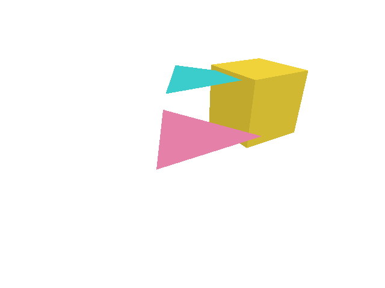
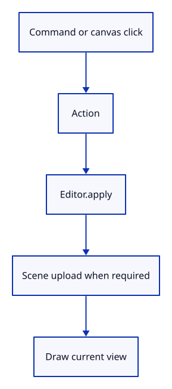

# 3.3.1 · Route browser input through the editor

**Chapter 3 · Documents, editing and ownership · Section 3.3 · Browser input and drawing size** · [Contents](contents.md)

**Typing: 29–57 minutes.** [Estimate](typing-load.md).

Convert submitted commands and canvas clicks to Action values. Apply them through Editor, upload only when Change is Scene, then redraw from the editor camera and background.

## Type

Continue from [Apply document and view actions in Rust](18b-actions.md). [Save or recover your work](recovery.md).

### 1. `src/editor.rs`

Check selection repair, redo preservation and picking through the editor’s current camera.

<details>
<summary>Locate the existing block</summary>

```rust
        assert_eq!(editor.background.rgb(), [0.9, 0.9, 0.9]);
    }
}
```

</details>

Edit the existing block to match this code; keep unchanged lines:

```rust
--8<-- "journey/code/19-actions-tests.rs"
```

### 2. `src/browser.rs`

Import the editor action types. Create one editor and initialize drawing from its scene. Present the editor background and camera. Start converting submitted lines into actions. Map commands to Action, apply through Editor, and synchronize according to Change. Redraw from the editor state. Report the shared action route.

Edit these blocks from bottom to top. Keep the surrounding lines unchanged.

<details>
<summary>Locate this block</summary>

```rust
    )?;
    // The page has one listener for its lifetime; JavaScript must retain the Rust callback.
    click.forget();
    report("Surface direction changes brightness, not geometry.");
    Ok(())
}
```

</details>

Replace it with:

```rust
    )?;
    // The page has one listener for its lifetime; JavaScript must retain the Rust callback.
    click.forget();
    report("Every document action follows the same editor path.");
    Ok(())
}
```

<details>
<summary>Locate this block</summary>

```rust
        if let Err(error) = present(
            &surface,
            &renderer,
            &background,
            &camera.uniform(),
            &mut panel,
        ) {
            report(&format!("Cannot redraw: {error:?}"));
```

</details>

Replace it with:

```rust
        if let Err(error) = present(
            &surface,
            &renderer,
            &editor.background,
            &editor.camera.uniform(),
            &mut panel,
        ) {
            report(&format!("Cannot redraw: {error:?}"));
```

<details>
<summary>Locate this block</summary>

```rust
                    if rect.width() <= 0.0 || rect.height() <= 0.0 {
                        return;
                    }
                    let screen = [
                        (2.0 * (event.client_x() as f64 - rect.left()) / rect.width() - 1.0) as f32,
                        (1.0 - 2.0 * (event.client_y() as f64 - rect.top()) / rect.height()) as f32,
                    ];
                    selected = camera
                        .ray(screen)
                        .and_then(|ray| crate::picking::pick(&scene, &ray));
                    renderer.set_scene(&scene, selected);
                }
                "example box" => {
                    if let Err(error) =
                        history.try_edit(&mut scene, |scene| scene.add_box().map(|_| ()))
                    {
                        report(error);
                        return;
                    }
                    renderer.set_scene(&scene, selected);
                }
                "example triangle" => {
                    history.edit(&mut scene, Scene::toggle_extra);
                    selected = selected.filter(|id| scene.contains(*id));
                    renderer.set_scene(&scene, selected);
                }
                "select next" => {
                    selected = scene.next(selected);
                    renderer.set_scene(&scene, selected);
                }
                "delete" => {
                    if let Some(id) = selected.take() {
                        history.edit(&mut scene, |scene| {
                            scene.remove(id);
                        });
                        renderer.set_scene(&scene, selected);
                    }
                }
                "undo" | "redo" => {
                    if line == "undo" {
                        history.undo(&mut scene);
                    } else {
                        history.redo(&mut scene);
                    }
                    selected = selected.filter(|id| scene.contains(*id));
                    renderer.set_scene(&scene, selected);
                }
                "background" => background.toggle(),
                "zoom in" => camera.zoom(2.0),
                "zoom out" => camera.zoom(0.5),
                "pan left" => camera.pan(-0.25, 0.0),
                "pan right" => camera.pan(0.25, 0.0),
                "orbit right" => camera.rotate(std::f32::consts::FRAC_PI_4),
                "orbit up" => camera.orbit(0.0, std::f64::consts::FRAC_PI_6),
                "view isometric" => camera.isometric(),
                "view reset" => camera = Camera { aspect: camera.aspect, ..Camera::default() },
                _ => return,
            }
        }
        if let Err(error) = panel.update(None, &input_canvas) {
```

</details>

Replace it with:

```rust
                    if rect.width() <= 0.0 || rect.height() <= 0.0 {
                        return;
                    }
                    Action::Pick([
                        (2.0 * (event.client_x() as f64 - rect.left()) / rect.width() - 1.0) as f32,
                        (1.0 - 2.0 * (event.client_y() as f64 - rect.top()) / rect.height()) as f32,
                    ])
                }
                "example box" => Action::AddBox,
                "example triangle" => Action::ToggleExtra,
                "select next" => Action::SelectNext,
                "delete" => Action::Delete,
                "undo" => Action::Undo,
                "redo" => Action::Redo,
                "background" => Action::Background,
                "zoom in" => Action::Zoom(2.0),
                "zoom out" => Action::Zoom(0.5),
                "pan left" => Action::Pan(-0.25, 0.0),
                "pan right" => Action::Pan(0.25, 0.0),
                "orbit right" => Action::Orbit(std::f64::consts::FRAC_PI_4, 0.0),
                "orbit up" => Action::Orbit(0.0, std::f64::consts::FRAC_PI_6),
                "view isometric" => Action::Isometric,
                "view reset" => Action::ResetView,
                _ => return,
            };
            match editor.apply(action) {
                Ok(Change::Scene) => renderer.set_scene(&editor.scene, editor.selected),
                Ok(Change::View) => {}
                Err(error) => {
                    report(error);
                    return;
                }
            }
        }
        if let Err(error) = panel.update(None, &input_canvas) {
```

<details>
<summary>Locate this block</summary>

```rust
            .then(|| "canvas".into())
        });
        if let Some(line) = line {
            match line.as_str() {
                "canvas" => {
                    let Some(event) = event.dyn_ref::<web_sys::MouseEvent>() else {
                        return;
```

</details>

Replace it with:

```rust
            .then(|| "canvas".into())
        });
        if let Some(line) = line {
            let action = match line.as_str() {
                "canvas" => {
                    let Some(event) = event.dyn_ref::<web_sys::MouseEvent>() else {
                        return;
```

<details>
<summary>Locate this block</summary>

```rust
        ],
    );
    panel.update(None, &canvas)?;
    let mut history = History::default();
    let mut selected = None;
    let mut background = Background::default();
    let mut camera = Camera { aspect: width as f64 / height as f64, ..Camera::default() };
    present(
        &surface,
        &renderer,
        &background,
        &camera.uniform(),
        &mut panel,
    )?;
    let input_canvas = canvas.clone();
```

</details>

Replace it with:

```rust
        ],
    );
    panel.update(None, &canvas)?;
    present(
        &surface,
        &renderer,
        &editor.background,
        &editor.camera.uniform(),
        &mut panel,
    )?;
    let input_canvas = canvas.clone();
```

<details>
<summary>Locate this block</summary>

```rust
        .ok_or("No compatible surface format")?;
    config.view_formats = vec![config.format.add_srgb_suffix()];
    surface.configure(&device, &config);
    let mut scene = Scene::demo();
    let mut renderer = Renderer::new(device, queue, config.format.add_srgb_suffix(), &scene);
    renderer.resize(width, height);
    let mut panel = crate::panel::Panel::new(
        &renderer,
```

</details>

Replace it with:

```rust
        .ok_or("No compatible surface format")?;
    config.view_formats = vec![config.format.add_srgb_suffix()];
    surface.configure(&device, &config);
    let mut editor = Editor::default();
    editor.camera.aspect = width as f64 / height as f64;
    let mut renderer = Renderer::new(
        device,
        queue,
        config.format.add_srgb_suffix(),
        &editor.scene,
    );
    renderer.resize(width, height);
    let mut panel = crate::panel::Panel::new(
        &renderer,
```

<details>
<summary>Locate this block</summary>

```rust
use crate::background::Background;
use crate::camera::Camera;
use crate::history::History;
use crate::renderer::Renderer;
use crate::scene::Scene;
use wasm_bindgen::{JsCast, JsValue, closure::Closure};

pub fn report(message: &str) {
```

</details>

Replace it with:

```rust
use crate::background::Background;
use crate::editor::{Action, Change, Editor};
use crate::renderer::Renderer;
use wasm_bindgen::{JsCast, JsValue, closure::Closure};

pub fn report(message: &str) {
```

<details>
<summary>Complete updated block reference</summary>

```rust
use crate::background::Background;
use crate::editor::{Action, Change, Editor};
use crate::renderer::Renderer;
use wasm_bindgen::{JsCast, JsValue, closure::Closure};

pub fn report(message: &str) {
    if let Some(document) = web_sys::window().and_then(|window| window.document()) {
        if let Some(status) = document.get_element_by_id("status") {
            status.set_text_content(Some(message));
            if message.starts_with("Cannot") { let _ = status.remove_attribute("hidden"); }
        }
    }
}

pub async fn run() -> Result<(), JsValue> {
    let window = web_sys::window().ok_or("No browser window")?;
    let document = window.document().ok_or("No document")?;
    let canvas: web_sys::HtmlCanvasElement = document
        .get_element_by_id("canvas")
        .ok_or("Missing canvas")?
        .dyn_into()?;
    let instance = wgpu::Instance::new(wgpu::InstanceDescriptor {
        backends: wgpu::Backends::BROWSER_WEBGPU,
        flags: Default::default(),
        memory_budget_thresholds: Default::default(),
        backend_options: Default::default(),
        display: None,
    });
    let surface = instance
        .create_surface(wgpu::SurfaceTarget::Canvas(canvas.clone()))
        .map_err(|error| JsValue::from_str(&error.to_string()))?;
    let adapter = instance
        .request_adapter(&wgpu::RequestAdapterOptions {
            compatible_surface: Some(&surface),
            ..Default::default()
        })
        .await
        .map_err(|error| JsValue::from_str(&error.to_string()))?;
    let (device, queue) = adapter
        .request_device(&wgpu::DeviceDescriptor::default())
        .await
        .map_err(|error| JsValue::from_str(&error.to_string()))?;
    device.on_uncaptured_error(std::sync::Arc::new(|error| report(&error.to_string())));
    let limit = device.limits().max_texture_dimension_2d;
    let width = (window.inner_width()?.as_f64().ok_or("No window width")? as u32).clamp(1, limit);
    let height = (window.inner_height()?.as_f64().ok_or("No window height")? as u32).clamp(1, limit);
    canvas.set_width(width);
    canvas.set_height(height);
    let mut config = surface
        .get_default_config(&adapter, width, height)
        .ok_or("No compatible surface format")?;
    config.view_formats = vec![config.format.add_srgb_suffix()];
    surface.configure(&device, &config);
    let mut editor = Editor::default();
    editor.camera.aspect = width as f64 / height as f64;
    let mut renderer = Renderer::new(
        device,
        queue,
        config.format.add_srgb_suffix(),
        &editor.scene,
    );
    renderer.resize(width, height);
    let mut panel = crate::panel::Panel::new(
        &renderer,
        config.format.add_srgb_suffix(),
        &[
            "Help",
            "Example Box",
            "Example Triangle",
            "Select Next",
            "Delete",
            "Undo",
            "Redo",
            "Background",
            "Zoom In",
            "Zoom Out",
            "Pan Left",
            "Pan Right",
            "Orbit Right",
            "Orbit Up",
            "View Isometric",
            "View Reset",
        ],
    );
    panel.update(None, &canvas)?;
    present(
        &surface,
        &renderer,
        &editor.background,
        &editor.camera.uniform(),
        &mut panel,
    )?;
    let input_canvas = canvas.clone();
    let click = Closure::<dyn FnMut(web_sys::Event)>::new(move |event: web_sys::Event| {
        let line = match panel.update(Some(&event), &input_canvas) {
            Ok(line) => line,
            Err(error) => {
                report(&format!("Cannot read command: {error:?}"));
                return;
            }
        };

        let line = line.or_else(|| {
            let mouse = event.dyn_ref::<web_sys::MouseEvent>()?;
            (event.type_() == "click"
                && !panel.consumed
                && mouse
                    .target()
                    .and_then(|target| target.dyn_into::<web_sys::Element>().ok())
                    .is_some_and(|target| target.id() == "canvas"))
            .then(|| "canvas".into())
        });
        if let Some(line) = line {
            let action = match line.as_str() {
                "canvas" => {
                    let Some(event) = event.dyn_ref::<web_sys::MouseEvent>() else {
                        return;
                    };
                    let rect = input_canvas.get_bounding_client_rect();
                    if rect.width() <= 0.0 || rect.height() <= 0.0 {
                        return;
                    }
                    Action::Pick([
                        (2.0 * (event.client_x() as f64 - rect.left()) / rect.width() - 1.0) as f32,
                        (1.0 - 2.0 * (event.client_y() as f64 - rect.top()) / rect.height()) as f32,
                    ])
                }
                "example box" => Action::AddBox,
                "example triangle" => Action::ToggleExtra,
                "select next" => Action::SelectNext,
                "delete" => Action::Delete,
                "undo" => Action::Undo,
                "redo" => Action::Redo,
                "background" => Action::Background,
                "zoom in" => Action::Zoom(2.0),
                "zoom out" => Action::Zoom(0.5),
                "pan left" => Action::Pan(-0.25, 0.0),
                "pan right" => Action::Pan(0.25, 0.0),
                "orbit right" => Action::Orbit(std::f64::consts::FRAC_PI_4, 0.0),
                "orbit up" => Action::Orbit(0.0, std::f64::consts::FRAC_PI_6),
                "view isometric" => Action::Isometric,
                "view reset" => Action::ResetView,
                _ => return,
            };
            match editor.apply(action) {
                Ok(Change::Scene) => renderer.set_scene(&editor.scene, editor.selected),
                Ok(Change::View) => {}
                Err(error) => {
                    report(error);
                    return;
                }
            }
        }
        if let Err(error) = panel.update(None, &input_canvas) {
            report(&format!("Cannot lay out commands: {error:?}"));
            return;
        }
        if let Err(error) = present(
            &surface,
            &renderer,
            &editor.background,
            &editor.camera.uniform(),
            &mut panel,
        ) {
            report(&format!("Cannot redraw: {error:?}"));
        }
    });
    for name in [
        "pointerdown",
        "pointermove",
        "pointerup",
        "pointercancel",
        "lostpointercapture",
        "contextmenu",
        "keydown",
        "keyup",
        "blur",
        "click",
    ] {
        canvas.add_event_listener_with_callback(name, click.as_ref().unchecked_ref())?;
    }
    let options = web_sys::AddEventListenerOptions::new();
    options.set_passive(false);
    canvas.add_event_listener_with_callback_and_add_event_listener_options(
        "wheel",
        click.as_ref().unchecked_ref(),
        &options,
    )?;
    // The page has one listener for its lifetime; JavaScript must retain the Rust callback.
    click.forget();
    report("Every document action follows the same editor path.");
    Ok(())
}

fn present(
    surface: &wgpu::Surface<'_>,
    renderer: &Renderer,
    background: &Background,
    transform: &[f32; 16],
    panel: &mut crate::panel::Panel,
) -> Result<(), JsValue> {
    let frame = match surface.get_current_texture() {
        wgpu::CurrentSurfaceTexture::Success(frame)
        | wgpu::CurrentSurfaceTexture::Suboptimal(frame) => frame,
        other => {
            return Err(JsValue::from_str(&format!(
                "Surface unavailable: {other:?}"
            )));
        }
    };
    let view = frame.texture.create_view(&wgpu::TextureViewDescriptor {
        format: Some(frame.texture.format().add_srgb_suffix()),
        ..Default::default()
    });
    renderer.draw(&view, background, transform);
    panel.draw(renderer, &view);
    frame.present();
    Ok(())
}
```

</details>

<details>
<summary>Optional patch references</summary>

Use these original edit fragments when comparing a saved checkpoint. Apply the complete blocks above.

```text
--8<-- "journey/code/19-actions-window-1.rs"
```

```text
--8<-- "journey/code/19-actions-window-2.rs"
```

```text
--8<-- "journey/code/19-actions-window-3.rs"
```

```text
--8<-- "journey/code/19-actions-window-4.rs"
```

```text
--8<-- "journey/code/19-actions-window-5.rs"
```

```text
--8<-- "journey/code/19-actions-window-6.rs"
```

```text
--8<-- "journey/code/19-actions-window-7.rs"
```

</details>

## Run and check

In your project:

```sh
cd workspace/journey
REGEN_PROTO=0 cargo build --lib --locked --target wasm32-unknown-unknown -j1
REGEN_PROTO=0 CARGO_BUILD_JOBS=1 trunk serve --port 8780
```

Open `http://127.0.0.1:8780/`. Keep an existing Trunk server running; saving rebuilds it.

Type Example Box, then Undo and Redo. The box disappears and returns through the editor route.

### Recorded visual result

**Previous native render — current verification pending.**

The box is yellow because it is selected. The helper sends AddBox, Isometric and three SelectNext actions through Editor, then checks the selected pixels. This demonstrates the result of the shared action path; it does not prove that a typed browser command delivered those actions.



*This recorded image predates a source or checker change. Rebuild this checkpoint before using it as current evidence; browser controls require separate acceptance.*

This reference image is shared with [3.2.3 · Apply document and view actions in Rust](18b-actions.md). It does not demonstrate a new feature by itself.

<details>
<summary>Code explanation and diagram</summary>

The closure captures one mutable editor. The GPU renderer keeps its derived representation separate from the document owner.

Typed command or canvas click → Action → Editor::apply → Change → scene upload when required → draw.



Why does Change::View skip set_scene?

The scene data did not change. Redrawing with the editor camera or background is sufficient.

Study estimate, including typing and experiments: 1–1.5 hours.

</details>

<details>
<summary>Optional experiment</summary>

Pan Right, delete a selected object and Undo. The document returns while the camera stays where you put it.

</details>

<details>
<summary>Check and save your work</summary>

Restore experimental edits, then run from `session_viewer`:

```sh
npm --prefix ../session_tests run course -- check 3.3.1
npm --prefix ../session_tests run course -- save 3.3.1
```

Source comparison leaves your project untouched. [Save and recovery instructions](recovery.md).

</details>

<details>
<summary>Viewer coverage and verification</summary>

The full command system will build on this boundary. commands, keyboard input and tools request document operations through the same owner, while rendering consumes the result. More commands should add behavior here or in focused command modules, not duplicate transactions in UI handlers.

The box is yellow after Select Next reaches it. commands feed the shared Editor action path.

[Full validation scope](release.md).

To reproduce the scripted acceptance of the reference checkpoint, run from `session_viewer` with the [course bundle server](release.md#reproduce) running on port 8781:

```sh
npm --prefix ../session_tests run course -- capture 3.3.1
```

This uses the verified reference bundle; it does not check or change your typed project.

</details>
