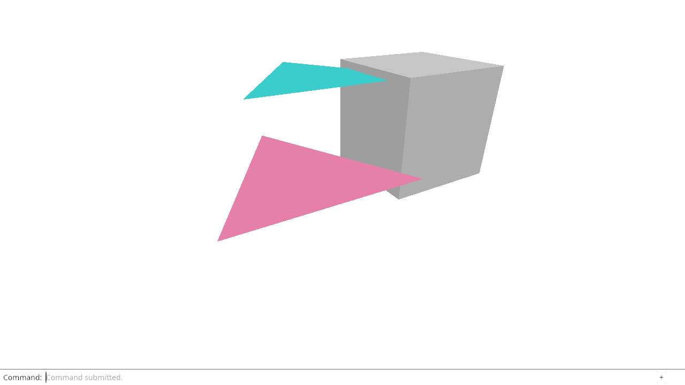

# One drawing size and one captured gesture

<a id="checkpoint-19a-viewport"></a>
<a id="checkpoint-20-resize"></a>
<a id="checkpoint-20a-press"></a>
<a id="checkpoint-20b-release"></a>
<a id="checkpoint-20c-motion"></a>
<a id="checkpoint-21-gestures"></a>
<a id="checkpoint-21a-wheel"></a>
<a id="checkpoint-22-shortcuts"></a>

Resize the shaded scene without stretching it, orbit with a captured pointer, and zoom with consistent wheel units.

## Prerequisites and ownership

Complete [Kernel geometry and one editor](17-solid.md). You need the editor's typed actions, camera projection, depth attachment and command dock.

This subject owns `src/viewport.rs`, `src/gesture.rs`, `src/navigation.rs` and their tests. It connects them in `src/browser.rs`, `src/renderer.rs`, `src/lib.rs` and `Cargo.toml`. Input produces editor actions; GPU resources remain with the renderer.

## Build

Type the complete files below in the existing project; retain its scene, editor, camera, shaders and command dock.

### Measure one drawable size

```rust
--8<-- "journey/code/19a-final-1.rs"
```

CSS dimensions describe layout, while the surface needs physical pixels. Multiply both dimensions by display density, then reduce them by one common factor if either exceeds the device limit. Clamping each dimension separately would change the aspect ratio and stretch the scene. Round only after scaling, and keep each physical dimension at least one pixel.

A hidden canvas, a nonfinite measurement or a nonpositive density has no drawable size. Returning `None` lets the application postpone drawing instead of configuring an invalid surface. The tests distinguish a denser display from a larger field of view: doubling density doubles both dimensions without changing aspect.

### Resize colour, depth and camera together

```rust
--8<-- "journey/code/19a-final-3.rs"
```

The renderer retains the current depth texture and recreates it when the drawable dimensions change. Colour and depth attachments in one render pass must have the same extent. Resizing changes their storage, not the mesh or pipeline.

The browser's resize function measures the canvas rectangle, updates its backing dimensions and surface configuration, and calls the renderer's resize method before drawing. The camera uses that same width-to-height ratio. An unchanged size still permits a redraw, but avoids reallocating the attachments.

### Keep one pointer responsible for a gesture

```rust
--8<-- "journey/code/19a-final-5.rs"
```

`Gesture` stores the accepted pointer ID, button, starting position and last position. A second pointer cannot take over an active gesture. The browser captures the accepted pointer so releasing outside the canvas still ends the same operation.

A left press becomes a pick only if it never moves more than four CSS pixels from its start. The moved flag stays set even if the pointer returns to its starting position. A right drag emits incremental orbit motion. Releasing processes the final pointer position before clearing the gesture, so the last movement is not lost.

Pick coordinates use the canvas rectangle to map client pixels to normalized device coordinates; the vertical axis is reversed. Orbit deltas are divided by the same rectangle dimensions, so a drag across half the canvas has a consistent angular meaning at different display densities.

```rust
--8<-- "journey/code/19a-final-6.rs"
```

These tests exercise pointer identity, click-versus-drag classification, cancellation and conversion into editor actions. They do not require a DOM or GPU.

### Normalize wheel movement

```rust
--8<-- "journey/code/19a-final-8.rs"
```

A wheel event reports pixels, lines or pages. The adapter converts these to pixels using sixteen pixels per line and the canvas height per page, then bounds one event to six hundred pixels in either direction. Invalid units, zero movement and invalid height produce no action.

Zoom uses an exponential factor. Successive wheel movements therefore multiply camera scale consistently: ten small movements have the same effect as their summed movement, within floating-point tolerance. The editor still owns the camera limits.

```rust
--8<-- "journey/code/19a-final-9.rs"
```

The navigation tests compare all three wheel units, small-event accumulation and large-event bounds. They also check that zoom does not become part of document undo history.

### Route browser events once

```rust
--8<-- "journey/code/19a-final-4.rs"
```

The command dock receives each event first. Only an unconsumed event reaches scene navigation. Pointer capture and focus failures cancel the pending gesture. Pointer cancellation, lost capture, blur, resize and Escape also clear it, preventing a delayed release from selecting an object after navigation has ended.

The wheel listener is explicitly nonpassive because accepted zoom events prevent browser scrolling. Both window and canvas listeners retain one callback for the page lifetime. The callback applies an editor action, updates scene display data only for `Change::Scene`, then resizes and presents through the existing renderer.

```toml
--8<-- "journey/code/19a-viewport-cumulative-kernel-feature-7.toml"
```

The manifest enables the browser event and pointer-capture APIs used by this adapter. Register the modules and their native tests:

```rust
--8<-- "journey/code/19a-viewport-cumulative-8-lib.rs"
```

## Run and observe

From `session_viewer`, run `npm --prefix ../session_tests run course -- check 19a-viewport` against your handwritten project. Build and serve with the [repository's resource guards](../maintaining.md). Automated validation uses `npm --prefix ../session_tests run course -- verify 19a-viewport` under those same guards.

Add a box and choose `View Isometric`. Resize the window: the box keeps its proportions and the depth test remains correct. Right-drag beyond the canvas edge and release; the next motion must not keep orbiting. Wheel toward the scene, then undo adding the box: the box disappears while the zoomed view remains.

A small left click picks; a left drag beyond four pixels does not become a click even when it ends at its starting position. Type a command while the dock has focus: those keys must not navigate the scene.



[Upright input check and its cropped view](../screenshots/journey/runtime-20261114/19a-viewport-upright.png) ? [Native WARP frame](../screenshots/journey/runtime-20261114/19a-viewport-native.png)

This retained native frame shows the endpoint scene. It does not establish fresh browser interaction or consolidated-checkpoint acceptance.

## Predict and try

Predict the physical size for a 768-by-384 CSS canvas at density four with a 1024-pixel device limit. It becomes 1024 by 512, retaining aspect two. Compare that with independently clamping the dimensions.

Press, drag beyond the threshold, return to the starting position and release. Predict whether the object is selected before trying it. The remembered drag classification prevents selection.

## Question and answer

Why must camera aspect and the depth attachment use the same drawable dimensions as the surface?

The aspect determines the projection into the colour image, and the depth attachment participates in that image's render pass. A different aspect stretches geometry; a different attachment extent makes the pass invalid.

## Validation

The cumulative checkpoint passes 56 native library tests and its optimized WASM build. Browser checks exercise the scene and retained mathematics at desktop and emulated upright dimensions. Pointer capture, cancellation, wheel units and dock event ownership preserve the document and camera state. [Source-bound runtime receipt](release/cumulative-six-runtime-windows-20261114.json).


[Upright browser result](../screenshots/journey/cumulative-six-20261114/19a-viewport/portrait-interacted.png). The scene clips at the upright viewport edges with these camera settings; fitting is a later subject. These checks use viewport emulation and do not establish physical-device or selected hardware-adapter acceptance. Full-course structure, finished-subject ownership and production parity remain unresolved. Later subjects still replace browser and renderer implementations.

The [native-only receipt](release/cumulative-native-six-windows-20261114.json) preserves the earlier test milestone. Historical references: [historical browser receipt](release/history-editor-viewport-windows-20261114.json).

Continue with [Validated files, bounds and useful projections](consolidation/22a-records.md).
