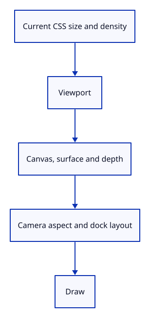

# 3.4.1 · Resize canvas, depth and camera together

**Chapter 3 · Documents, editing and ownership · Section 3.4 · Resize and pointer motion** · [Contents](contents.md)

**Typing: 29–57 minutes.** [Estimate](typing-load.md).

Use Viewport to resize canvas pixels, the surface, depth attachment and camera aspect together. Read the current CSS rectangle and display density before drawing.

## Type

Continue from [Measure a safe drawing size](19a-viewport.md). [Save or recover your work](recovery.md).

### 1. `src/renderer.rs`

Keep depth texture allocation in the existing depth helper. Recreate the depth view for the measured viewport dimensions.

Edit these blocks from bottom to top. Keep the surrounding lines unchanged.

<details>
<summary>Locate this block</summary>

```rust
        depth_texture.create_view(&Default::default())
    }

    pub fn resize(&mut self, width: u32, height: u32) {
        self.depth = Self::depth(&self.device, width, height);
    }

    pub fn draw(
```

</details>

Replace it with:

```rust
        depth_texture.create_view(&Default::default())
    }

    pub fn resize(&mut self, size: crate::viewport::Viewport) {
        self.depth = Self::depth(&self.device, size.width, size.height);
    }

    pub fn set_scene(&mut self, scene: &Scene, selected: Option<ObjectId>) {
        self.meshes = scene.objects().iter().map(|object| {
            GpuMesh::upload(&self.device, &object.mesh, selected == Some(object.id))
        }).collect();
    }

    pub fn draw(
```

<details>
<summary>Locate this block</summary>

```rust
        Self { device, queue, pipeline, meshes, uniform, view_group, depth }
    }

    pub fn set_scene(&mut self, scene: &Scene, selected: Option<ObjectId>) {
        self.meshes = scene.objects().iter().map(|object| {
            GpuMesh::upload(&self.device, &object.mesh, selected == Some(object.id))
        }).collect();
    }

    fn depth(device: &wgpu::Device, width: u32, height: u32) -> wgpu::TextureView {
        let depth_texture = device.create_texture(&wgpu::TextureDescriptor {
            label: Some("opaque depth"),
```

</details>

Replace it with:

```rust
        Self { device, queue, pipeline, meshes, uniform, view_group, depth }
    }

    fn depth(device: &wgpu::Device, width: u32, height: u32) -> wgpu::TextureView {
        let depth_texture = device.create_texture(&wgpu::TextureDescriptor {
            label: Some("opaque depth"),
```

<details>
<summary>Complete updated block reference</summary>

```rust
use crate::{gpu_mesh::GpuMesh, scene::{ObjectId, Scene}};

pub struct Renderer {
    pub device: wgpu::Device,
    pub queue: wgpu::Queue,
    pipeline: wgpu::RenderPipeline,
    meshes: Vec<GpuMesh>,
    uniform: wgpu::Buffer,
    view_group: wgpu::BindGroup,
    depth: wgpu::TextureView,
}

impl Renderer {
    pub fn new(
        device: wgpu::Device,
        queue: wgpu::Queue,
        format: wgpu::TextureFormat,
        scene: &Scene,
    ) -> Self {
        let meshes = scene.objects().iter().map(|object| GpuMesh::upload(&device, &object.mesh, false)).collect();
        let shader = device.create_shader_module(wgpu::ShaderModuleDescriptor {
            label: Some("triangle"),
            source: wgpu::ShaderSource::Wgsl(include_str!("triangle.wgsl").into()),
        });
        let pipeline = device.create_render_pipeline(&wgpu::RenderPipelineDescriptor {
            label: Some("triangle"),
            layout: None,
            vertex: wgpu::VertexState {
                module: &shader,
                entry_point: Some("vertex"),
                compilation_options: Default::default(),
                buffers: &[wgpu::VertexBufferLayout {
                    array_stride: 24,
                    step_mode: wgpu::VertexStepMode::Vertex,
                    attributes: &wgpu::vertex_attr_array![0 => Float32x3, 1 => Float32x3],
                }],
            },
            fragment: Some(wgpu::FragmentState {
                module: &shader,
                entry_point: Some("fragment"),
                compilation_options: Default::default(),
                targets: &[Some(format.into())],
            }),
            primitive: Default::default(),
            depth_stencil: Some(wgpu::DepthStencilState {
                format: wgpu::TextureFormat::Depth32Float,
                depth_write_enabled: Some(true),
                depth_compare: Some(wgpu::CompareFunction::Less),
                stencil: Default::default(),
                bias: Default::default(),
            }),
            multisample: Default::default(),
            multiview_mask: None,
            cache: None,
        });
        let uniform = device.create_buffer(&wgpu::BufferDescriptor {
            label: Some("view transform"),
            size: 64,
            usage: wgpu::BufferUsages::UNIFORM | wgpu::BufferUsages::COPY_DST,
            mapped_at_creation: false,
        });
        let view_group = device.create_bind_group(&wgpu::BindGroupDescriptor {
            label: Some("view settings"),
            layout: &pipeline.get_bind_group_layout(0),
            entries: &[wgpu::BindGroupEntry {
                binding: 0,
                resource: uniform.as_entire_binding(),
            }],
        });
        let depth = Self::depth(&device, 640, 480);
        Self { device, queue, pipeline, meshes, uniform, view_group, depth }
    }

    fn depth(device: &wgpu::Device, width: u32, height: u32) -> wgpu::TextureView {
        let depth_texture = device.create_texture(&wgpu::TextureDescriptor {
            label: Some("opaque depth"),
            size: wgpu::Extent3d { width, height, depth_or_array_layers: 1 },
            mip_level_count: 1,
            sample_count: 1,
            dimension: wgpu::TextureDimension::D2,
            format: wgpu::TextureFormat::Depth32Float,
            usage: wgpu::TextureUsages::RENDER_ATTACHMENT,
            view_formats: &[],
        });
        depth_texture.create_view(&Default::default())
    }

    pub fn resize(&mut self, size: crate::viewport::Viewport) {
        self.depth = Self::depth(&self.device, size.width, size.height);
    }

    pub fn set_scene(&mut self, scene: &Scene, selected: Option<ObjectId>) {
        self.meshes = scene.objects().iter().map(|object| {
            GpuMesh::upload(&self.device, &object.mesh, selected == Some(object.id))
        }).collect();
    }

    pub fn draw(
        &self,
        view: &wgpu::TextureView,
        background: &crate::background::Background,
        transform: &[f32; 16],
    ) {
        let bytes: Vec<u8> = transform.iter().flat_map(|value| value.to_ne_bytes()).collect();
        self.queue.write_buffer(&self.uniform, 0, &bytes);
        let [r, g, b] = background.rgb();
        let mut encoder = self.device.create_command_encoder(&Default::default());
        {
            // The pass borrows the encoder. This scope ends that borrow before finish takes it.
            let mut pass = encoder.begin_render_pass(&wgpu::RenderPassDescriptor {
                label: Some("canvas"),
                depth_stencil_attachment: Some(wgpu::RenderPassDepthStencilAttachment {
                    view: &self.depth,
                    depth_ops: Some(wgpu::Operations {
                        load: wgpu::LoadOp::Clear(1.0),
                        store: wgpu::StoreOp::Store,
                    }),
                    stencil_ops: None,
                }),
                color_attachments: &[Some(wgpu::RenderPassColorAttachment {
                    view,
                    depth_slice: None,
                    resolve_target: None,
                    ops: wgpu::Operations {
                        load: wgpu::LoadOp::Clear(wgpu::Color {
                            r, g, b, a: 1.0,
                        }),
                        store: wgpu::StoreOp::Store,
                    },
                })],
                ..Default::default()
            });
            pass.set_pipeline(&self.pipeline);
            pass.set_bind_group(0, &self.view_group, &[]);
            for mesh in &self.meshes {
                mesh.draw(&mut pass);
            }
        }
        self.queue.submit([encoder.finish()]);
    }
}
```

</details>

<details>
<summary>Optional patch references</summary>

Use these original edit fragments when comparing a saved checkpoint. Apply the complete blocks above.

```text
--8<-- "journey/code/20-resize-fullscreen-8.rs"
```

```text
--8<-- "journey/code/20-resize-fullscreen-9.rs"
```

</details>

### 2. `src/browser.rs`

Import the viewport size type. Size renderer attachments from the viewport. Handle initial resizing and retain the window for later resize events. Keep the event callback open for the resize path. Resize before handling input; refresh dock layout and drawing when dimensions change. Register resize events and update canvas pixels, surface configuration, attachments and camera aspect together.

Edit these blocks from bottom to top. Keep the surrounding lines unchanged.

<details>
<summary>Locate this block</summary>

```rust
        "blur",
        "click",
    ] {
        canvas.add_event_listener_with_callback(name, click.as_ref().unchecked_ref())?;
    }
    let options = web_sys::AddEventListenerOptions::new();
    options.set_passive(false);
    canvas.add_event_listener_with_callback_and_add_event_listener_options(
        "wheel",
        click.as_ref().unchecked_ref(),
        &options,
    )?;
    // The page has one listener for its lifetime; JavaScript must retain the Rust callback.
    click.forget();
    report("Every document action follows the same editor path.");
    Ok(())
}

fn present(
    surface: &wgpu::Surface<'_>,
    renderer: &Renderer,
```

</details>

Replace it with:

```rust
        "blur",
        "click",
    ] {
        canvas.add_event_listener_with_callback(name, update.as_ref().unchecked_ref())?;
    }
    let options = web_sys::AddEventListenerOptions::new();
    options.set_passive(false);
    canvas.add_event_listener_with_callback_and_add_event_listener_options(
        "wheel",
        update.as_ref().unchecked_ref(),
        &options,
    )?;
    window.add_event_listener_with_callback("resize", update.as_ref().unchecked_ref())?;
    // Both event sources retain this one callback for the lifetime of the page.
    update.forget();
    report("Canvas pixels, depth and camera resize together.");
    Ok(())
}

fn resize(
    window: &web_sys::Window,
    canvas: &web_sys::HtmlCanvasElement,
    surface: &wgpu::Surface<'_>,
    config: &mut wgpu::SurfaceConfiguration,
    renderer: &mut Renderer,
    editor: &mut Editor,
) -> bool {
    let rect = canvas.get_bounding_client_rect();
    let limit = renderer.device.limits().max_texture_dimension_2d;
    let Some(size) = Viewport::from_css(
        rect.width(),
        rect.height(),
        window.device_pixel_ratio(),
        limit,
    ) else {
        return false;
    };
    if size.width != config.width || size.height != config.height {
        canvas.set_width(size.width);
        canvas.set_height(size.height);
        config.width = size.width;
        config.height = size.height;
        surface.configure(&renderer.device, config);
        renderer.resize(size);
    }
    editor.camera.aspect = size.aspect();
    true
}

fn present(
    surface: &wgpu::Surface<'_>,
    renderer: &Renderer,
```

<details>
<summary>Locate this block</summary>

```rust
                }
            }
        }
        if let Err(error) = panel.update(None, &input_canvas) {
            report(&format!("Cannot lay out commands: {error:?}"));
            return;
        }
        if let Err(error) = present(
            &surface,
            &renderer,
            &editor.background,
            &editor.camera.uniform(),
            &mut panel,
        ) {
            report(&format!("Cannot redraw: {error:?}"));
        }
    });
    for name in [
```

</details>

Replace it with:

```rust
                }
            }
        }
        if resize(
            &browser_window,
            &input_canvas,
            &surface,
            &mut config,
            &mut renderer,
            &mut editor,
        ) {
            if let Err(error) = panel.update(None, &input_canvas) {
                report(&format!("Cannot lay out commands: {error:?}"));
                return;
            }
            if let Err(error) = present(
                &surface,
                &renderer,
                &editor.background,
                &editor.camera.uniform(),
                &mut panel,
            ) {
                report(&format!("Cannot redraw: {error:?}"));
            }
        }
    });
    for name in [
```

<details>
<summary>Locate this block</summary>

```rust
                return;
            }
        };

        let line = line.or_else(|| {
            let mouse = event.dyn_ref::<web_sys::MouseEvent>()?;
            (event.type_() == "click"
```

</details>

Replace it with:

```rust
                return;
            }
        };
        let line = line.or_else(|| {
            let mouse = event.dyn_ref::<web_sys::MouseEvent>()?;
            (event.type_() == "click"
```

<details>
<summary>Locate this block</summary>

```rust
        ],
    );
    panel.update(None, &canvas)?;
    present(
        &surface,
        &renderer,
        &editor.background,
        &editor.camera.uniform(),
        &mut panel,
    )?;
    let input_canvas = canvas.clone();
    let click = Closure::<dyn FnMut(web_sys::Event)>::new(move |event: web_sys::Event| {
        let line = match panel.update(Some(&event), &input_canvas) {
            Ok(line) => line,
            Err(error) => {
```

</details>

Replace it with:

```rust
        ],
    );
    panel.update(None, &canvas)?;
    if resize(
        &window,
        &canvas,
        &surface,
        &mut config,
        &mut renderer,
        &mut editor,
    ) {
        panel.update(None, &canvas)?;
        present(
            &surface,
            &renderer,
            &editor.background,
            &editor.camera.uniform(),
            &mut panel,
        )?;
    }
    let input_canvas = canvas.clone();
    let browser_window = window.clone();
    let update = Closure::<dyn FnMut(web_sys::Event)>::new(move |event: web_sys::Event| {
        let line = match panel.update(Some(&event), &input_canvas) {
            Ok(line) => line,
            Err(error) => {
```

<details>
<summary>Locate this block</summary>

```rust
    config.view_formats = vec![config.format.add_srgb_suffix()];
    surface.configure(&device, &config);
    let mut editor = Editor::default();
    editor.camera.aspect = width as f64 / height as f64;
    let mut renderer = Renderer::new(
        device,
        queue,
        config.format.add_srgb_suffix(),
        &editor.scene,
    );
    renderer.resize(width, height);
    let mut panel = crate::panel::Panel::new(
        &renderer,
        config.format.add_srgb_suffix(),
```

</details>

Replace it with:

```rust
    config.view_formats = vec![config.format.add_srgb_suffix()];
    surface.configure(&device, &config);
    let mut editor = Editor::default();
    let mut renderer = Renderer::new(
        device,
        queue,
        config.format.add_srgb_suffix(),
        &editor.scene,
    );
    renderer.resize(Viewport { width, height });
    let mut panel = crate::panel::Panel::new(
        &renderer,
        config.format.add_srgb_suffix(),
```

<details>
<summary>Locate this block</summary>

```rust
use crate::background::Background;
use crate::editor::{Action, Change, Editor};
use crate::renderer::Renderer;
use wasm_bindgen::{JsCast, JsValue, closure::Closure};

pub fn report(message: &str) {
```

</details>

Replace it with:

```rust
use crate::background::Background;
use crate::editor::{Action, Change, Editor};
use crate::renderer::Renderer;
use crate::viewport::Viewport;
use wasm_bindgen::{JsCast, JsValue, closure::Closure};

pub fn report(message: &str) {
```

<details>
<summary>Complete updated block reference</summary>

```rust
use crate::background::Background;
use crate::editor::{Action, Change, Editor};
use crate::renderer::Renderer;
use crate::viewport::Viewport;
use wasm_bindgen::{JsCast, JsValue, closure::Closure};

pub fn report(message: &str) {
    if let Some(document) = web_sys::window().and_then(|window| window.document()) {
        if let Some(status) = document.get_element_by_id("status") {
            status.set_text_content(Some(message));
            if message.starts_with("Cannot") { let _ = status.remove_attribute("hidden"); }
        }
    }
}

pub async fn run() -> Result<(), JsValue> {
    let window = web_sys::window().ok_or("No browser window")?;
    let document = window.document().ok_or("No document")?;
    let canvas: web_sys::HtmlCanvasElement = document
        .get_element_by_id("canvas")
        .ok_or("Missing canvas")?
        .dyn_into()?;
    let instance = wgpu::Instance::new(wgpu::InstanceDescriptor {
        backends: wgpu::Backends::BROWSER_WEBGPU,
        flags: Default::default(),
        memory_budget_thresholds: Default::default(),
        backend_options: Default::default(),
        display: None,
    });
    let surface = instance
        .create_surface(wgpu::SurfaceTarget::Canvas(canvas.clone()))
        .map_err(|error| JsValue::from_str(&error.to_string()))?;
    let adapter = instance
        .request_adapter(&wgpu::RequestAdapterOptions {
            compatible_surface: Some(&surface),
            ..Default::default()
        })
        .await
        .map_err(|error| JsValue::from_str(&error.to_string()))?;
    let (device, queue) = adapter
        .request_device(&wgpu::DeviceDescriptor::default())
        .await
        .map_err(|error| JsValue::from_str(&error.to_string()))?;
    device.on_uncaptured_error(std::sync::Arc::new(|error| report(&error.to_string())));
    let limit = device.limits().max_texture_dimension_2d;
    let width = (window.inner_width()?.as_f64().ok_or("No window width")? as u32).clamp(1, limit);
    let height = (window.inner_height()?.as_f64().ok_or("No window height")? as u32).clamp(1, limit);
    canvas.set_width(width);
    canvas.set_height(height);
    let mut config = surface
        .get_default_config(&adapter, width, height)
        .ok_or("No compatible surface format")?;
    config.view_formats = vec![config.format.add_srgb_suffix()];
    surface.configure(&device, &config);
    let mut editor = Editor::default();
    let mut renderer = Renderer::new(
        device,
        queue,
        config.format.add_srgb_suffix(),
        &editor.scene,
    );
    renderer.resize(Viewport { width, height });
    let mut panel = crate::panel::Panel::new(
        &renderer,
        config.format.add_srgb_suffix(),
        &[
            "Help",
            "Example Box",
            "Example Triangle",
            "Select Next",
            "Delete",
            "Undo",
            "Redo",
            "Background",
            "Zoom In",
            "Zoom Out",
            "Pan Left",
            "Pan Right",
            "Orbit Right",
            "Orbit Up",
            "View Isometric",
            "View Reset",
        ],
    );
    panel.update(None, &canvas)?;
    if resize(
        &window,
        &canvas,
        &surface,
        &mut config,
        &mut renderer,
        &mut editor,
    ) {
        panel.update(None, &canvas)?;
        present(
            &surface,
            &renderer,
            &editor.background,
            &editor.camera.uniform(),
            &mut panel,
        )?;
    }
    let input_canvas = canvas.clone();
    let browser_window = window.clone();
    let update = Closure::<dyn FnMut(web_sys::Event)>::new(move |event: web_sys::Event| {
        let line = match panel.update(Some(&event), &input_canvas) {
            Ok(line) => line,
            Err(error) => {
                report(&format!("Cannot read command: {error:?}"));
                return;
            }
        };
        let line = line.or_else(|| {
            let mouse = event.dyn_ref::<web_sys::MouseEvent>()?;
            (event.type_() == "click"
                && !panel.consumed
                && mouse
                    .target()
                    .and_then(|target| target.dyn_into::<web_sys::Element>().ok())
                    .is_some_and(|target| target.id() == "canvas"))
            .then(|| "canvas".into())
        });
        if let Some(line) = line {
            let action = match line.as_str() {
                "canvas" => {
                    let Some(event) = event.dyn_ref::<web_sys::MouseEvent>() else {
                        return;
                    };
                    let rect = input_canvas.get_bounding_client_rect();
                    if rect.width() <= 0.0 || rect.height() <= 0.0 {
                        return;
                    }
                    Action::Pick([
                        (2.0 * (event.client_x() as f64 - rect.left()) / rect.width() - 1.0) as f32,
                        (1.0 - 2.0 * (event.client_y() as f64 - rect.top()) / rect.height()) as f32,
                    ])
                }
                "example box" => Action::AddBox,
                "example triangle" => Action::ToggleExtra,
                "select next" => Action::SelectNext,
                "delete" => Action::Delete,
                "undo" => Action::Undo,
                "redo" => Action::Redo,
                "background" => Action::Background,
                "zoom in" => Action::Zoom(2.0),
                "zoom out" => Action::Zoom(0.5),
                "pan left" => Action::Pan(-0.25, 0.0),
                "pan right" => Action::Pan(0.25, 0.0),
                "orbit right" => Action::Orbit(std::f64::consts::FRAC_PI_4, 0.0),
                "orbit up" => Action::Orbit(0.0, std::f64::consts::FRAC_PI_6),
                "view isometric" => Action::Isometric,
                "view reset" => Action::ResetView,
                _ => return,
            };
            match editor.apply(action) {
                Ok(Change::Scene) => renderer.set_scene(&editor.scene, editor.selected),
                Ok(Change::View) => {}
                Err(error) => {
                    report(error);
                    return;
                }
            }
        }
        if resize(
            &browser_window,
            &input_canvas,
            &surface,
            &mut config,
            &mut renderer,
            &mut editor,
        ) {
            if let Err(error) = panel.update(None, &input_canvas) {
                report(&format!("Cannot lay out commands: {error:?}"));
                return;
            }
            if let Err(error) = present(
                &surface,
                &renderer,
                &editor.background,
                &editor.camera.uniform(),
                &mut panel,
            ) {
                report(&format!("Cannot redraw: {error:?}"));
            }
        }
    });
    for name in [
        "pointerdown",
        "pointermove",
        "pointerup",
        "pointercancel",
        "lostpointercapture",
        "contextmenu",
        "keydown",
        "keyup",
        "blur",
        "click",
    ] {
        canvas.add_event_listener_with_callback(name, update.as_ref().unchecked_ref())?;
    }
    let options = web_sys::AddEventListenerOptions::new();
    options.set_passive(false);
    canvas.add_event_listener_with_callback_and_add_event_listener_options(
        "wheel",
        update.as_ref().unchecked_ref(),
        &options,
    )?;
    window.add_event_listener_with_callback("resize", update.as_ref().unchecked_ref())?;
    // Both event sources retain this one callback for the lifetime of the page.
    update.forget();
    report("Canvas pixels, depth and camera resize together.");
    Ok(())
}

fn resize(
    window: &web_sys::Window,
    canvas: &web_sys::HtmlCanvasElement,
    surface: &wgpu::Surface<'_>,
    config: &mut wgpu::SurfaceConfiguration,
    renderer: &mut Renderer,
    editor: &mut Editor,
) -> bool {
    let rect = canvas.get_bounding_client_rect();
    let limit = renderer.device.limits().max_texture_dimension_2d;
    let Some(size) = Viewport::from_css(
        rect.width(),
        rect.height(),
        window.device_pixel_ratio(),
        limit,
    ) else {
        return false;
    };
    if size.width != config.width || size.height != config.height {
        canvas.set_width(size.width);
        canvas.set_height(size.height);
        config.width = size.width;
        config.height = size.height;
        surface.configure(&renderer.device, config);
        renderer.resize(size);
    }
    editor.camera.aspect = size.aspect();
    true
}

fn present(
    surface: &wgpu::Surface<'_>,
    renderer: &Renderer,
    background: &Background,
    transform: &[f32; 16],
    panel: &mut crate::panel::Panel,
) -> Result<(), JsValue> {
    let frame = match surface.get_current_texture() {
        wgpu::CurrentSurfaceTexture::Success(frame)
        | wgpu::CurrentSurfaceTexture::Suboptimal(frame) => frame,
        other => {
            return Err(JsValue::from_str(&format!(
                "Surface unavailable: {other:?}"
            )));
        }
    };
    let view = frame.texture.create_view(&wgpu::TextureViewDescriptor {
        format: Some(frame.texture.format().add_srgb_suffix()),
        ..Default::default()
    });
    renderer.draw(&view, background, transform);
    panel.draw(renderer, &view);
    frame.present();
    Ok(())
}
```

</details>

<details>
<summary>Optional patch references</summary>

Use these original edit fragments when comparing a saved checkpoint. Apply the complete blocks above.

```text
--8<-- "journey/code/20-resize-window-1.rs"
```

```text
--8<-- "journey/code/20-resize-window-2.rs"
```

```text
--8<-- "journey/code/20-resize-window-3.rs"
```

```text
--8<-- "journey/code/20-resize-window-4.rs"
```

```text
--8<-- "journey/code/20-resize-window-5.rs"
```

```text
--8<-- "journey/code/20-resize-window-6.rs"
```

</details>

## Run and check

In your project:

```sh
cd workspace/journey
REGEN_PROTO=0 cargo build --lib --locked --target wasm32-unknown-unknown -j1
REGEN_PROTO=0 CARGO_BUILD_JOBS=1 trunk serve --port 8780
```

Open `http://127.0.0.1:8780/`. Keep an existing Trunk server running; saving rebuilds it.

Resize the browser window. Geometry keeps its proportions and continues drawing across wide and tall sizes.

### Recorded visual result

**Previous native render — current verification pending.**

This frame is 770 × 385 pixels, a 2:1 viewport. Compare its wide shape with lesson 18’s 640 × 480 frame. The helper resizes the renderer through three sizes and checks the final face positions and shading. The final image alone cannot show the resize sequence; a browser resize recording is still needed.


*This recorded image predates a source or checker change. Rebuild this checkpoint before using it as current evidence; browser controls require separate acceptance.*

<details>
<summary>Code explanation and diagram</summary>

The callback borrows the renderer and editor mutably. A hidden canvas returns without drawing; a changed size recreates attachments before the next frame.

Resize event → Viewport → canvas pixels, surface, depth and aspect → command layout → draw.



Why resize the depth attachment with the canvas?

The colour and depth attachments in one render pass must have matching dimensions.

Study estimate, including typing and experiments: 1–1.5 hours.

</details>

<details>
<summary>Optional experiment</summary>

Change the window from wide to tall, then type View Reset. The view should retain the current aspect.

</details>

<details>
<summary>Check and save your work</summary>

Restore experimental edits, then run from `session_viewer`:

```sh
npm --prefix ../session_tests run course -- check 3.4.1
npm --prefix ../session_tests run course -- save 3.4.1
```

Source comparison leaves your project untouched. [Save and recovery instructions](recovery.md).

</details>

<details>
<summary>Viewer coverage and verification</summary>

The final viewer uses the same size agreement for every attachment, including multisampling, picking and post-processing. Later panels need element resize observation as well as window events; this lesson handles window resizing and rechecks layout on each action.

Chrome verifies wide and tall resize events, then density two with stable CSS geometry bounds. The capture restores the default viewport and initial scene after those checks.

[Full validation scope](release.md).

To reproduce the scripted acceptance of the reference checkpoint, run from `session_viewer` with the [course bundle server](release.md#reproduce) running on port 8781:

```sh
npm --prefix ../session_tests run course -- capture 3.4.1
```

This uses the verified reference bundle; it does not check or change your typed project.

</details>
