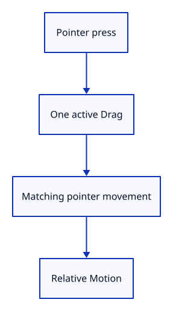

# 3.4.2 · Remember the pointer that starts a drag

**Chapter 3 · Documents, editing and ownership · Section 3.4 · Resize and pointer motion** · [Contents](contents.md)

**Typing: 14–27 minutes.** [Estimate](typing-load.md).

Gesture remembers one pointer ID, its button and its positions. Reject a second press while that pointer is active. Each move reports the change from the previous position.

## Type

Continue from [Resize canvas, depth and camera together](20-resize.md). [Save or recover your work](recovery.md).

### 1. `src/gesture.rs`

Retain one pointer, track its starting position and return relative right-drag movement.

Create the file and type:

```rust
--8<-- "journey/code/20a-press-state.rs"
```

<details>
<summary>Supplied validation fixture</summary>

Copy this supplied authoring fixture once. Continue with the browser build below; the course does not require running native tests.

### 2. `src/gesture_tests.rs`

Optional authoring fixture. Check rejected presses, pointer ownership and movement from the previous position.

Copy this supplied file:

```text
--8<-- "journey/code/20a-press-tests.rs"
```

</details>

### 3. `src/lib.rs`

Expose the gesture module to the browser and compile its tests only in the test build.

<details>
<summary>Locate the existing block</summary>

```rust
pub mod history;
pub mod editor;
pub mod viewport;
pub mod gpu_mesh;
pub mod renderer;
#[cfg(target_arch = "wasm32")]
```

</details>

Edit the existing block to match this code; keep unchanged lines:

```rust
--8<-- "journey/code/21-gestures-fullscreen-1.rs"
```

## Run and check

In your project:

```sh
cd workspace/journey
REGEN_PROTO=0 cargo build --lib --locked --target wasm32-unknown-unknown -j1
REGEN_PROTO=0 CARGO_BUILD_JOBS=1 trunk serve --port 8780
```

Open `http://127.0.0.1:8780/`. Keep an existing Trunk server running; saving rebuilds it.

Inspect the supplied state fixtures. Another pointer cannot replace the press or move it; matching moves report relative deltas.

### Recorded visual result

**Previous native render — current verification pending.**


*This recorded image predates a source or checker change. Rebuild this checkpoint before using it as current evidence; browser controls require separate acceptance.*

This reference image is shared with [3.4.1 · Resize canvas, depth and camera together](20-resize.md). It does not demonstrate a new feature by itself.

<details>
<summary>Code explanation and diagram</summary>

Option holds one Drag or none. as_mut borrows the stored drag; filter accepts only its pointer ID. The click threshold remembers whether any movement exceeded four CSS pixels.

Press → Option<Drag> → matching move → Motion::Orbit.



Why retain both the starting and previous positions?

The start distinguishes a click from a drag. The previous position gives the next orbit delta.

Study estimate, including typing and experiments: 0.75–1.25 hours.

</details>

<details>
<summary>Optional experiment</summary>

Trace a matching pointer moving from [20.0, 25.0] to [30.0, 28.0] through the supplied press fixture. Predict the delta before reading its expected result.

</details>

<details>
<summary>Check and save your work</summary>

Restore experimental edits, then run from `session_viewer`:

```sh
npm --prefix ../session_tests run course -- check 3.4.2
npm --prefix ../session_tests run course -- save 3.4.2
```

Source comparison leaves your project untouched. [Save and recovery instructions](recovery.md).

</details>

<details>
<summary>Viewer coverage and verification</summary>

The browser will later deliver captured pointer events. This step establishes application ownership independently of DOM capture.

Native checks establish one-pointer ownership and relative movement. Chrome retains the previous resize and command route; browser gestures are connected after release and action conversion.

[Full validation scope](release.md).

To reproduce the scripted acceptance of the reference checkpoint, run from `session_viewer` with the [course bundle server](release.md#reproduce) running on port 8781:

```sh
npm --prefix ../session_tests run course -- capture 3.4.2
```

This uses the verified reference bundle; it does not check or change your typed project.

</details>
