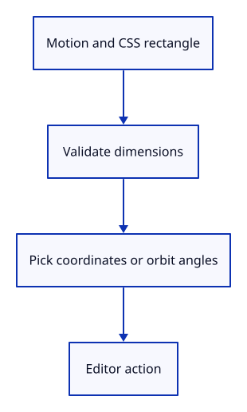

# 3.4.4 · Convert pointer motion to editor actions

**Chapter 3 · Documents, editing and ownership · Section 3.4 · Resize and pointer motion** · [Contents](contents.md)

**Typing: 7–14 minutes.** [Estimate](typing-load.md).

Motion::action uses the canvas CSS rectangle to convert a pick to normalized screen coordinates or a drag delta to orbit angles. Reject an invalid rectangle before dividing.

## Type

Continue from [Finish or cancel a drag](20b-release.md). [Save or recover your work](recovery.md).

### 1. `src/gesture.rs`

Import the editor action used by motion conversion. Convert CSS position or motion to an existing editor action after validating the canvas rectangle.

Edit these blocks from bottom to top. Keep the surrounding lines unchanged.

<details>
<summary>Locate this block</summary>

```rust
#[derive(Debug, PartialEq)]
pub enum Motion {
    Pick([f64; 2]),
    Orbit([f64; 2]),
}

struct Drag {
    id: i32,
    button: i16,
```

</details>

Replace it with:

```rust
use crate::editor::Action;

#[derive(Debug, PartialEq)]
pub enum Motion {
    Pick([f64; 2]),
    Orbit([f64; 2]),
}

impl Motion {
    pub fn action(self, rect: [f64; 4]) -> Option<Action> {
        let [left, top, width, height] = rect;
        if rect.iter().any(|n| !n.is_finite()) || width <= 0.0 || height <= 0.0 {
            return None;
        }
        Some(match self {
            Self::Pick([x, y]) => Action::Pick([
                (2.0 * (x - left) / width - 1.0) as f32,
                (1.0 - 2.0 * (y - top) / height) as f32,
            ]),
            Self::Orbit([dx, dy]) => Action::Orbit(
                -std::f64::consts::PI * dx / width,
                -std::f64::consts::PI * dy / height,
            ),
        })
    }
}

struct Drag {
    id: i32,
    button: i16,
```

<details>
<summary>Complete updated block reference</summary>

```rust
use crate::editor::Action;

#[derive(Debug, PartialEq)]
pub enum Motion {
    Pick([f64; 2]),
    Orbit([f64; 2]),
}

impl Motion {
    pub fn action(self, rect: [f64; 4]) -> Option<Action> {
        let [left, top, width, height] = rect;
        if rect.iter().any(|n| !n.is_finite()) || width <= 0.0 || height <= 0.0 {
            return None;
        }
        Some(match self {
            Self::Pick([x, y]) => Action::Pick([
                (2.0 * (x - left) / width - 1.0) as f32,
                (1.0 - 2.0 * (y - top) / height) as f32,
            ]),
            Self::Orbit([dx, dy]) => Action::Orbit(
                -std::f64::consts::PI * dx / width,
                -std::f64::consts::PI * dy / height,
            ),
        })
    }
}

struct Drag {
    id: i32,
    button: i16,
    start: [f64; 2],
    last: [f64; 2],
    moved: bool,
}

#[derive(Default)]
pub struct Gesture {
    active: Option<Drag>,
}

impl Gesture {
    pub fn press(&mut self, id: i32, button: i16, position: [f64; 2]) -> bool {
        if self.active.is_some() || !matches!(button, 0 | 2)
            || position.iter().any(|n| !n.is_finite()) {
            return false;
        }
        self.active = Some(Drag { id, button, start: position, last: position, moved: false });
        true
    }

    pub fn move_to(&mut self, id: i32, position: [f64; 2]) -> Option<Motion> {
        let drag = self.active.as_mut().filter(|drag| drag.id == id)?;
        if position.iter().any(|n| !n.is_finite()) {
            return None;
        }
        let delta = [position[0] - drag.last[0], position[1] - drag.last[1]];
        drag.last = position;
        let distance = (position[0] - drag.start[0]).hypot(position[1] - drag.start[1]);
        // Once a press becomes a drag, returning to its start must not turn it into a click.
        drag.moved |= distance > 4.0;
        (drag.button == 2 && delta != [0.0, 0.0]).then_some(Motion::Orbit(delta))
    }

    pub fn release(&mut self, id: i32, position: [f64; 2]) -> Option<Motion> {
        if self.active.as_ref()?.id != id {
            return None;
        }
        let last_motion = self.move_to(id, position);
        let drag = self.active.take()?;
        if drag.button == 2 {
            return last_motion;
        }
        (!drag.moved && position.iter().all(|n| n.is_finite()))
            .then_some(Motion::Pick(position))
    }

    pub fn cancel(&mut self) {
        self.active = None;
    }

    pub fn cancel_pointer(&mut self, id: i32) {
        if self.active.as_ref().is_some_and(|drag| drag.id == id) {
            self.cancel();
        }
    }
}
```

</details>

<details>
<summary>Optional patch references</summary>

Use these original edit fragments when comparing a saved checkpoint. Apply the complete blocks above.

```text
--8<-- "journey/code/20c-motion-import.rs"
```

```text
--8<-- "journey/code/20c-motion-action.rs"
```

</details>

<details>
<summary>Supplied validation fixture</summary>

Copy this supplied authoring fixture once. Continue with the browser build below; the course does not require running native tests.

### 2. `src/gesture_tests.rs`

Optional authoring fixture. Import editor actions for motion and history checks.

<details>
<summary>Locate the existing block</summary>

```text
use crate::gesture::{Gesture, Motion};
```

</details>

Update the existing block with this supplied code; keep unchanged lines:

```text
--8<-- "journey/code/20c-motion-test-imports.rs"
```

</details>

<details>
<summary>Supplied validation fixture</summary>

Copy this supplied authoring fixture once. Continue with the browser build below; the course does not require running native tests.

### 3. `src/gesture_tests.rs`

Optional authoring fixture. Check CSS coordinate conversion and camera movement outside document history.

<details>
<summary>Locate the existing block</summary>

```text
    assert!(!input.press(1, 0, [f64::NAN, 0.0]));
}
```

</details>

After that block, append this supplied code:

```text
--8<-- "journey/code/20c-motion-tests.rs" skip=53
```

</details>

## Run and check

In your project:

```sh
cd workspace/journey
REGEN_PROTO=0 cargo build --lib --locked --target wasm32-unknown-unknown -j1
REGEN_PROTO=0 CARGO_BUILD_JOBS=1 trunk serve --port 8780
```

Open `http://127.0.0.1:8780/`. Keep an existing Trunk server running; saving rebuilds it.

Inspect the supplied state fixtures. A CSS centre maps to [0, 0]; orbit changes the camera, and Undo restores the document without rewinding it.

### Recorded visual result

**Previous native render — current verification pending.**


*This recorded image predates a source or checker change. Rebuild this checkpoint before using it as current evidence; browser controls require separate acceptance.*

<details>
<summary>Code explanation and diagram</summary>

The method consumes Motion. Option<Action> permits invalid input to produce no editor request. Orbit changes the view while leaving document history unchanged.

Motion + CSS rectangle → Action → Editor → selection or view change.



Why use CSS dimensions instead of the GPU drawing size?

Pointer positions use CSS pixels. Mixing them with denser GPU pixels would change picking and sensitivity when display density changes.

Study estimate, including typing and experiments: 0.75–1.25 hours.

</details>

<details>
<summary>Optional experiment</summary>

Double the rectangle dimensions and the pointer offsets in the centre test. Predict the same [0, 0] pick before running it.

</details>

<details>
<summary>Check and save your work</summary>

Restore experimental edits, then run from `session_viewer`:

```sh
npm --prefix ../session_tests run course -- check 3.4.4
npm --prefix ../session_tests run course -- save 3.4.4
```

Source comparison leaves your project untouched. [Save and recovery instructions](recovery.md).

</details>

<details>
<summary>Viewer coverage and verification</summary>

Pointer and command input share Editor actions. Camera navigation stays outside document history and browser callbacks do not edit geometry directly.

Native checks route pointer motion through Editor and render its orbited view. Chrome independently retains the earlier input route until browser pointer delivery is connected next.

[Full validation scope](release.md).

To reproduce the scripted acceptance of the reference checkpoint, run from `session_viewer` with the [course bundle server](release.md#reproduce) running on port 8781:

```sh
npm --prefix ../session_tests run course -- capture 3.4.4
```

This uses the verified reference bundle; it does not check or change your typed project.

</details>
